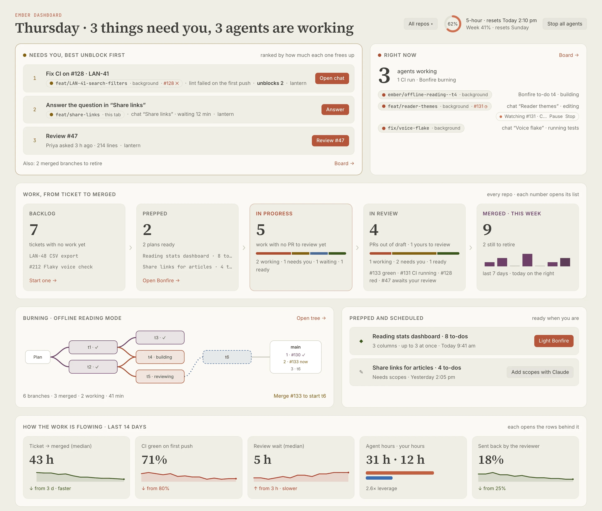

<p align="center">
  <picture>
    <source media="(prefers-color-scheme: dark)" srcset="assets/ember-lockup-dark.png">
    
  </picture>
</p>

<p align="center">
  <b>Ember is an AI coding workspace, shipped as one app.</b><br>
  Made by the Ember Team. Every chat runs through the Claude Code CLI on your computer.
</p>

<p align="center">
  <a href="https://github.com/dgruhin-hrizn/ember-releases/releases/latest"><b>Download</b></a> &nbsp;·&nbsp;
  <a href="docs/README.md"><b>Documentation</b></a> &nbsp;·&nbsp;
  <a href="https://github.com/dgruhin-hrizn/ember-releases/releases"><b>Release notes</b></a> &nbsp;·&nbsp;
  <a href="https://github.com/dgruhin-hrizn/ember-releases/issues"><b>Report a problem</b></a>
</p>

<p align="center">
  <picture>
    <source media="(prefers-color-scheme: dark)" srcset="readme/dashboard.dark.png">
    
  </picture>
</p>

This repository holds Ember's downloads, release notes, documentation and licence. It holds no source code.

## What Ember is

Ember.app is a complete code editor (a VSCodium build) with Ember built in. It puts Claude next to your code: a chat
panel where Claude reads, searches, edits and runs commands in your project, plans you can review before anything is
built, and tools to keep or undo every change Claude makes.

- **Chats run through Claude Code.** Ember has no account of its own. Every chat, plan and subagent runs through the
  Claude Code CLI (`claude`) on your computer, so your `CLAUDE.md` files, skills, hooks, subagents, MCP servers and
  permission rules work in Ember as they do in the terminal. Ember never sees your password or your sign-in token.
- **Your Claude subscription, and other models if you connect them.** Chats run on your Claude subscription. You can
  add more models to the model picker: other subscriptions (for example a ChatGPT plan) through the
  [model bridge](docs/models/model-bridge.md), a gateway or provider with your own key, or a model server on your own
  computer through [your own endpoints](docs/models/own-endpoints.md).
- **Several chats at once.** Chats can work in their own git worktrees and branches, and the Dashboard shows what
  needs you, what is working and what is ready. See [The Ember Dashboard](docs/worktrees/dashboard.md) and
  [Worktrees](docs/worktrees/worktrees.md).
- **Review before you keep.** Every edit can be kept or undone, change by change. See
  [Review changes](docs/editing/review-changes.md) and [Plans](docs/plans/plans.md).
- **Git, issues, a browser, your phone.** See the [documentation](docs/README.md) for Forge (git), Issues, the
  built-in browser, voice and the phone app.

## What you need

- **The Claude Code CLI** (`claude`), installed and signed in. Without it, Ember's chat panel shows the install
  command for your computer. See [Sign in](docs/getting-started/sign-in.md).
- **A Claude subscription** to sign the CLI in with. Other providers are optional and are added in
  **Settings › Models**.
- **macOS** on Apple silicon, **Windows** on x64 or Arm64, or **Linux** on x64 or Arm64 (glibc 2.28 or newer).
- On Windows, **Git for Windows**: Claude Code runs its shell commands in Git Bash.

## Download and install

Get the latest version from [Releases](https://github.com/dgruhin-hrizn/ember-releases/releases/latest) and pick the
file for your computer:

| Computer | File | How to install |
|---|---|---|
| macOS (Apple silicon) | `Ember-darwin-arm64-<version>.zip` | Unzip it and move **Ember.app** to Applications. |
| Windows (x64, Arm64) | `EmberUserSetup-<arch>-<version>.exe` | Run it. It installs for your user only, without admin rights. |
| Windows, portable | `Ember-win32-<arch>-<version>.zip` | Unzip it into a new, empty folder and run `Ember.exe`. |
| Debian, Ubuntu | `ember_<version>_<arch>.deb` | `sudo apt install ./ember_<version>_<arch>.deb` |
| Fedora, RHEL, openSUSE | `ember-<version>-1.<arch>.rpm` | `sudo dnf install ./ember-<version>-1.<arch>.rpm` |
| Any Linux | `Ember-linux-<arch>-<version>.tar.gz` | Extract it into a new, empty folder and run `ember` there. |

There is no build for Intel Macs.

Each release lists the SHA-256 of every file in `SHA256SUMS`, so you can check a download:

```bash
shasum -a 256 -c SHA256SUMS --ignore-missing
```

Don't unpack a `.zip` or `.tar.gz` over an older copy's folder: unpack it into a new folder and delete the old one.
Your chats and settings aren't in that folder, so they stay. More detail, and the Linux requirements, are in
[Install and Update Ember](docs/getting-started/install-update.md).

## Updates

Ember looks for a new version on this repository's releases page when it starts and about every two hours while it
stays open, and checks what it downloads against `SHA256SUMS`. Choose what it does in **Settings › General › Updates**:

| Choice | What happens |
|---|---|
| **Tell me about new versions** | A notification says a new version is out, with **Install and Restart**, **Release Notes** and **Skip This Version**. |
| **Install automatically when Ember quits** | Ember downloads the new version in the background and installs it the next time you quit. |
| **Don't check** | Ember never looks for new versions. |

On macOS, with the Windows installer and on Linux, Ember installs the update itself (a Linux package asks for your
password). The portable Windows zip offers **Download** instead, so you unpack the new file yourself. The Claude Code
CLI updates separately.

## Documentation

The [documentation](docs/README.md) is Ember's in-app Help as Markdown. Good places to start:

- [What is Ember?](docs/getting-started/what-is-ember.md)
- [Install and Update Ember](docs/getting-started/install-update.md)
- [Sign In with Your Claude Subscription](docs/getting-started/sign-in.md)
- [Your First Chat](docs/getting-started/first-chat.md)
- [Choosing models](docs/models/choosing-models.md), [Your own endpoints](docs/models/own-endpoints.md) and the
  [Model bridge](docs/models/model-bridge.md)
- [Privacy and storage](docs/privacy/privacy-storage.md)
- [Troubleshooting](docs/troubleshooting/troubleshooting.md)

Inside Ember, the same pages are under **Help › Ember Help**, and they always match the version you have installed.

## Report a problem

Open an [issue](https://github.com/dgruhin-hrizn/ember-releases/issues) in this repository. It helps to include:

- what you did, what you expected and what happened;
- the diagnostics summary: in Ember, open **About Ember** and click **Copy diagnostics**. It holds Ember's version
  and build, what it runs on and whether you're signed in, not your email.

Issues here are public, so leave out anything private: code, keys, tokens and account details.
[Troubleshooting](docs/troubleshooting/troubleshooting.md) covers the common problems and where Ember's logs are.

## Licence

Ember is proprietary software. Copyright © 2026 the Ember Team. All rights reserved. You may install and use the
released builds under the terms in [LICENSE](LICENSE); you may not redistribute, modify or reverse engineer them.
Ember includes open-source components that stay under their own licences: see
[THIRD-PARTY-NOTICES.md](THIRD-PARTY-NOTICES.md).

The Ember name, mark and wordmark in [`assets/`](assets) belong to the Ember Team and are not licensed for other use.

## Not affiliated with Anthropic or OpenAI

Ember is made by the Ember Team. It is not made by, endorsed by or affiliated with Anthropic or OpenAI. Claude and
Claude Code are Anthropic's, and ChatGPT is OpenAI's; Ember runs chats through the Claude Code CLI you install and
sign in to yourself, under the terms you agreed with its provider. Other product names are trademarks of their owners
and are used only to say what Ember works with.
