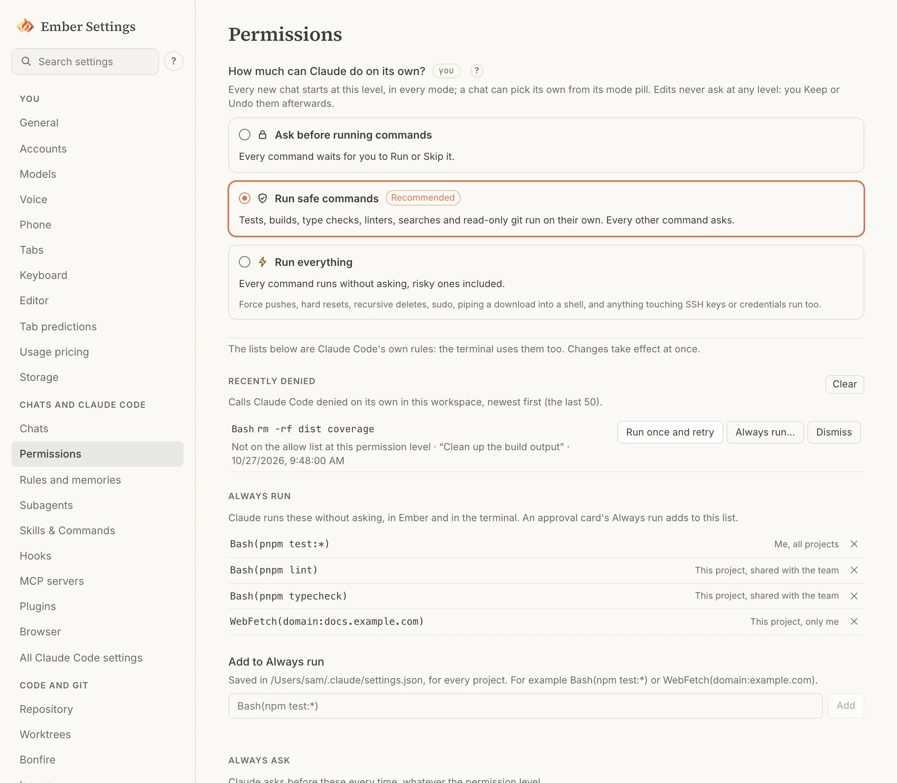
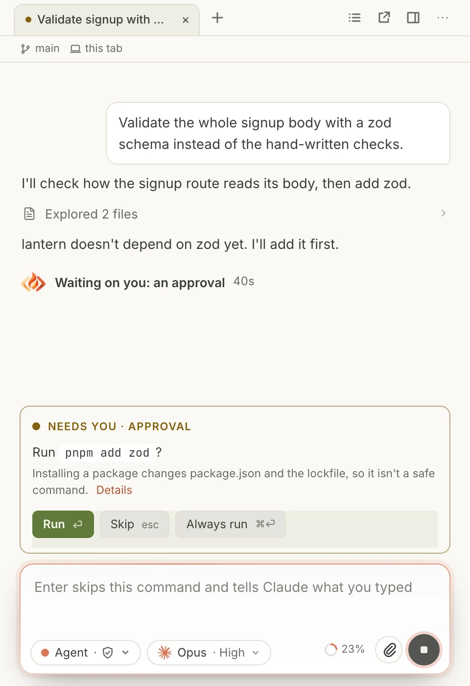

# Approvals and Permissions

Choose how much Claude does on its own, answer approvals, see which commands always ask, and save rules with Always run (and choose which rule).

Claude's edits never wait for you: they go into your files, and you keep or undo them afterwards (see
[Review changes](../editing/review-changes.md)). Commands are different. Your permission level decides which commands Claude runs on its
own and which ones ask you first.

## Choose a permission level

  <picture>
    <source media="(prefers-color-scheme: dark)" srcset="../images/settings-permissions.dark.webp">
    
  </picture>
   <em>Settings › Permissions: how much Claude does on its own</em>

There are three levels:

| Level | What happens |
|---|---|
| **Ask before running commands** | Every command waits for you to **Run** or **Skip** it. |
| **Run safe commands** (the default) | Tests, builds, type checks, linters, searches and read-only git run on their own, in this chat's own folder. Every other command asks. |
| **Run everything** | Every command runs without asking, the risky ones included, in every mode. What still asks is what needs your own answer: Claude's questions, a plan to approve, a suggestion to switch modes, where a worktree opens, an MCP server asking for something, and your own **Always ask** rules. Ember asks you to confirm before turning it on. |

**For new chats**: open **Settings › Permissions** and pick under **How much can Claude do on its own?**
([`ember.permissions.level`](../settings/settings-permissions.md#emberpermissionslevel)). A change reaches the chats already open at once, except a chat that has its own
level.

**For one chat**: the mode button under what you write in the message box names the chat's level, for example
**Agent · Safe commands**. Click it: below the modes, the menu lists the three levels. The one in effect is ticked, and
the one from Settings is marked **default**.

- Pick another level to set it for this chat only. The chat keeps it; new chats still start at the default.
- Pick the one marked **default** to put the chat back on the Settings level.
- **Run everything** asks you to confirm first. On the phone you can lower a chat's level but not turn on Run
  everything.
- **Permission settings…** opens Settings › Permissions.

The chat says when a new level takes effect. If a chat's Claude can't switch to Run everything (it started while that
level wasn't allowed), it restarts with your next message, or once the running turn ends, and the conversation carries
on. A chat that says so offers **Use it in this chat** to restart now.

> **Note:** **Run everything** needs Claude Code to allow running without asking. If your Claude Code settings or your
> organization turn that off (`disableBypassPermissionsMode`), the level is unavailable and chats run safe commands only.

## Answer an approval

  <picture>
    <source media="(prefers-color-scheme: dark)" srcset="../images/chat-approval.dark.webp">
    
  </picture>
   <em>A command waits for you: Run it, Skip it, or Always run commands like it</em>

When a command needs your OK, a card with a gold edge asks in the chat, under the label **Needs you · approval**:
"Run `git push`?". Under the question is one line:

- why it asks, when there's a reason: a protected branch, a saved rule that doesn't cover it, a command that always
  asks, your own **Always ask** rule, a path outside the project;
- otherwise, what Claude says the command does.

Anything else worth knowing (the file path, the MCP server and where it's set up, the steps no rule can cover) is
under **Details**.

| Button | Key | What it does |
|---|---|---|
| **Run** | Enter | Runs it this once. |
| **Skip** | Esc | Doesn't run it. Claude carries on without it. |
| **Always run** | Ctrl+Enter (⌘Enter) | Runs it, and saves a rule so commands like it run without asking from now on. Point at it to see the rule and where it's saved. |
| **⌄** (beside Always run) | | Choose which rule Always run saves, and where (see below). |

**Always run** shows only when there's a rule that can match again. Page JavaScript and the everyday commands that
always ask offer **Allow in this chat** instead (see [Allow in this chat](#allow-in-this-chat)).

The keys work once the card has the focus: click it, Tab to it, or press Alt+↑ in the message box (it jumps to the
newest card waiting for you). Enter runs any card, a command that always asks included. Only when Claude Code asks
that no single key approves a call does **Skip** come first, and then you click **Run**.

### Where the approval shows

An approval never waits out of sight. When one arrives, the chat scrolls to it, unless you're typing. If its spot in the
chat is folded away, inside a closed subagent or scrolled out of view, it shows just above the message box instead.
A subagent's approval sits inside that subagent's card, and its label names the subagent (**Needs you · approval ·
subagent** *name*). When several wait, the space above the message box scrolls.

A long command shows once and never pushes the buttons out of sight. It's cut in the middle: its first and last lines
with a count between, like **+32 lines**. Text a command feeds itself (a heredoc, such as a pull request body) folds
to a count like **+42 lines of input**. Click the count to show all of it, and **Show less** to fold it again.

### Write instead of answering

You can also answer by writing in the message box. A message you send while a card waits is never held behind it, and
the box says what Enter will do ("Enter skips this command and tells Claude what you typed").

- **An approval**: it's skipped, and your message goes to Claude straight away, in the same turn, shown once in the
  chat as yours, with its attachments.
- **A question**: what you type is your answer (as **Other…** on the card). With several questions on one card, or
  with attachments, your message answers them all at once, in your own words.
- **A question from an MCP server**: it's declined, and your message goes to Claude.
- **Several at once** (Claude ran a few commands together, or a subagent asks too): all of them are skipped, and your
  message goes once.

Writing never approves anything: "yes" or "go ahead" in the box is still a Skip with your words. To run the command,
press **Run**. Ctrl+Enter (⌘Enter) still stops the turn first, which ends everything that waits. Messages you queued
before the card arrived stay queued and go after the turn.

A message Ember writes for you (**Fix in chat**, Agent Review, a canvas, Ask Claude in Ember Git, **Retry** on a denied
call, **Save as skill**, **Done — tell Claude** after a sign-in) never answers a card, even one waiting between turns:
it waits in the queue, marked **waits for your answer above**, and goes once you've answered and the turn is over.

### Questions

Claude's questions come the same way, on a card labelled **Needs you · question**. When Claude asks several at once,
the label says how many (**Needs you · 4 questions**), and the card shows one at a time, with **Question 2 of 4** and
the question's short name beside it. Its buttons are **Next** (**Submit** on the last), **Back** and **Skip**.

An MCP server asking you something wears the same label (**Needs you · a question from** *server*), with **Submit**
(or **Done** after a sign-in page) and **Skip**, which tells the server you won't answer.

### Subagents

A subagent gets the same answer as its chat. In a Plan or Ask chat, **Run** on a subagent's approval lets that
subagent make that kind of call for the rest of the turn; another subagent, or the next turn, asks again. **Skip**
allows nothing. A change its chat's mode doesn't allow offers to switch to Agent mode, and says a subagent asks.

## Commands that always ask

Some commands can do damage that's hard to undo, so they ask at **Ask before running commands** and **Run safe
commands**, in subagents too. At **Run everything** they run like any other command. A command asks when it:

- deletes a folder and everything in it (a recursive delete; temporary folders are fine);
- force-pushes, which can overwrite work on the remote;
- deletes a branch or tag on the remote;
- throws away uncommitted changes (a hard reset);
- deletes untracked files;
- runs as an administrator, for example with `sudo`;
- runs a script straight from the internet, such as a download piped into a shell, handed to `eval` or saved and then
  run;
- changes permissions or owners of a whole folder tree;
- erases, partitions or writes to a disk;
- runs a command on another machine or inside a container (`ssh host command`, `docker exec`, `docker run`,
  `kubectl exec`);
- loads code or writes files through an option, such as `--node-options`, `--require`, `--plugin`, `--config x.mjs`,
  `git log --output=…`, `git -c`, or a `data:` URL, whatever rule allows the command. git's `--output` into a
  temporary folder (`git diff main --output=/tmp/pr-diff.txt`, or `%TEMP%` on Windows) is fine once Ember has checked
  where the file really lands; anywhere else, a `.git` folder included, it asks;
- touches SSH keys, AWS credentials or Claude Code's sign-in.

For these commands the card's one line says why it asks, and there's no **Always run**: **Run** (or Enter) runs it
this once. In a chain, the card names the step that always asks, for example "…an option Ember can't check:
git diff --output=/Users/you/.zshrc".

### Allow in this chat

For the everyday ones, the card offers **Allow in this chat** where **Always run** would be: the same kind of command
then runs without asking for the rest of that chat. Nothing is saved, and each command is still checked:

| Command | What Allow in this chat covers |
|---|---|
| `rm -r` (`rm -rf dist`) | Deleting folders inside the chat's folder, by a plain path, with the shell in that folder. Not the folder itself, `.git`, `..`, `~`, a wildcard, or a link that leads out of the folder. |
| `git clean -f` | Deleting untracked files. Never with `-x` or `-X`, which delete ignored files such as `.env`. |
| `ssh host command`, `docker exec`, `kubectl exec` | Commands on that host, or in a container that already runs. Never a script fed in from a pipe or a file, and never `docker run` (it can reach this computer's files). |
| `git -c key=value` | That exact setting, for settings that only change how git shows or signs things (`core.quotepath`, `color.*`, `user.name`, `commit.gpgsign` and the like). Never one that can run a program. |
| `vitest --config vitest.config.mts` | That tool with that config file inside the chat's folder. |
| A command too long for Ember to read | That exact command, in that folder. |
| Page JavaScript in Ember's browser | Scripts on that site (**Allow on** *site* **in this chat**); another site asks again. |

Force pushes, remote deletes, hard resets, administrators, scripts from the internet, permissions of a folder tree,
disks and credentials never offer it, and neither does a command that pushes to a protected branch. Anything else in
the command is still checked: `rm -rf dist && git push --force` asks.

To take one back, open **Settings › Permissions**: **Allowed in this chat** lists what the open chat was allowed for
itself, in plain words, each with **Forget**.

## Choose the rule Always run saves

**Always run** saves the rule shown when you point at it, such as `Bash(npm run test:*)`. It's always a rule that can
match again, never the exact command line with its arguments, paths and messages (that would never come up again).
When no such rule fits, such as for `git commit -m "…"`, the card has no **Always run**, and **Details** says why.

To save a different rule, click the **⌄** beside it (or Tab to it and press Enter). The card lists the rules it can
save, narrowest first, each with a line on what it allows. For `npm run test -- --watch=false`:

| Rule | What it allows |
|---|---|
| `Bash(npm run test:*)` (suggested) | `npm run test` with anything after it |
| `Bash(npm run:*)` | `npm run` with anything after it |

- A program that only reads, like `grep` or `cat`, is also offered on its own (`Bash(grep:*)`).
- For a chain (`&&`, `;`, `|`), each choice has one rule per program. Steps that only read, like `| tail -20`, need no
  rule.
- A script in your project, run by its interpreter, can have a rule pinned to its path: for
  `node scripts/check.mjs --all`, the card offers `Bash(node scripts/check.mjs:*)`, which runs that script with any
  arguments. The same goes for `python3`, `bash`, `tsx`, `ts-node`, `bun`, `deno run`, `ruby` and `perl`. The path must
  be a plain path inside the chat's folder (no `..`, `~`, `$` or wildcards), with nothing between the interpreter and
  the script. The rule runs whatever that file does, now or after it changes; the card says so.
- For an MCP tool, **Always run** saves one rule for the whole server (`mcp__<server>`), so none of that server's tools
  asks again.

### When a saved rule still asks

Sometimes Ember asks although you saved an **Always run** rule that looks like it covers the command. The card says
which rule and why, in one sentence, for example "Your Always run rule for npm run test doesn't cover this because
the shell moved to /Users/you/app/packages/x, and the rule was saved for this chat's folder." It happens when:

- the shell is in another folder (after `cd` or `pushd`, in the same command or an earlier one, or with a package
  manager's `--prefix` or `-C`);
- a step is fed from a pipe or a file, or run through `xargs`;
- the command has an option that always asks, or a package manager's long option Ember doesn't know as harmless
  (anything but `--silent`, `--if-present`, `--filter`, `--workspace` and the like);
- it writes a file through `>` or `>>` (Claude Code asks about every such write, whatever rule you saved);
- it runs inline code.

When you run it, the same rule in the same folder doesn't ask again in that chat. A script in `node_modules`, in a dot
folder such as `.git` or `.venv`, or one git ignores gets no rule.

### Steps that still ask

A step that runs inline code, such as `node -e '…'`, `python3 -c '…'` or `bash -c '…'`, always asks: Ember saves no
rule for it, because code written into a command can load other code in too many ways to check. When a chain has
steps no rule can cover, the card still offers rules for the others, and **Details** lists, under **Still asks each
time**, what will keep asking and why. When no step can have a rule, the card has no **Always run**, and **Details**
names each step and why.

### Rules Ember won't save

A rule with a wildcard (`:*` or a trailing ` *`) covers more than the command on the card, so Ember offers and saves
one only where the wildcard can't reach other programs:

- a package script: `npm run test:*`, `npm run:*`, `npm test:*`, `pnpm run build:*`, `pnpm test:*`;
- a test runner, linter, formatter or type checker: `vitest:*`, `eslint:*`, `tsc:*`;
- git that only reads: `git status:*`, `git diff:*`, `git log:*`;
- a program that only reads: `grep:*`, `cat:*`.

These can't hold back a command's options, so Ember asks every time one of them loads code or writes files somewhere
else, whatever rule you saved. Any other command gets no rule from the card, and neither does a PowerShell command
(you can still write an exact rule yourself with **⌄**). Some commands get no rule at all, because they can run any
program or code: shells and interpreters (`bash`, `python`, `node`, `bun`, `tsx`) other than a script in your project
named by its path, inline code, `python -m`, `ssh`, `docker`, `kubectl`, `make`, `awk`, `vim`, `source`, `env`,
`xargs`, `npx`, `pnpm dlx`, `go run`, `git -c`, PowerShell's `Invoke-Command`, and commands that always ask. Ember also
refuses `Bash`, `Bash(*)`, a wildcard in the program's name or anywhere but the end, and a rule that covers no step of
the command on the card, and says why.

When Claude Code suggests a rule Ember won't save, such as `Bash(git push:*)` or an exact command line, Always run
saves the narrowest rule it offers instead, or isn't offered when there is none.

## Where Always run saves

**Always run** adds a Claude Code permission rule, so the terminal uses it too. Point at the button to see where it
goes. Choose the default with [`ember.permissions.alwaysAllowScope`](../settings/settings-permissions.md#emberpermissionsalwaysallowscope), or pick for one rule with **⌄**:

| Choice | File |
|---|---|
| All projects (the default) | `~/.claude/settings.json` |
| This project, shared | `.claude/settings.json` |
| This project, just you | `.claude/settings.local.json` |

## Manage your rules

**Settings › Permissions** also lists:

- **Always run**: commands and tools Claude runs without asking. Add a rule, for example `Bash(npm test:*)`, or
  remove one.
- **Always ask**: commands and tools that ask every time, whatever the level, for example `Bash(git push:*)`.
- **Recently denied**: calls Claude Code denied on its own. **Run once and retry** lets that exact call run once;
  **Always run…** adds it to the Always run list; **Dismiss** removes it from the list.
- **Allowed in this chat**: what the open chat was allowed for itself (**Allow in this chat**, and what it was allowed
  until it restarts). **Forget** takes one back; forgetting the rest starts the chat's Claude Code fresh
  on its next message.
- **Blocked by your organization**: the block (deny) rules in your organization's managed settings, shown with a lock.
  Claude can't use them in Ember or in the terminal, whatever your own rules allow, and Ember's own file reads,
  @-mentions and @Web skip the files they cover. They can't be changed in Ember.

These are Claude Code's own rules. Block (deny) rules and other permission settings in your Claude Code files keep
counting in Ember too.

## The same in every mode

The level decides what asks; the chat's mode decides only whether a change may happen at all. A Plan chat doesn't
edit your project or act in the browser, and an Ask chat doesn't change anything. When one wants to, you get one card
for the turn that offers to switch the chat to Agent mode (see [Edits in Plan or Ask mode](#edits-in-plan-or-ask-mode)).
In the table, **Offers Agent** means that card. A chat's subagents get the same answer as the chat.

| What Claude does | Ask before running commands | Run safe commands | Run everything |
|---|---|---|---|
| A command that only reads (`git log`, `cat ~/notes.txt`) | Asks | Runs | Runs |
| A test, build, linter or type check in this chat's folder | Asks (Ask chat: Offers Agent) | Runs (Ask chat: Offers Agent) | Runs (Ask chat: Offers Agent) |
| The same in another folder, `node_modules` or a hidden folder (`cd node_modules/x && npm test`) | Asks (Ask chat: Offers Agent) | Asks (Ask chat: Offers Agent) | Runs (Ask chat: Offers Agent) |
| Any other command | Asks (Ask chat: Offers Agent) | Asks (Ask chat: Offers Agent) | Runs (Ask chat: Offers Agent) |
| A read of a hidden file in your home folder (`cat ~/.netrc`, `cat /Users/you/.netrc`), another user's home folder or a system secret (`/etc/shadow`) | Asks | Asks | Runs |
| A read Ember can't prove harmless: git in another folder (`cd /tmp/x && git status`), a path filled in by `$(…)` (`cat $(pwd)/../.netrc`), a link out of this chat's folder, a credential store (`~/Library/Keychains`), `cat < .env` | Asks | Asks | Runs |
| A command that always asks, if it changes something | Asks (Ask chat: Offers Agent) | Asks (Ask chat: Offers Agent) | Runs (Ask chat: Offers Agent) |
| A command that always asks, if it only reads (`cat ~/.ssh/id_rsa`) | Asks | Asks | Runs |
| An edit to your project | Runs (Plan and Ask: Offers Agent) | Runs (Plan and Ask: Offers Agent) | Runs (Plan and Ask: Offers Agent) |
| An MCP tool its server marks read-only | Runs | Runs | Runs |
| The same, on a server set to always ask | Asks | Asks | Runs |
| Any other MCP tool | Asks (Ask chat: Offers Agent) | Asks (Ask chat: Offers Agent) | Runs (Ask chat: Offers Agent) |
| JavaScript in the browser's page on your own page: a server on this machine (`localhost`, `127.0.0.1`, `[::1]`) or a file in this chat's folder | Asks (Plan and Ask: Offers Agent) | Runs (Plan and Ask: Offers Agent) | Runs (Plan and Ask: Offers Agent) |
| JavaScript in the browser's page on a file outside this chat's folder | Asks (Plan and Ask: Offers Agent) | Asks (Plan and Ask: Offers Agent) | Runs (Plan and Ask: Offers Agent) |
| JavaScript in the browser's page on any other site (a real website, a `data:` or blank page) | Asks (Plan and Ask: Offers Agent) | Asks (Plan and Ask: Offers Agent) | Asks once, then **Allow in this chat** covers that site (Plan and Ask: Offers Agent) |
| Clicking or typing in the browser | Asks (Plan and Ask: Offers Agent) | Asks (Plan and Ask: Offers Agent) | Runs (Plan and Ask: Offers Agent) |

Whatever the row says, your own **Always ask** rules, the protected-branch guard and asks Claude Code won't let one
click answer still ask. Page JavaScript on a site you allowed for the chat runs. Edits Claude Code itself asks about
(outside the working folders) still ask in an Agent chat. A secret file in the project, like `.env`, isn't read at all
below Run everything, in every mode.

### What counts as this chat's folder

Ember lets a command run on its own only where it can tell the command stays in this chat's project:

- **Tests, builds and linters** run on their own only where the shell is in this chat's folder or a plain folder
  inside it. After a `cd` into `node_modules`, a hidden folder like `.git`, a folder with `..` or anywhere else (or
  when handed a path there), they would run that folder's scripts, so they ask, and the card says where.
- **Git reads** (`git status`, `git log` and the like) run programs a repository's own settings name, so they run on
  their own only in this chat's repository: its folder, a plain folder inside it, or another worktree of it.
- **Your home folder**: a path there counts the same however it's written (`~/.netrc`, `$HOME/.netrc`,
  `/Users/you/.netrc`, `C:\Users\you\.netrc`). Your keychains, saved browser passwords and cookies, and Windows's
  credential stores ask like hidden files do.
- **Paths filled in for you**: a file a command reads through `$(…)` or a variable counts only when Ember can tell it is
  inside this chat's folder (`$(pwd)/src/a.ts`, the names `git diff --name-only` prints); otherwise it asks. A file read
  through `<` is judged like one named on the command line.
- **Links**: a folder or file inside this chat's folder that is really a link (or a Windows junction) to somewhere else
  counts as that somewhere else.

Each **Offers Agent** is there because the call changes something: an edit changes your files; tests and builds write
files; a command or MCP tool Ember can't prove only reads may change something; page JavaScript, clicks and typing can
change what a site holds, with your sign-ins. A Plan chat runs commands and MCP tools to get its plan done, so only the
level decides those.

## MCP servers that always ask

To have Claude ask before every call to an MCP server's tools, at any level below Run everything, open **Settings ›
MCP servers** and turn on **Ask before each use** for that server ([`ember.mcp.alwaysAsk`](../settings/settings-mcp.md#embermcpalwaysask)). MCP tools their
server marks read-only otherwise run without asking in every chat, subagents included.

## Mode suggestions

Claude can suggest switching a chat's mode when the work calls for it:

- **Agent** from Plan once you agree to the plan in a message; from Ask when you want changes made.
- **Plan** from Agent when the work grows mid-task (many files, a risky or irreversible change, or doubt about what you
  want), before it changes anything.
- **Debug** for a bug whose cause isn't clear yet.

A card labelled **Needs you · mode** asks, for example **Switch to Plan mode?**, with Claude's reason and one line on
what switching changes, then **Switch** and **Stay**. It waits until you answer or write to the chat (a message you
send keeps the mode and goes to Claude straight away). Meanwhile the chat counts as needing you. A switch to Agent
takes effect at once, so Claude carries on; any other from the next turn. Once you answer, one row in the chat says
what you chose, such as **Switched to Agent mode** or **Stayed in Ask mode**. After **Stay**, Claude doesn't suggest
that mode again until you write. Clicking **Build** on the plan while a **Switch to Agent mode?** card waits answers
it: Claude finishes the turn without changing anything, and the build starts in Agent mode right after.

Choose in **Settings › Editor › Mode suggestions** ([`ember.modeProposals`](../settings/settings-editor.md#embermodeproposals)):

- **Ask me**: a card asks every time.
- **Switch automatically** (the default) to a mode that lets Claude do less (Agent → Plan → Ask). A switch to a mode
  that lets it do more still asks.
- **Off**: Claude never suggests a mode.

### Edits in Plan or Ask mode

When a Plan chat tries to edit a file or act in the browser, or an Ask chat tries anything that may change something
(an edit, a command Ember can't prove only reads, an MCP tool that isn't marked read-only, page JavaScript, a click),
or a subagent of either does, you get one card for the turn instead of an approval or a refusal for each call:
**Claude wants to make changes. Switch to Agent mode?**, listing the files, commands and actions, with "asked by a
subagent" beside a subagent's.

- **Switch** puts the chat in Agent mode, and the calls go on as Agent mode at your level makes them: an edit runs,
  and a command the level asks about still gets its approval. After that, Agent mode's usual rules count (a Debug chat
  that Claude took into planning goes back to Debug). If Claude Code refuses the switch, the card says so and stays
  up: **Switch** tries again.
- **Stay** refuses them, and Claude keeps planning (or answering) until you write.

A command a Plan chat runs to get its plan done never offers the switch: the level decides it, as in an Agent chat,
and so does a scratch file it writes in the temp folder. Claude's own plan file, and a `.plan.md` written straight
into Ember's plans folder, are written without a card. Commands that only read (PowerShell's too), like `git log`,
`ls` or `rg`, never offer the switch: at **Run safe commands** and **Run everything** they run, and at **Ask before
running commands** they get an approval.

## Approving a plan

In Plan mode, Claude changes nothing until you approve its plan with **Build**, or switch the chat to Agent mode (on
the card that asks when Claude wants to make changes, or yourself). See [Plans](../plans/plans.md).

---

[All documentation](../README.md)
