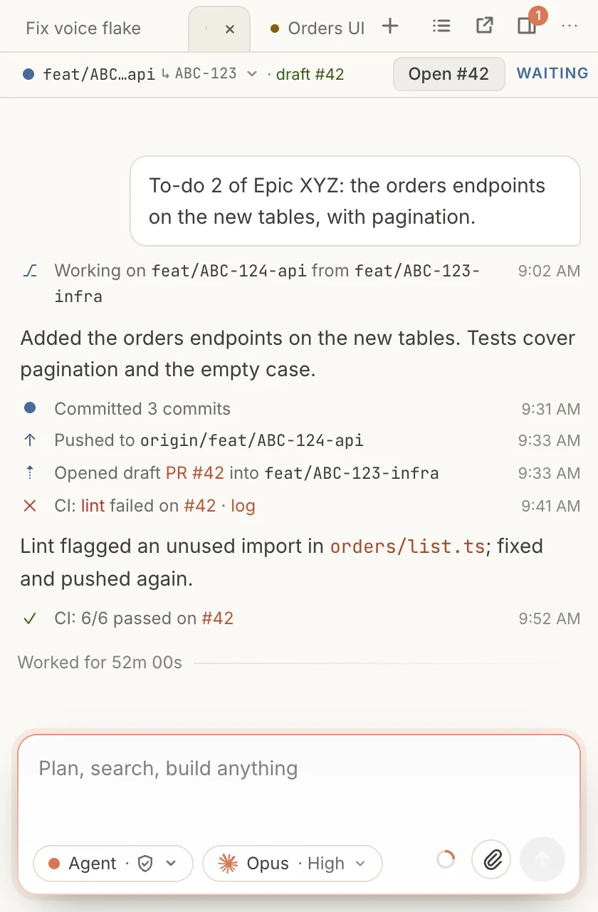
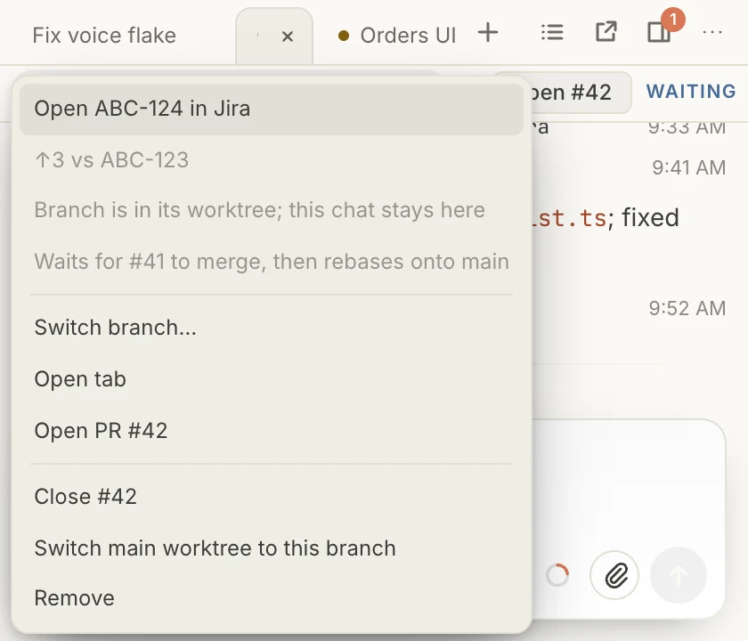
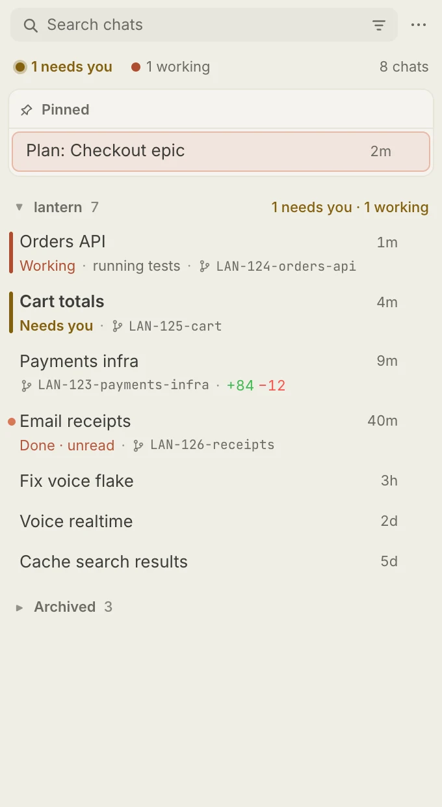
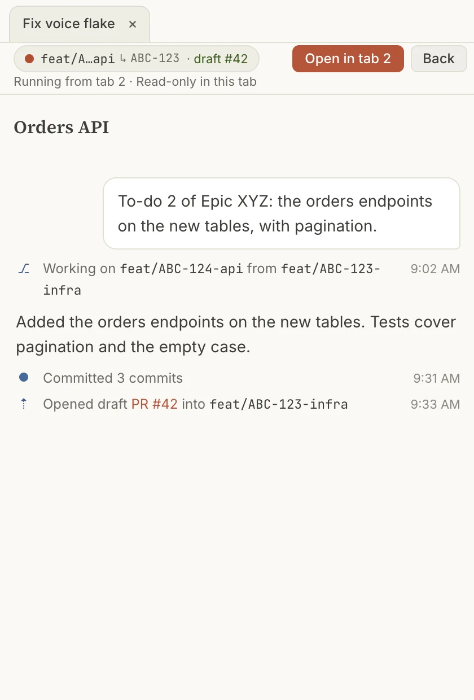
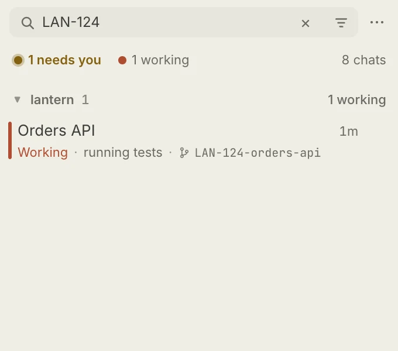

# Chats, Tabs and the Chat List

Work in several chats at once: tabs, side chats, the chat list, search, find, outline, chats in editor tabs, compare, export and save as a skill.

You can have many chats going at once. Chats keep running when you switch away from them, and the chat list shows
which ones are working, waiting for you, or done.

## Chat tabs

Each open chat has a tab at the top of the chat panel. A small flame on a tab means that chat is working.

| To | Do this |
|---|---|
| Start a new chat | <kbd>⌘T</kbd> (<kbd>Ctrl+T</kbd> on Windows and Linux) |
| Go to the next or previous tab | <kbd>⌘]</kbd> (<kbd>Ctrl+]</kbd> on Windows and Linux) / <kbd>⌘[</kbd> (<kbd>Ctrl+[</kbd> on Windows and Linux) |
| Close the tab | Click its **✕**, middle-click it, or press <kbd>⌘W</kbd> (<kbd>Ctrl+W</kbd> on Windows and Linux). The chat stays in the chat list. |
| Open a closed chat again | Click it in the chat list: its tab comes back next to the chat you're in. |

With the chat list showing beside the chat, the top of the panel names the chat instead of showing tabs. Its **✕**
closes that chat's tab, and a chat that is open as a tab has **Close Tab** on its ⋯ menu in the list. Closing never
deletes a chat. Only a side chat you never wrote in is gone when you close it.

Right-click a tab for **Rename**, **Pin**, then **Branch off** (**Fork**, **Fork to Worktree**, **New Side Chat**,
**Continue in a new chat**, each saying what you get), **Open in Editor**, **Open to the Side**, **Close** and
**Close Others**.

**Fork** starts a new chat with everything up to that point; the original stays as it was. To fork from an earlier
message, point at it and click **Fork**. See [Fork a Chat](forks.md).

A chat working on a ticket's branch (a name like `feat/ABC-124-orders`) shows the ticket key before its title.

## The context line

At the top of the chat, under its tabs, one line says where the chat you're looking at works:

- **The branch** and where it lives: **this tab** (the folder this window has open), another tab by its number
  (**tab 2**), the **main worktree**, **its own worktree**, or **not checked out**. A branch stacked on another
  says what it is stacked on after its name (**↳ ABC-123**, the parent's ticket, else its branch). Its dot has the branch's state color (**Needs you**, **Working**,
  **Waiting**, **Ready** or **Merged**). Its pull request comes next, with its CI: ✓ passed, ✕ failed, ◷ running, or
  **draft**.
- **One button** for the branch's next step, the same one the Dashboard shows (such as **Merge #42**), or **Open
  tab** when the branch lives somewhere else.
- At the end, the branch's state in a word when nothing else on screen says it (**NEEDS YOU**, **WAITING**,
  **READY**, **MERGED**; never Working, which the working line says), or **Watching** with Pause and Stop while it
  watches a pull request. While an approval or a question waits on you, it and the working line say so, and the word
  steps aside.

Click the branch for its details. They list what holds the branch up when it needs you or waits, the ticket its branch
names (with its tracker, **Open ABC-124 in Jira** when Settings › Issues has your Jira site), **↑ ↓ vs** its base (a
stacked branch against the branch it builds on: **↑3 vs ABC-123**), and **Branch is in the main worktree; this chat
stays here** (or **in its worktree**, with **Move this chat to tab 2** when it can go there). Under those are **Go to
tab** or **Open tab**, **Open chat** and **View PR #42**, each when the branch has it, and the rest of the branch's
menu (**Stop**, **Remove worktree**…).

  <picture>
    <source media="(prefers-color-scheme: dark)" srcset="../images/chat-context.dark.webp">
    
  </picture>
   <em>The context line: the chat's branch, where it lives and its PR, its one next step and ticket — and the git timeline in the transcript</em>

  <picture>
    <source media="(prefers-color-scheme: dark)" srcset="../images/chat-chip-menu.dark.webp">
    
  </picture>
   <em>A click on the branch opens its details: the ticket, how far it is ahead, what holds it up, Open tab and Open PR</em>

The same words and colors show wherever Ember counts work, so the tab's dot and the status bar's bell agree with it.

## Git in the transcript

As things happen on a chat's branch, a short row appears in its transcript where it happened: the chat starts working
on a branch, commits, a push, its pull request opening, CI turning red (naming the checks that failed, in red, with a
**log** link) or green (with its checks counted), and the merge (or the pull request closing). Branch names show in the code font; click the pull request's number to open it.
These rows show while the window stays open; a chat read back from history doesn't have them. When several chats work
on one branch (in the main worktree, say), a row goes to the chat at work there, or the one that last was, not to all
of them.

After the merge, a card asks to go back to the base and delete the branch (**#18 merged. Back to main and delete
fix/cache-headers?**), with what Ember checked and what goes. When the repository cleans up merged branches on its own,
Ember does it without asking when everything is safe, and a row says what happened (or why it kept the branch). See
[After a pull request merges](../worktrees/worktrees.md#after-a-pull-request-merges).

## Side chats

A side chat is a copy of a chat that answers on the side while the original carries on. It runs on the same account and
as the same agent. Its tab shows which chat it belongs to. Start one with <kbd>⇧⌘S</kbd> (<kbd>Ctrl+Shift+S</kbd> on Windows and Linux), `/side`, or **New Side Chat** on a tab's menu,
or move a queued message to one from the **⋯** on its row in the **Queued** list above the message box.
**Side Chats…** lists the side chats of the chat you're in. See [Ask on the side](context.md#ask-on-the-side).

## The chat list

The chat list is in **Chats**, the list beside the chat. Show or hide it with <kbd>⌃⌘L</kbd> (<kbd>Ctrl+K Shift+L</kbd> on Windows and Linux) or
the **Chats** button at the right of the chat's header row, next to **⋯**
(**Show or Hide Chats**); while it's hidden, the button's badge counts your other chats that are working or unread. While the list
shows, it switches chats and the header names the chat on screen; hide it or fold it, and the header shows your open
chats as tabs again. See [Chats](../getting-started/layout.md#chats).

Each chat has one mark beside it for its state:

- **Working**: Claude is working (a hollow ring: only commands it started are still running).
- **Needs you**: a card is waiting for you.
- **Its last turn failed**.
- **Interrupted when Ember closed**, or **Stopped by a usage limit**: see [When Ember Closes Mid-Run](resume.md).
- **Finished — not viewed yet**: the chat finished while you were elsewhere.

Under the search, one line counts what's live in every layout: **● 2 needs you ● 1 working** and how many chats the
list holds. Click a count to show only those chats; click it again to show them all.

A row's columns line up from row to row: its mark, its title with its tags, where it was started (a terminal glyph for
Claude Code, a screen for the Claude desktop app), where it's open, and its time. Pointing at a row never moves or hides
any of them; it only shows the row's **⋯**.

With **One line** rows (the default), a chat at work says what it's doing on a short line under its title: **Needs
you** in gold with what it waits on, its title in bold, or its current step (**running tests**). Its time stays.

A chat with unsent text in its message box shows **Draft**. The text stays through a reload or restart, and a new chat
you close with text in its box stays in the chat list.

A chat open somewhere else says where: the number of the tab it's in (click it to go there), a window glyph, or an
editor glyph for a chat editor tab. Another worktree's chat that isn't open anywhere shows a worktree glyph instead
(point at it for its branch), and in a list 300px wide or more a small tag with its branch after its title. Every
Ember window and tab knows this about the others, so the marks agree everywhere; after you move a tab, its number
catches up within a few seconds.

Point at a chat and click its **⋯**, right-click it, or press Shift+F10 for its menu; **Pin**, **Rename** (F2),
**Fork** and **Delete** (Delete key) are there:

- **Open in Editor** and **Open to the Side** open the chat in an editor tab. **Move to tab N** moves a chat to its
  branch's worktree tab.
- **Pin**: old-chat cleanup never deletes a pinned chat (see [Delete Old Chats](delete-old-chats.md)).
- **Branch off**: **Fork**, **Fork to Worktree** and **Continue in a new chat**, and for a chat with forks its **Fork tree**, **Compare Versions…**
  and **Keep this one**. See [Fork a Chat](forks.md).
- **Mark Unread**.
- **Keep all** and **Undo all** for the chat's pending edits.
- **Clean up**, each choice naming what goes:
  - **Archive** moves the chat under **Archived** at the end of the list; **Archive Prior Chats…** archives
    every chat older than this one, except pinned and running chats, after asking. **Unarchive** brings one back. A
    worktree chat's worktree is removed once its work is merged, with a moment to keep it; its branch stays
    ([Worktrees](../worktrees/worktrees.md)).
  - **Delete** deletes the chat and its transcript. For a worktree chat it asks whether to remove its worktree too; the
    branch stays.

Another worktree's chat opens in that worktree's tab: the tab already open on it comes to the front, or Ember opens a
new tab on that folder with the chat. It's never moved into this tab. ⌥-click it (Alt-click on Windows and Linux) to
open it in a new window instead. Its menu has **Open**, **Go to tab N** while a tab has it, **Open in New Window**, and
**Pin**: a pin you give it is kept in that chat, so it shows in its own folder's list too. Under **Archived**, its
menu also has **Unarchive** and **Delete** (the Delete key too). **Unarchive** brings it back in its own folder's list
as well. **Delete** asks first, naming the chat; it deletes the chat and its transcript, and can't be undone. Its
worktree stays. While a window is open on that worktree, delete it there instead: that window may have the chat open.
A chat whose folder is gone is faded and doesn't open; its **⋯** has **Delete**.

### The list's layout

The layout button at the right end of the search field opens the list's options, and Ember keeps your choice. The
same choices are in Settings › Chats › Chat list layout, with a picture of each, and
**Chat list settings…** at the bottom of the menu goes there:

- **Group by**: **Branch** (the default, a card per worktree), **Needs you first**, or **None** (by time).
- **Rows**: **One line** or **Two lines**.
- **Sort ›**: **Sort groups by** **Manual** (the order you drag them into, kept for each **Group by**) or **Updated**
  (the group with the newest chat first), and **Sort chats by** **Updated** (newest first) or **Status** (the chats
  that need you first). Chats inside a group are sorted, never dragged.
- **Filter ›**: by status (**Running**, **Needs you**, **Done**, **Error**), **Unread only**, **Bonfire only**, the
  pull request (none, draft, open, merged, closed), and where the chat was started (**Ember** or **Claude Code**).
  When the filter hides chats, the list says how many, with **Show all**.
- **Show ›**: the parts a row shows (branch, worktree, pull request, lines changed, time).

**Needs you first** puts the chats that need you in a gold band at the top, then **Working**, **To look at** (a failed
or interrupted chat, or one you haven't read), **Pinned**, and the rest under **Today**, **Yesterday**, **This week**
and **Older**. **None** lists **Pinned**, then the same four time groups. Outside a branch card, a row shows another
worktree's tab or branch itself.

**Two lines** trades the mark for a colored rail at the row's left (gold needs you, a pulsing clay working, a ring for
commands still running, red failed, faded gold interrupted, a dot unread) and says the rest on a second line in words:
**Needs you** and what it waits on, **Working** and its step, **Last turn failed**, **Interrupted** or **Done ·
unread**; then, outside a card, its worktree's branch and pull request; where it was started, **fork**, its side
chats, its Bonfire to-do, the branch it ran on, the lines waiting for review, ✦ outputs and its versions to compare. A
chat with nothing to say stays one line.

### Branch cards

With **Group by** **Branch**, each worktree with chats is a card. Its header shows:

- a dot for its most urgent chat (gold when one needs you, and then the card has a gold edge);
- its branch (point at it for the folder);
- its pull request, with its CI: ✓ passed, ✕ failed, ◷ running, or **merged**;
- where it is: **this tab** (that card is tinted, with its branch in the accent color), **tab 2**, or **Folder gone**.

Its chats sit inside it, and because the card names the branch and the tab, its rows don't repeat them. **Pinned** is
a card of its own at the top. When this tab's worktree is the only one with chats, its chats show without a card, and
with one repository the cards stand alone, without the repository's heading.

Click a card's header (or select it and press Left or Right) to fold it. Its **⋯** (point at the header, or press
Shift+F10) has:

- **Pin** (or **Unpin**): pinned cards come first. After them come the cards with a chat that needs you.
- **Open in New Tab** brings that worktree's tab to the front, or opens a new tab on it; **Open in New Window** opens it
  in a window of its own.
- **Delete old chats in this worktree…** (the usual [Delete Old Chats](delete-old-chats.md), for that card's chats only), **Copy
  path** and **Reveal in Finder** (**Reveal in File Explorer** on Windows).

Drag a card by its header to move it among the repository's cards. Drop it among the pinned ones and it's pinned.
**Alt+Up** and **Alt+Down** move the selected card. Each window keeps its own pins, order and folds for each repository,
also when Ember closes and opens again.

A Bonfire run's to-do chats fold into one row in the run's card, **Bonfire run** with the run's name and how many
to-do chats it has: click it to show them. A chat that ran on a different branch than its card's branch now shows
that branch in small type. A gone worktree's card says **The folder is gone. Delete its N chats**, with the same
checks as **Delete Chats Whose Worktree Is Gone…** below.

### Finished branches

Branches whose pull request merged, and worktrees whose folder is gone, move into **Finished branches** at the bottom
of the list (Settings › Chats › Chat list layout turns this off). Its **Clean up…** has **Delete chats whose folder is gone
(N)…** and **Archive chats on merged branches (N)…**, which archives their chats except pinned and running ones. Each
asks first.

A group's header says how many chats it holds and, on its right, how many need you or are working, so a folded group
still tells you (gold while one needs you). Click a group's header, or select it and press Left or Right, to fold or
open it; each **Group by** keeps its own
folds. Up and Down move through the headers and chats, Enter opens a chat, and Right and Left show or hide a chat's
side chats. Search finds chats by title, branch, ticket, pull request number and what was said in them. Folding a
group while you search lasts for that search only.

Drag a chat onto **Pinned** to pin it where you drop it, drag within **Pinned** to reorder it, and drag a pinned chat
out to unpin it. With **Sort groups by** **Manual**, drag a group's header to move the group. A line shows where it
lands. From the keyboard, **Alt+Up** and **Alt+Down** move the selected pinned chat or group, and their menus have
**Move Up** and **Move Down**. Pinned's order and the groups' order are kept when Ember closes and opens again.

### The list's menu

**⋯** next to the search has **New Chat** and three ways to tidy up. Each asks before it changes anything:

- **Archive Prior Chats…** archives the chats older than the one on screen, except pinned and running chats.
- **Delete Old Chats…** deletes chats older than the days you pick (see [Delete Old Chats](delete-old-chats.md)).
- **Delete Chats Whose Worktree Is Gone…** deletes this tab's chats whose worktree git no longer has, and the chats
  from other folders that the list marks **Folder gone**. For this tab's own chats a missing folder alone isn't enough:
  a worktree git still lists, or whose repository can't be reached (an unmounted drive, a moved repository), stays. A
  **Folder gone** chat goes while its folder is still missing, as its own **Delete** would, unless a window still has
  that folder open. Running and pinned chats, chats with unsent text and the chat on screen always stay. Ember names what
  goes and what stays before it deletes. It deletes Ember's chats and Claude Code's transcripts of them (in
  `~/.claude/projects`), so Claude Code can't resume them, and it can't be undone. It never touches git or any file in
  your project.

  <picture>
    <source media="(prefers-color-scheme: dark)" srcset="../images/chat-list-history.dark.webp">
    
  </picture>
   <em>The chat list: the summary line, Pinned as a card, your chats, then Archived; two-line rows have a state rail and say what each chat does</em>

Chats stay with the tab they were started in. Opened from a link or the switcher, a chat that belongs to another open
tab shows right here, read-only: its transcript as saved, its branch, **Running from tab 2** (or **Belongs to** that tab
when it is idle), **Back** to this tab's chat, and **Open in tab 2**, which brings that tab to the front with the chat
open to send to (see [A chat that belongs to another tab](../worktrees/across-tabs.md#a-chat-that-belongs-to-another-tab)). It keeps up with that tab while you look
at it. When its transcript takes more than a moment to read, the Ember flame says **Reading “…” from tab 2…** until it
is there.

  <picture>
    <source media="(prefers-color-scheme: dark)" srcset="../images/chat-peek.dark.webp">
    
  </picture>
   <em>A chat that belongs to another tab, opened from this tab's list: shown right here, read-only, with the tab that runs it and Open in tab 2</em>

From the chat list, a click opens another worktree's chat in that worktree's tab straight away; when no tab is open on
its folder, Ember opens one and opens the chat there.

### Search the list

Type in **Search chats** at the top of the list. It finds chats by:

- their name;
- a ticket key such as `ABC-123` (any case): the chats on that ticket's branch;
- a pull request number, `#41` or `41`: the chats on that pull request's branch;
- part of a branch name, such as `login`;
- what was said in them, once you type two or more letters.

Searching shows only the chats that match, in their groups, exact matches first, and opens every folded group. Chats
from other folders are found too. A chat found by what one of its side chats said shows with its side chats open. Clear
the search and your groups fold as you left them.

  <picture>
    <source media="(prefers-color-scheme: dark)" srcset="../images/chat-list-search.dark.webp">
    
  </picture>
   <em>Search knows git: a ticket key finds the chat on its branch</em>

## Search every chat

Press <kbd>⌥⌘'</kbd> (<kbd>Ctrl+Alt+'</kbd> on Windows and Linux) or run **Search Chats…** to search what was said in your chats,
in every folder. See [Conversation Search](../knowledge/conversation-search.md).

## Find in a chat

- <kbd>⌘F</kbd> (<kbd>Ctrl+F</kbd> on Windows and Linux) finds text in the chat on screen.
- <kbd>⇧⌘O</kbd> (<kbd>Ctrl+Shift+O</kbd> on Windows and Linux) opens the chat outline: a list of your messages; pick one to jump to it.
- Alt+↑ and Alt+↓ jump between your messages in a long chat.

## Open a chat in an editor tab

Press <kbd>⌘D</kbd> (<kbd>Ctrl+D</kbd> on Windows and Linux), or the open-in-editor button on the right of the chat's header row, to open the
chat on screen in an editor tab, where it has more room. **Open Chat to the Side**, on the
header's **⋯** menu, opens it beside the editor.

## Compare two chats

Run **Compare Chats Side by Side**, pick two chats, and they open in two editor tabs side by
side. Useful when you asked two chats, or two models, the same thing.

## Copy, export or save a chat

On the **⋯** menu at the right of the chat's header row:

- **Copy Chat as Markdown** copies the whole chat.
- **Export Chat as Markdown…** saves it to a file you choose, and offers **Reveal** to find it.
- **Save Chat as Skill** asks Claude to turn what you worked through in this chat into a
  reusable skill. Run it after the current turn has finished.

---

[All documentation](../README.md)
