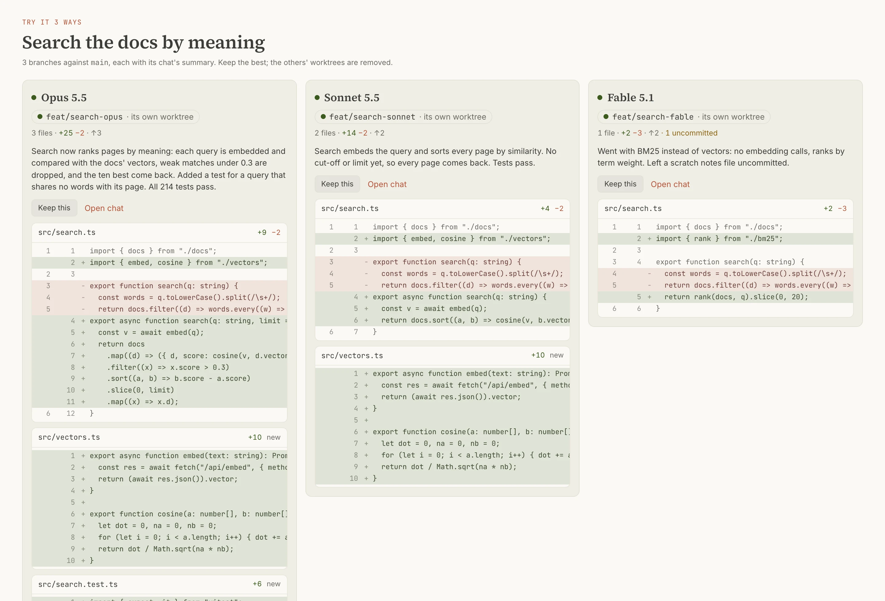
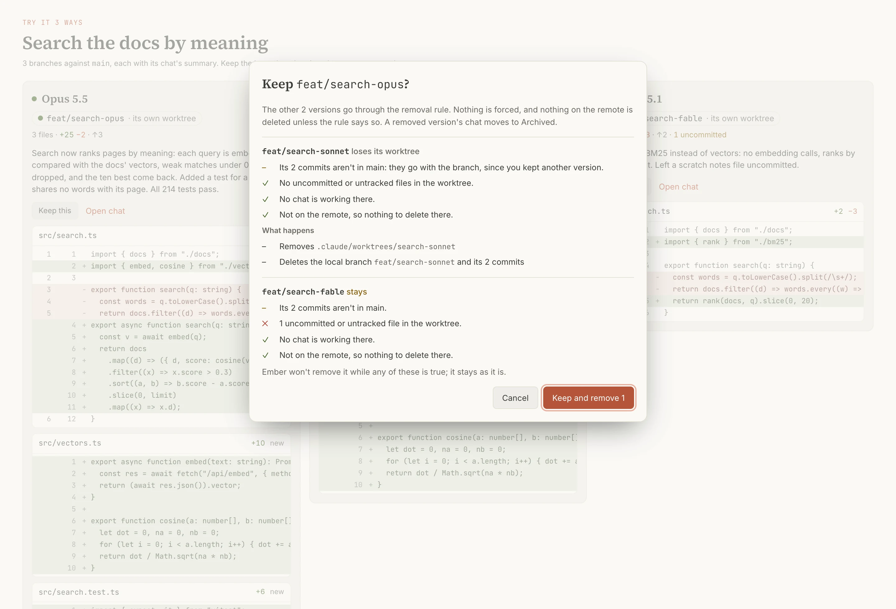
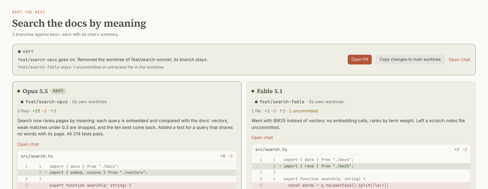

# Try It Several Ways, Keep the Best

Send one prompt to two to four models, or to one model several times, each on its own branch in its own worktree, compare their changes side by side against the base, keep the best one, and let Ember remove the others' worktrees.

When you aren't sure how a change should go, try it more than one way. Each version works on a branch of its own, so
nothing it does touches your main worktree or the other versions.

## Start the versions

In the composer, click **Try several** next to the model and tick two to four models: it uses about that many times the
usage of one chat. To try one model more than once, click **+** on its ticked row (and **−** to take one off): two
to four versions in all, from one model or several. The button then says how many, and the
composer's Where menu reads **New worktree**. When you send, Ember starts one chat per version with the same prompt. Each one
works in its own worktree on its own branch from the same base, named after the prompt (for example
`ember/search` and `ember/search-2`). No tab opens; the chats show in the chat list as they work. Each chat's title ends
with its model; versions from the same model are numbered, as in **Opus 5.5 · 1** and **Opus 5.5 · 2**.

Forks can be compared the same way: fork a chat into two or more worktrees (see [Fork a Chat](forks.md)), and its worktree forks
are versions too.

## Compare them

When they've all finished, the chat on screen says so with **Compare and keep one**, and the first version's row in the chat list says **3 versions finished · Compare and
keep one**. Click that, or right-click one of the versions in the chat list and click **Compare Versions…**, or run
**Compare Versions of This Chat…**. The Compare page opens:

  <picture>
    <source media="(prefers-color-scheme: dark)" srcset="../images/compare-tries.dark.webp">
    
  </picture>
   <em>Three versions of one prompt side by side: each model's branch, stats, its chat's summary and its changes against main</em>

- One column per version, side by side in a wide tab and stacked in a narrow one.
- At the top of each: its model (with its number when you tried that model more than once), its branch and how far it got: files changed, lines added and
  removed, commits, and uncommitted files if it left any.
- Its chat's last summary, in short.
- Its changes against the base, file by file, as numbered diffs like the review page's. **Open chat** opens its chat.

## Keep one

Click **Keep this** on the version you want. A version that is still working, or waiting on you, can't be kept until it
finishes.

Before anything happens, Ember shows what keeping it means for every other version. Each one goes through the same
checks as everywhere else in Ember, and the sheet shows the checks and what it would remove:

  <picture>
    <source media="(prefers-color-scheme: dark)" srcset="../images/compare-tries-keep.dark.webp">
    
  </picture>
   <em>Keep one: the removal rule's checks for every other version first; the one with uncommitted work stays</em>

- Each other version's worktree is removed; its branch stays, with every commit, so nothing you compared is lost.
- Anything in a version's worktree that its branch doesn't hold (uncommitted or untracked files, ignored files that may
  be yours) goes with the worktree, and the sheet names it for that version before you say yes.
- A version with a pull request stays.
- A version that got new commits after you compared it stays too, and so does one that got a pull request, or another chat
  working in its worktree, after the sheet opened: Ember checks again as it removes each one.

Click **Keep and remove** to go ahead, or **Cancel** to change nothing. Each version the rule allows has its worktree
removed, and its chat moves to **Archived** (its history stays). A version that stays is named, with why, and keeps
its chat open. The kept version isn't touched.

## Carry on with the kept branch

After Keep, the tab says which worktrees were removed and what stayed. The kept branch goes on like any branch in its own worktree:

  <picture>
    <source media="(prefers-color-scheme: dark)" srcset="../images/compare-tries-kept.dark.webp">
    
  </picture>
   <em>After Keep: what was removed and what stayed, and the kept branch goes on with Open PR or Copy changes to main worktree</em>

- **Open PR** pushes it and opens a draft pull request.
- **Copy changes to main worktree** squashes it into your main worktree as uncommitted changes. It isn't offered in a repository
  whose main worktree stays on its base.

See [Worktrees](../worktrees/worktrees.md) for more on worktree branches.

---

[All documentation](../README.md)
