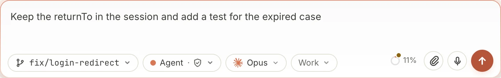
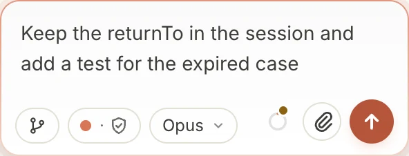
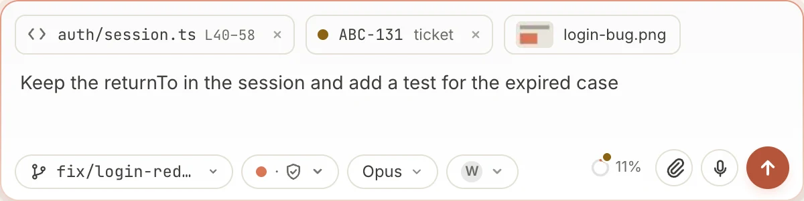
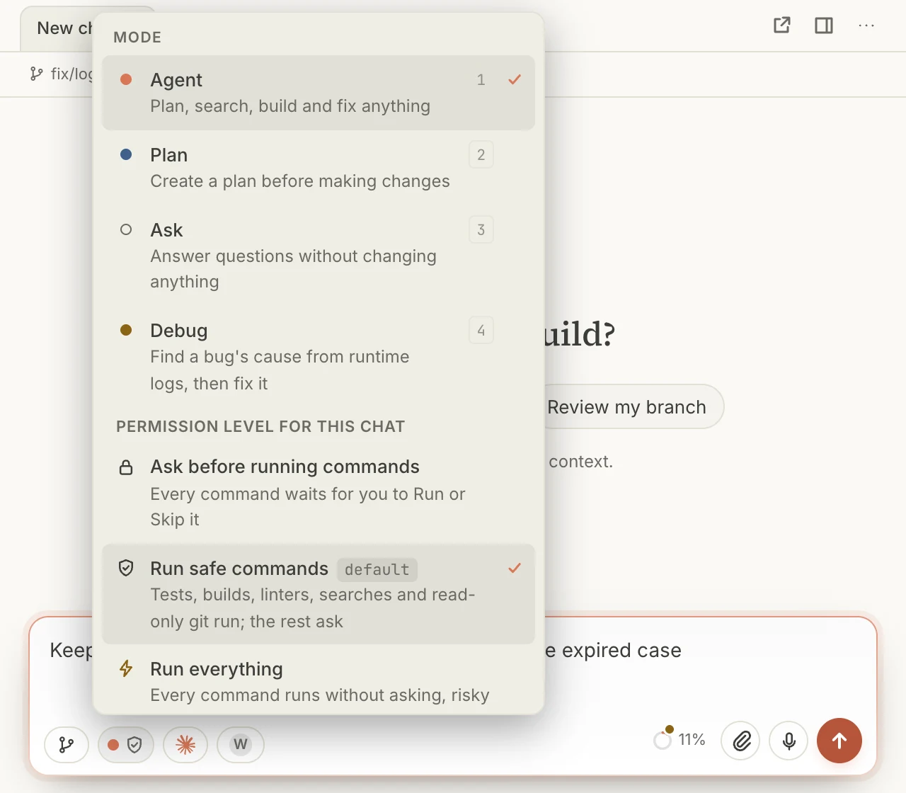
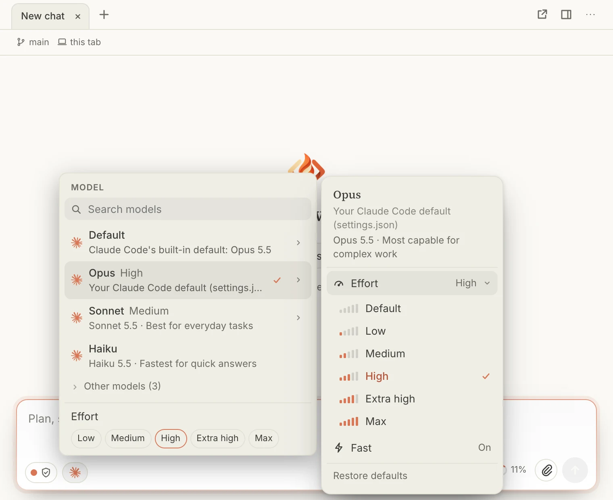
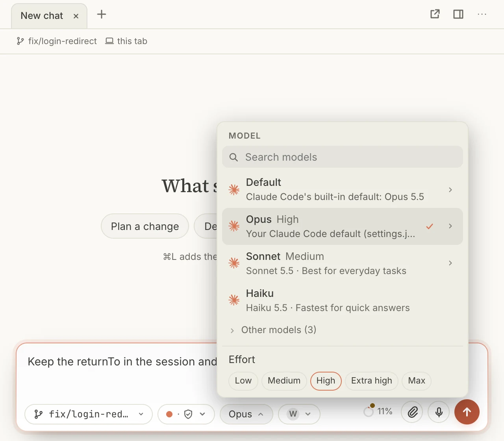

# The Message Box

Modes, permission level, models, thinking, Fast and effort; queueing or sending now while Claude works; editing and resending; suggestions; text size and density.

The message box at the bottom of a chat is where you write to Claude and choose how it answers. The keys that work
while you type are in [In the message box](../shortcuts/keyboard-shortcuts.md#in-the-message-box).

  <picture>
    <source media="(prefers-color-scheme: dark)" srcset="../images/composer-wide.dark.webp">
    
  </picture>
   <em>The composer: where it works, the mode in its colour, the model, the account — then the context ring (its gold dot: a limit is near), attach, voice and send in the corner</em>

Under what you write is one row of small buttons. From the left:

- **Where the chat works**: before the first message, **Here · main** or another choice (see
  [Start a chat in a worktree](../worktrees/worktrees.md#start-a-chat-in-a-worktree)). Once the chat has started, its branch shows on the line above the
  chat instead, so this button is gone, except in a worktree chat, where it says **Worktree** and opens the worktree's
  menu (**Open PR**, **Copy changes to main worktree** and the rest).
- **Mode and permission level**, as one button, for example **Agent · Safe commands**.
- **Model and effort**.
- **Account**, when you have more than one Claude account.

Each opens its menu. At the right end of the same row are the context ring, attach, the microphone and send. The ring
holds your plan's limits too: a gold dot on it means a limit is near, red means you're at it, and a click shows each
limit with its reset time.

In a narrow chat the buttons get shorter step by step: the quieter words go first (the level's name leaves early; its
icon stays), then the mode's name, and at last each shows only its icon (point at it to see what it says). Send never
moves.

  <picture>
    <source media="(prefers-color-scheme: dark)" srcset="../images/composer-320.dark.webp">
    
  </picture>
   <em>The narrowest chat: the pills keep their icons, the microphone steps aside, and attach and send stay in the corner</em>

Files, screenshots and @-mentions you add sit above what you write, as tiles. Point at one and click ✕ to remove it.

  <picture>
    <source media="(prefers-color-scheme: dark)" srcset="../images/composer-attachments.dark.webp">
    
  </picture>
   <em>What goes with the message sits above it as tiles: a selection with its lines, a screenshot, a ticket</em>

## Modes

The mode button sets what Claude does with your message: **Agent**, **Plan**, **Ask** or **Debug** (see
[Pick a mode](../getting-started/first-chat.md#pick-a-mode)). Each mode has its colour, so you see at a glance what a send will do: Agent clay,
Plan blue, Debug gold, Ask an empty circle. Press Shift+Tab to move to the next mode; with the menu open, 1–4 pick
one.

  <picture>
    <source media="(prefers-color-scheme: dark)" srcset="../images/composer-mode-menu.dark.webp">
    
  </picture>
   <em>The mode menu: Agent, Plan, Ask and Debug, each in its colour; the one in use is ticked</em>

The same button names this chat's permission level: how much Claude may do without asking. Below the modes, its menu
lists the three levels. The one in effect is ticked, and the one from **Settings › Permissions** is marked
**default**.

- Pick another level to set it for this chat only; it stays with the chat.
- Pick the default again to put the chat back on the Settings level.
- **Run everything** asks you to confirm first.
- **Permission settings…** opens Settings › Permissions.

On the phone the mode sheet has the same choices, except turning on Run everything, which you do at your computer.
See [Approvals and Permissions](approvals.md).

## Models, thinking, Fast and effort

  <picture>
    <source media="(prefers-color-scheme: dark)" srcset="../images/chat-model-picker.dark.webp">
    
  </picture>
   <em>The model picker: models, where each default comes from, and each model's effort and Fast</em>

Click the model button, or press <kbd>⌥P</kbd> (<kbd>Alt+P</kbd> on Windows and Linux). It shows the model and its effort.

  <picture>
    <source media="(prefers-color-scheme: dark)" srcset="../images/composer-model-menu.dark.webp">
    
  </picture>
   <em>The model menu in the same shell: the models, then the chat model's effort</em>

- Type to search. Less common models are under **Other models**.
- **Effort** under the list sets the chat model's effort in one click; the menu stays open.
- A model that has reached its own usage limit says **limit** in its row, with when it resets.
- Click the settings button beside a model (**Effort and settings**) to set its **Effort** (**Low**, **Medium**,
  **High**, **Extra high**, **Max**, or **Default**) and turn **Fast** on or off, where the model supports them.
- **Make … the default** saves the model in Claude Code's settings, so new chats and the terminal start on it.

The choice is for this chat. New chats start on the model you picked last; turn that off with
[`ember.rememberLastModel`](../settings/settings-models.md#emberrememberlastmodel).

Shortcuts in the chat:

- <kbd>⌥T</kbd> turns thinking on or off for this chat.
- <kbd>⌥O</kbd> (<kbd>Alt+O</kbd> on Windows and Linux) turns Fast mode on or off.

See [Choosing models](../models/choosing-models.md) for which model suits what.

## Send while Claude works

You don't have to wait for Claude to finish. While a turn runs, the message you send can either **queue** (go when the
turn ends) or **send now** (go into the running turn, so Claude takes it into account straight away).

- Enter does one and Alt+Enter (⌥Enter on macOS) does the other. Choose which Enter does in **Settings › General ›
  Enter while running** ([`ember.composer.whileRunning`](../settings/settings-general.md#embercomposerwhilerunning)).
- The **Send now** button beside the stop button sends the message now, whatever Enter does.
- The stop button (Esc) stops this turn. What runs in the background keeps running; **Stop all** in the
  **Background** list stops that too.
- Ctrl+Enter (⌘Enter) stops the turn and sends your message now.

While Claude waits on you (an approval, a question, a mode suggestion), Enter and Alt+Enter don't queue: what you send
answers what waits, and the box says how ("Enter skips this command and tells Claude what you typed"). It never
approves anything, whatever you type; see [Write instead of answering](approvals.md#write-instead-of-answering). A message Ember writes for you (**Fix in
chat**, Agent Review, a canvas, Ask Claude in Ember Git) never answers what waits: it queues, marked **waits for your
answer above**, and goes once you've answered and the turn is over.

Queued messages wait in a list titled **Queued** just above the message box. Each row has **Send now** (**Send** when
no turn runs), and **⋯** for the rest:

- **Edit** (or Enter on the row);
- **Move to a new chat**;
- **Ask in a new side chat** (and, when the chat has side chats already, each of them under **Move to a side chat**):
  the side chat asks it instead of after the turn, with its mentions and attachments, and this chat carries on. If no
  side chat can start yet (the chat's first reply hasn't finished), the message stays queued. See
  [Side chats](chat-tabs.md#side-chats);
- **Remove** (or Delete).

## Edit and resend a message

1. Point at one of your earlier messages and click **Edit** (or pick **Edit and resend** under **Rewind to here** in
   its **⋯**).
2. Change it and send it. The chat continues from that point.

The message's mentions and attachments (images, PDFs, pasted text) come back with it, and they go again when you send.
Click ✕ on one to leave it out. If Ember can't get an attachment back (Claude Code no longer keeps that part of the
chat, say), it stays in the box marked **No longer available** with the reason, and isn't sent.

Files Claude changed after that message can go back to how they were. **Settings › General › Edit & resubmit**
([`ember.composer.editRevert`](../settings/settings-general.md#embercomposereditrevert)) decides: **Ask, last answer first**, **Always revert** or **Never revert**.
When it asks, the question comes in the chat, naming the files: your last answer is the first button, and **Always
Revert** or **Always Keep** beside it answers the same way from then on without asking. **Dismiss** sends nothing and
changes nothing.

To go back further, see [Rewind a Chat](rewind.md).

## Earlier prompts

If Ember can't send a message (you're signed out, say, or its worktree is gone), your text, mentions and attachments
come back to the message box, and a notice says why.

Press ↑ at the start of the message box to bring back your earlier prompts, ↓ for later ones.

## Suggested next message

After each reply, Claude's guess at your next message waits, dimmed, in the empty message box. Press Tab to use it.
Turn it off in **Settings › General › Suggest my next message** ([`ember.promptSuggestions`](../settings/settings-general.md#emberpromptsuggestions)).

## Slash commands

Type `/` at the start of the message box for Claude Code's commands and your skills.

## Text size, width and density

In **Settings › General › Chat display**:

- **Text size** scales the chat and the message box ([`ember.chat.textSize`](../settings/settings-general.md#emberchattextsize)).
- **Reading width**: by default the chat fills its panel, and widens as you widen the panel. Set a number of pixels to
  keep the transcript to that width, centred ([`ember.chat.maxWidth`](../settings/settings-general.md#emberchatmaxwidth)).
- **Density** sets how much of Claude's work a chat shows ([`ember.chat.density`](../settings/settings-general.md#emberchatdensity)):

| Density | What you see |
|---|---|
| **Compact** | Reads, searches, edits and commands fold into one row per run; a finished turn's work folds into one row above the reply. |
| **Balanced** | Reads and searches fold into **Explored …**; a finished turn's work folds into one row above the reply. |
| **Detailed** | Every tool call on its own row, opened; nothing folds but the to-do calls. |
| **Custom** | You choose with the switches that appear below. |

In every density, Claude's to-do calls (adding to-dos and marking them started or done) fold into one row such as
**Created 13 to-dos**: the to-dos themselves are in the checklist above the message box.

See [Read a Chat](reading-a-chat.md).

---

[All documentation](../README.md)
