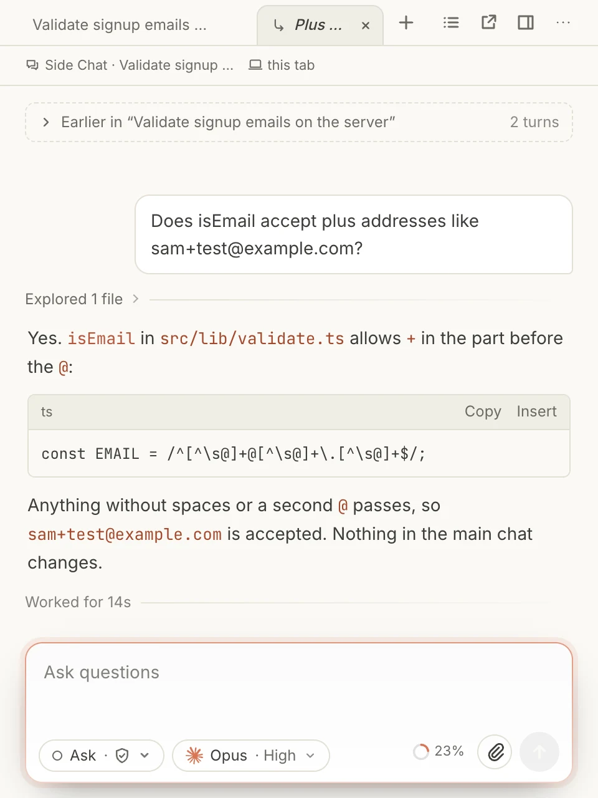

# Give Claude Context

Point Claude at files, code, problems, terminals, commits and more with @, Add to Chat, quotes of its replies, side chats, attachments and drag and drop.

Claude can find most things in your project on its own, but pointing it at the right file, error or terminal output
saves time and gets better answers. Everything you add shows as a small tile above what you write; click its **×** to
remove it.

## Mention with @

Type `@` in the message box (or press <kbd>⌥⌘P</kbd> (<kbd>Ctrl+Alt+P</kbd> on Windows and Linux)) and pick what to add:

| Category | What it adds |
|---|---|
| **Files & Folders** | A file or folder. |
| **Code** | A function, class or type. |
| **Rules** | A rule, for this message only. |
| **Past Chats** | Another chat's context. |
| **Problems** | The current errors and warnings. |
| **Git Changes** | Your uncommitted diff. |
| **Codebase** | A search of the codebase index with this message (see [Codebase Index](../knowledge/codebase-index.md)). |
| **Docs** | A docs site you added in **Settings › Indexing** (see [@Docs](../knowledge/docs.md)). |
| **Terminals** | Recent output from a terminal, or its selection. |
| **Commits** | A commit, or everything this branch changed. |
| **PRs** | An open pull request and its diff. Needs the GitHub CLI (`gh`), signed in. |
| **Web** | Lets Claude search the web for this message, or read a page whose address you type after `@`. |
| **MCP Resources** | A resource from a connected MCP server. |
| **Browser** | A page open in Ember's browser: its address, title and outline, or (under it) a screenshot taken when you send (see [Ember's browser](../connect/browser.md)). |

Keep typing after `@` to search, for example `@auth` for files and code named like it.

## Add from the editor

- Select code and press <kbd>⌘L</kbd> (<kbd>Ctrl+L</kbd> on Windows and Linux) to add the selection to the chat.
- After you select text, a small toolbar offers **Add to Chat** and **Quick Edit** (see [Inline Edit](../editing/inline-edit.md)): under
  the selection, or in the editor's bottom-right corner with [`ember.selectionToolbarPlacement`](../settings/settings-editor.md#emberselectiontoolbarplacement). Turn it off
  with [`ember.selectionToolbar`](../settings/settings-editor.md#emberselectiontoolbar). The toolbar needs editor features only Ember.app turns on; with Ember's
  extension in stock VS Code or VSCodium, use <kbd>⌘L</kbd> (<kbd>Ctrl+L</kbd> on Windows and Linux) and inline edit instead.
- Right-click in the editor for **Add Symbol to Chat**, and, with text selected, **Add to Side Chat** and **Add to
  Memory**.
- Right-click an editor tab for **Add File to Chat**.

## Add from the Explorer and the terminal

- Right-click a file in the Explorer for **Add to Chat** or **Add to New Chat**.
- Select text in a terminal and press <kbd>⌘L</kbd> (<kbd>Ctrl+L</kbd> on Windows and Linux), or right-click it for **Add Terminal
  Selection to Chat**.

## Quote part of a reply

Select text in one of Claude's replies and a small bar appears under it:

- **Quote** (<kbd>⌘L</kbd> (<kbd>Ctrl+L</kbd> on Windows and Linux)) adds the words to the message box as a quote tile. Claude gets them with
  your next message, along with the opening words of the reply they came from, so you can ask about exactly that part.
  Hover the tile to see the whole quote and its reply.
- **Ask on the side** (<kbd>⇧⌘S</kbd> (<kbd>Ctrl+Shift+S</kbd> on Windows and Linux)) opens a side chat with the quote already in its message box.

Copy, find in chat and a code block's copy button work as before; the bar only appears for a finished reply, not for
your own messages or a subagent's text. A quote goes with up to 4,000 characters. It stays on the message when you
queue it, or edit and send it again. On your phone, select text in a reply to get the same bar.

## Ask on the side

A side chat starts as a copy of the chat you're in, so it knows everything said so far, but works on its own: the
original chat carries on undisturbed. Use one for a quick question that would derail the main task.

  <picture>
    <source media="(prefers-color-scheme: dark)" srcset="../images/chat-side.dark.webp">
    
  </picture>
   <em>A side chat: a copy of the chat with its earlier turns folded, asking on the side</em>

- Press <kbd>⇧⌘S</kbd> (<kbd>Ctrl+Shift+S</kbd> on Windows and Linux) in the chat panel, or type `/side` and then your question.
- To ask about part of a reply, select it and choose **Ask on the side** (see above).
- A side chat starts in **Ask** mode, so it changes nothing unless you switch modes.
- **Side Chats…** lists the side chats of the chat you're in.

## Carry a chat into a new one

**New Chat with Previous Context** starts a new chat with the chat you were in already
in its message box, as a **Past Chats** tile. It's also in the chat's **⋯** menu once the chat has messages. Nothing
is summarised in advance: Claude reads the old chat when you send, as with any `@` past chat, and you can remove the
tile like any other.

## Attach files

Click the paperclip (**Attach files**) to add images, PDFs or text files, or paste an image into the message box. A
message takes up to 20 attachments. Text files from your project are added as file tiles instead.

## Drag and drop

Drag files from the Explorer, editor tabs or your computer's file manager onto the chat. The message box shows **Drop
to add as context** while you drag.

> **Tip:** In stock VS Code and VSCodium, hold Shift while you drop. The message box says so when it's needed.

---

[All documentation](../README.md)
