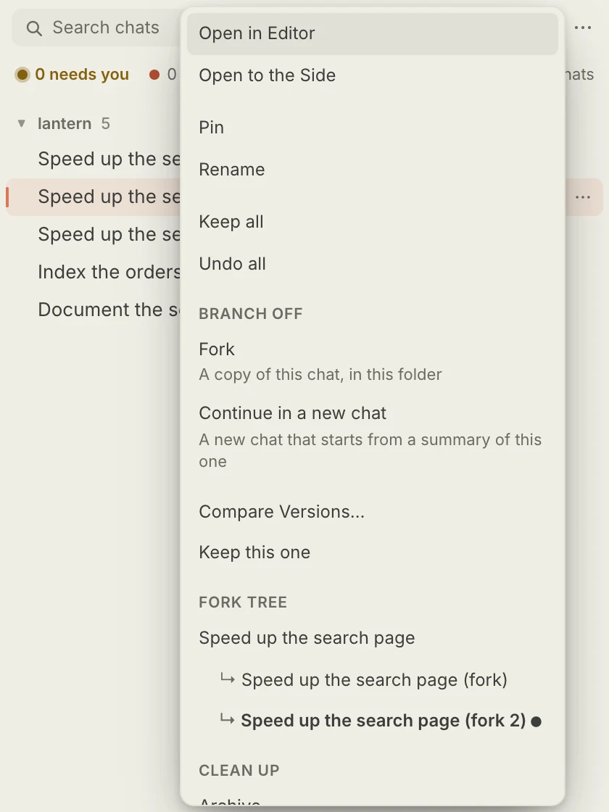

# Fork a Chat

Branch a chat to try another approach: forks remember where they came from, can run in their own worktree, and can be compared so you keep the best one.

A fork is a new chat that starts with everything the original chat had up to a point. The original stays as it was,
so you can try something else without losing what you have.

## Fork a chat

Do one of these:

- Point at one of your messages, click its **⋯** and pick **Fork** under **Branch off**. The fork gets everything up
  to that message's reply.
- Click **Fork** on a chat in the chat list, or right-click a tab and click **Fork** under **Branch off**. The fork
  gets the whole chat.

**Branch off** is where every menu puts the ways to start something new from a chat, each with a line saying what you
get: **Fork**, **Fork to Worktree**, **New Side Chat**, and **Continue in a new chat** (from your messages, a tab, a
chat in the chat list, or the phone's chat menu; not for a side chat). The chat's
**⋯** has **New Chat with Previous Context** there: an empty chat with this one attached, read when you send, where
**Continue in a new chat** starts from a summary of this one.

A plain fork works in the same folder as the original, so both chats edit the same files.

## Fork into a new worktree

To try another approach side by side, give the fork its own worktree:

- Point at one of your messages, click its **⋯** and pick **Fork to Worktree** under **Branch off**.
- Or right-click a chat in the chat list or a tab, and click **Fork to Worktree**.
- Or run **Fork This Chat into a New Worktree**.

Ember makes a new worktree and branch for the fork. It starts from the chat's files as they were at that point:
after that message's reply, uncommitted changes included. The original chat and your main worktree don't change. If Ember
has no snapshot from that point (the message is older than this feature, or the chat isn't in a git repository), it
says so and starts from the files as they are now.

While it works, the chat says "Forking into a worktree…" and the worktree's setup streams there, folding once it's done. Clicking again does nothing until it's done.

The chat's folder must be in a git repository. See [Worktrees](../worktrees/worktrees.md) for how worktrees work.

## The fork tree

Forks remember the chat they came from. In the chat list, a fork shows **Fork**, and the chat it came from shows how
many forks it has.

Right-click a chat in the list, or click its **⋯**, to see its **Fork tree**: the first chat, then its forks
indented under it, with the chat you're on marked. Click a chat in the tree to open it.

  <picture>
    <source media="(prefers-color-scheme: dark)" srcset="../images/chat-list-forks.dark.webp">
    
  </picture>
   <em>A chat's menu: Compare Versions…, Keep this one and the fork tree, with the chat you're on marked</em>

On your phone, a chat's menu lists the same tree. Tap a chat to open it.

## Compare forks and keep one

When a chat has two or more forks that run in their own worktrees, they are versions you can compare and keep one of.
Right-click the chat or one of its forks in the chat list and click **Compare Versions…**, or run
**Compare Versions of This Chat…**. On a fork itself, **Keep this one** opens the same view with
Keep asked for it. See [Try It Several Ways, Keep the Best](compare-tries.md) for the Compare page, what keeping one does to the others, and how the kept
branch goes on.

---

[All documentation](../README.md)
