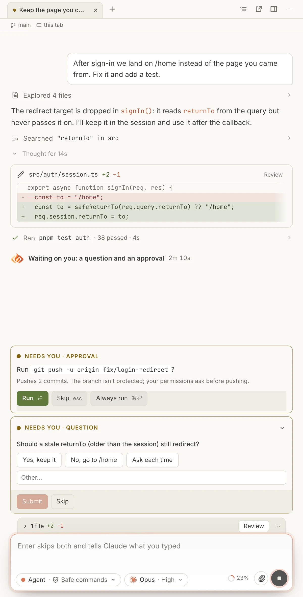
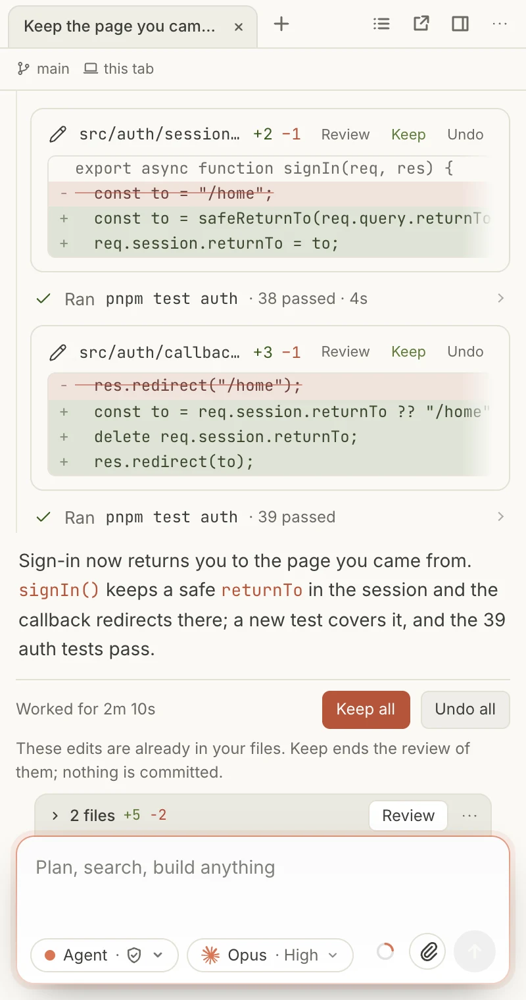
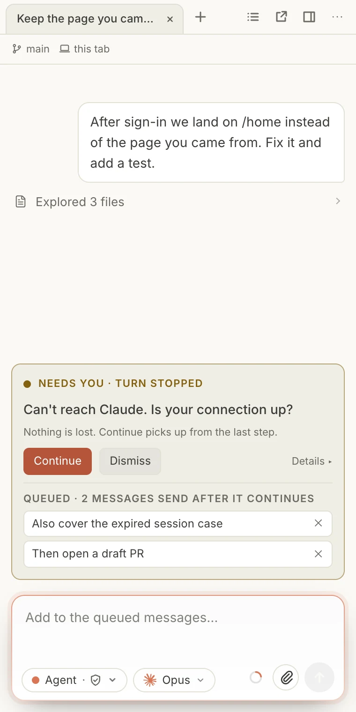
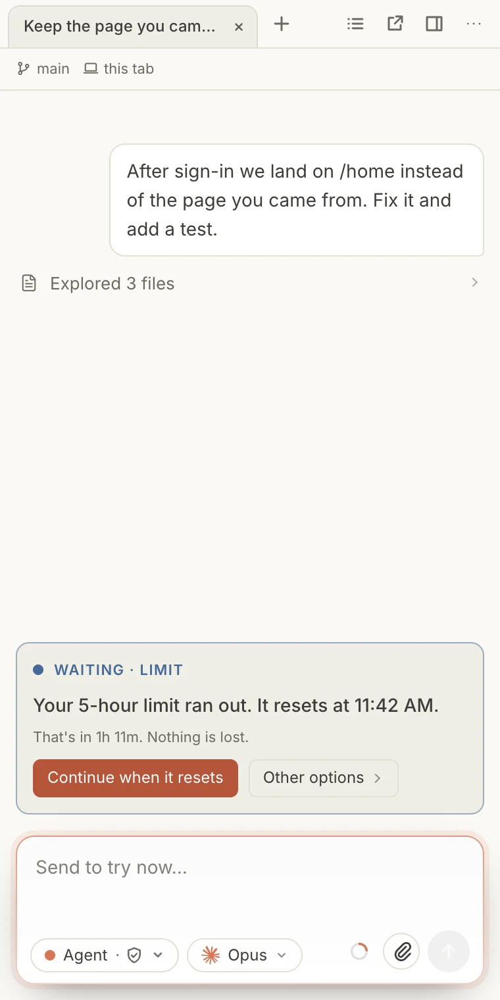
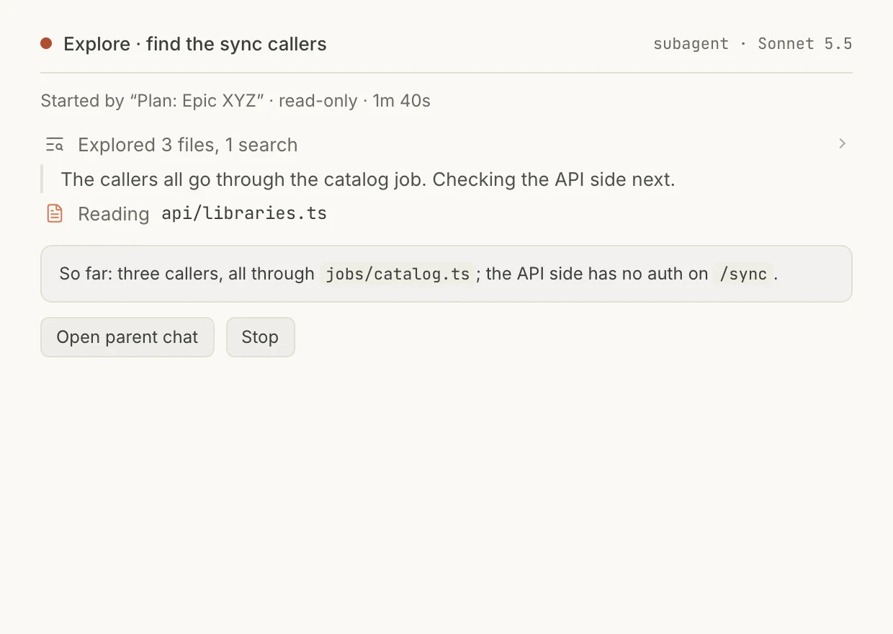
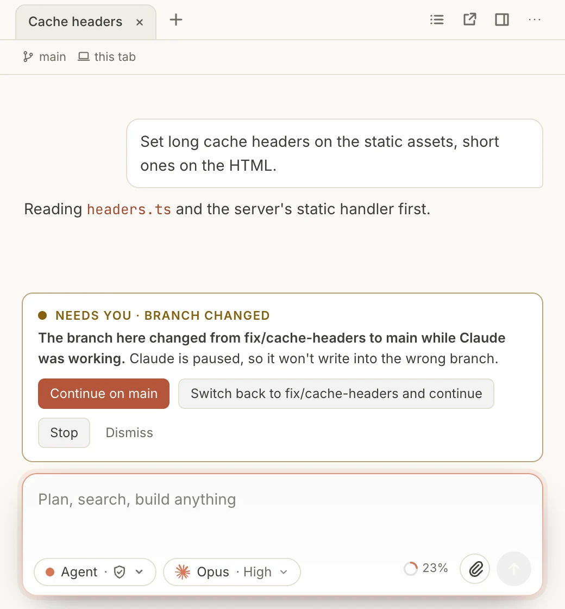

# Read a Chat

What you see while Claude works: your messages and its replies, the message ticks for jumping back, folded turns, tool lines, edits, thinking, the working line, notices, the turn footer, subagents and the Background list, hook rows, the context line, the status line, the context ring and continuing a long chat in a new one.

A chat shows Claude's reply and the work behind it. Your messages sit on the right; Claude's words sit on the
panel with no bubble, with code and paths in mono. Most of the work starts folded so the answer stays easy to find;
click anything to open it.

  <picture>
    <source media="(prefers-color-scheme: dark)" srcset="../images/chat-transcript.dark.webp">
    
  </picture>
   <em>The transcript: your message on the right, one quiet line per tool, an edit card with its diff, a test run's outcome, thinking as one faint line, and what needs you in gold</em>

## Jump between your messages

Down the chat's left edge there's a short tick for each message you sent, in order. The ticks for the turns on
screen are a little brighter, so the column also shows where you are in a long chat.

- **Point at a tick** to see a preview: your message's first line, the start of Claude's answer and how long that
  turn worked. The ticks around it grow as you move, so you can run along the column to find a turn.
- **Click a tick** (or its preview) to scroll that turn to the top.
- The turn running now pulses. An approval or question waiting on you has its own tick on the right, beside the
  scroll bar, which goes straight to it.
- With the keyboard, Tab to the column, use ↑ and ↓ to read the previews, and Enter to jump to that turn.
  <kbd>⇧⌘O</kbd> (<kbd>Ctrl+Shift+O</kbd> on Windows and Linux) and Option+↑ / Option+↓ jump between your messages too.
- When a chat has more messages than fit, the oldest fold into **⋯** at the top, which opens the chat outline.

Turn them off with **Settings › General › Message ticks** ([`ember.chat.jumpRail`](../settings/settings-general.md#emberchatjumprail)).

## Folded turns

When a turn finishes, everything Claude did before the reply (reading, searching, editing, running commands, notes
between them) folds into one row above the reply that says what it did, such as **Explored 3 files, edited 2 files** (a file Claude
wrote whole reads **wrote 1 file**, as its own row says **Wrote**).
Click it to see its rows themselves; a row opens to its output, so what a command printed is never more than three
clicks from the fold. How long the turn worked is in its footer (see below). A background subagent
that is still working, or that has an approval or a question waiting on you, stays out of the fold, and so does work
Claude starts by itself after the turn (when a background subagent ends) until that work finishes. A call that failed
stays out of the fold too, open on what went wrong, and so does a question you answered, a mode switch Claude asked for
included (**Switched to Agent mode**): it is never counted as work.

While Claude works, reads and searches group into one line that counts them, **Exploring 3 files, 1 search**, and
keeps that form as more join; **Explored** once they're done. In Ember's way, a read or search Claude runs in the shell
(`cat`, `sed -n`, `grep`, `ls`) counts the same as the Read and Search tools. A call that failed is never folded into a
group and never counted as explored: it stays its own line, open on what went wrong (**Couldn't list missing-dir**).
A commit is its own line too, and a fold counts it as **Committed 1 commit**. How much folds, and what starts open, depends
on **Settings › General › Density** ([`ember.chat.density`](../settings/settings-general.md#emberchatdensity)); see [Text size, width and density](composer.md#text-size-width-and-density).

A link in a reply that names a file (`src/a.ts`, `src/a.ts:12`) opens that file from the chat's folder, or says so if it isn't there any more.

Web addresses are links wherever Ember shows them: in replies (code included), tool output, notices, errors,
approval cards, git rows, Bonfire's drawers and logs. Click one to open it in your browser; VS Code asks first for a
site you haven't trusted. Alt+click opens a web page in Ember's browser instead. A notification that names an address
has an **Open Link** button.

Files and folders Ember names are links too, once Ember has found them on this computer: a full path, a `~/` path, a
path in the chat's folder or a file name that matches one file there (with `:12` it opens at line 12). A file opens
in the editor, a canvas opens as its canvas, and a folder is shown in the Explorer, or in Finder when it's outside the
workspace. Text that only looks like a path stays plain.

Code in a reply that names a function, class or member, such as `ensureSession`, `PlanStore.save` or `run()`, is a
link to its definition. Click it and Ember looks the name up in your workspace: one match opens, several are offered
in a list. With no match yet, **Go to Symbol in Workspace** opens with the name typed in, so you see results as soon
as the language server has loaded the project. A name that is also a file Ember found opens the file instead. Plain
words, commands, file names and setting keys in code stay plain.

## Tool calls

Each thing Claude does is one quiet line: an icon, what it did and what to (**Read**, **Searched**, **Ran**). Click
a line to see the details, such as the command and all of its output, opened at its end. The icon says how it went: it
pulses while it runs, a clay ✕ when the call failed (the line opens by itself on what went wrong), a green ✓ when a
test, build or check run passed, with the run's own count beside it (**38 passed · 4.2 s**). A call that never ran
never says **Ran**: **Skipped** when you skipped it, **Blocked** when a permission rule, one of Ember's safety checks, the
chat's mode or a hook refused it, **Didn't run** when you stayed in Ask or Plan mode, nobody answered its question, or
the turn stopped first; a command still at work in the background says **Running**. A question card you
answered is one line, **You answered 2 questions**, with your answers inside. At most one more line sits under a row
(why a rule blocked it, or what a command installed and changed); the rest is inside.

In Ember's way, shell commands show as the card of what they did: a read as **Read**, a search with its results, a
fetch as its address, status and size (**Fetched api.example.com/users · 200 OK · JSON 2.1 KB**), a GitHub command as
the pull request, checks or run it touched (**Checking PR…** while it runs). Opened, a fetch shows the whole JSON it
got, nothing folded (a very large one shows its first lines). **Show output** on a card shows the command and what it
printed as it came (a fetch's headers too); **Hide output** puts it away.

Git work is one line that says what it did: **Committed “fix: cache headers” · 2 files · pushed**, **Pushed
feat/x**, **Committed 3 commits**; staging isn't listed. It stays closed when it worked. It opens by itself when it
failed or stopped on conflicts, with git's own lines and the conflicted files to click. A commit, push or pull request
a card shows isn't said again by the git row under the turn.

A line shows up as soon as Claude starts writing a call, and fills in while it does: **Writing src/app.ts · 180 lines**
for a large file, the command as it's typed, the file a read is about to open.

An edit is a card instead: the file with its added and removed lines, and the first lines of the change. Click the
file to open it, or **N more lines** to see the rest. While the change waits for you, the card has the same three
controls as every changed file in the chat: **Review** (its diff), **Keep** and **Undo**. Keep and Undo wait while
Claude is working.

While **Settings › General › How Claude works with files** is
set to Ember's way (the default), commands that changed files show those changes with **Review**, **Keep** and
**Undo**, like Claude's own edits.

## Thinking

Claude's reasoning is one faint line: **Thinking…** while it streams, then how long it thought (**Thought for 14s**).
Click it to read it.

## When the chat waits on you

While a turn runs, the line under the transcript says what Claude is doing and how long the turn has run. For its
first few seconds it says **Working…**; then it names the step, in the words its row uses: **Running pnpm test**,
**Writing src/routes/orders.ts · 340 lines**, **Writing the plan**, **Thinking**. A turn Claude started by itself,
because something it left running finished, says so: **Claude continued: a background command finished**.

If the turn hears only a stream with no finished step for two minutes (a very long file being written), the line says
**Still receiving…**. If it hears nothing at all, it says **Connection looks slow…**, and after two minutes
**No response for 2 min**, with **Retry** and **Stop**.

When Claude asks you something, the same line says so instead: **Waiting on you: a question**,
**Waiting on you: an approval**, **Waiting on you: 2 approvals**, **Waiting on you: switch to Agent mode?**,
**Waiting on you: unsaved changes in b.txt**. A
subagent's asks count too. While a card asks, the row of the call it asks about waits with it: the card says what the
call is. The timer stays, the
line stops moving, and it goes back to what Claude is doing once you've answered.

When the turn is over but subagents or commands it started still run, the line stays:
**Working in the background: 1 subagent, 2 commands**. Click it to see them in the
[Background list](#the-background-list). The chat's row in the chat list and its Dashboard row say **Working** too, never Idle,
until they finish.

## Notices above the message box

Ember's notes about the chat sit just above the message box. Each kind stays as long as it is useful:

- A note that confirms what you just did clears itself after five seconds on screen. Time while the chat isn't on
  screen doesn't count, so you see it before it goes.
- A note about something under way (a retry, a push) has no **Dismiss**: it goes when that step ends.
- A note that is only worth knowing goes into the chat as a row instead: a summarized chat, calls denied
  automatically, a usage warning, where the chat works after it leaves a worktree, the answer to a command you typed.
- A notice that needs you, or says something failed, stays until you answer it or press **Dismiss**.

Up to three show at once: older notes fold into **N more notices**, which you press to see them all. A notice that
needs you or says something failed always shows. A notice you dismissed doesn't come back with the same words until
what it was about has ended. If the panel reloads, the notices still waiting on you (a paused chat, where its worktree
opens, a build waiting, an MCP sign-in) come back.

When the chat isn't on screen (the panel is closed or covered, or you clicked in an editor, the terminal, the browser
or another tab), nothing is said where you can't see it:

- The answer to your click shows as a notification instead. In the Ember app, notifications appear in the bottom-left
  corner, away from the chat.
- A notice that needs you, or says something failed, still waits in its chat. The chat panel's icon counts it until
  you look, and a notification has its buttons and **Show chat**, which opens the chat. A notification that asks you
  something stays until you answer it.

## The turn footer

A finished turn closes with a footer that says how long it worked, **Worked for 2m 10s**. When the turn ends with
changes waiting for you, the footer also has **Keep all** and **Undo all** (see [Review changes](../editing/review-changes.md)); the first
time, a line under them says what Keep means. How many files changed, and **Review**, are on the row on top of the
message box. A worktree chat shows its next steps instead.

Hover the time to see what the turn added to the chat's context, such as **+12k context**, as Claude Code measured it
when the turn ended, and about how much of your limit it took. Turns from before Ember last loaded the chat don't have
them. A turn shorter than 5 seconds has no footer.

  <picture>
    <source media="(prefers-color-scheme: dark)" srcset="../images/chat-turn-footer.dark.webp">
    
  </picture>
   <em>A finished turn ends in a footer: how long it worked, the model and what changed, with Keep all and Undo all</em>

## When a turn stops

When a turn can't finish, a card above the message box says what happened in one sentence and what fixes it. The error
Claude Code gave is under **Details**, with **Copy** and **Open the log**. The chat's row in Chats and on the Dashboard
says the same.

- **Continue** picks up from the last step. If it stops the same way again, the card says how many times it has tried.
- Some stops have their own fix instead: **Sign in**, **Summarize and continue** when the chat has grown too long, or
  **Make worktree** when the chat's worktree folder was deleted.
- Messages you typed while it ran wait on the card. You can remove any of them, and they go after the turn continues.
- Pressing send counts as Continue. With messages waiting, yours joins them. Otherwise it's the message that carries on.
- **Dismiss** puts waiting messages back in the box and the row goes Idle.

  <picture>
    <source media="(prefers-color-scheme: dark)" srcset="../images/chat-turn-stopped.dark.webp">
    
  </picture>
   <em>A failed turn: one sentence, one fix and Continue, with what you typed meanwhile held under it</em>

## When a usage limit runs out

When a limit cuts a turn off, the chat doesn't read as finished. Its card and its row say **Waiting**, with the limit
and when it resets. Nothing sends by itself unless you choose it, because the next window is yours to spend.

- **Continue when it resets** carries the chat on at the reset. If Ember is closed then, it carries on the next time it
  opens. **Don't continue** changes your mind. If the reset comes before you choose, the card and its row say so and offer
  Continue, and the row needs you.
- **Other options** opens the rest:
  - **Retry now** goes straight away, for when you've turned on extra usage or moved model; sending a message does the
    same. If the limit still holds, the card comes back with its new reset. A wait you chose still stands.
  - A limit on one model also offers another model to use instead.
  - **Use another account** moves this chat to another signed-in account and carries on. The first time, it shows the
    note about Claude Code's terms.
  - **Extra usage** opens your Claude usage page. Ember doesn't turn it on.
- Messages queued before show on the card, and send after it continues.
- Moving the chat to another account with the account button in the message box ends the wait: that limit was the
  other account's.

  <picture>
    <source media="(prefers-color-scheme: dark)" srcset="../images/chat-limit-card.dark.webp">
    
  </picture>
   <em>A usage limit ran out: it waits, and continuing when it resets is your choice</em>

## Subagents

When Claude hands part of the work to a subagent, a card shows the subagent, what it was asked, what it's doing right
now and how long it has run.

- Click the card to see the subagent's work inside it: the model it runs on, how many tool calls and tokens it has
  used, then its steps one by one (click a step for its output).
- **Stop** stops that subagent without stopping the chat.
- **Open**, inside the opened card, opens its full transcript in an editor tab.

If a subagent needs your approval, its card says so.

A subagent that runs in the background has its row in the Background list instead: while it runs, its card shows
**In Background ↓** instead of Stop, and a click takes you to its row, which has its Open and Stop. Claude sees the same: ask it what a
subagent is doing, and it reads the subagent's progress instead of guessing.

## The Background list

Everything a chat runs in the background is in one list, **Background**, just above the message box: subagents,
monitors and workflows, and background commands. Its heading counts them the way the working line does
(**Background 1 subagent, 2 commands**), and every row has the same shape:

- a dot (orange while it runs, amber once a subagent has sent nothing for two minutes and no step is running),
- its name: the subagent's type and what it was asked, or the command,
- what it is doing now: the subagent's latest step, the command's latest line of output, or a dev server's address
  (click the address to open it in Ember's browser),
- how long it has run, for example `42s`, `3m 05s` or `1h 12m`,
- **Open** (the subagent's steps in a tab, or the command's output in a terminal) and **Stop**, which stops only that
  row (its hover says so: this subagent, this command, this background task). Stop says **Stopping…** until it has
  stopped.

A command's terminal from **Open** only shows its output. Pressing Ctrl+C there asks in the chat whether to stop the
command.

The list shows four rows, then **2 more** for the rest; a long list scrolls inside its own space, so it never pushes
the message box away. Click the heading to fold it to one line. While an approval or a question waits above the
message box, the list folds to its heading so the card stays in view; click the heading to open it again.

When nothing runs, there is no list. A finished command leaves the list at once; its row in the chat keeps how it
ended (**Finished · 1m 52s**, **Failed · exit 1**), and a click on that opens its output. While a command runs, its row in the
chat says **In Background ↓** and takes you to its row in the list.

When background commands leave your computer short of memory or very busy, Ember can say so in the chat, with a way
to stop them: turn on **Warn when background commands overload my computer** in Settings › Chats
([`ember.chat.loadWarning`](../settings/settings-general.md#emberchatloadwarning); off by default). Each Ember window checks its own chats.

`/tasks` (or `/bashes`) shows the list too, and says so when nothing is running. On the phone, the chat menu's
**Background** row shows it, and a command's row has Stop only.

### Stop and Stop all

Each Stop names what it stops. The message box's stop button, **Stop this turn** (or Esc, or <kbd>⇧⌘⌫</kbd> (<kbd>Ctrl+Shift+Backspace</kbd> on Windows and Linux),
**Ember: Stop the Turn**), ends only the running turn. Background subagents, workflows and monitors keep running, each
with its own **Stop** on its row in the [Background list](#the-background-list). To end everything at once, press **Stop all**
on the list's heading, or run **Ember: Stop This Chat and Its Background Tasks**
(<kbd>⌥⇧⌘⌫</kbd> (<kbd>Ctrl+K Ctrl+Backspace</kbd> on Windows and Linux)): it stops the turn, every background task and the background commands of this chat.
**Ember: Stop All Chats** stops every chat's subagents instead. Archiving a chat, closing its tab with **Stop**, or stopping a plan's build stops its
background subagents too. A Bonfire to-do's chat works the old way: stopping it ends everything it runs.

The subagent's tab is a small transcript: its state dot, its name and model, which chat started it, whether it only
reads, and how long it has run. Its tool lines read as they do in the chat, and its latest summary sits under them
(its result once it's done). **Open parent chat** goes back to the chat that started it, and **Stop** stops it while
it runs or waits for your approval.

  <picture>
    <source media="(prefers-color-scheme: dark)" srcset="../images/subagent-tab.dark.webp">
    
  </picture>
   <em>A subagent's tab: who started it, its model, its tool lines and its running summary, with Open parent chat and Stop</em>

## HTML visualizations

Claude can draw charts and diagrams as small HTML pages inside the chat. This is off by default. Turn on
[`ember.chat.htmlVisualizations`](../settings/settings-general.md#emberchathtmlvisualizations) to run them in a sandboxed frame with no network access and links disabled.
Chats started (or restarted) after the change are told they can use them; until then, HTML shows as code.

## Hook rows

If you set up hooks in Claude Code, a row in the chat says what one did, in plain words: **A hook blocked this
command**, **A hook changed this command**, **A hook ran**, **A hook failed**. **Details** shows what it said, the
hook itself, when it ran, where it is set, how long it took, and **Open in Settings**. A hook that failed opens its
details by itself.

**Settings › General › Show hook runs** ([`ember.chats.showHookRuns`](../settings/settings-general.md#emberchatsshowhookruns)): **All**, **Only blocks, changes and
failures** (the default) or **Off**.

## Where the chat works

Each fact shows once, where you act on it. The context line, the thin line at the top of the chat under its tabs,
says:

- the chat's branch (the message box and the finished worktree card don't repeat it);
- its pull request, with CI;
- at its right end, the branch's state when nothing else on screen says it: **Needs you**, **Waiting**, **Ready** or
  **Merged**. Never Idle or Working (the working line says that); not Needs you while an approval, a question or the
  line's own next step already says so; and nothing while a finished or merged card is on screen. While the chat watches
  a pull request, the end of the line shows that instead (see [Watch a pull request](../forge/babysit.md));
- its one next step, as a button, such as **Open PR**. While the finished worktree card is on screen, its button is
  the one next step, and the line shows none.

Click the branch on the context line for its details. They start with where the chat's work lands: the repository,
the branch and the worktree it's in (`app / main · app-fix`). Hover the branch for the full folder.
**Open terminal for this chat** opens a terminal in that folder, the chat's worktree included, while the normal terminal
keys keep opening in the editor's folder. A chat's review names the same worktree.

## Switching the chat's branch

Click the branch on the chat's context line, then **Switch branch…**, for the branch menu, which lists branches and
worktrees; **Open in New Window** opens a worktree in its own window. Pick a branch that's checked out in another
worktree and Ember asks **New Tab** or **New Window**: that worktree opens there, and the tab you're in stays as it is. In one of Ember's worktrees the menu switches that
worktree's branch (the main worktree stays as it is), and the chat's branch moves with it. Where there's no context line
(a folder that isn't a git repository, or a chat open in an editor tab), the line under the chat's header shows the
branch and where the chat runs, and a click on the branch opens the same menu.

Switching branches there while a chat works in that worktree asks the same question as Forge: **Open** *branch* **in
its own tab** (nothing here changes), **Switch when Claude finishes** (the same switch, once the chat is done), or
**Stop Claude and switch now** (its background commands stop too; nothing switches while it still works). When only a
command runs, it says so and offers to switch when the command finishes or to stop it. **Cancel** changes nothing. A new
branch only offers stopping the chat first.

When the branch changes outside the chat (Source Control, a terminal, another app), the chat says so and Claude
is paused, so it won't write into the wrong branch: **Continue on** *branch*, **Switch back to** *branch* **and
continue**, or **Stop**. Ember checks before each of Claude's edits and commands, so this holds even when the chat was idle at
the time of the switch, or Ember was closed: its next turn pauses before its first edit. Commands that only read still
run while it's paused. Switches and commits Claude makes itself carry on, a switch made inside one of its own commands
(merging a pull request and deleting its branch, a release script) included.

  <picture>
    <source media="(prefers-color-scheme: dark)" srcset="../images/chat-head-moved.dark.webp">
    
  </picture>
   <em>The tab switched branch outside Ember while Claude worked: Claude is paused; carry on there, switch back and carry on, or stop</em>

### Your Claude Code status line

If you have a Claude Code status line, Ember can run it for the chat on screen and show its output in its own row
under the message box.

1. Open **Settings › General › Chat display**.
2. Turn on **Show my status line** ([`ember.statusBar.statusLine`](../settings/settings-general.md#emberstatusbarstatusline)).
3. Under **Status line**, set the **Command** Claude Code runs (it reads the chat as JSON on its input), and
   optionally **Padding** and **Refresh every**.
4. Click **Preview** to try it. Pick where to save it, then click **Save for …**. Or click **Ask Claude to write one**.

The status line is a Claude Code setting, so the terminal shows it too.

Your command gets the same fields Claude Code gives it, including your plan limits (`rate_limits.five_hour` and
`rate_limits.seven_day`: percent used and reset time) for the chat's account, and the branch's open pull request
(`pr`: number, link, review state). Ember adds its own fields under `ember`: every limit window (per-model weeks
too), the account's name when you have several, and the pull request's state and CI checks (`ember.pr.checks`),
merged or closed ones too. The line runs again when a limit, the pull request or its checks change, and when a limit
window resets.

## The context ring

The ring beside the send button fills as the chat's context window fills. Click it for:

- **Context window**: how much is used, and a breakdown by kind (including MCP tools and memory files) **Ember**
  lists what Ember itself adds to the chat, part by part: its instructions to Claude (sizes estimated) and its own
  tools. Those are already counted in the rows above.
- How much is left before Claude Code summarizes the chat by itself, and **Summarize chat** to summarize the
  conversation now and free context.
- Your plan's usage limits with their reset times (see [Usage, Limits and Notifications](usage-limits.md)).

Turn off [`ember.statusBar.showContext`](../settings/settings-editor.md#emberstatusbarshowcontext) to leave the context window out: the ring then holds only your plan's
limits, as it does before a chat's first reply.

## Continue a long chat in a new one

Every turn reads the whole chat again, so a long one gets slower, costs more of your limits and loses track of
details. A card above the message box offers to carry on in a new chat. It comes:

- **Once, when the chat gets long** (labelled **Long chat**): close to where Claude Code would summarize the chat
  by itself (at 72% of that point, or of the window when automatic summaries are off), so the summary still fits before
  it does.
- **At a good point to start fresh**, only if you turn on **Also at a good point to start fresh** in Settings › Chats
  ([`ember.chats.suggestHandoverAtBreaks`](../settings/settings-chats.md#emberchatssuggesthandoveratbreaks)). Once the chat holds at least 150k tokens of context (and at least
  15% of its window), the card comes when one piece of work has just ended since your last message: a pull request
  for the chat's branch was opened, merged or closed, its worktree was removed, it switched to another branch, the
  Bonfire run it started ended, or you came back after a break of 2 hours or more. It says which, for example "The
  last piece is done (PR #123 opened)".

You can also start one yourself at any time: **Continue in a new chat** is in the chat's menu and in a message's
**⋯**, under **Branch off**.

It's only an offer: the chat goes on as it is if you leave it. If you send another message instead, the card goes:
the **Long chat** card doesn't come back in that chat, and a **Good point to start fresh** card comes back only at the
next good point.

- **Continue in a new chat**: Ember writes a short summary of the goal, the decisions, what was found, where things
  stand and the next steps. Nothing is added to the chat itself, and the writer can't use any tools. A new chat then
  starts from that summary, on the same account, agent, model and mode, in the same worktree or folder. It answers with
  where things stand and waits for you. If you send a message while the summary is being written, it stops: continue in
  a new chat again once that turn is done.
  Who writes it is **Note for a new chat** in Settings › Chats ([`ember.chats.handoverNote`](../settings/settings-chats.md#emberchatshandovernote)):
  - **Quick** (the default): Haiku writes it from a copy of the chat cut to what the summary needs: your first message,
    everything you typed, the latest plan and its to-dos, the files the chat changed, what failed, its last 40 tool
    calls, and the last 120 messages, all without tool output. It costs a small part of one more turn in the chat. If its summary leaves out one of
    the five parts, or names none of the changed files, the chat's own model writes it instead, and the new chat says
    so. If Haiku can't write it at all, the move stops and says why.
  - **Thorough**: a copy of the chat writes it on the chat's own model from the whole chat. That reads all of it once
    more without the chat's cache (it runs without your settings or any tools, so it doesn't start the way the chat's
    turns do): about as much as a turn that reads the whole chat from scratch.

  Usage counts what the summary actually cost against what the move saved.
- **Not now**: the card doesn't come back in this chat.
- **Why?** beside the card's label: hover over it (or Tab to it and press Enter) for why Ember suggests this. Every turn
  re-reads the chat's whole context, so a long chat that moves on to unrelated work spends your plan's usage on context
  that no longer helps. `/compact` shrinks that context; a fresh chat for each separate task keeps every turn small.
  Both make your plan's usage go further. **Esc** closes it.
- **Don't suggest again**, inside **Why?** (on the computer, not the phone): the card stops coming in every chat, and
  a notice says where to turn it back on: **Settings › Chats › Suggest a fresh chat** ([`ember.chats.suggestHandover`](../settings/settings-chats.md#emberchatssuggesthandover)).

A chat watching a PR and a side chat aren't offered it: what they're tied to stays with them.

The summary is the new chat's first message, tagged **carried over**: you didn't type it. What you asked in the old
chat carries over too, so a check of the fresh chat's changes still knows what you wanted. The old chat stays, with a
link to the new one, and the new one links back. If you edit and resend one of the old chat's earlier messages, the
link goes and the old chat can continue in a new chat again.

**Usage** shows what each move to a new chat saved, measured from the two chats' turns: see
[What a change saved](usage-limits.md#what-a-change-saved).

---

[All documentation](../README.md)
