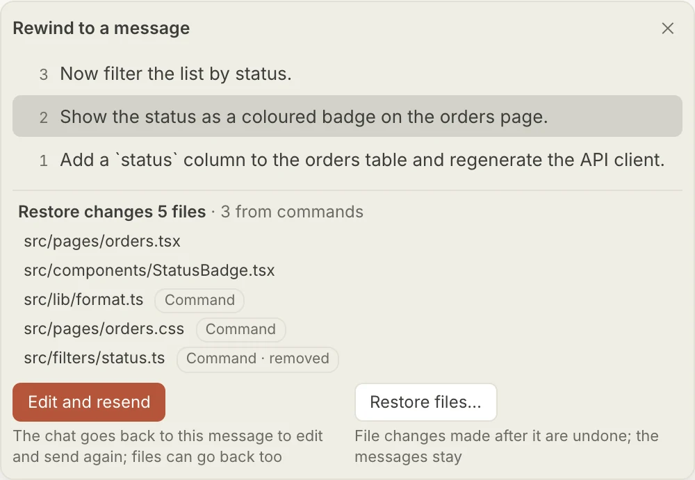

# Rewind a Chat

Go back to an earlier message: put your files back as they were, or edit the message and send it again.

Every message you send is a checkpoint. If a chat went the wrong way, rewind it to an earlier message and try
again from there.

## Open the rewind list

Do one of these:

- Press Esc twice in an empty message box while Claude isn't working.
- Type `/rewind` and send it.
- Run **Rewind This Chat…**.
- On your phone, open the chat menu and tap **Restore files…** under **Rewind to here**.

**Rewind to a message** lists your messages, newest first. Use ↑ and ↓ to pick one. Under the list, Ember shows
which files restoring to that message would change. Files a command changed (not Claude's file edits) are marked
**Command**.

  <picture>
    <source media="(prefers-color-scheme: dark)" srcset="../images/chat-rewind-preview.dark.webp">
    
  </picture>
   <em>Rewind to a message: the files a restore puts back, with those commands changed marked Command</em>

## Put your files back

1. Pick the message, then click **Restore files…**.
2. Ember lists the files that will change and asks **Discard all changes up to this checkpoint?**. Click
   **Restore**.

Your files go back to how they were before that message. A notice says **Files restored to this checkpoint. Your next
message continues from here.** Click **Redo** on it to put the files back as they were before the restore.

The message you restored to is back in the composer (unless you were typing something there), so you can change it and
send it again. When you send your next message, the conversation goes back to that point too: the turns after it
leave the chat and Claude no longer sees them. Messages before that point keep their own **Restore**. Until you
send, nothing in the conversation has changed and **Redo** still works.

Restoring to the very first message of a chat puts the files back and keeps the conversation: Claude is told the
files went back.

You can also pick **Restore files…** under **Rewind to here** in the **⋯** of any of your messages in the chat. The
same group has **Edit and resend**, so both ways back sit together, each saying what it undoes and what stays.

If background subagents, other background tasks or background commands are still running (Stop ends only the turn),
the question says so, and Ember stops them and waits until each has ended before restoring, so they can't go on
changing the restored files. If one doesn't stop, nothing is restored and the chat names it.

## What comes back

Restoring puts back both kinds of changes Claude made after that message:

- **Claude's file edits**: files it wrote or edited.
- **What commands changed**: files a command rewrote, created or deleted, such as a code generator, a formatter, a
  script or a package install. In the confirmation these are marked **(changed by a command)**.

Your own edits between Claude's turns stay as they are, unless Claude changed the same file later, and so do
changes another chat made in the same folder at the same time. Edits you make while Claude is working count as part
of that turn and are restored with it.

To do this, Ember takes a snapshot of the chat's folder at the start and end of every turn. The snapshots live in your
repository's git data. They are not commits and don't appear on any branch or in `git log`. Ember keeps them for 14
days, and at most 100 per chat.

Commands' changes come back only when:

- The chat's folder is in a git repository.
- The files aren't ignored by `.gitignore`. Ignored files (build output, `node_modules`) are never snapshotted or
  restored.
- The folder has no more than 3,000 untracked files, taking no more than 50 MB, and a snapshot takes no more than a
  few seconds. Otherwise Ember skips the snapshot, so your messages are never held up, and says so in the preview.

> **Note:** Stop the run before restoring. A message you sent into a running turn has no checkpoint of its own:
> restore at the message that started that turn. A chat forked from another can't restore checkpoints from before the
> fork. To try another approach without losing this one, fork instead: see [Fork a Chat](forks.md).

## Edit and resend from there

1. Pick the message, then click **Edit and resend** (or press Enter). A message's own **Edit** button, and **Edit and
   resend** in its **⋯**, do the same.
2. The message opens for editing. Change it and send it; the chat continues from that point.

Whether files changed after that message go back too depends on **Settings › General › Edit & resubmit**
([`ember.composer.editRevert`](../settings/settings-general.md#embercomposereditrevert)). See [Edit and resend a message](composer.md#edit-and-resend-a-message).

## Rewind or undo?

Rewinding goes back to a point in the conversation. To drop some of Claude's edits but keep the conversation, use
**Undo** instead: see [Review changes](../editing/review-changes.md).

After a restore, edits Claude made before that point and you haven't reviewed yet are still on disk, and still
show **Keep** and **Undo**.

---

[All documentation](../README.md)
