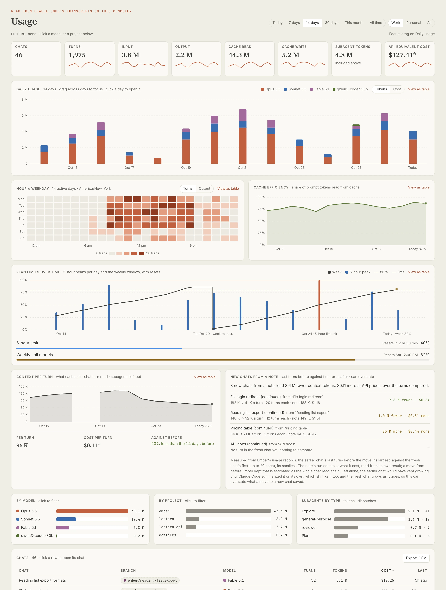
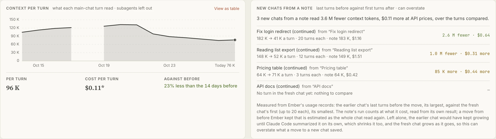
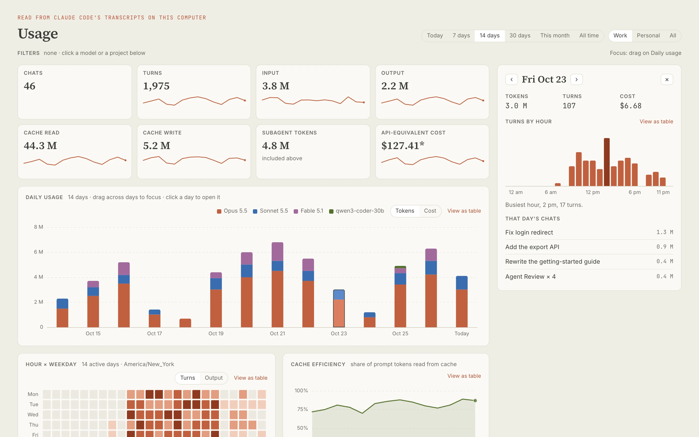
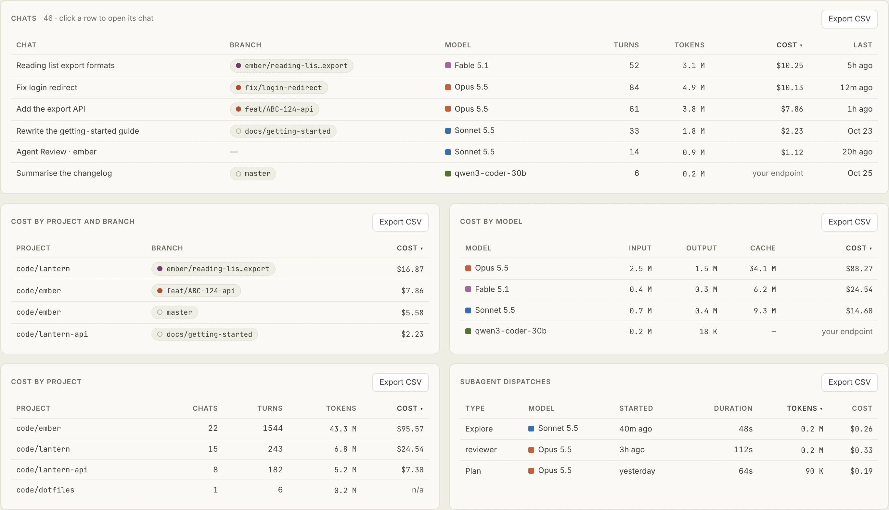

# Usage, Limits and Notifications

Know how much of your Claude plan you've used: limit warnings, the usage dashboard, limit resets, and notifications when a chat finishes or needs you.

Your Claude plan has usage limits: a 5-hour limit, a weekly limit, and weekly limits for some models. Ember tells you
when you're getting close, and shows where your usage went.

## Limit warnings

When a limit reaches 80% (or the percent you choose), a row in the chat names the limit, how full it is and when it
resets. It says so once per limit until that limit resets; after that the context ring shows how full it is. Change the
percent with [`ember.notifications.usageWarnAt`](../settings/settings-general.md#embernotificationsusagewarnat) (50–99). Reaching a limit is always shown, above the message
box, until a turn goes through.

To see your limits at any time, click the context ring beside the send button: it lists each limit with its reset
time, when the numbers were read, and ↻ to read them again. A gold dot on the ring means a limit is near its line, red
that you're at it. See [The context ring](reading-a-chat.md#the-context-ring).

With more than one Claude account, each account has its own limits: the usage bars name the chat's account, and you
choose what happens when one runs low. See [When an account runs low](../getting-started/accounts.md#when-an-account-runs-low).

A Bonfire build's to-dos are ordinary chats: each one stops at a limit and carries on like any other chat. See
[How to build a plan with Bonfire](../plans/bonfire-howto.md).

## The usage dashboard

  <picture>
    <source media="(prefers-color-scheme: dark)" srcset="../images/usage-overview.dark.webp">
    
  </picture>
   <em>Usage: the range and filters, the tiles, daily usage by model, when you work, cache efficiency, plan limits over time, what a change saved and where it went</em>

Open it with the usage button in the chat panel's title bar, or **Usage Dashboard**.
It reads your Claude Code transcripts on this computer: every chat, in Ember and in the terminal.

- **Range**: **Today**, **7 days**, **14 days**, **30 days**, **This month** or **All time**.
- **Account**: with more than one Claude account, the switch beside the range shows one account's usage (every tile,
  chart and table below match) or **All** of them added up. Ember knows which account ran a chat because it records the
  account each chat starts on; usage from before that counts under your default account, and chats you ran in the
  terminal under your main one. An account with a transcripts folder of its own is read from there too.
  **Plan limits over time** is kept for your main account only. Each window remembers its choice.
- **Filters**: click a model under **By model** or a project under **By project** to show only it; the filter shows
  as a small label with an **×**, and **Clear all** removes them. Filtered bars stay full and the others dim.
- **Focus**: drag across days on **Daily usage** to look only at them. A clay-edged band marks the days, every chart
  and table below match, and **Esc** (or **Esc clears**) goes back to the whole range.
- The tiles: sessions, turns, input, output, cache reads and writes, subagent tokens (already counted in the others)
  and the API-equivalent cost, each with its day-by-day line.
- Charts: **Daily usage** (tokens or cost per day, stacked by model), **Hour × weekday** (when you work, turns or
  output, darker or lighter as it gets busier), **Cache efficiency** (the share of prompt tokens read from cache),
  **Plan limits over time** (your 5-hour peak each day, the weekly window, the 80% line and the limit, and each weekly
  reset marked with ▲, with your plan's limits right now under it; with several accounts they're in every account's
  meters at the top instead), **By model**, **By project** and **Subagents by type** (tokens, and how many times each ran).

Each model keeps its colour in every chart, legend and tooltip: Opus clay, Sonnet blue, Fable purple and your own
endpoints green. Everything that isn't a model is grey. Every chart has **View as table**, and the arrow keys step
through its days or cells with the tooltip moving along.

### What a change saved

  <picture>
    <source media="(prefers-color-scheme: dark)" srcset="../images/usage-savings.dark.webp">
    
  </picture>
   <em>What a change saved: context per turn against the days before, and what each move to a new chat saved, measured</em>

Two panels under **Plan limits over time** show, from Ember's own usage records, whether a change paid off, so one that
doesn't can be taken back.

- **Context per turn**: how much context each turn in a main chat read (its whole prompt: new input, cache reads and
  cache writes; subagents are left out), as a line by day. Under it: the average, the average API-equivalent cost of a
  turn, and the change against the same number of days just before the range (or the focused days). With **All
  time**, or nothing in the days before, it says there's nothing to compare with rather than show a number.
- **New chats from a note**: each time a long chat continued in a new one ([Continue a long chat in a new one](reading-a-chat.md#continue-a-long-chat-in-a-new-one)) in the range,
  newest first. It compares the earlier chat's last turns before the move, its largest, with the fresh chat's
  first turns, its smallest (up to 20 each, the same number of each), as context a turn and in total. The note's run
  counts at what it cost, read from its own result: it reads the whole chat again without its cache, so a move to a new chat
  can read fewer tokens and still cost more. A move from before Ember recorded that shows the note as estimated.
  Left alone, the earlier chat would have kept growing until Claude Code summarized it on its own, which shrinks it
  too, so the panel can overstate what a move to a new chat saved; it says so under the list. A row says **more** when the
  fresh chat cost more. A fresh chat with no turn yet, or an earlier chat whose turns aren't in the records, is listed
  with nothing to compare and left out of the total. With one account shown, a move counts when either chat ran
  on it. Click a row to open the fresh chat.

A turn here is one reply from Claude, as under **Turns**. Costs are API-equivalent, like everywhere on this page.

### One day

  <picture>
    <source media="(prefers-color-scheme: dark)" srcset="../images/usage-day.dark.webp">
    
  </picture>
   <em>A day opened from Daily usage: its tokens, turns and cost, turns by hour with the busiest hour named, and that day's chats</em>

Click a day on **Daily usage** (or press Enter on it) to open it beside the charts: its tokens, turns and cost, its
turns by hour with the busiest hour named, and that day's chats. Click an Ember chat to open it. **‹** and **›** step
through the days; **×** or **Esc** closes it.

### The tables

  <picture>
    <source media="(prefers-color-scheme: dark)" srcset="../images/usage-tables.dark.webp">
    
  </picture>
   <em>The tables in one shell: sessions with their branch and model, cost by project and branch, cost by model, Export CSV on each</em>

**Sessions** (click an Ember chat to open it), **Cost by project and branch**, **Cost by model**, **Cost by project**
and **Subagent dispatches**. A branch shows with its state dot, so a merged branch's cost reads as merged. Click a
column's header to sort by it; each table has **Export CSV**. **Rescan**, at the bottom, reads new transcripts.

Costs are what the same usage would cost at API prices. Your subscription doesn't charge them; they help you compare.
Your own endpoints have no price. Set your own prices in **Settings › Usage pricing**.

## The account item in the status bar

The status bar's right end shows your Claude account and its weekly limit, **Week 84%**. With more than one account it
starts with the chat's account (**Work · Week 84%**). When the 5-hour limit is at 75% or more and nearer its limit
than the week, it shows that limit instead (**Session 93%**); at 100% it adds when the limit comes back
(**Session 100% · resets 3:40 PM**). From 75% the words turn gold, from 90% red. Until a limit is read, or without one
(on an API key or your own endpoint), it shows today's Claude Code tokens and cost. Hover it for the window and its
reset in one line.

Click it for a panel just above it: the chat's account with its plan, email and where the account came from, then its
5-hour, weekly and per-model limits, when they were read and today's tokens and cost. **↻** reads every account's
limits again. With one or two accounts, **Switch this chat to** lists the others: click one to move this chat to it
from its next message, or use its **⋯** for **Use for this window** and **Make default**. With three or more, each
account is a tab, so the panel keeps its size; a gold or red dot marks an account at 75% or 90%, and **Use for this
chat** moves the chat. **Set for this window…** and **Add an account…** are there too, and at the bottom
**Usage dashboard** opens this page and **Settings › Accounts** opens your accounts. Esc, a click outside or a second
click on the item closes it. Turn the item off with [`ember.usageDashboard.statusBar`](../settings/settings-usage.md#emberusagedashboardstatusbar).

## Limit resets

When your plan offers a usage-limit reset, the status bar shows **Reset available** (or **Reset saved**) at its far
right, and a notification announces it once, in whichever Ember window sees it first. Click it, or run **Use Usage-Limit Reset**: a terminal opens running Claude Code's `/limit-reset`, which claims it. Ember never claims a reset by itself.

## Notifications and sounds

Ember sends a system notification when a chat finishes or needs you, with **Run** and **Skip** on approvals. Click
a notification to open its chat. A chat whose background subagents still work, or whose queued messages still go, says
it's done once they have all finished.

### Written by Haiku

Claude Haiku writes each notification from the chat's own facts, so it says what happened: **PR #2983 opened**, or
**Pick what to do with the hotfix** when a turn ended on a decision only you can make. The title is the outcome or the
ask, the line under it says what the chat is about and names the project, and the body gives the detail. Your phone
gets the same words, and Ember's voice reads the note's spoken line.

- **What Haiku reads:** the chat's title, the folder's name, the start of your last message and the end of Claude's
  reply, a question and its choices, or a command and Claude's description of it. Links to pull requests become their
  numbers, other links and file paths are shortened, and keys are removed. A command's output is never sent.
- **What it may say:** only facts from the chat. Every number, `#` reference and name-like identifier in a note has to
  be in the chat, or Ember uses its own words instead.
- **Approvals:** Haiku writes the title, but the body is still the exact command, since you can tap **Run** right
  there.
- **Timing:** a notification waits up to 10 seconds for its note, then goes out in Ember's own words. If a new turn
  starts while it waits, the finished one isn't announced, and a question you answer meanwhile isn't either.
- **What it costs:** one short call per moment, on your Claude subscription, shared with the Dashboard's summary of
  the same turn. Ember makes no call once a usage limit is 95% full, for chats on your own models (they're
  never sent to Claude), for usage and account notices, or for a background command Claude described itself.

Turn it off with **Write with Haiku** ([`ember.notifications.writer`](../settings/settings-general.md#embernotificationswriter)) to get Ember's fixed wording, such as
**Done • ‹chat›**.

In **Settings › General › Notifications**:

| Setting | What it does |
|---|---|
| **System notifications** | On or off ([`ember.notifications.enabled`](../settings/settings-general.md#embernotificationsenabled)). |
| **When to notify** | Only while Ember is in the background (the default), or **Always**, also for chats in the background while you work in Ember ([`ember.notifications.when`](../settings/settings-general.md#embernotificationswhen)). A card that waits on you notifies whenever nobody is watching it, whatever this says: its chat isn't the one on screen (or the panel is hidden), Ember is in the background, or Claude started that turn by itself. |
| **Write with Haiku** | Claude Haiku writes each notification from the chat's facts; off gives Ember's fixed wording ([`ember.notifications.writer`](../settings/settings-general.md#embernotificationswriter)). |
| **Play a sound with notifications** | The Ember tone ([`ember.notifications.sound`](../settings/settings-general.md#embernotificationssound)). |
| **Custom sound** | A sound file to play instead ([`ember.notifications.soundPath`](../settings/settings-general.md#embernotificationssoundpath)). |
| **Try it** | **Send test notification** sends one now. |

> **Tip:** If the test notification doesn't appear, check that your system allows notifications from Ember (or from
> VS Code or VSCodium).

---

[All documentation](../README.md)
