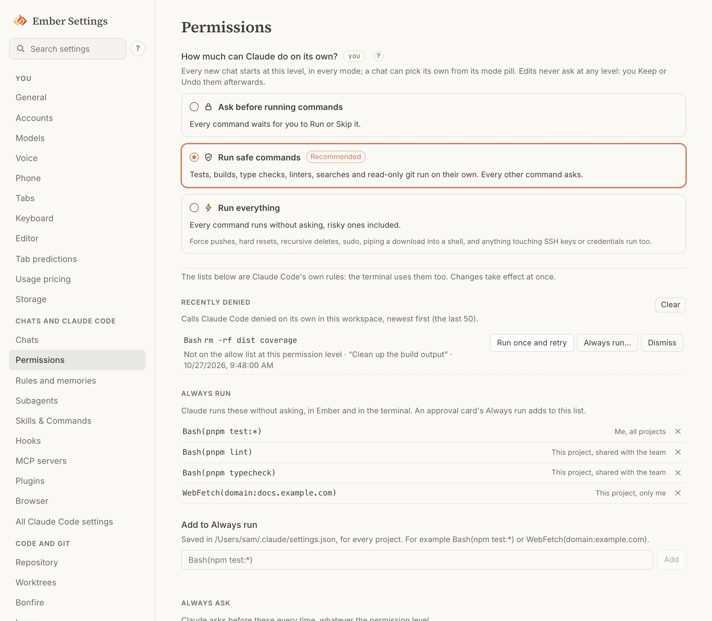

# What Ember changes, and why

How Ember's permission levels map onto Claude Code's modes, the commands that always ask, Ember's own tools for Claude, API-key removal, worktrees, memories, and the small model calls Ember makes.

Ember runs Claude Code as it is (see [What Ember honours from Claude Code](claude-code-honours.md)), and adds a few things around it so chats fit an
editor: one question about permissions instead of Claude Code's modes, its own tools for Claude, and some
housekeeping. Everything here is listed with the reason for it and, where there is one, the setting that turns it
off.

## Permission levels and Claude Code's modes

Instead of Claude Code's permission modes, Ember has three permission levels: Settings › Permissions › **How much can
Claude do on its own?** ([`ember.permissions.level`](../settings/settings-permissions.md#emberpermissionslevel)) sets the level new chats start at, and the mode button in
the message box sets it for one chat. In an Agent or Debug chat, each level runs on a Claude Code mode:

| Level | Claude Code mode | What happens |
| --- | --- | --- |
| **Ask before running commands** | Accept edits | Edits go in without asking; every command waits for **Run** or **Skip**. |
| **Run safe commands** (the default) | Accept edits | Edits go in; Ember runs safe commands where Claude Code would ask. Other commands ask. |
| **Run everything** | Bypass permissions | Everything runs, the commands below that always ask included. |

  <picture>
    <source media="(prefers-color-scheme: dark)" srcset="../images/settings-permissions.dark.webp">
    
  </picture>
   <em>Settings › Permissions: how much Claude does on its own</em>

Plan chats run in Claude Code's Plan mode and Ask chats in its default mode, but the level means the same thing there:
it decides which commands ask, and the mode decides only whether a change may happen at all (see
[The same in every mode](../chat/approvals.md#the-same-in-every-mode)).

Edits never ask at any level because you review them afterwards: every change can be kept or undone (see
[Review changes](../editing/review-changes.md)).

If a Claude Code setting turns Bypass permissions off (`disableBypassPermissionsMode`, your organization's or your
own), **Run everything** isn't offered and chats run safe commands only.

**Open Settings › Permissions**

### Safe commands

At **Run safe commands**, Ember reads each command itself and runs it without a card when every step of it only
reads, runs the project's tests, builds, type checks or linters, or reads git. Read-only queries of tools such as
`gh`, `aws`, `kubectl` or `docker` count as reading. A command Ember can't read is never treated as safe; it asks.
Because Ember reads the command itself, this works on every model, not only Claude's.

### Commands that always ask

Some commands ask at every level below **Run everything**, subagents included. Ember checks them in a hook that runs
before the tool, so a Claude Code allow rule doesn't skip it. A command asks when it:

- deletes a folder and everything in it (outside temporary folders)
- force-pushes, which can overwrite work on the remote
- deletes a branch or tag on the remote
- throws away uncommitted changes (a hard reset)
- deletes untracked files (a forced clean)
- runs as an administrator
- runs a script straight from the internet (a download piped into a shell, handed to `eval` or saved and then run)
- changes permissions or owners of a whole folder tree
- erases, partitions or writes to a disk
- touches SSH keys, AWS credentials or Claude Code's sign-in

This covers Windows's own commands and PowerShell's too (`rd /s`, `Remove-Item -Recurse` and its aliases, `Format-Volume`),
and what `cmd /c`, `powershell -Command` and `Invoke-Expression` run.

For these, the approval says why it asks and has no **Always run**: **Run** runs it once, and the everyday ones
(`rm -rf dist`, `git clean`, `ssh host command`…) offer **Allow in this chat** instead. See
[Commands that always ask](../chat/approvals.md#commands-that-always-ask).

### When a safety check fails

Ember's safety checks (this list, protected branches, the chat's mode, `.emberignore`, a Bonfire to-do's scope and what it may
push) fail closed. If one of them hits an error or doesn't answer within its time, Ember blocks the call instead of
letting it run unchecked, and the chat says which check failed and why, for example "Ember's protected branch safety
check failed (…), so Ember blocked this call". Try again; if it keeps happening, reload the window. On Claude Code
2.1.318 and later, Claude Code itself also blocks the call if a check can't answer at all.

### Claude Code's own settings still count

Your allow, ask and deny rules, extra working folders and the sandbox keep working at every level. Settings ›
Permissions shows the allow and ask rules; under **Advanced**, **Claude Code's settings** counts the other rules in
your files (deny rules among them) and opens each file, with a link to **All Claude Code settings**.

## Ember's tools for Claude

Ember gives each chat a few tools of its own (an MCP server named `ember`, built in). Tools that only read never ask.

| Tool | What it does | Asks? | Turn it off |
| --- | --- | --- | --- |
| `diagnostics`, `open_editors`, `terminal_output` | Read the Problems list, your open editors and selection, and recent terminal output. | No | **IDE tools for Claude** ([`ember.ideTools`](../settings/settings-general.md#emberidetools)) |
| `browser_snapshot`, `browser_screenshot`, `browser_console`, `browser_network`, `browser_tabs`, `browser_scroll`, `browser_hover`, `browser_resize`, `browser_get_bounding_box`, `browser_highlight` | Read and look at the page in Ember's browser. | No | **Browser for Claude** ([`ember.browser.tools`](../settings/settings-browser.md#emberbrowsertools)) |
| `browser_baseline`, `browser_compare`, `browser_record` | Visual checks: save a baseline screenshot (in `.ember/visual`), compare with it, record an animation ([Visual checks](../connect/visual-checks.md)). | No — recording a click or key press asks like a click | Same switch |
| `browser_navigate`, `browser_back`, `browser_tab`, `browser_click`, `browser_type`, `browser_fill`, `browser_select_option`, `browser_press_key`, `browser_drag`, `browser_mouse_click_xy`, `browser_evaluate`, `browser_cdp` | Open pages and act on them in Ember's browser. Ask and Plan chats can navigate but not act. | Yes, or your permission rules decide | Same switch |
| `codebase_search` | Search the folder's codebase index by meaning. | No | **Codebase search for Claude** in Settings › Indexing ([`ember.index.tool`](../settings/settings-indexing.md#emberindextool)) |
| `search_conversations` | Search your earlier chats in this project. Not for subagents. | No | **Search past conversations** ([`ember.searchConversations.tool`](../settings/settings-general.md#embersearchconversationstool)). Chats on your own models get it only with [`ember.searchConversations.ownModels`](../settings/settings-general.md#embersearchconversationsownmodels). |
| `agent_blame` | Tell which Ember chat wrote lines of a file. | No | [`ember.blame.tool`](../settings/settings-editor.md#emberblametool) |
| `ember_help` | Search these help pages. | No | [`ember.help.tool`](../settings/settings-other.md#emberhelptool) |
| `canvas_open` | Open one of this workspace's canvases beside the chat again ([Canvases](../connect/canvases.md)). | No | [`ember.canvas.enabled`](../settings/settings-browser.md#embercanvasenabled) |
| `propose_mode` | Suggest switching the chat to another mode; you decide. Not for subagents. | No | **Mode suggestions** in Settings › Editor ([`ember.modeProposals`](../settings/settings-editor.md#embermodeproposals)) |
| `debug_logs` | Read a Debug chat's runtime log. | No | — |
| `subagent_progress` | See what the chat's subagents are doing: their time, tool calls, last steps, latest text, and whether one looks stalled. | No | — |
| `report_done` | A Bonfire to-do's chat hands its work over for review. | No | Only in Bonfire to-do chats |
| `bonfire_status`, `bonfire_escalate` | The chat that started a Bonfire run reads the run, or leaves a to-do's question for you. | No | Only while that chat's run is live |
| `bonfire_answer`, `bonfire_carry_on`, `bonfire_message`, `bonfire_open_pr` | That chat answers, sends to or finishes the run when you ask it to. | Yes | Only while that chat's run is live |

Except where the table says, these switches are in Settings › General › **What Claude can use** and take effect in new
chats.

**Open Settings › General**

### Other things a chat gets

- A few lines added to Claude Code's system prompt: that it runs inside Ember, how to run commands that might hang,
  and how to use the tools above.
- File checkpoints, which **Restore files…** uses (see [Rewind a Chat](../chat/rewind.md)).
- Two read-only subagents, `ember-reviewer` and `ember-security-reviewer`, which Ember's `/review` and
  `/review-security` use.
- With **How Claude works with files** set to Ember's way ([`ember.chat.fileWork`](../settings/settings-general.md#emberchatfilework)), Claude is asked to use
  its file tools, shell commands that only edit files go to those tools, shell reads run and show as Read cards, and
  other shell changes become cards you can review and undo. Claude Code's way leaves the shell as it is.

## Your subscription, not an API key

Ember removes `ANTHROPIC_API_KEY` and `ANTHROPIC_AUTH_TOKEN` from the environment of every `claude` it starts:
chats, sign-in and the small calls below. If either reached Claude Code, it would bill per token to that key
instead of using your Claude subscription. The chat says once when Ember removed one. See
[Why Ember removes API keys](../getting-started/sign-in.md#why-ember-removes-api-keys).

Variables that send requests to another provider (`CLAUDE_CODE_USE_BEDROCK`, `CLAUDE_CODE_USE_VERTEX`,
`CLAUDE_CODE_USE_FOUNDRY`, or an `ANTHROPIC_BASE_URL` that isn't Anthropic's) are left alone, with a warning in the
chat while one is set.

Ember also starts `claude` with:

- Claude Code's to-do tools turned on, which Ember's to-do list and plan sync need.
- Claude Code's error reports and chat surveys off, unless you set those variables yourself. Settings › Accounts
  & Privacy › **Privacy** shows these switches.

## Worktrees for chats

Claude uses Claude Code's own `EnterWorktree` and `ExitWorktree` tools in Ember's chats, as it does in the
terminal. When Claude moves into a worktree (or out of one), the chat moves with it: Ember notes which worktree and
branch the chat works on, and its window, Source Control and review move with it. See [Worktrees](../worktrees/worktrees.md).

## Memories become Claude Code memory

A memory you add in Ember is saved in Claude Code's own memory, so the terminal loads it too:

- **For me, in every project**: a line in `ember-memories.md` in the `rules` folder of your Claude Code folder, loaded like any
  other rule file.
- **For this project**: Claude Code's auto memory, or `CLAUDE.local.md` when auto memory is off.

Memories older versions of Ember kept in their own storage go to new chats as always-on rules while
[`ember.memories.enabled`](../settings/settings-memories.md#embermemoriesenabled) is on, until you move them. See [Memory](../knowledge/memory.md).

## Small model calls on your plan

Ember makes two kinds of small model calls of its own, both on your Claude subscription:

- **Auto titles**: after a chat's first reply, one short call without tools names the chat. Renamed chats are never
  changed. Turn it off in Settings › General › **Auto titles** ([`ember.autoTitles`](../settings/settings-general.md#emberautotitles)); choose the model in
  Settings › Models › **Chat titles** ([`ember.autoTitleModel`](../settings/settings-models.md#emberautotitlemodel), Haiku by default).
- **Suggest my next message**: after each reply, Claude's guess at your next message waits in the empty message
  box; Tab uses it. It reuses the chat's prompt cache, so it costs almost nothing. Turn it off in Settings › General
  › **Sending messages** ([`ember.promptSuggestions`](../settings/settings-general.md#emberpromptsuggestions)); it's saved in Claude Code's settings too, so the
  terminal uses it too. Bonfire's to-do chats never ask for one.

---

[All documentation](../README.md)
