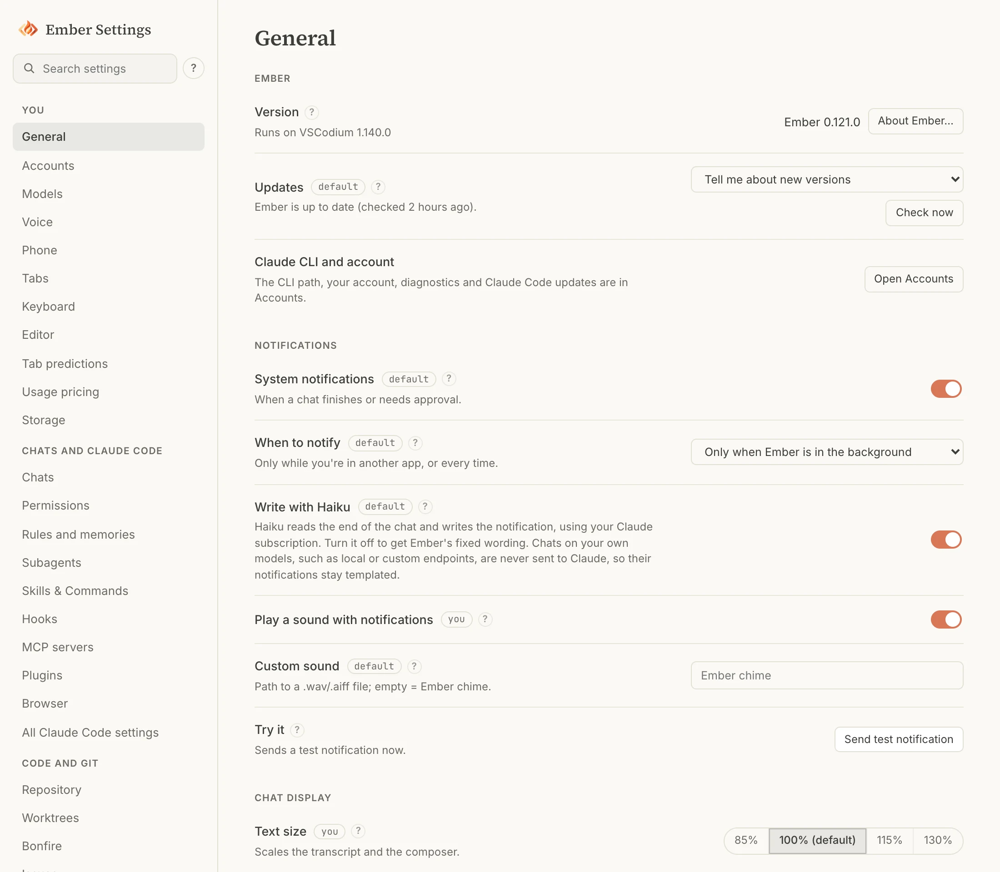

# Where Ember writes, and using the CLI alongside

Which files Ember writes for Claude Code, what goes in a project's .ember folder, what Ember keeps in its own storage, and how chats move between Ember and the claude CLI.

Ember keeps what belongs to Claude Code in Claude Code's own files, so the terminal sees the same thing. What only
Ember uses stays in Ember's own storage.

## What Ember writes to Claude Code's files

When you change a Claude Code setting in Ember, it goes into one of Claude Code's settings files. Rows that write
one let you pick the file: "Me, all projects" (`~/.claude/settings.json`), "This project, shared with the team"
(`.claude/settings.json`) or "This project, only me" (`.claude/settings.local.json`).

| What | Where it goes |
| --- | --- |
| An approval card's **Always run** | An allow rule in the file [`ember.permissions.alwaysAllowScope`](../settings/settings-permissions.md#emberpermissionsalwaysallowscope) picks: all projects (the default), this project shared, or this project just for you. |
| Rules added in Settings › Permissions | **Always run** and **Always ask** add to `~/.claude/settings.json`. |
| Memories for all projects | `ember-memories.md` in the `rules` folder of your Claude Code folder. |
| Memories for this project | Claude Code's auto memory, or `CLAUDE.local.md` when auto memory is off. |
| Skills, subagents and output styles you create | Your Claude Code folder (all projects) or the project's `.claude` folder. |
| MCP servers you add | `~/.claude.json` (just for you, in all projects or only this one), or the project's `.mcp.json` (shared). |
| Hooks, the status line, skill visibility, environment variables and other settings | The settings file you pick on the row. |

Your organization's managed settings are read, never written.

## Where a value comes from

  <picture>
    <source media="(prefers-color-scheme: dark)" srcset="../images/settings-general.dark.webp">
    
  </picture>
   <em>Settings › General</em>

Every value in Settings carries a small tag saying where it comes from:

- `default`: nothing sets it, so Ember's (or Claude Code's) default is used.
- `you`: your own editor settings, for every folder. Ember's switches always save there.
- `this workspace` or `this folder`: the open workspace's or folder's `.vscode/settings.json` sets it, and that wins
  over yours. Change it there, or remove it there to have yours used.
- A Claude Code file, such as `Now from: Me, all projects · settings.json`: which settings file the value in effect
  comes from. Hover over it for the full path.
- `Set by your organization`: a managed settings file decides it, so the row is locked.

Settings › Repository tags each value with the repository's file, GitHub, git, its hooks or `default` (see
[Repository policy](../worktrees/worktrees.md#repository-policy)).

See [Where Always run saves](../chat/approvals.md#where-always-run-saves) and [Memory](../knowledge/memory.md).

## A project's .ember folder

The `.ember` folder in a project holds Ember files you choose to keep with the repository:

- `.ember/worktrees.json`: the setup commands for new worktrees (see [Worktrees](../worktrees/worktrees.md)).
- `.ember/plans/`: plans you move into the project with **Save to Workspace** in the plan editor's menu, and new
  plans when `~/.ember/plans` can't be written.

One other project file belongs to Ember: `.emberignore` at the project root keeps files away from Claude (see
[.emberignore](../privacy/privacy-storage.md#emberignore)). Ember's new worktrees live outside the project, under `~/.ember/worktrees`
([`ember.worktrees.root`](../settings/settings-worktrees.md#emberworktreesroot)); ones made before that stay in the repository's `.claude/worktrees` folder.

## Your plans folder

Ember keeps your plans in `~/.ember/plans`, one `.plan.md` file each, the way the app's own folder `~/.ember` also
holds its settings and extensions. Plans Ember kept in its storage before move there the first time a newer Ember
starts. Claude Code's `plansDirectory` setting puts new plans somewhere else.

## Ember's own storage

Everything else Ember keeps is in the editor's storage folder for the Ember extension. Settings › **Storage** shows
where the database is, and how big it is. It holds:

- **The database** (`ember.db`): chats' titles and settings, plans, usage, review snapshots, dismissed review findings, worktrees, which chat
  wrote each line, and the rest of Ember's records.
- **Codebase indexes** (`index/`) and their vectors.
- **Ember Help's search vectors** (`help/`).
- **Canvases**, **docs** you added, Ember's headless browser profile, Debug chats' logs, Bonfire runs, and
  downloaded updates.

Chat transcripts aren't in Ember's storage: Claude Code keeps them in its own folder. Ember's storage belongs to
this Ember alone, so Ember.app and Ember's extensions in VS Code keep separate copies. See
[Storage settings](../privacy/privacy-storage.md#storage-settings).

**Open Settings › Storage**

## Claude Code's folder

Settings › Accounts › **Advanced** › **Claude Code config folder** shows where Claude Code keeps its
settings, memory and sessions (`~/.claude` unless you moved it). To move it, set `CLAUDE_CONFIG_DIR` in the
environment you start Ember and the terminal from; a settings file can't change it. Ember uses it too: memories,
rules and settings rows use the folder it names.

## Environment variables

Settings › Accounts › **Advanced** › **Environment variables** edits Claude Code's `env` setting: variables
every chat and the terminal start with.

1. Under **Save environment variables to**, pick the settings file. The list shows that file's variables.
2. Type a **NAME** and a **value** and click **Add**, or edit and remove the ones listed.
3. To add several at once, open **Paste variables**, paste `NAME=value` lines and click **Add**.

API keys, tokens, a base URL, a model override and cloud-provider switches are refused, with the reason: they would
move Claude Code off your subscription. A variable that has its own row elsewhere in Settings links there instead.
Variables your organization sets are listed under the grid.

**Open Settings › Accounts**

## Model training

Whether Anthropic may use your chats to train its models is a setting on your Anthropic account, not in Ember or on
this computer, and Ember never changes it. Settings › Accounts › **Privacy** › **Help improve Claude (model
training)** has two ways to it: **Change in Claude Code** runs Claude Code's `/privacy-settings` in a terminal, and
**Open claude.ai privacy settings** opens the page on claude.ai. Ember doesn't read the setting, so the row shows no
value.

## Using the claude CLI alongside Ember

Ember's chats are ordinary Claude Code sessions, stored where the `claude` CLI stores its own. So you can switch
between them:

- **From the terminal to Ember**: a session you started with `claude` in the same folder appears in Ember's chat
  list with a **CLI** tag (**Desktop** when it ran in the Claude desktop app). Open it and send a message to carry on in
  Ember.
- **From Ember to the terminal**: Ember's chats are in Claude Code's own session list for that folder, so the CLI's
  resume picker lists them.

Both read the same `CLAUDE.md`, rules, memory, skills, hooks, MCP servers, plugins and permission rules, and an
**Always run** saved in Ember counts in the terminal. Chat titles, pins and what Ember shows around a chat (review,
blame, plans) stay in Ember's own storage.

> **Note:** A chat Claude moved into a worktree keeps its transcript in the folder where it started; Ember still
> finds it there.

---

[All documentation](../README.md)
