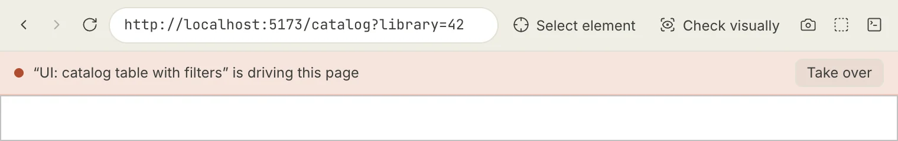

# Ember's browser

A browser you and Claude share: open pages, add an element to a chat, let Claude read and test pages, and manage the sites it's signed in to.

Ember has a browser that you and Claude share. You can open your app in it, point at an element and add it to a chat, and let Claude read pages, take screenshots, check the console and click through a flow while you watch.

**Open Browser**

## Engines

Settings › Browser › **Engine** ([`ember.browser.engine`](../settings/settings-browser.md#emberbrowserengine)) picks what the browser runs on:

| Engine | What it is |
| --- | --- |
| **Built-in browser tab** | The editor's own browser tab, when the editor has one: a real browser you sign in to once and share with Claude. Claude works in the tab you're looking at. |
| **Headless Chrome** | Ember's own headless Chromium on a separate profile — never your everyday browser's. You see it in Ember's **Browser** tab. |
| **Automatic** | The built-in tab when this editor has one, otherwise headless Chrome. The default. |

With the built-in tab, **Sign in as Chrome** ([`ember.browser.userAgent`](../settings/settings-browser.md#emberbrowseruseragent)) makes pages see a plain Chrome user agent instead of the editor's name, so Google, Microsoft and other sign-ins work.

With headless Chrome, **Browser** ([`ember.browser.path`](../settings/settings-browser.md#emberbrowserpath)) picks the Chromium-based browser it runs. Empty finds Google Chrome, Chromium, Microsoft Edge or Brave, whichever is installed.

## Open a page

- Click **Open Browser** in the chat panel's title bar.
- Right-click an `.html` or `.svg` file in the Explorer and choose **Open in Ember Browser**.

Ember's **Browser** tab has **Back**, **Forward**, **Reload** and an address bar. When Claude has resized the page to test a layout, the bar shows the size, with **Reset**.

## Add an element to a chat

1. In Ember's **Browser** tab, click **⌖ Select element**. In the editor's built-in browser tab, use **Add Element to Ember Chat** in the tab's title bar.
2. Click the element on the page.

The chat receives the element's tag, id, classes, HTML, text and where it sits in the page, so you can ask Claude about it or to change it.

## Send a screenshot, an area or a console line

In Ember's **Browser** tab:

- **Screenshot** (the camera) adds what the page shows to the chat's message box as an image.
- **Capture area** (the dashed square): drag out a rectangle on the page and it goes to the chat as an image. Press
  **Escape** to stop. Your drag never reaches the page.
- **Console** (the terminal button, with the number of errors) opens the page's console under the page. Point at a line
  and click **Add to chat**: the chat gets a tile with the message, its level, the file and line it came from, and a
  short stack. **Clear** empties the list.

In the editor's built-in browser tab, use **Add Screenshot to Ember Chat** and **Add Console Line to Ember Chat** in the
tab's title bar. They work in the tab Claude's browser tools act in. Capturing an area needs Ember's Browser tab.

Screenshots are taken at the page's own size and scaled so the long side is at most 2,000 pixels, like any image you
attach. They're only a look: nothing scrolls or resizes, so they work while Claude drives the page or while you have
taken over. A screenshot shows the page as it's drawn: password fields show as dots, but anything else on screen, a
card number in a plain field included, is in the picture.

A console line's tile shows your home folder as `~` and leaves out values that look like keys or tokens.

## Mention a browser page

Type `@`, choose **Browser** and pick a page. The tile says **page text**: Claude gets the page's address, its title
and its outline (the first 8,000 characters or so), read when you send. Under each page, **Screenshot** sends a screenshot instead, also taken when you
send. With the built-in tab, every open tab is listed, but Ember reads only the tab Claude's browser tools act in: for the
others Claude gets the address and title, and a screenshot needs that tab in front. If the page has moved to another
address by the time the message goes (it waited in the queue, say), nothing is read: Claude is told the page changed, and
you mention it again. The outline leaves out what's typed in fields Ember recognizes as passwords, one-time codes or card
numbers and codes, by their type, autocomplete, name or label.

Console lines and pages you add stay with the message: they go along when it waits in the queue, and **Edit and
resend** sends them again as they were.

## What Claude can do in the browser

With **Let Claude use the browser** on ([`ember.browser.tools`](../settings/settings-browser.md#emberbrowsertools); the same switch is **Browser for Claude** in Settings › General), new chats get Ember's browser tools: open pages, read the page's outline, take screenshots, read the console and network requests, resize the viewport, work with tabs, click, type, press keys, fill forms, drag, and run JavaScript or DevTools commands. Claude also checks UI changes visually — baselines, comparisons and recordings of animations — see [Visual checks](visual-checks.md); **◎ Check visually** in the Browser tab asks for one.

Claude reads long pages whole: when a page's outline is longer than about 12,000 characters, Claude gets the first part and Ember writes the whole outline to a file in its temp folder for that chat, which Claude reads on from without asking you. Each chat keeps its five newest outline files; they go when you delete the chat, and a day after a restart. Screenshots show the visible part of the page, one element, or the whole page; a very long page is cut at 4,000 pixels and scaled down, and Claude is told so.

### When Claude drives the page

In Ember's **Browser** tab, while a chat acts in the page, a clay band under the address bar names that chat. Click **Take over** to pause its
clicks, typing and navigation: Claude can still read the page, and it waits until you click **Give back**.

The editor's built-in browser tab is the editor's own page, so Ember can't put a band on it. There the status bar says
the same thing: "“Orders UI” is driving the browser · Take over" while a chat drives it, and "You have the browser ·
“Orders UI” waits · Give back" once you have taken it over. Click it to take over or give back. It shows with Ember's
Browser tab too.

  <picture>
    <source media="(prefers-color-scheme: dark)" srcset="../images/browser-driving.dark.webp">
    
  </picture>
   <em>Ember's Browser tab while a chat drives the page: the band names the chat, with Take over</em>

### What asks first

- **Never ask:** reading the page, screenshots, the console, network requests, scrolling, hovering, resizing, listing tabs and visual checks (baselines, comparing, recording while hovering or scrolling).
- **Ask first:** navigating, going back, switching or opening tabs, clicking, typing, pressing keys, choosing options, filling fields, dragging, clicking at a point and recording a click or key press — unless a permission rule allows them.
- **Always ask:** running JavaScript in the page and DevTools commands on a real site. You can allow them for the session at most.
  On your own page (a server on this machine, such as `localhost`, or a file in the chat's folder) they run without
  asking at **Run safe commands** and **Run everything**, judged on the page open when Claude asks.
- Ask and Plan chats can navigate but never act on a page.

**Ask before navigating, clicking and typing** in Settings › Browser offers **Always allow in this project**: after you confirm, it writes allow rules for the browser actions to this project's local Claude settings. To manage rules yourself, open Settings › Permissions — see [Approvals and Permissions](../chat/approvals.md).

### When a page needs you to sign in

If Claude reaches a sign-in page, the browser shows **Sign in here — Claude's browser keeps this sign-in.** Sign in yourself. When Claude asked you to, click **Done — tell Claude** so it carries on.

> **Careful:** Claude is told never to type passwords or secrets for you. Sign in yourself.

## Signed-in sites

Settings › Browser › **Signed-in sites** lists the sites Ember's browser holds cookies for. Only their names are read — cookie values never leave the browser.

1. Click **Show signed-in sites**. With headless Chrome this starts the browser if it isn't running.
2. Click **Sign out** next to a site, or **Sign out of everything**.

Under **Profile** (headless) or **Storage** (built-in tab):

- **Open Browser** opens the browser so you can sign in to sites there.
- **Reset browser profile** (headless) or **Clear browser storage** (built-in tab) wipes every sign-in. The row shows where that profile or storage lives.

**Open Settings › Browser**

---

[All documentation](../README.md)
