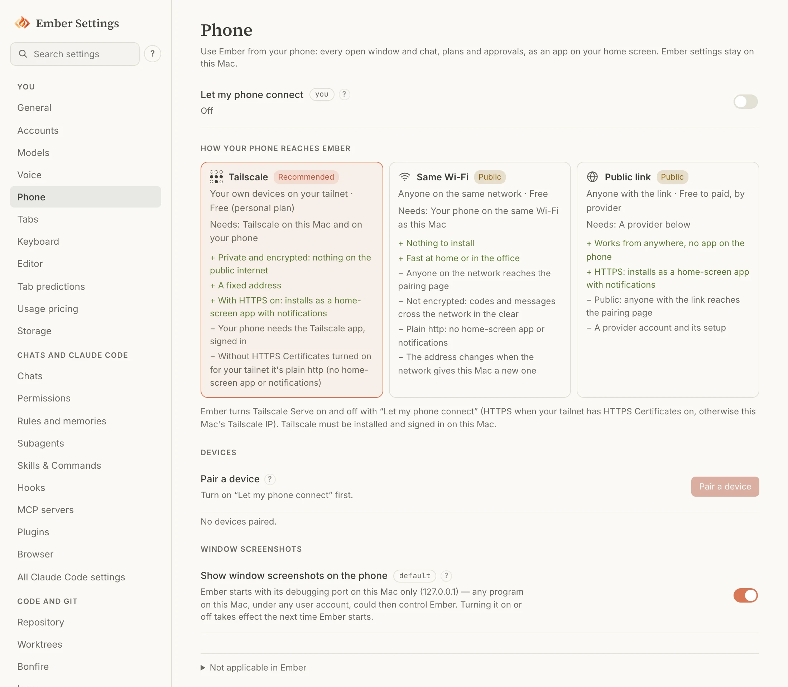
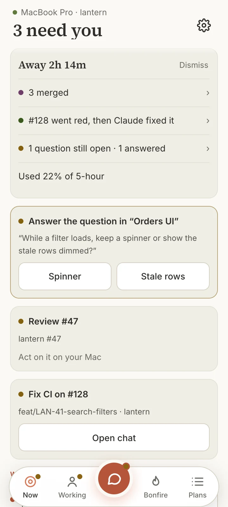
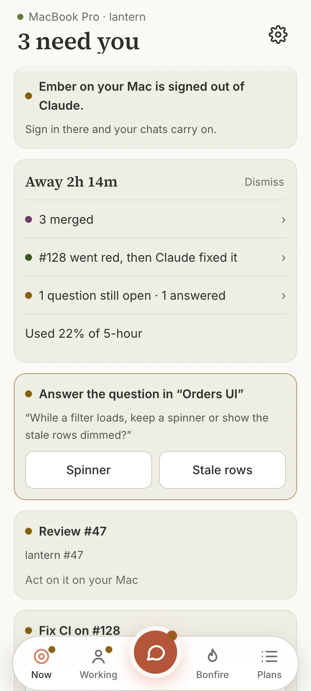
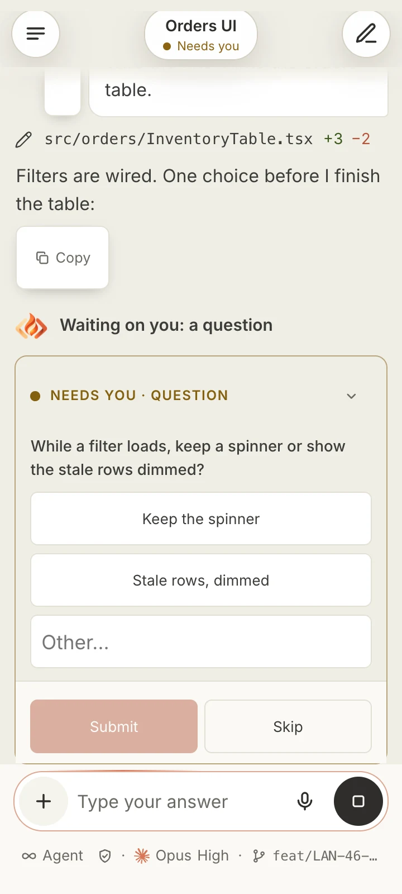
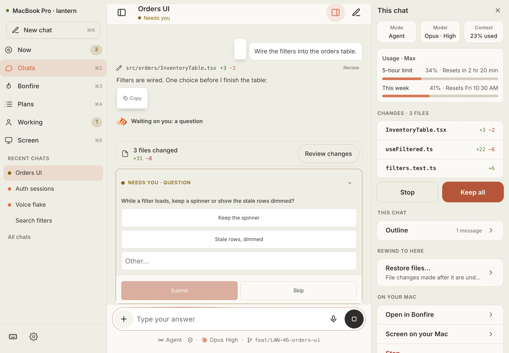
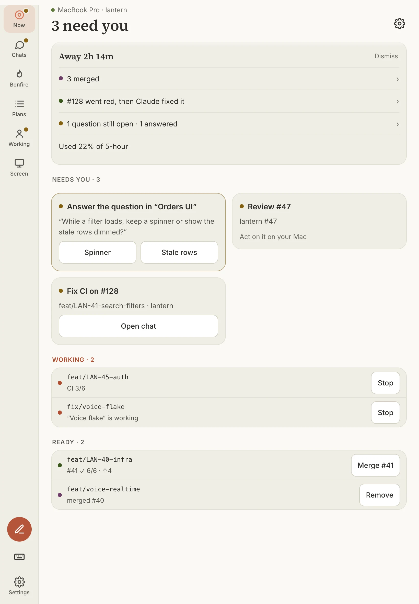

# Ember on your phone

Watch and guide your chats from your phone: turn on Settings › Phone, choose how the phone reaches Ember, and pair it with a one-time code.

Ember's remote puts every open window and chat on your phone — plans, agents and approvals included — as an app on your home screen. Ember's settings stay on this computer. The remote is off until you turn it on.

  <picture>
    <source media="(prefers-color-scheme: dark)" srcset="../images/settings-remote.dark.webp">
    
  </picture>
   <em>Settings › Phone</em>

## Turn it on

1. Open Settings › Phone.
2. Choose how your phone reaches Ember (below).
3. Turn on **Let my phone connect**. The row then shows whether a phone is connected, and **Address** shows where to open Ember on the phone.

**Open Settings › Phone**

## How your phone reaches Ember

The remote listens on this computer only (127.0.0.1, port [`ember.remote.port`](../settings/settings-remote.md#emberremoteport)). Pick a way in under **How your phone reaches Ember** ([`ember.remote.access`](../settings/settings-remote.md#emberremoteaccess)); each card lists its pros and cons.

| Way in | Who can reach it | Good to know |
| --- | --- | --- |
| **Tailscale** (recommended) | Your own devices on your tailnet | Private and encrypted, with a fixed address. Needs Tailscale signed in on this computer and on your phone. Ember turns Tailscale Serve on and off with **Let my phone connect**. Without HTTPS Certificates turned on for your tailnet, it's plain http. |
| **Same Wi-Fi** | Anyone on the same network | Nothing to install, but not encrypted, and the address changes when the network gives this computer a new one. Use it only on networks you trust. |
| **Public link** | Anyone with the link | Works from anywhere over HTTPS, with no app on the phone. Needs a provider account. |

Over plain http the phone can't install Ember as a home-screen app or show notifications. Over HTTPS, open the address and use your browser's **Add to Home Screen**.

> **Careful:** **Same Wi-Fi** and **Public link** put Ember's pairing page where others can reach it. Only a 6-digit code that lasts 5 minutes, and then your device's own token, let anyone in.

### Public link providers

Choose a provider under the cards ([`ember.remote.publicProvider`](../settings/settings-remote.md#emberremotepublicprovider)).

#### ngrok

Needs the ngrok CLI, your authtoken and your free static domain. Quick to set up; the free plan shows a warning page before the first page load.

- **Static domain** — from the ngrok dashboard's Domains page ([`ember.remote.ngrokDomain`](../settings/settings-remote.md#emberremotengrokdomain)).
- **Authtoken** — from the ngrok dashboard. It's kept in secret storage, not in your settings.

#### Cloudflare

Needs `cloudflared`, a named tunnel and its token, and a hostname — so a domain whose DNS is on Cloudflare. Your own hostname, no warning page.

- **Hostname** — the public hostname you routed to the tunnel ([`ember.remote.cloudflareHostname`](../settings/settings-remote.md#emberremotecloudflarehostname)).
- **Tunnel token** — the tunnel's token from Cloudflare. Kept in secret storage.

#### Your own URL

Your own reverse proxy or paid tunnel. Enter its HTTPS **Address** ([`ember.remote.customUrl`](../settings/settings-remote.md#emberremotecustomurl)) and forward it to `http://127.0.0.1` on the remote's port. You run and secure it; Ember can't start or stop it.

## Pair your phone

1. With **Let my phone connect** on, click **Pair a device** under **Devices**.
2. Scan the QR code with your phone's camera, or open the address on the phone and enter the 6-digit code. The code expires after 5 minutes.
3. When the phone is paired, Ember shows a new code for the next device.

Each paired device is listed with when it was paired and last seen. **Revoke** stops it from connecting.

After an update, reload every Ember window. Windows from different versions can't share the remote: Settings says **Can't
join** in the new one, and a device you revoke there stays connected until the old window reloads.

> **Note:** The QR code shows only once your phone can reach the address. If the address is this computer's own (127.0.0.1), choose a way in first.

## What needs you

The app opens on **Now**: how many things need you, in every Ember window, as a card each, in the
Dashboard's order. These are the Dashboard's own numbers (see [Outside the Dashboard](../worktrees/dashboard.md#outside-the-dashboard)). Each card has one big
button: the branch's next step, or **Open chat** when its chat is in the window your phone shows. A card the phone can't
act on (its chat is in another window) says to act on it on your Mac. Under the cards come
the branches working now (with **Stop**) and the ones ready to go on. The app's icon badge is the same count.

  <picture>
    <source media="(prefers-color-scheme: dark)" srcset="../images/phone-now.dark.webp">
    
  </picture>
   <em>Now on your phone: what needs you, ranked, each with one big button or a question's choices — then what works and what is ready</em>

If Ember on your computer is signed out of Claude, Now says so and chats stay readable. Sign in on the computer and your
chats carry on: there's no sign-in on the phone.

  <picture>
    <source media="(prefers-color-scheme: dark)" srcset="../images/phone-signed-out.dark.webp">
    
  </picture>
   <em>Signed out on your computer: Now says so and where to sign in, with no button that can't work</em>

The tab bar, centred at the bottom, has **Now**, **Working** (every chat at work, with how many, and approvals you can
answer on its rows; an amber dot when one asks), **Chats** (the raised button in the middle; hold it for a new chat),
**Bonfire** and **Plans**. Screen is in the menu inside a chat.

**Chats** lays out the window's chats as your computer's chat list does, by its **Group by**: **Pinned** first,
then each group under its heading. With Group by Branch, each worktree is a card with its branch and its pull request,
in the same colours as on your computer: yellow while checks run, green when ready, purple once merged, red on a
problem. Tap another worktree's chat and it opens in that worktree's window on your computer. **Archived** at the end
opens your archived chats, each with **Unarchive** and **Delete…** (Ember asks on your phone before it deletes).

In a chat, nothing waits for a hover: the latest reply shows **Copy** and your last message its **⋯**; tap any other
message to show its own. The to-do strip's plan button opens the plan the chat builds on the phone's Plan screen, and
the chat menu's **Hide to-dos** / **Show to-dos** hides the strip and brings it back.

In a chat, the stop button and the menu's **Stop** end only the running turn: background subagents, monitors and
commands keep going, as on your computer. The chat menu's **Stop all** (shown while any of them runs) ends the turn and
all of them, including tasks the phone can't stop one by one. See [Stop and Stop all](../chat/reading-a-chat.md#stop-and-stop-all).

The chat menu also has **Branch off**: **Fork** and **New Side Chat** open the new chat on the phone, and **Continue in
a new chat** links this chat to the one it starts. **Rewind to here** has **Restore files…**: pick one of your messages
and Ember asks before your files go back. Fork to Worktree and Edit and resend are on your computer.

### Act from the phone

Each button is the branch's one next step, as the Dashboard shows it ([The Ember Dashboard](../worktrees/dashboard.md)):

| Button | What it does |
| --- | --- |
| **Answer** | Opens the chat that asks, on your phone (only a chat of the window your phone shows). |
| A question's choices | When the chat asks one question with two to four short choices, the card shows the question and a button for each choice instead of **Answer**. Tap one to answer, as you would in the chat. To answer in your own words, or a question with several parts, open the chat. |
| **Merge #N** | Merges the branch's pull request with the repository's merge method, as the Dashboard's button does. Ember reads the pull request again first, and asks once, on your phone, before it merges. |
| **Open PR** | Pushes the branch and opens its pull request, as the Dashboard does. |
| **Remove worktree** / **Delete branch** | Removes a merged branch's worktree (the branch stays), or deletes a merged branch checked out nowhere. Ember asks on your phone first. |
| **Continue** | Carries on a chat that failed or was interrupted, on your Mac (only a chat of the window your phone shows). |
| **Stop** | Stops the chat working on the branch, in whichever window it runs. |

Ember checks each tap against the branch as it is right now: if the branch changed since your phone last showed it,
nothing happens and the phone says so. A choice counts only for the question the chat asks now: if that question was
answered already, or the chat moved on, the card says so and nothing is sent. Everything else a branch row offers
(tabs, Pause, Close PR, Check out) stays on your computer.

### A chat on the phone

A chat on the phone is its transcript, condensed: each edit is one line (open its diff from **Review changes**), and a
question's choices and an approval's answers are full-width buttons. Send stays in the composer's bottom-right corner.

  <picture>
    <source media="(prefers-color-scheme: dark)" srcset="../images/phone-chat.dark.webp">
    
  </picture>
   <em>A chat on your phone: the transcript, condensed — a question's choices are full-width buttons, and send stays in the composer's corner</em>

## On an iPad

Open the same address on an iPad and add it to the Home Screen, as on a phone. The window's width picks the layout, not
the device or which way you hold it:

| Window width | Layout |
| --- | --- |
| Under 700 points (Slide Over, a narrow Split View or Stage Manager window) | The phone layout, as above. |
| 700 to 1,099 points (portrait) | A column of icons down the left, and the page beside it. |
| 1,100 points and wider (landscape) | A sidebar with the sections, New chat and your recent chats, and the page beside it. |

Drag a Split View divider or rotate the iPad and the layout changes with it; whatever you had open stays open.

  <picture>
    <source media="(prefers-color-scheme: dark)" srcset="../images/phone-ipad-landscape.dark.webp">
    
  </picture>
   <em>Ember on an iPad in landscape: the sidebar, the chat with its header, and the inspector beside it once the list is hidden</em>

- **Lists beside what you open.** Chats, Bonfire, Plans, Working and Settings keep their list on the left and show what
  you tap beside it. In a portrait window narrower than 960 points, what you open fills the window with **Back**, and
  the list slides over it from the list button. Hide or show the list with the list button in the chat's header or
  `⌘\`.
- **The chat's header.** The list button (or **Back**), the chat's title and status (tap it for the chat menu), the
  inspector button and New chat. The branch and Stop are where you type: on the message box, as on the phone.
- **The inspector.** The inspector button keeps the chat menu open beside the chat: the mode, model and context, your
  usage, the chat's changes with **Keep all** and **Undo all**, its tools and what you can do on your Mac. It sits beside
  the chat when the chat has 900 points; narrower, it slides over from the right. Hide the list to make room for it.
  Ember remembers it, and the list hidden, on this iPad.
- **Diffs.** In landscape a file's diff opens beside the chat, where the list and the inspector were; the list and
  inspector buttons close it and bring them back. In portrait it shows where the chat was until you close it.
- **Sheets.** What slides up from the bottom on a phone opens as a sheet in the middle of the window; a narrow portrait
  opens a Bonfire to-do the same way, over the run.
- **A trackpad or mouse.** Rows and buttons light up under the pointer.

  <picture>
    <source media="(prefers-color-scheme: dark)" srcset="../images/phone-ipad-portrait.dark.webp">
    
  </picture>
   <em>Ember on an iPad in portrait: a column of icons down the side and Now across the window</em>

### Keyboard shortcuts

With a keyboard attached, the iPad layout has these shortcuts. The keyboard button at the foot of the sidebar or the column of icons,
or `⌘/`, lists them.

| Shortcut | What it does |
| --- | --- |
| `⌘1` … `⌘6` | Now, Chats, Bonfire, Plans, Working, Screen |
| `⌘N` | New chat |
| `⌘K` | Find a chat |
| `⌘↩` · `↩` | Send · new line, in the composer |
| `⌘.` | Stop the turn |
| `⌘\` | Show or hide the list |
| `⌘I` | The inspector |
| `⌘[` | Back |
| `↑` `↓` · `↩` | Move in a list · open the row |
| `esc` | Close a sheet or popover |
| `⌘,` | Settings |
| `⌘/` | This list |

The iPad keeps `⌘H`, `⌘Tab` and `⌘Space` for itself.

## Window screenshots

**Show window screenshots on the phone** ([`ember.remote.screenshots`](../settings/settings-remote.md#emberremotescreenshots)) lets the phone show screenshots of your Ember windows. It's off by default, for a reason:

> **Careful:** To take screenshots, Ember starts with its debugging port open on this computer (127.0.0.1). While it's on, any program on this computer, under any user account, could control Ember. Turning it on or off takes effect the next time Ember starts.

## Hear Ember on your phone

While the Ember app is open on your phone, it can say what Ember says out loud on your computer ([Talk to Ember and hear it](voice.md)): turn on **Speak Ember's notifications** in the phone's Settings › Speak. It uses the phone's own voice — English (UK) female when the phone has one. To answer, open the chat and tap the mic in its composer: your phone's dictation puts your words there as you speak, and when you pause it sends them after a short countdown (tap the mic during the countdown to keep them unsent). With Settings › Voice › When you pause › Dictate only on your computer, they wait in the composer instead.

---

[All documentation](../README.md)
