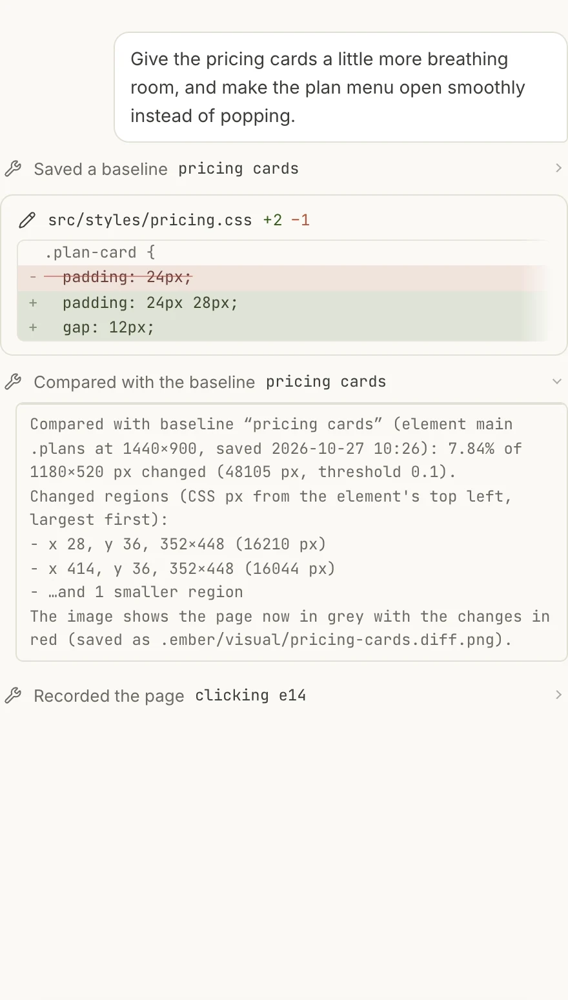
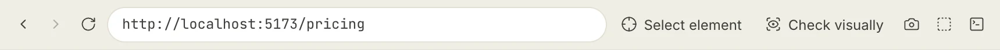

# Visual checks

Claude checks UI changes in Ember's browser: it saves a baseline screenshot, compares after a change (what changed and where, with a diff image) and records animations to catch layout jumps.

Claude can look at your UI the way you would: before it changes a page that's open in Ember's browser ([Ember's browser](browser.md)), it saves a **baseline** screenshot; afterwards it **compares** the page with it and sees what moved; for menus, dialogs and transitions it **records** a moment and looks for jumps. A broken layout or a janky animation is caught before you see it.

  <picture>
    <source media="(prefers-color-scheme: dark)" srcset="../images/chat-visual-check.dark.webp">
    
  </picture>
   <em>Claude saves a baseline, changes the CSS, compares — the changed areas, and where it saved the diff image — and records the menu opening</em>

## What Claude can do

| Tool | What it does |
| --- | --- |
| `browser_baseline` | Saves a named screenshot of the page, or of one element (from the page outline, or a CSS selector), optionally at a phone, tablet or desktop size. It records the page's address, the viewport size and the screen's pixel ratio with it. Saving under the same name replaces it. |
| `browser_compare` | Takes a new screenshot under the baseline's conditions — the same viewport size and the same element — and compares the two: how much changed, the boxes around each changed area, and an image of the page in grey with the changes in red. Anti-aliased edges (text drawn a little differently) don't count. If there's no baseline with that name yet, it offers to save one. |
| `browser_record` | Records the page for up to 5 seconds while it hovers, clicks, presses a key or scrolls, and returns a contact sheet: the frames worth seeing, each with its time, and frames where a large part of the page changed at once outlined in red. It also says how many frames moved and when the page settled. |

Screenshots are taken at 1× (CSS pixels), so a baseline from a Retina screen compares with one from a regular screen.

## After Claude edits UI files

When Claude has edited components, styles or markup (`.tsx`, `.jsx`, `.css`, `.vue`, `.svelte`, `.html` and the like — not tests) and the browser shows a page, Ember reminds it on your next message to check the page before calling the change done. The reminder doesn't come every turn: once Claude has compared, recorded or taken a screenshot, it stops until the next UI edit, and it comes at most every third message.

## Check visually

To ask for a check yourself, click **◎ Check visually** in Ember's **Browser** tab, or **Check Visually with Claude** in the title bar of the editor's built-in browser tab. The active chat compares the page with the baselines saved for it (or takes a screenshot when there are none), looks for broken layout, overflow and cut-off text, tries a phone size, and records anything that animates. It reports what it finds and doesn't change code unless you ask.

  <picture>
    <source media="(prefers-color-scheme: dark)" srcset="../images/browser-check-visually.dark.webp">
    
  </picture>
   <em>Ember's Browser tab: Check visually asks Claude to look the page over</em>

**Check Visually with Claude**

## Where baselines live

By default each project keeps its baselines in a `.ember/visual` folder (in the chat's folder: a worktree chat keeps them in its worktree). Next to each `name.png` is a `name.json` with the address, viewport and pixel ratio it was taken at. The last comparison's image (`name.diff.png`) and the last recording (`recording.png`) are there too, so you can open what Claude saw.

- **Git ignores the folder.** Ember writes a `.gitignore` into `.ember/visual` when it creates it. To commit baselines, for visual checks in review, delete that `.gitignore`; Ember doesn't put it back.
- **Keep them out of the project.** Settings › Browser › **Visual-check baselines** ([`ember.browser.visualBaselines`](../settings/settings-browser.md#emberbrowservisualbaselines)) set to **In Ember's storage** keeps them in Ember's own storage, one folder per project.

**Open Settings › Browser**

## What asks first

- **Never ask:** saving a baseline (it only writes Ember's `.ember/visual` folder), comparing, and recording while hovering or scrolling — in every mode.
- **Ask first:** recording while clicking or pressing a key, like any click in the browser. Ask and Plan chats can't record a click. **Always allow in this project** in Settings › Browser covers it.

Claude gets the visual tools with the rest of the browser tools ([`ember.browser.tools`](../settings/settings-browser.md#emberbrowsertools)).

---

[All documentation](../README.md)
