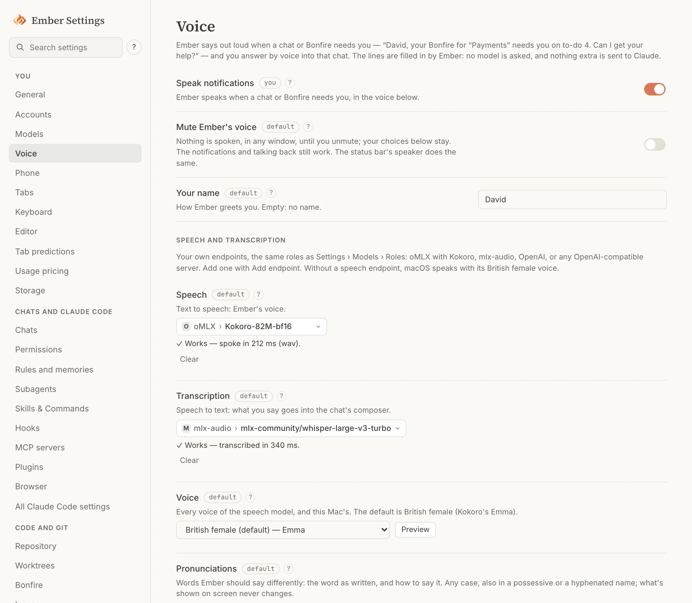
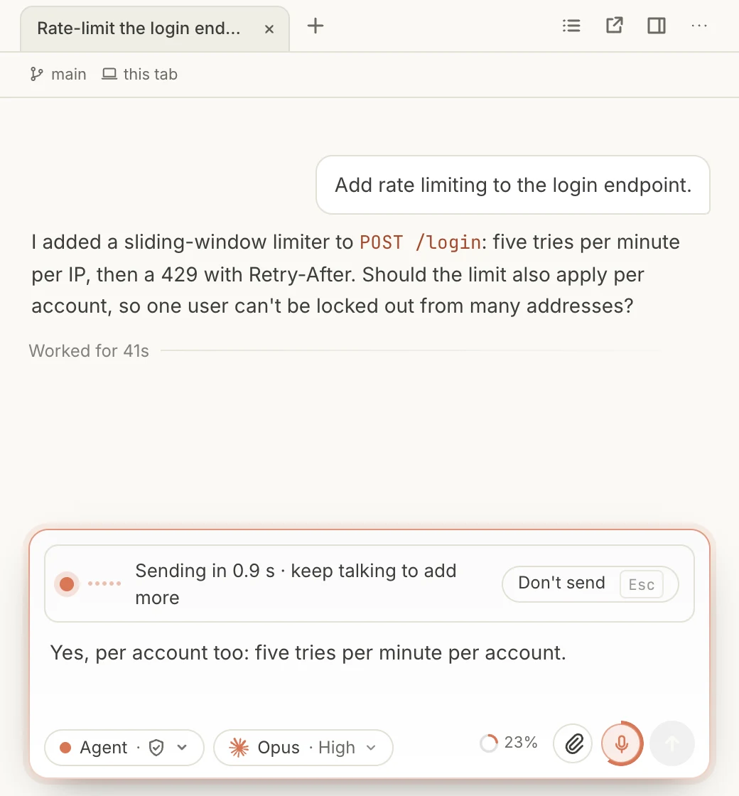
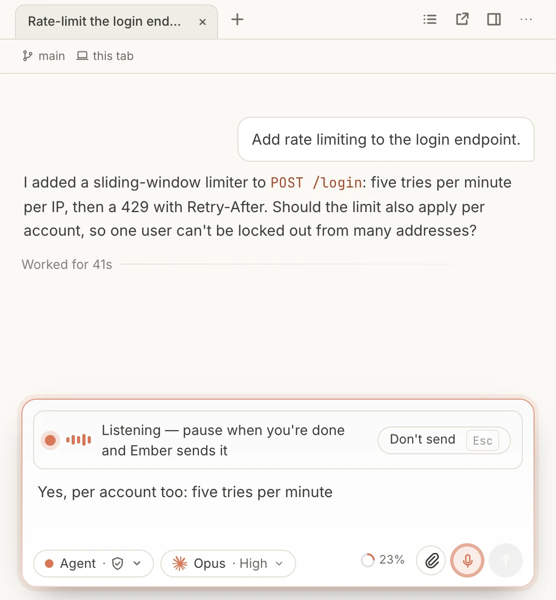
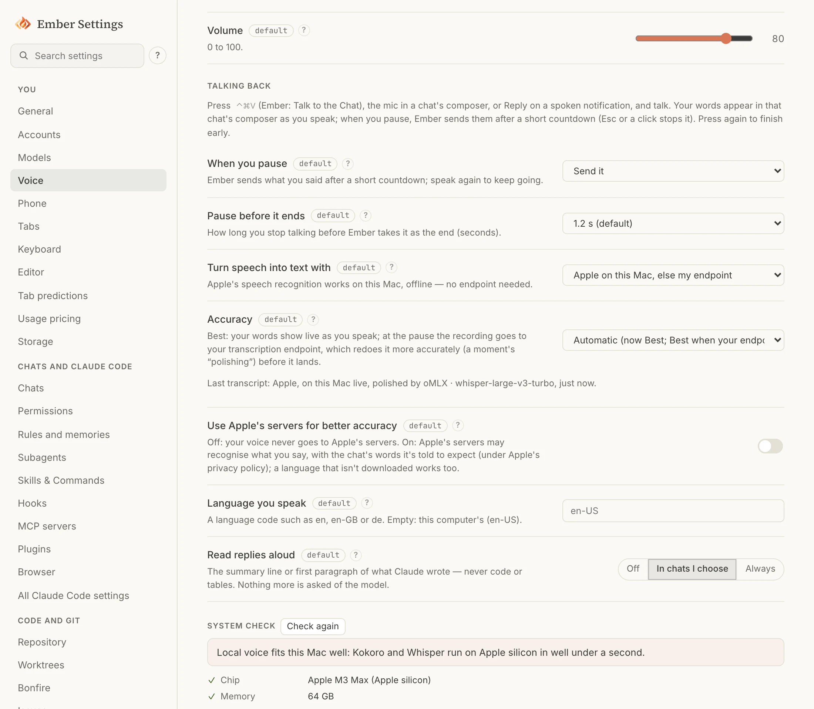

# Talk to Ember and hear it

Ember says out loud when a chat or Bonfire needs you, by name, and you answer by voice into that chat. Your own speech and transcription endpoints (oMLX with Kokoro, mlx-audio, OpenAI) or macOS's British voice.

Ember can tell you, out loud, when something needs you — “David, your Bonfire for “Payments” needs you on to-do 4. Can I get your help?” — and you can answer by voice, straight into that chat. Voice is only a way in and out of the chat you already have: Ember fills in the spoken lines itself from what happened (no model is asked), and what you say lands in the chat's composer like typed text. Nothing extra is sent to Claude.

<p align="center">
  <picture>
    <source media="(prefers-color-scheme: dark)" srcset="../images/settings-voice.dark.webp">
    
  </picture>
  <br><em>Settings › Voice: spoken notifications, talking back, voices and the system check</em>
</p>

## Turn it on

1. Open Settings › Voice and turn on **Speak notifications**.
2. Under **Your name**, type how Ember should greet you, or click the name it found (from git or this computer's account). Ember never assumes one: the first time it speaks with no name set, it asks.
3. Pick a **Speech** endpoint for Ember's voice and a **Transcription** endpoint for talking back (below). On a Mac, Ember speaks without either, with macOS's British female voice.

**Open Settings › Voice**

## What Ember says, and when

| Line | When |
| --- | --- |
| “David, the chat “Fix login” is waiting for your approval.” | A chat needs your approval, has a question, needs a sign-in, or stopped answering. |
| “David, your Bonfire for “Payments” needs you on to-do 4. Can I get your help?” | A Bonfire to-do asks you something, or the run needs you to finish it. |
| “Your Bonfire for “Payments” is done: six merged, one needs you.” | A Bonfire run finished. |
| “The chat “Fix login” is done.” | A chat finished its turn (off by default). |

- **A chat needs you**, **Bonfire** and **A chat finished** turn each kind on or off.
- **When**: only while Ember isn't the app in front (the default), or always — never about the chat you're looking at.
- **Quiet hours** keep Ember silent between two times. **Volume** sets how loud.
- Things that happen together are said once (“David, two chats need you.”), and the same thing at most once in 30 seconds.
- Ember never reads out a command, a question's text or an approval's details, and says “a link” or “a key” for anything that looks like one in a chat's title.

Each line about a chat also shows a desktop notification with **Reply**. **Ember: Stop Speaking** stops a line.

## Mute

While voice is on, a speaker sits at the right of the status bar. Click it to mute Ember: she stops mid-line and says nothing more, in any window and on phones with Ember open, until you click it again. The icon shows a crossed-out speaker while she's muted.

- Muting isn't turning voice off: your choices stay as they are, and unmuting brings them back as they were, quiet hours included.
- The desktop notifications with **Reply** still show, and talking back still works: only Ember's speaking stops.
- **Ember: Mute / Unmute Ember's Voice** does the same from the Command Palette, and so does **Mute Ember's voice** in Settings › Voice. It has no shortcut; add one in Keyboard Shortcuts if you like.

**Mute / Unmute Ember's Voice**

## Speech and transcription

Both are roles of your own endpoints, the same as Settings › Models › Roles ([Your own endpoints](../models/own-endpoints.md)): add the endpoint once (its key stays in your system keychain), then pick its model here. Picking a model tests it at once.

| Provider | Speech | Transcription | Setup |
| --- | --- | --- | --- |
| **oMLX** (this Mac) | Kokoro | Whisper, if you add one | Add Kokoro in oMLX. In Ember: Add endpoint › oMLX, paste the API key from oMLX's settings. |
| **mlx-audio** (this Mac) | Kokoro | Whisper, Parakeet | `pip install mlx-audio`, then `mlx_audio.server --port 8001` (oMLX keeps 8000). Add endpoint › mlx-audio. |
| **OpenAI** | gpt-4o-mini-tts, tts-1 | gpt-4o-mini-transcribe, whisper-1 | Add endpoint › OpenAI with an API key. |
| **Any OpenAI-compatible server** | `POST /audio/speech` | `POST /audio/transcriptions` | Add endpoint › Custom, OpenAI-compatible. |

> **Note:** With a hosted provider, the lines Ember speaks and what you say go to that provider. Your chats don't.

### Without a speech endpoint

- **macOS:** Ember speaks with the built-in British female voice — Serena, else Kate (or another British English female voice that's installed). To add Serena: System Settings › Accessibility › Spoken Content › System voice › Manage Voices…, under English (United Kingdom).
- **Windows and Linux:** Ember stays silent (the desktop notification still shows). With a speech endpoint, it plays the audio — on Linux with `paplay`, on Windows as a WAV.

If the speech endpoint stops answering, macOS says the line instead, so nothing is missed.

## Voices

**Voice** lists every voice of your speech endpoint — the voices it lists itself, else every voice of its model (all 54 Kokoro voices, by accent and language) — and this Mac's voices. **Preview** says a sample line in the voice you picked.

The default is British female: Kokoro's **Emma** (`bf_emma`), else your endpoint's British female voice, else macOS's Serena or Kate.

## Pronunciations

When Ember says a word wrong — a company or product name, a tool — tell her how to say it. Under **Pronunciations**, click **Add word**, type the word as it's written and how to say it, and click ▶ to hear it in the voice you picked. It's saved when you leave the field; ✕ removes it.

- Any case: one entry for `nginx` covers NGINX and Nginx too.
- Whole words only, also in a possessive or a hyphenated name: “nginx's” is said “engine x's”, and “nginx-proxy” is said “engine x proxy”. A word inside another word (“nginxify”, “nginx_conf”) is left alone.
- The longest entry wins, so “nginx plus” can be said differently from “nginx”.
- Only what Ember says changes: the notification, the chat and your phone's screen still show the word as written. Your phones say it the new way too.

A repository can carry its own in `.vscode/settings.json`, so everyone on the team gets them by opening it:

```json
{
  "ember.voice.pronunciations": { "nginx": "engine x", "kubectl": "cube control" }
}
```

Settings › Voice lists them read-only under **Pronunciations**; yours win for the same word. A repository adds up to 100 words, and none until you trust its folder.

## Talk back

1. Press **Ctrl+Cmd+V** (Windows and Linux: **Ctrl+Alt+V**, **Ember: Talk to the Chat**), click **Reply** on a spoken notification, or click the mic in a chat's composer.
2. Talk. Your words appear in the composer as you speak, and firm up as you go. A bar above them says Ember is listening and shows your voice's level as a small meter, and Ember stops speaking while you talk.
3. Pause. After about 1.2 seconds of quiet a short countdown runs ("Sending in 1.5 s · keep talking to add more"), then Ember sends it.

<p align="center">
  <picture>
    <source media="(prefers-color-scheme: dark)" srcset="../images/chat-voice-live.dark.webp">
    
  </picture>
  <br><em>You paused: a short countdown before Ember sends it — keep talking to add more, or Esc to keep it unsent</em>
</p>

- **Keep talking** during the countdown and it carries on: the same message, not a new one.
- **Esc** (or **Don't send**) stops listening and keeps your words in the composer, unsent. Clicking the mic finishes now; clicking it during the countdown keeps the words unsent.
- **Dictate only:** Settings › Voice › When you pause › Dictate only — your words wait in the composer for you to check and send.
- **Pause before it ends** sets how long a pause ends what you say (1.2 s by default).
- **Which chat:** the one whose mic you pressed, the one the notification's Reply named, else the one Ember last spoke about (for five minutes), else the chat on screen.
- The leading and trailing silence is trimmed off, and a transcript that is mostly repeats or in another language is refused with "Ember didn't catch that clearly" instead of being pasted.

<p align="center">
  <picture>
    <source media="(prefers-color-scheme: dark)" srcset="../images/chat-voice-mic.dark.webp">
    
  </picture>
  <br><em>Talking back: your words appear in the composer as you speak, and the mic shows your voice's level</em>
</p>

### What turns your words into text

- **macOS:** Apple's speech recognition, on your Mac only — your voice never goes to Apple's servers. For an English variant your Mac can't do offline, Ember listens in US English, which understands every English accent; for a language it can't do offline at all, your transcription endpoint does it. **For English, no transcription endpoint is needed.** The first time, macOS asks whether Ember may use the microphone and speech recognition; allow both. You can change them in System Settings › Privacy & Security › Microphone and Speech Recognition.
- **Your transcription endpoint** (Whisper, Parakeet, OpenAI…): choose **My transcription endpoint** under **Turn speech into text with**, or set one on Linux. With **Apple on this Mac, else my endpoint**, the endpoint steps in when Apple's recognition isn't allowed or can't do your language; **Apple on this Mac** never asks the endpoint. Ember re-transcribes what you've said so far about every 1.2 seconds to show it as you speak, then sends the whole utterance once more for the final text, with your language and the chat's own words as a hint.
- **Language you speak:** a code such as `en`, `en-GB` or `de`; empty uses this computer's.
- Linux needs `arecord` (alsa-utils) and a transcription endpoint. Windows can't listen yet.

### Accuracy

**Accuracy** in Settings › Voice › Talking back:

- **Best** — the default when your Transcription endpoint runs on this computer (choose it yourself for a hosted one). Apple's recognition shows your words live as you speak; at the pause the composer says "Polishing what you said…" while the recording goes once to your endpoint (silence trimmed, your language, temperature 0, this chat's words as a hint), and its text is what lands. If the endpoint fails, takes too long or returns junk, Apple's words are kept; Esc while it polishes keeps them unsent.
- **Fast** — Apple's words as they are, with no wait at the end.

Settings › Voice shows which engine made the last transcript.

To make it more accurate:

- **Use a bigger Whisper.** `whisper-base` is quick but makes many mistakes; `whisper-large-v3-turbo` (in oMLX or mlx-audio) is much better and still fast on Apple silicon.
- **Download your language for Dictation.** Apple recognises a language on your Mac only once its model is downloaded: System Settings › Keyboard › Dictation, add your language under Languages. The system check below says whether yours is there.
- **Set the language you speak** if it isn't this computer's.
- Apple is told what to expect in each chat: your name, the project and branch, the files the chat touched, and the notable words of its recent messages.
- **Use Apple's servers for better accuracy** lets Apple's servers recognise what you say — with the chat's words it's told to expect — and works for a language that isn't downloaded. It's off by default: your voice never goes to Apple's servers unless you turn it on. (Keys and tokens are never among those words.)

## Read replies aloud

**Read replies aloud** reads what Claude wrote when a chat finishes a turn: its summary line, or its first paragraph — never code, tables or tool output, and never a summary Claude is asked for. Choose **In chats I choose** to turn it on per chat with the speaker in the composer, or **Always**.

## System check

The system check looks at this computer — its chip, memory and free disk — and whether your speech and transcription endpoints answer with their models. It says whether local voice suits this computer (Apple silicon with 16 GB or more runs Kokoro and Whisper well) and lists the setup steps still to do: oMLX with Kokoro for speech, mlx-audio with Whisper or Parakeet for transcription, or a hosted provider. **Check again** looks again.

<p align="center">
  <picture>
    <source media="(prefers-color-scheme: dark)" srcset="../images/settings-voice-check.dark.webp">
    
  </picture>
  <br><em>Settings › Voice: accuracy (Fast or Best), the language you speak, reading replies aloud, and the system check</em>
</p>

## On your phone

While the Ember app is open on your phone, it can say the same lines, and its mic sends what you dictated when you pause, like the desktop — see [Ember on your phone](phone.md).

---

[All documentation](../README.md)
