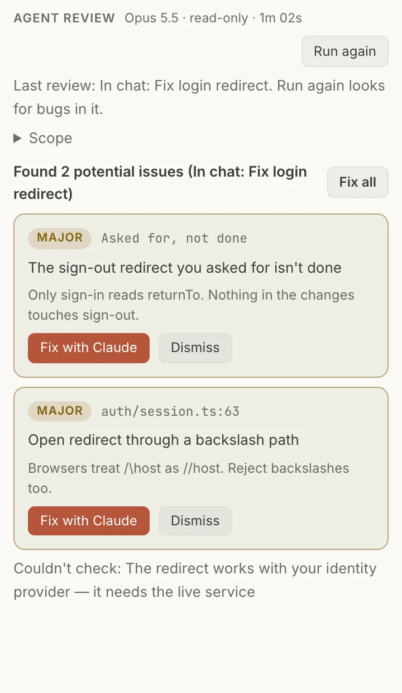
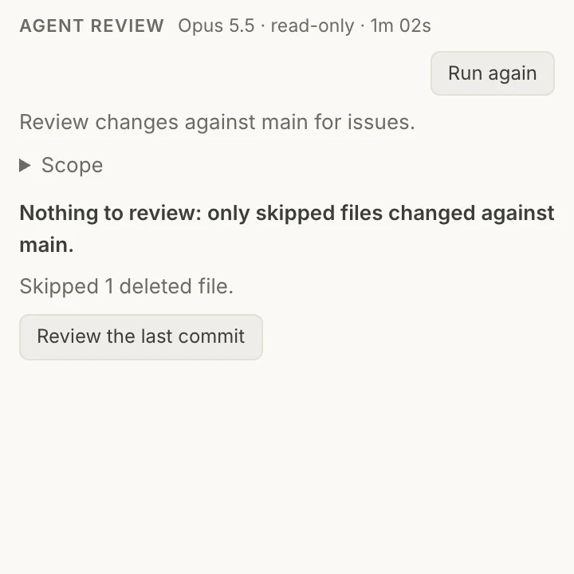
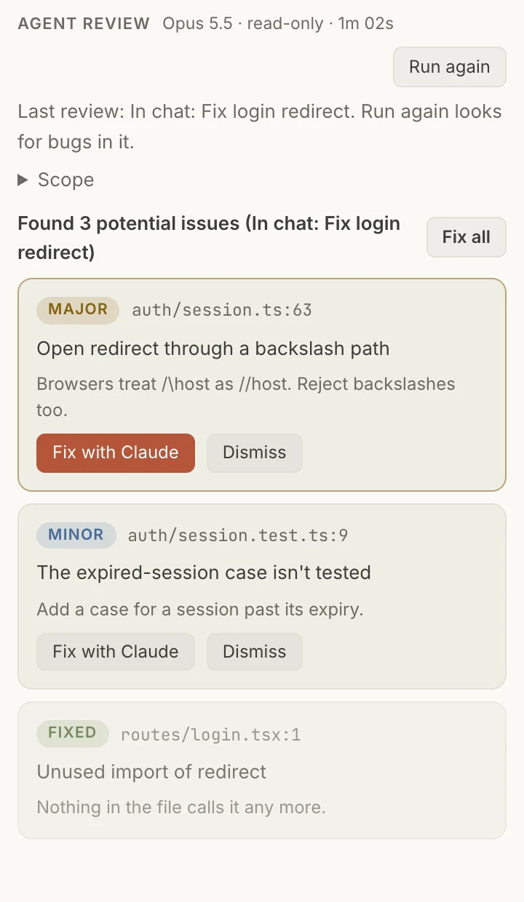

# Agent Review

Have Claude look over your changes, a commit or a chat's edits for bugs and for what you asked that wasn't done, then fix what it finds.

Agent Review is a read-only pass in which Claude looks over a set of changes for bugs and lists what it finds. It
never edits anything itself. Findings show in the **Agent Review** view and in VS Code's Problems panel, and you
choose which ones go to a chat to be fixed.

## Review your branch

1. Open the Source Control view and find the **Agent Review** section.
2. Optionally open **Scope** to add **Optional instructions** (for example "focus on the auth changes"), pick the
   branch under **Diff against**, and choose the **Approach**.
3. Click **Check for bugs**, or run **Agent Review: Check for Bugs**.

Claude reviews the difference between your working tree and that branch. While it runs, **Stop review** (or
**Stop Agent Review**) cancels it. When it is done, the chat it reviewed (else the chat on screen) says so, with **Show** when there are
findings to look at, the button becomes **Run again**, and the line beside **Agent Review** names the model that reviewed and how long it took. Started
from the Command Palette or Source Control's icon, the **Agent Review** view opens first. If a review can't finish,
the chat says why, and its **Show** button opens the view.

### Quick or Deep

- **Quick** balances quality and speed.
- **Deep** is more thorough: more turns and higher effort, so it costs more of your usage.

To start every review as Deep, turn on [`ember.review.deepDefault`](../settings/settings-other.md#emberreviewdeepdefault). A chat's review always starts as Deep.

## Security review

Open **Scope** and set **Look for** to **Security** to have Claude look over the same changes for security problems
instead of bugs: injection, path traversal, unsafe deserialization, secrets in code, missing authorization or
validation, unsafe use of crypto, and data leaks. The button becomes **Check security**.

- It's a separate pass: its own run, on the same model and the same **Quick** or **Deep** approach as a review for bugs,
  over the scope you picked. Run both if you want both.
- Its findings say **Security** beside their word, in the view and in the review page, and Problems entries start with
  "Security:". **Fix with Claude**, **Fix all**, **Dismiss** and the dismissed list work as for any other finding.
- **Run again** repeats a security review until you pick **Bugs** again; after a chat's review, it reviews that chat's
  changes. A security review of a chat's changes doesn't check them against what you asked.
- A security review on its own doesn't count as the chat's review on its branch's row.

In a chat, `/review-security` hands the uncommitted changes to the `ember-security-reviewer` subagent, which is read-only
and checks them against the same list of problems; the chat answers with a table. `/review` does the same for bugs with
the `ember-reviewer` subagent.

## Review a chat's changes

In the **⋯** of the changes row on a chat's composer, or in the chat's review page, click **Check for bugs**. Claude reviews just that
chat's changes, read-only, in the chat's folder, and looks at them two ways at once:

- **Against what you asked.** The messages you typed in the chat, and your answers to its questions, are the requirement.
  What Ember sent there for you, such as a Watch PR turn, doesn't count. A later
  message changes an earlier one. What you asked for that isn't done, was done differently, or broke something that
  worked is a **Major** finding. Something you never mentioned isn't held against the change here.
- **For bugs**, as in any other review, with each finding's own word for how much it matters.

Something you asked for that isn't anywhere in the code has no line to point at, so its finding says **Asked for,
not done** where a file and line would be. What Claude can't tell from the code, such as a live service or how something
looks on screen, is listed as **Couldn't check**: **No issues found** doesn't cover those. If one of the two looks
couldn't finish, or Ember's record of what you typed starts partway through the chat or is missing (one from before this
version, or from a terminal), it isn't checked against part of what you asked: the result says what wasn't checked,
**Not reviewed** says why, and you still get the other's findings.

  <picture>
    <source media="(prefers-color-scheme: dark)" srcset="../images/agent-review-asked.dark.webp">
    
  </picture>
   <em>A chat's review: what you asked for that isn't done, a bug, and what Claude couldn't check</em>

A chat's review runs on Opus at high effort, whichever model the chat uses, unless your default model is one of your
own, which it keeps. That's two thorough runs, so it uses more of your usage than a review of a branch.

Fixes go back to that same chat. The findings show in the review page beside the diff, and a finding about a line on
screen shows right under that line (see [Review changes](review-changes.md)).

## Review every commit

Turn on [`ember.review.onCommit`](../settings/settings-other.md#emberreviewoncommit) and Ember reviews each commit you make, in the background, right after
you make it.

## What is included

- Uncommitted changes, and files git doesn't track yet ([`ember.review.includeUntracked`](../settings/settings-other.md#emberreviewincludeuntracked)).
- Files excluded by `.emberignore` are left out.
- The project's `CLAUDE.md` files and rules for the changed files guide the review. Rule files that the changes
  themselves edit are reviewed as code instead.
- If the changes are too large to review in one go, the view lists the files it left out.

## When there's nothing to review

**No issues found** means Claude read your changes and found nothing. If there was nothing to read, Agent Review says
**Nothing to review: no changes against main** instead, and offers **Pick another base** or **Review the last commit**.
If only deleted files or files in `.emberignore` changed, it says what it skipped.

  <picture>
    <source media="(prefers-color-scheme: dark)" srcset="../images/agent-review-nothing.dark.webp">
    
  </picture>
   <em>With nothing to review, Agent Review says so, rather than no issues found</em>

## Work through the findings

  <picture>
    <source media="(prefers-color-scheme: dark)" srcset="../images/agent-review-findings.dark.webp">
    
  </picture>
   <em>Agent Review's findings in Source Control: Major, Minor, and a fixed one dimmed</em>

Findings are listed file by file, each with its file and line, a title and a word for how much it matters:

- **Major** (gold): a bug or risk worth fixing before you keep the change.
- **Minor** (blue): worth a look, less urgent.
- **Fixed** (green, dimmed): you sent it to a chat with **Fix with Claude** and the lines it pointed at have changed
  since. It stays in the list until the review runs again.

- Click a finding's file and line to open it in the diff where it was found.
- **Fix with Claude** sends that finding to a chat to fix. It is marked **Sent to the chat**.
- **Fix all** sends every finding at once (or run **Fix All Agent Review Findings**).
- **Dismiss** takes a finding off the list and keeps it out of later reviews (Findings you dismiss).

The same findings appear in the Problems panel and as squiggles in the editor, with **Fix with Claude** and
**Dismiss (Agent Review)** quick fixes.

Fixes go to the chat whose changes were reviewed. For a branch or commit review, Ember starts a new chat for the
first fix and sends later fixes to the same one.

## Findings you dismiss

A finding you dismiss isn't raised again while its code is unchanged. Ember keeps it per repository, in its own storage,
so it holds in every worktree and window of that repository and survives updates.

- It goes by the finding's file and what it says, however the next review words it, and by the lines it pointed at and
  the two either side. Lines that only moved still count; **when any of them change, even by an indent, the finding
  comes back**. So does one about something else ("on order", not "on user"), the same words on other lines of the
  file, and one where two blocks of code look alike. When Ember can't be sure, it raises the finding: dismissing it again
  takes one click.
- A finding raised at a higher level than when you dismissed it comes back. **Critical findings are never silenced**:
  dismiss one and it goes for that review only.
- A finding on very long lines, or across more than about 40 lines, goes for that review only: Ember couldn't tell later
  whether all of it changed.
- **Something asked for, not done** has no lines to hold to, so it holds to what you said: it stays out while your
  messages in the chat are the same, and comes back as soon as you say anything more or change what you asked. Another
  chat's review, asked for other words, still raises it.

When a review leaves anything out it says how many, under its findings. Open that line to see them; **Forget** puts one
back on the list and lets later reviews raise it again. Settings › Repository lists everything dismissed in the
repository, with **Forget** on each.

## Ultra review

When it is available, **Scope** also offers **Ultra review (cloud, billed)…**: a multi-agent review of the branch
that runs in Claude's cloud. It is billed separately, so Ember asks before it starts, and it can't be stopped once
it is running. Its findings show in the same list.

---

[All documentation](../README.md)
