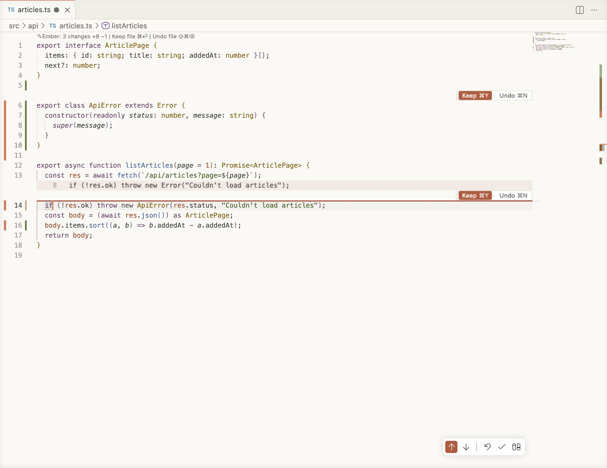
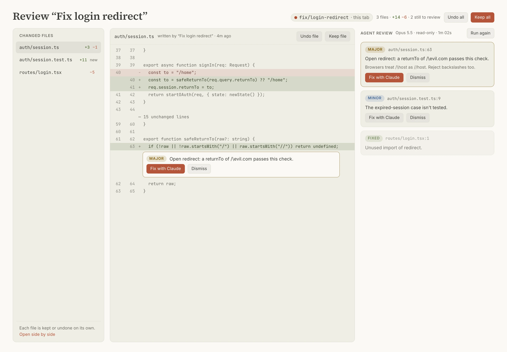
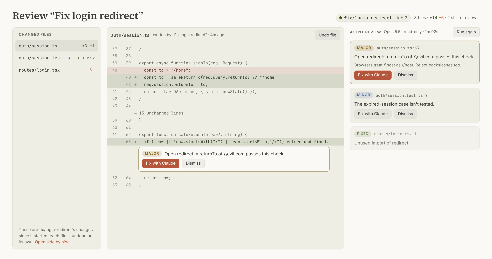

# Review changes

Keep or undo what an agent changed, one change, one file or a whole chat at a time.

An agent's edits land on disk right away, so you can run and test them immediately. Ember remembers what each file
looked like before, and shows every edit as a **pending change** until you keep it or undo it. Nothing is lost
either way: **Keep** accepts the change, **Undo** puts the old code back.

  <picture>
    <source media="(prefers-color-scheme: dark)" srcset="../images/window-keep-undo.dark.webp">
    
  </picture>
   <em>An agent's change in the editor: Keep · Undo, and the lines it removed</em>

## A file you have unsaved changes to

When Claude is about to edit a file you've changed in the editor without saving, the chat asks first, so the editor
never ends up refusing to save because the file on disk is newer:

- **Save and let Claude edit** saves your changes, then Claude edits the saved file.
- **Let Claude overwrite** drops your unsaved changes, then Claude edits the file as it is on disk. If the edit is
  refused after all, your changes come back in the editor when the turn ends.
- **Skip this edit** keeps your changes and refuses the edit; Claude hears why and carries on without it. The edit's
  row reads **Skipped**.

The chat waits while it asks, and the line under the chat says so: **Waiting on you: unsaved changes in b.txt**. It asks once per file each turn: the turn's later edits to that file get the same answer.
Closing the question, or not answering within an hour, skips the edit. At Run everything nothing asks: your changes
are saved, never dropped, and the chat says so.

## What a pending change looks like

In the editor, lines a chat wrote and you haven't kept yet have a thin clay bar in the gutter. Keeping a change
takes its bar away; Agent Blame still remembers which chat wrote the lines (see [Agent Blame](agent-blame.md)). Lines
Claude removed show inline, just above the change ([`ember.review.inlineRemoved`](../settings/settings-editor.md#emberreviewinlineremoved)); with that off, hover the
red line marker to see them. An inline edit's new lines are also tinted green, as its own inline diff (see
[Inline Edit](inline-edit.md)).

Hover one of those lines to see who wrote it: the chat's title, how long ago, "not yet kept" and the chat's branch
when it has its own. **Open chat** opens that chat; **Keep** and **Undo** act on that one change.

A row at the top of the file shows how many changes it has, with **Keep file** and **Undo file**. A small
**Keep · Undo** pair of buttons sits above the first change and the change under the cursor or the mouse
([`ember.review.hunkPills`](../settings/settings-editor.md#emberreviewhunkpills)). With them off, each change gets its own **✓ Keep** and **✕ Undo** row instead.

> **Note:** The inline removed lines and the **Keep · Undo** buttons need Ember.app. In stock VS Code or VSCodium, the removed lines
> show on hover and each change has its own Keep / Undo row.

## Keep or undo one change

Put the cursor in the change, then:

- Press <kbd>⌘Y</kbd> (<kbd>Ctrl+Y</kbd> on Windows and Linux) or click **Keep** to accept it.
- Press <kbd>⌘N</kbd> (<kbd>Ctrl+N</kbd> on Windows and Linux) or click **Undo** to put the old code back.

Commands that have nothing to act on say so in the status bar ("No changes to review"), and the Command Palette hides Keep, Undo, Next Change and Previous Change until the file in front has changes. Move between changes with <kbd>⌥J</kbd> (<kbd>Alt+J</kbd> on Windows and Linux) and <kbd>⌥K</kbd> (<kbd>Alt+K</kbd> on Windows and Linux). The status bar shows
where you are, for example which change of how many.

## Keep or undo a whole file

- <kbd>⌘⏎</kbd> (<kbd>Ctrl+Enter</kbd> on Windows and Linux) or **Keep file** accepts every change in the file.
- <kbd>⇧⌘⌫</kbd> (<kbd>Ctrl+Shift+Backspace</kbd> on Windows and Linux) or **Undo file** undoes them all. If Claude created the file, undoing it moves the
  file to the trash.

After **Keep File** or **Undo File**, Ember opens the chat's next changed file at its first change
([`ember.review.nextFileOnKeep`](../settings/settings-editor.md#emberreviewnextfileonkeep)). You can also jump with <kbd>⌥L</kbd> (<kbd>Alt+L</kbd> on Windows and Linux) and
<kbd>⌥H</kbd> (<kbd>Alt+H</kbd> on Windows and Linux). Once a file has no changes left, the status bar offers **Keep all** and
**Review next file**.

## Committing keeps a change

Committing a pending change keeps it. When a commit made after Claude's edit holds exactly what Claude wrote,
Ember keeps the change for you, as **Keep** would. The gutter bars, the dot in the Explorer and **Keep** / **Undo** go
away, and Agent Blame still knows which chat wrote the lines. Ember never changes the file itself.

It doesn't matter how the commit was made: from Source Control, a terminal, Claude's own `git commit`, another tab or
window in the same worktree, or a Bonfire merge. Ember also checks when it starts, so changes committed while it was
closed clear up without a click.

A few things stay pending:

- A file you changed after Claude's last write, before or after the commit.
- A file with unsaved edits.
- A change that put a file back the way the last commit has it, over work of yours that was never committed.
  **Undo** is the only way to get that work back.
- A deleted file the last commit never had, a stashed change, an ignored file and a very large file.
- Changes made before this version of Ember, which didn't record where they started.

The Explorer marks only uncommitted work. A file with pending changes gets a dot (●) while git shows it changed; its
name keeps git's own colour, the same colours VS Code uses, and no folder is tinted. Once git shows the file unchanged
against the last commit, Ember's dot goes. The bar above the composer counts only what is still uncommitted too.

A worktree chat's bar works the same way. It lists what the worktree hasn't committed yet, or says **All committed**,
with how far the branch has come beside it (for example **20 commits ahead of main**, against the branch's base: the branch it was cut from, else the default; the finished card says it instead while it shows). **Review** opens everything the branch
changed since it started.

## Undo a Keep

Kept something by mistake? Press <kbd>⌘Z</kbd> (<kbd>Ctrl+Z</kbd> on Windows and Linux) (the usual Undo key) right after: in a file with a
recent Keep, it brings the change back as pending. When there is no Keep to undo, the key does a normal undo.

## Review everything a chat changed

On top of the chat's composer, like a tab, a row counts the files the chat changed with their added and removed lines.
Click the count to see each file. Point at one for **Review** (its diff), **Keep** and **Undo**, the same controls an
edit card and a command's changed files have; Keep and Undo wait while the chat is working.

- **Review** opens the chat's changes in a review page. You can
  also press <kbd>⇧⌘R</kbd> (<kbd>Ctrl+Shift+R</kbd> on Windows and Linux) or run **Review Changes**.
- **Keep all** accepts every pending change in the chat. Once the chat's turn has ended, **Keep all** and **Undo all**
  sit at the end of the turn, in its footer, instead of on the row; while Claude is working, neither is offered.
- The row's **⋯** holds the rest:
  - **Undo all** puts every file back. Pick it twice ("Click again to undo all") within 3 seconds. While Claude is
    still working it isn't there: the composer's **Stop** comes first.
  - **Undo Apply**, for a chat whose worktree's changes were brought here before, and **Open PR** for a worktree's
    changes.
  - **Check for bugs** asks Claude to check the changes against what you asked in the chat, and to look for bugs (see [Agent Review](agent-review.md)).

## The review page

  <picture>
    <source media="(prefers-color-scheme: dark)" srcset="../images/review-tab.dark.webp">
    
  </picture>
   <em>The review page: the chat's changed files, the chosen file's diff with a finding under its line, and Agent Review's findings beside it</em>

The review page lists the files the chat changed on the left, with their added and removed lines. Click a file to see
its changes: each line keeps its old and new line number, added lines are tinted green, removed lines clay, and long
runs of unchanged lines fold into one row ("⋯ 15 unchanged lines"). Click the file's name to open its diff in the
editor.

- **Keep file** and **Undo file** act on the file you're looking at.
- **Keep all** (the one filled button) and **Undo all** at the top act on every file. While the chat is working,
  **Stop** stands in for **Undo all**.
- The head says how many files you haven't opened yet ("2 still to review").
- **Open side by side** shows every file in VS Code's own diff editor, with **Keep File** and **Undo File** for each
  file and **Keep All** and **Undo All** in its title bar. Binary and very large files are only shown there.

On the right, **Agent Review** lists what Claude found in these changes, and a finding about a line on screen also
shows in the diff, after the whole change that line is in. **Fix with Claude** sends it to the chat that made the
change; **Fix All** sends every finding not fixed yet (a **Fixed** one is never sent again). See [Agent Review](agent-review.md).

A worktree chat's **Review** opens the same tab, with its branch's changes since it started (and so does a chat
applied before, with its edits in your main worktree). A worktree's work isn't kept here: **Undo file** puts a file back as it was
where the branch started, and the branch goes on through **Open PR**.

  <picture>
    <source media="(prefers-color-scheme: dark)" srcset="../images/review-tab-worktree.dark.webp">
    
  </picture>
   <em>A worktree chat's review page: its branch's changes since it started, undone file by file; its work goes on through Open PR</em>

### Pending or everything

A chat in your main worktree has a **This chat's changes** switch at the top of the page:

- **Pending** shows what's still waiting for Keep or Undo (the page opens here when anything is pending).
- **Everything** shows every file the chat changed, from before its first edit to now: what you kept, what's still
  pending and what has been committed since, as one diff per file. It's read-only: **Keep** and **Undo** stay on
  **Pending**, and a file still pending is tagged **pending**.

Everything comes from the snapshots Ember takes at the start and end of each of the chat's turns (the ones
[Rewind a Chat](../chat/rewind.md) uses), not from git history, so other people's commits and other chats' work in the
same files stay out. What changed between the chat's turns, or after its last one, was someone else's (you, or
another chat): those lines are marked with a grey edge, and the file's head says how many. Inside a turn, only what the
chat's own edits wrote counts as the chat's; anything else that changed the file then (you, a formatter, a hook) is
marked too. When another chat worked on the same file during this chat's turn, or a command changed it, Ember can't
always tell the lines apart, and the file says so. A file Ember
has no snapshot of (a git-ignored file, or one edited before snapshots were kept) shows only its pending part.

Keeping the last pending file takes the page to **Everything**; a new edit by the chat brings it back to **Pending**.
**Review** with nothing pending opens **Everything** too.

Once nothing is left to review, the tab closes and the status bar says **All changes reviewed** (a chat with
**Everything** goes there instead).

Deleting a chat keeps its pending changes as they are: their marks go, and the files stay as they are now. Nothing is
undone. The same goes for a chat deleted in another window or by an old-chat clean-up.

In a narrow panel the tab stacks: the files, then the diff, then the findings.

> **Tip:** Editing a pending change yourself is fine. Ember folds your typing into the change, so Keep and Undo
> still work on the result.

Very large changes don't get per-change rows in the editor; the top row says **Large change — open the review to
see it**.

## Format Claude's files when it finishes

Turn on [`ember.review.formatOnFinish`](../settings/settings-editor.md#emberreviewformatonfinish) to format the files Claude edited, with each file's own formatter,
when its turn ends. The formatting becomes part of the pending change. Files with unsaved edits, files excluded by
`.emberignore` and files without a formatter are left alone.

All of these switches are in Settings › Editor under **Claude's changes**. Every review key is listed in
[Reviewing agent changes](../shortcuts/keyboard-shortcuts.md#reviewing-agent-changes).

---

[All documentation](../README.md)
