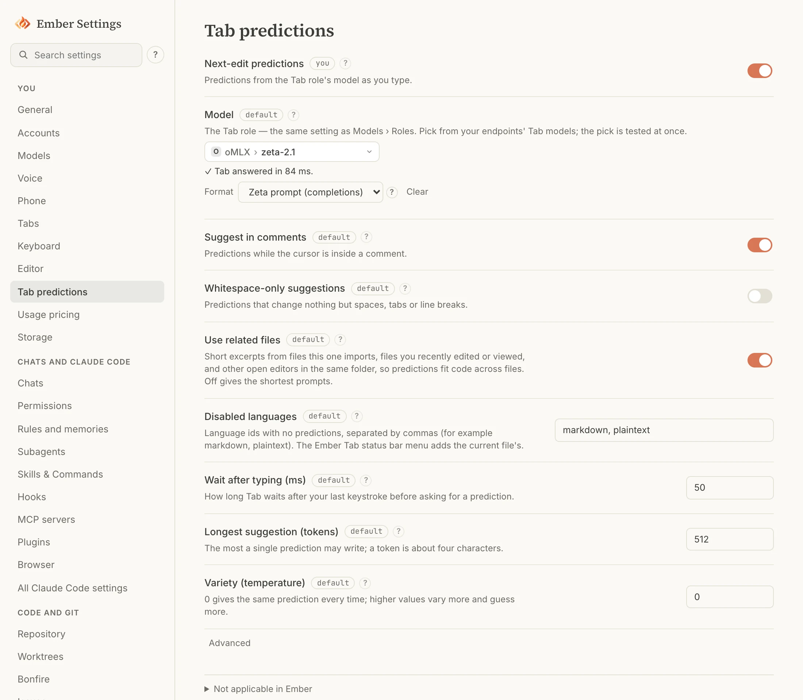

# Tab Predictions

Ember Tab suggests your next edit as you type; press Tab to take it.

Ember Tab predicts the next edit you are about to make, as you type, and shows it in the editor. It can be an
insertion at the cursor, a change to nearby lines, or an edit further away in the file. Press Tab to take it.

Predictions come from a small, fast model on an endpoint you choose (by default a local server on this computer),
not from your Claude subscription.

  <picture>
    <source media="(prefers-color-scheme: dark)" srcset="../images/settings-tab.dark.webp">
    
  </picture>
   <em>Settings › Tab predictions: next-edit predictions</em>

## Set up the model

Ember Tab needs a model to ask. Open Settings › Tab predictions and pick one under **Model**. This is the Tab role, the same
setting as Settings › Models › Roles ([`ember.roles.tab`](../settings/settings-tab.md#emberrolestab)). Choose from the Tab models of the endpoints you
added; Ember tests your pick right away. To add an endpoint, see [Your own endpoints](../models/own-endpoints.md).

If Tab was set up earlier with its own endpoint, Settings › Tab predictions offers **Move to a role** so it shares Ember's
endpoints and key.

## What a prediction looks like

An insertion at the cursor shows as ghost text, in the same faint grey as comments. The very first time you get one,
a small label beside it says how to take it and which model made it, for example **Tab to accept · Zeta, local**. It
goes away with that prediction and doesn't come back.

## Take or skip a prediction

- **Tab** (<kbd>Tab</kbd>) accepts the prediction. For an edit elsewhere in the file, Tab first jumps
  there. Accepting often brings the next prediction straight away.
- **Esc** (<kbd>esc</kbd> (<kbd>Esc</kbd> on Windows and Linux)) dismisses it.
- Keep typing to ignore it.

Files excluded by `.emberignore`, `.env` files, keys and certificates (such as `.pem`, `.crt` and `id_rsa`) and
credentials files (such as `.npmrc`, `.netrc` and kubeconfigs) are never sent to the model, and neither is anything git
ignores or anything inside `.git`. A file reached through a link is judged by where it really is as well as by its
name, and a link inside a workspace folder to a file outside it gets no predictions. A file you open from outside your
workspace folders (or with no folder open) still gets predictions, from that file alone: other files and their edits
are never added to its prompt.

## Related files

Each prediction also shows the model short excerpts of files related to the one you are editing, so it can fit
code that spans files. They come from:

- files this one imports, starting with the names the code around your cursor uses,
- files you recently edited or viewed,
- other editors open beside it.

Ember picks the parts that matter, such as the declarations of the names near your cursor or the lines you were
looking at, and keeps the excerpts small so predictions stay fast. Only files in the same workspace folder are used,
and they pass the same checks as everything else Tab sends: nothing excluded by `.emberignore`, no secrets, and nothing
from outside the workspace. Related files also leave out very large or binary files. Turn this off with **Use related files** ([`emberTab.relatedFiles`](../settings/settings-tab.md#embertabrelatedfiles)).

## Pause or turn off predictions

The **Ember Tab** item in the status bar shows whether predictions are on. Click it for a menu:

- **Turn Off Ember Tab** / **Turn On Ember Tab** (**Toggle Tab Predictions**).
- **Snooze 5 min**, **Snooze 15 min** or **Snooze 60 min**: no suggestions until then. The status bar counts down,
  and predictions come back on by themselves. **Resume Now** ends a snooze early. You can also run
  **Snooze…**.
- **Disable for** *language* / **Enable for** *language*: turn predictions off or on for the current file's language
  (**Turn Off or On for This Language**).
- **Model…** and **Open Settings**.

A snooze covers every Ember window.

## Tune predictions

Settings › Tab predictions also has:

| Setting | What it does |
|---|---|
| **Next-edit predictions** ([`emberTab.enabled`](../settings/settings-tab.md#embertabenabled)) | Turns predictions on or off. |
| **Suggest in comments** ([`emberTab.suggestInComments`](../settings/settings-tab.md#embertabsuggestincomments)) | Predictions while the cursor is inside a comment. |
| **Whitespace-only suggestions** ([`emberTab.whitespaceOnlySuggestions`](../settings/settings-tab.md#embertabwhitespaceonlysuggestions)) | Predictions that change nothing but spaces, tabs or line breaks. |
| **Use related files** ([`emberTab.relatedFiles`](../settings/settings-tab.md#embertabrelatedfiles)) | Excerpts of imported, recently used and open files go with each prediction. |
| **Disabled languages** ([`emberTab.disabledLanguages`](../settings/settings-tab.md#embertabdisabledlanguages)) | Language ids with no predictions, for example `markdown, plaintext`. |
| **Wait after typing (ms)** ([`emberTab.debounceMs`](../settings/settings-tab.md#embertabdebouncems)) | How long Tab waits after your last keystroke before asking. |
| **Longest suggestion (tokens)** ([`emberTab.maxTokens`](../settings/settings-tab.md#embertabmaxtokens)) | The most one prediction may write. |
| **Variety (temperature)** ([`emberTab.temperature`](../settings/settings-tab.md#embertabtemperature)) | 0 gives the same prediction every time; higher values vary more. |

Under **Advanced**, **Prepend BOS token** ([`emberTab.prependBos`](../settings/settings-tab.md#embertabprependbos)) is only for servers that don't add the
model's start token themselves.

---

[All documentation](../README.md)
