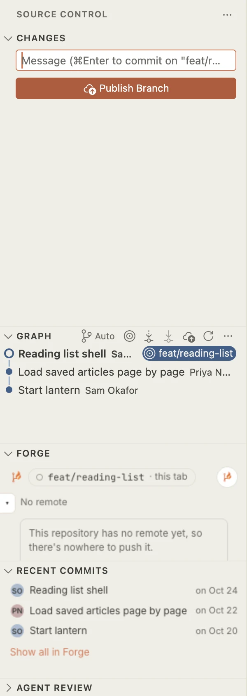
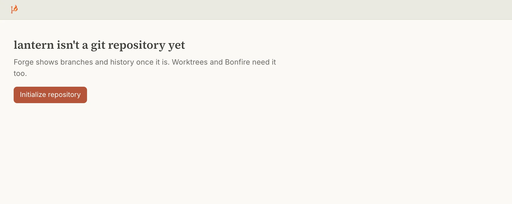
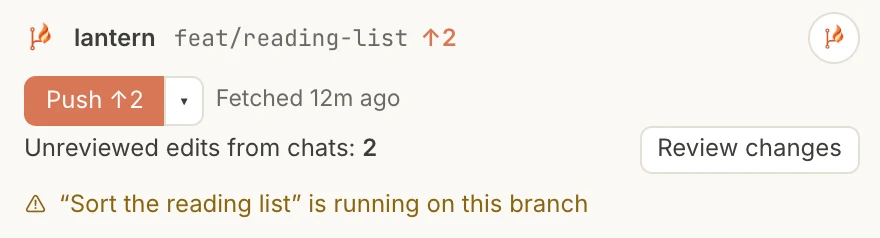
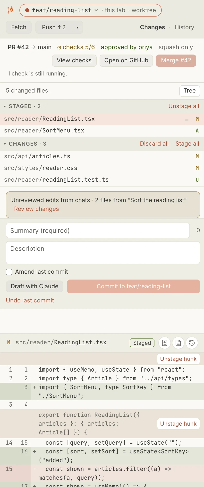
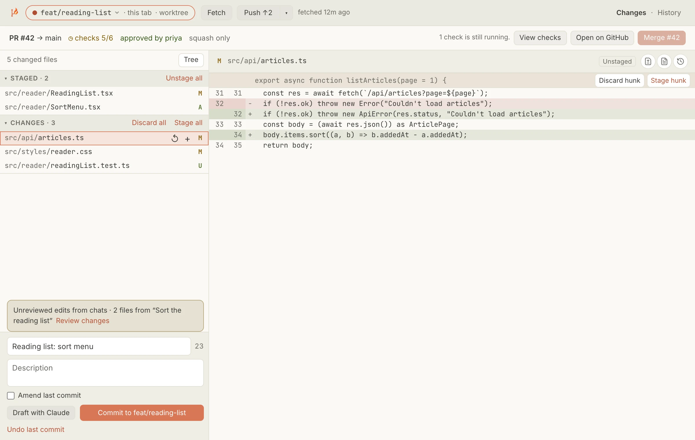
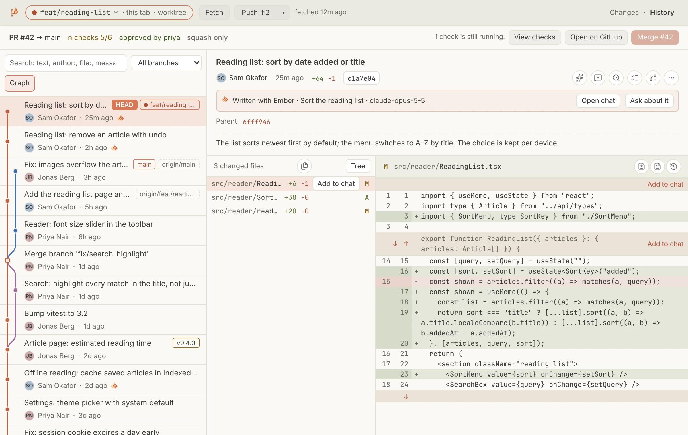
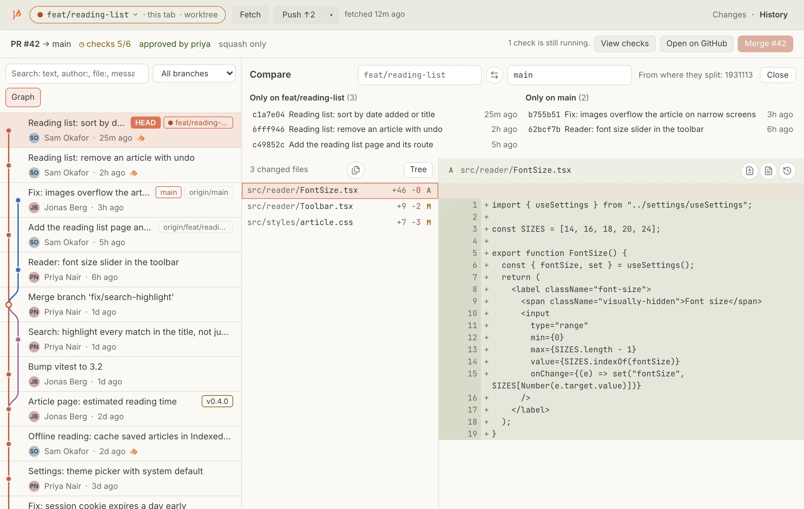
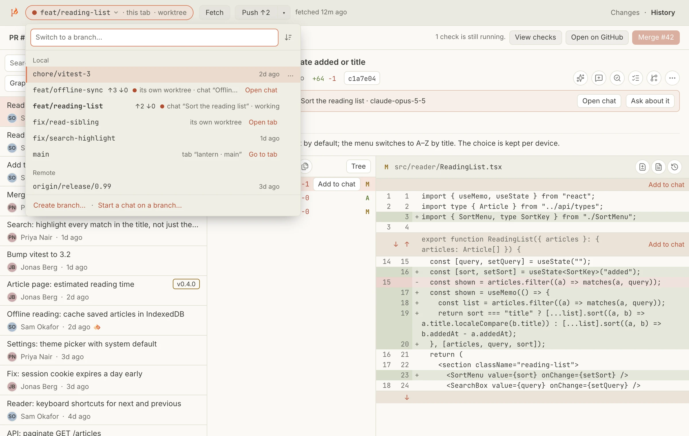
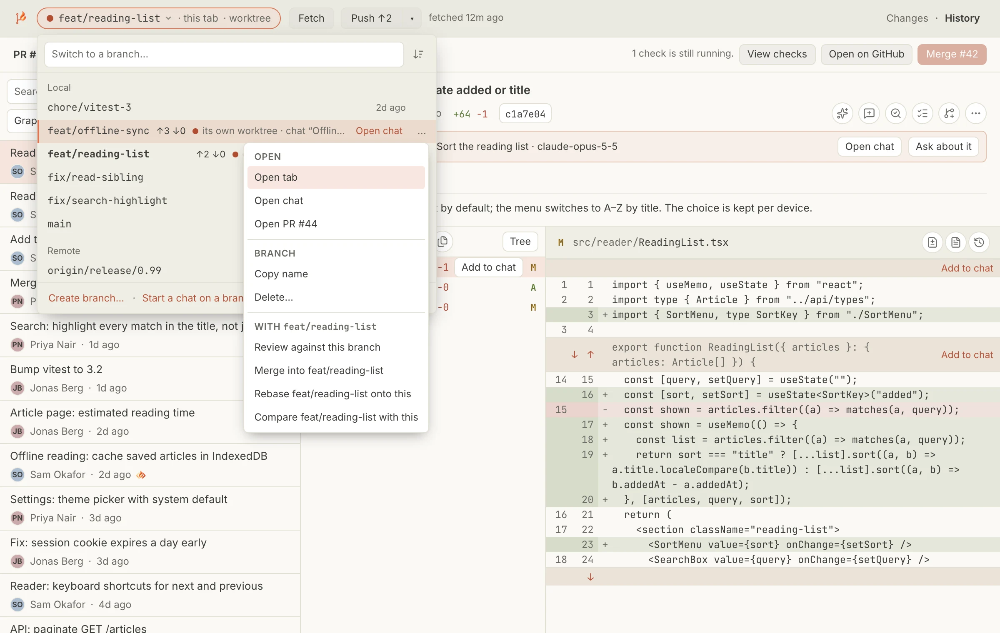

# How to use Forge

Ember's git for this worktree: its branch and pull request, stage and commit, browse history, file and line history, compare any two refs, open diffs in the editor, switch branches, sync and get out of a paused merge.

Forge is Ember's git for the worktree this tab has open. It lives in two spots: two compact sections in VS Code's
Source Control view, and a full **Forge** panel that opens as an editor tab. Both work on the same repository, and both
know about the edits Ember's chats make, so you don't commit or throw away work you haven't reviewed.

Forge works on VS Code's built-in Git. It lists the repositories Source Control lists, and its commits, branch
changes, merges, pulls and pushes go through the built-in Git, so its sign-in prompt and your `git.*` settings count, and
Source Control shows the same state at once. VS Code's own Graph, branch item and sync item stay as they are.

Work that spans worktrees (opening another worktree in its tab, moving a branch into the main worktree, removing a
worktree or deleting a branch) lives on the Dashboard ([The Ember Dashboard](../worktrees/dashboard.md)).

  <picture>
    <source media="(prefers-color-scheme: dark)" srcset="../images/window-scm-forge.dark.webp">
    
  </picture>
   <em>Source Control with Forge's header and Recent commits</em>

## With no repository yet

Forge says what's missing and offers the way in.

- **No folder open:** **Open folder** or **Clone a repository**.
- **A folder that isn't a repository:** **Initialize repository** has VS Code's Git make it one, on the branch your
  `git.defaultBranchName` setting names. Worktrees and Bonfire need a repository too.
- **A repository with no remote:** **Publish to GitHub** asks for a name (the repository's, even from a worktree's tab) and
  private or public, then creates it with the GitHub CLI, adds it as `origin` and pushes this branch. If only the push
  fails, Forge says so and offers **Push this branch**. **Add a remote** is for a repository that's somewhere else.

  <picture>
    <source media="(prefers-color-scheme: dark)" srcset="../images/forge-no-repo.dark.webp">
    
  </picture>
   <em>A folder that isn't a repository yet: Forge says so, and offers Initialize repository</em>

## The Forge section in Source Control

Open Source Control. Above the built-in changes list, the **Forge** section shows:

- the worktree of the file you're editing: its branch, where it lives (this tab, the main worktree or its own
  worktree), and its pull request with CI (✓ passed, ✕ failed, ◷ running);
- how far the branch is from its upstream (↑ to push, ↓ to pull);
- the sync button and when the repository was last fetched;
- a paused merge, rebase, cherry-pick or revert, with **Continue**, **Abort** and **Open in Forge**;
- **Unreviewed edits from chats** with a count and a **Review changes** button, when Ember's chats changed files here that you
  haven't kept or undone yet;
- a warning when a chat is running on this branch.

Click the Forge mark at the right of the section to open the full panel.

  <picture>
    <source media="(prefers-color-scheme: dark)" srcset="../images/forge-scm-header.dark.webp">
    
  </picture>
   <em>The Forge section in Source Control</em>

## Recent commits

The **Recent Commits** section lists the last 20 commits of the worktree, with avatars, the time, and the Ember mark on
commits Ember's chats wrote.

- Click a commit to open it in Forge.
- Drag a commit into the chat to attach it, so you can ask Claude about it.
- Click **Show all in Forge** for the full history.

## Open Forge

Do one of these:

- Press <kbd>⌥⌘G</kbd> (<kbd>Ctrl+Alt+G</kbd> on Windows and Linux).
- Click the Forge icon in the Source Control title bar, or in the chat panel's title bar.
- **Open Forge: git for this worktree**

Forge opens only when you ask for it this way. A push, a pull request, CI, a chat's git work or opening Source Control
never opens it or brings it forward. Close it and it stays closed in that window until you open it again. After a
restart, it comes back only if it was open when the window closed.

The panel's top bar shows this worktree's branch (its state dot, where it lives: this tab, and "worktree" for a
linked worktree); click it to switch branches. In the Source Control section the branch opens its menu
instead (**Open chat**, **Open PR**), as it does everywhere. Then **Fetch**, the sync button (with the ↑↓ counts), when you last
fetched, and the **Changes** · **History** tabs. When the window has more than one repository, a **Repository** list
beside the branch picks the one Forge shows. Under the top bar is the pull request line; below it is the list, with the selected
file or commit beside it (under it, when Forge is narrow).

  <picture>
    <source media="(prefers-color-scheme: dark)" srcset="../images/forge-narrow.dark.webp">
    
  </picture>
   <em>Forge at side-bar width: the bar, the pull request line and the Changes tab wrap to fit</em>

## Turn Forge off

If you do git on the command line or ask Claude, turn off [`ember.forge.enabled`](../settings/settings-other.md#emberforgeenabled). Forge then never opens, its
sections leave Source Control, and VS Code's own Source Control stays. The Forge key, buttons and links show Source
Control instead (a commit's link shows that commit's diff), **Open File History** and **Open Line History** show the
file in VS Code's own **Timeline**. Turn the setting back on to use Forge again.

## The branch's pull request

The pull request line under the top bar shows the pull request of this worktree's branch:

- **PR #41 → main**: its number and the branch it merges into (point at it for its title; click it, or
  **Open on GitHub**, to open it in the browser), and **draft** while it is one;
- its checks as one mark: **✓ checks 6/6** when all passed, ✕ when one failed, ◷ while one still runs (point at it
  for the counts); **View checks** opens them on GitHub;
- its review: **approved by** whoever approved it, **changes requested**, **review required** or **no review required**;
- the merge method: one GitHub allows for the repository (squash merge, merge commit or rebase merge), its default
  first; **squash only** when GitHub allows that one method; and the ticket in the branch's name (Jira ABC-123);
- **Merge #41**, by that method. Ember asks first. Merge is off, with the reason beside it, while the pull request is a
  draft, has conflicts, has a failed or running check, or still needs a review. A pull request from a fork that happens to
  use the same branch name isn't this branch's: the line doesn't show it, and Ember won't merge it. Nor does Ember merge
  one stacked on a branch whose pull request already merged: point it at that one's base first, or it would merge into
  the old branch. The branch stays after
  the merge: delete it from the Dashboard ([The Ember Dashboard](../worktrees/dashboard.md)).

When checks fail, a reviewer asked for changes or it has conflicts, **Fix with Claude** is the line's main button: the same action as on the
Dashboard ([The Ember Dashboard](../worktrees/dashboard.md)).

With no pull request yet, the line offers **Open PR**: the built-in Git pushes the branch (and sets its upstream), then
Ember opens the pull request on GitHub with the GitHub CLI, or the compare page on other hosts, as the Dashboard and a
chat's worktree menu do. A GitHub Enterprise host counts as GitHub once the GitHub CLI is signed in to it.

## Stage and commit

  <picture>
    <source media="(prefers-color-scheme: dark)" srcset="../images/forge-changes.dark.webp">
    
  </picture>
   <em>The Changes tab: staged and unstaged files with their status letters, unreviewed edits from chats, the selected file's diff and the commit box</em>

1. Open Forge and click **Changes**. Files are grouped under **Changes** (unstaged), **Staged** and, during a merge,
   **Conflicted**. When Ember's chats changed files here that you haven't reviewed, a card over the commit box says how
   many and which chat; click **Review changes** to go over them first.
2. Stage what you want to commit:
   - a whole file: the stage button on its row (or select it and press Space);
   - everything: **Stage all**;
   - part of a file: select it, then click **Stage hunk** on a hunk, or click changed lines (Shift-click for a range) and
     click **Stage lines**.
3. Type a **Summary** (required) and, if you like, a **Description**.
4. Click **Commit**, or press Cmd+Enter (macOS) / Ctrl+Enter.

The built-in Git makes the commit, so your hooks run and its settings count: `git.alwaysSignOff`,
`git.enableCommitSigning`, and `git.enableSmartCommit` (with nothing staged, Commit takes your changes, as
`git.smartCommitChanges` says). `git.postCommitCommand` pushes or syncs after it.

To fix the last commit instead, tick **Amend last commit** before you commit. If that commit is already pushed, Forge
warns you that amending rewrites shared history.

Unstage works the same way from the **Staged** group: **Unstage all**, the row button, **Unstage hunk** or
**Unstage lines**. Click **Show as tree** / **Show as list** to change how files are listed.

## Let Claude write the commit message

1. Stage your changes (or tick **Amend last commit**).
2. Click **Draft with Claude**, beside the commit button. Claude writes a message from the staged changes. Nothing is committed.
3. If the box already had text, choose **Replace** or **Keep mine**.
4. Read the draft, edit it if you want, then commit. Click **Cancel** while it drafts to stop.

## Discard changes

Discarding never deletes your work outright: a copy of what you throw away goes to the Trash first, under the file's
own name, so you can get it back.

1. In **Changes**, click the discard button on a file's row (or select it and press Delete), click **Discard all**, or
   pick lines and click **Discard lines** (or **Discard hunk**).
2. Forge asks first and names what it will discard. Click **Discard**.

If the Trash isn't available, the copy is kept in the repository's git folder instead, and Forge tells you where.

## Undo the last commit

**Undo last commit** appears under the commit box while the last commit isn't pushed and isn't a merge. Click it: VS
Code's **Undo Last Commit** takes the commit away, its changes are staged again, and its message comes back into the commit box (if you'd already typed
something, choose **Replace** or **Keep mine**).

## Unreviewed edits from chats

Forge keeps track of edits Ember's chats made that you haven't reviewed yet:

- **Staging** a file with unreviewed edits from chats keeps those edits, so Agent Blame records them as the chat's.
- **Discarding** them asks first, naming the chat they came from.
- While a chat is working in the folder, Forge waits before undoing the last commit, stashing, pulling or other changes
  to your files, and says which chat to wait for or stop.
- Switching branches in Forge or from the chat's branch menu while a chat of any Ember window works in that worktree
  asks first (VS Code's own git commands, such as Source Control's **Checkout to…**, don't ask):
  **Claude is working on** *branch* **in this tab**. **Open** *branch* **in its own tab** (or **Go to** *branch*'s
  **tab**) leaves this one as it is (offered only for a branch, not a remote ref, tag or commit); **Switch when Claude
  finishes** switches once the chat is done, the same way you asked (the chat shows the waiting switch with
  **Don't switch** to drop it; Forge asks its usual questions then, the chat says why if it couldn't, and it waits again
  if the chat starts its next message first);
  **Stop Claude and switch now** stops the chat, its background commands too, and its uncommitted edits come along
  with the switch. If the chat is still working a few seconds after Stop, nothing switches and Ember says why. When
  only a chat's command runs (a dev server, a watcher), the question says **A command is running**, with **Switch
  when the command finishes** and **Stop the command and switch now**. A waiting switch shows a notice with **Don't
  switch** to drop it; switching that worktree's branch yourself meanwhile drops it too, and one still waiting after 6
  hours is dropped, and Ember says so; asking again for the same worktree replaces the one waiting. **Cancel** changes
  nothing.

To go over them first, click **Review changes** next to **Unreviewed edits from chats**, in the Forge section or on Forge's Changes
tab. See
[Review changes](../editing/review-changes.md).

## Browse history and the graph

  <picture>
    <source media="(prefers-color-scheme: dark)" srcset="../images/forge-history.dark.webp">
    
  </picture>
   <em>History with the branch graph, refs and the selected commit</em>

1. Open Forge and click **History**.
2. Search with plain text, or narrow it with `author:`, `file:` or `message:`.
3. Pick **Current branch** or **All branches**.
4. Click **Graph** to show branch lanes (they hide while you search).
5. Click a commit to see its message, who wrote it, and its files and diffs on the right.

A branch label with a small dot has a chat working on it. The dot takes the color of the branch's state (working,
needs you, waiting, ready); point at it to see the chat's title.

A commit Ember's chats wrote shows **Written with Ember** with the chat, which you can open or ask more in. The
commit's buttons:

- **Explain**: a new chat explains the commit.
- **Add to chat**: attaches the commit to the open chat (you can also drag the row into the chat).
- **Check for bugs** / **Check for bugs through HEAD**: Agent Review looks over this commit, or this commit and every one after it.
- **Create branch here…** and **Open on remote**.

Drag a hunk header into the chat, or click its **Add to chat**, to attach just that hunk.

## Open a diff in the editor

Every diff in Forge (a change in **Changes**, a commit's file, a compared file, a version in a file's history) has
three buttons on its header:

- **Open changes in editor**: the same diff in VS Code's own diff editor. For a change you haven't staged, the right
  side is the file itself, so you can edit it there, search it, go to definitions and see each line's blame. A staged
  change compares the last commit with what's staged; a commit's file compares it with the commit before.
- **Open file**: the file as it is now.
- **File history**: the commits that changed this file (below).

Above a commit's or a comparison's files, **Open all in editor** opens every changed file in one multi-file diff.

## File and line history

1. Right-click a file in the Explorer or on its tab and choose **Open File History**, or click **File history** on a
   diff in Forge. To see who changed some lines, select them in the editor, right-click and choose **Open Line History**.
2. Forge lists the commits that changed the file (across renames) or those lines, newest first, with the file's
   path in each. Click one to see that version's diff; open it in the editor, or click **Show commit** to see the whole
   commit in History.
3. The history stays open while you look at other commits: the bar above brings it back, and its **×** closes it.

Line history reads the lines as the last commit numbers them, so save the file first. Lines you've added but not
committed have no history yet. With Forge turned off, both open VS Code's **Timeline** for the file.

## The commit menu

Right-click a commit in **History**, or click its **Actions** (…) button:

- **Check out this commit…**: your files show this commit on a detached HEAD. Asks first.
- **Create branch here…**
- **Compare** *branch* **with** *commit*
- **Copy commit id**, **Copy message**, **Copy link**

To cherry-pick a commit, right-click it in VS Code's Source Control **Graph** and choose **Cherry Pick**.

## Compare two branches, tags or commits

  <picture>
    <source media="(prefers-color-scheme: dark)" srcset="../images/forge-compare.dark.webp">
    
  </picture>
   <em>Comparing the branch with main: where they split, the commits only on each side, and main's files</em>

1. Click **Compare** *branch* **with** *commit* in the commit menu, or **Compare** *branch* **with this** in a branch's
   menu.
2. Forge shows where the two split, the commits only on each side (**Only on** …), and the files the right side changed
   since then, with their diffs.
3. Type another branch, tag or commit on either side and press **Enter** (leave the left side empty for the branch
   you're on), or click **Swap sides**.
4. Open a file's diff in the editor, or **Open all in editor**.
5. Click a commit to open it in History. The comparison stays open in the bar above until you close it.

## Switch and manage branches

  <picture>
    <source media="(prefers-color-scheme: dark)" srcset="../images/forge-branches.dark.webp">
    
  </picture>
   <em>The branch picker, opened from the worktree's branch: where each branch lives and who is on it, Open chat, Go to tab and Open tab, then Create branch… and Start a chat on a branch…</em>

1. Click the branch in Forge's top bar.
2. Type to search (**Switch to a branch…**), and pick a branch to switch this worktree to it.
3. If you have uncommitted changes, Forge asks what to do with them:
   - **Leave them on** *branch*: they're stashed, and come back when you switch back in Ember;
   - **Bring them to** *branch*: they stay in your files (git stops if they'd be overwritten).

Each row says where the branch lives (**main worktree**, **its own worktree**, or the other tab that shows it: **tab 2**,
by its number in the row of tabs, or by its name outside Ember's app) and
who is on it: a chat and what it is doing, led by the branch's state dot while someone is on it.
Rows show their one action on the right:

- **Open chat** while a chat works on the branch: the chat opens, in the tab it belongs to;
- **Go to tab** when another tab already shows the branch's worktree: that tab comes forward;
- **Open tab** for a branch another worktree has: its worktree opens as a new tab.

To make a branch, click **Create branch…**, type a name, choose **Switch to it** or not, and click **Create**. From a
commit, use **Create branch here…**. To have Claude work on a new branch, click **Start a chat on a branch…**: a new
chat opens with its message box ready, set to work in a new worktree on a branch of its own (named after the
name you typed in the search when it's a new one, else after its first message). Change that in the composer's Where
menu before you send.

  <picture>
    <source media="(prefers-color-scheme: dark)" srcset="../images/forge-chip-menu.dark.webp">
    
  </picture>
   <em>In the branch picker, a branch's menu starts with the branch's own: Open tab, Open chat and Open PR</em>

Each branch row's menu has three groups. **Open** is the menu its branch has everywhere, for a branch in flight:
**Go to tab** or **Open tab**, **Open chat** and **Open PR** where the branch has them (another branch offers **Open
tab**, and **Open tab** on a branch checked out nowhere makes it a worktree of its own). **Branch** has **Copy name** and **Delete…**, and on the branch you're on **Rename…**,
which opens VS Code's own Rename Branch box. **With** *the branch you're on*
has **Review against this branch**, **Merge into** *branch*, **Rebase** *branch* **onto this** and **Compare** *branch*
**with this**.

### A branch another worktree has

Git checks a branch out in one folder at a time. When you pick a branch that the main worktree or another
worktree has checked out, Forge doesn't switch: it says where the branch is and offers **Open tab** (or **Go to tab**), which
brings forward the tab showing that branch, or opens its worktree as a new tab. The row itself has it too, and so does
its menu. To go back to the main worktree, or to move another
worktree's branch into it, use the Dashboard ([The Ember Dashboard](../worktrees/dashboard.md)).

## Sync, pull and push

The sync button does what the branch needs next: **Publish branch**, **Pull ↓**, **Push ↑**, **Pull first** (when both
sides have new commits) or **Fetch**.

1. Click it. The built-in Git does the fetch, pull or push, with its own sign-in prompt. **Cancel** works until it
   starts.
2. For other choices, click the arrow beside it: **Fetch**, **Pull (merge)**, **Pull (rebase)**, **Push**,
   **Force push with lease…** (asks first) and **Summarize what I'm pushing** (a chat sums up your unpushed commits).
   Force push goes by VS Code's settings: it's refused while `git.allowForcePush` is off, and uses the lease that
   `git.useForcePushWithLease` and `git.useForcePushIfIncludes` ask for.

When both your branch and its remote have new commits, a plain pull asks whether to **Merge** or **Rebase**.

## Stashes

Your stashes are in VS Code's own Git commands: **Git: Pop Stash...**, **Git: Apply Stash...** and **Git: Drop Stash...**.
Stashes named "ember: left on …" hold changes you left on a branch when switching.

## Finish or abort a paused merge, rebase or cherry-pick

When a merge, rebase, cherry-pick or revert stops on conflicts, a banner shows what is paused and how many files have
conflicts.

1. For each conflicted file, choose **Take ours**, **Take theirs**, or **Merge editor** to resolve it by hand.
2. When a file is resolved, click **Mark resolved** (or stage it).
3. Click **Continue** once no conflicts are left. VS Code's Git makes the commit with git's prepared message, or
   continues the rebase.

Or:

- **Abort** puts everything back as it was before it started (asks first).
- **Resolve with Claude** opens a chat that edits the conflicted files. Its edits wait for your review; then mark the
  files resolved and continue.

The Forge section in Source Control shows the same **Continue** and **Abort** buttons.

VS Code's Git has no Skip. To leave a rebase's commit out, run `git rebase --skip` in a terminal. A revert, or a
cherry-pick or revert of several commits started in a terminal, is finished there too: the banner shows only the
buttons VS Code's Git can do.

## When git reports a problem

When a git command fails, Forge shows a card where it happened: a short title, one plain sentence, and a fix button when
there's an obvious one.

- Click the fix button to run it.
- Click **Show git's output** to see what git said.
- Click **Ask Claude** to open a chat with the command, its output and the repository's state.
- Click × to dismiss the card.

See also [Fix Problems, Conflicts and Commit Messages](../editing/fix-with-ember.md) and [Glossary](../glossary/glossary.md).

---

[All documentation](../README.md)
