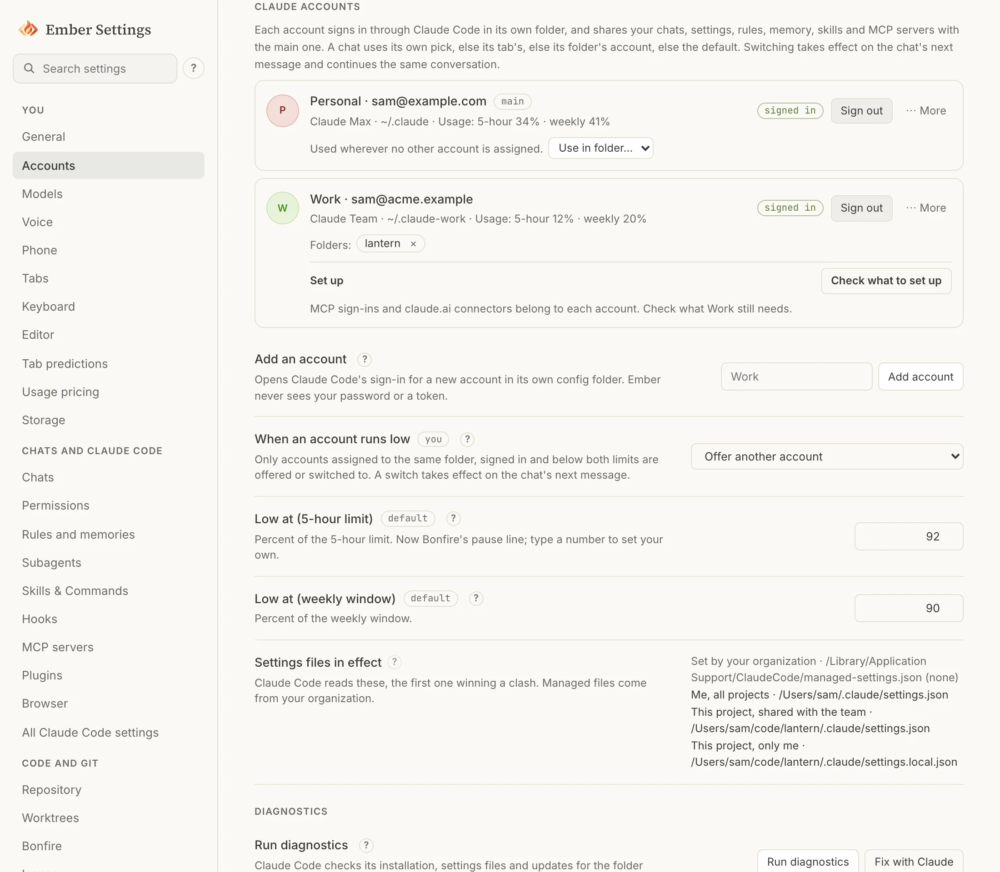
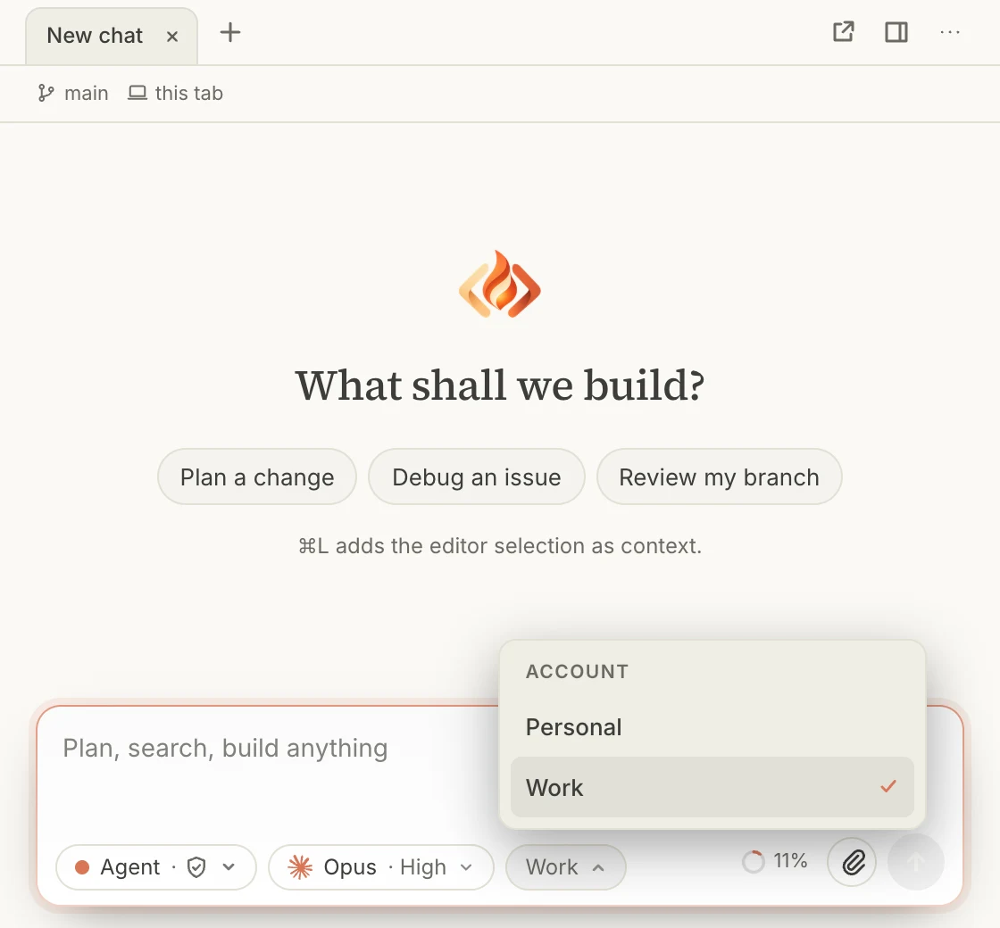
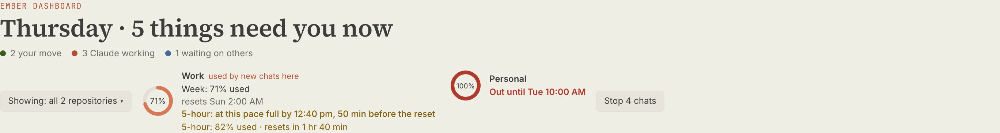

# Use More Than One Claude Account

Sign in to a second Claude account, for example Work beside Personal. Pick which account each folder, window or chat uses, switch without losing anything, and choose what happens when one runs low.

Ember can sign in to more than one Claude account, for example your personal plan and your work seat. Each account
signs in through Claude Code's own sign-in in a folder of its own, the way Claude Code documents logging in with
several accounts. Ember never sees a password or a token, and never needs an API key.

  <picture>
    <source media="(prefers-color-scheme: dark)" srcset="../images/settings-accounts.dark.webp">
    
  </picture>
   <em>Settings › Accounts: your Claude accounts, the folders each is for, and what happens when one runs low</em>

## Add an account

1. Open **Settings › Accounts** (<kbd>⌘,</kbd> (<kbd>Ctrl+,</kbd> on Windows and Linux) opens Settings).
2. Under **Claude accounts**, type a name (for example **Work**) and click **Add account**.
3. Claude Code's sign-in opens in your browser. Sign in with that account. Ember picks it up by itself.
4. On the account's row, pick **Use in folder…** for the folders whose chats should use it.

You can also click the status bar's account item and choose **Add an account…**, or run
**Add Claude Account**: Ember asks for the name, then Claude Code's sign-in opens.

The new account gets its own Claude Code folder, `~/.claude-work` for an account named Work. Your main account is the
one your terminal uses (`~/.claude`).

Each account in the list is a card with its name and email, its plan, folder and usage, a `signed in` or `signed out`
tag and its folders. **Sign in** or **Sign out** is on the card; **⋯ More** has **Rename…**, **Make default** and
**Remove…**. Double-clicking the name renames it too.

The plan is named as Claude Code names it: Pro, Max, Ultra, Team or Enterprise, or a newer plan by its own name. The
same name shows on the account's usage bars, in Usage and in About.

## What every account shares

Your accounts share everything except the sign-in itself. Ember links these from your main Claude Code folder into
each account's folder:

- your chats and their history, so any chat can continue on any account;
- your settings, CLAUDE.md, rules and memory;
- your skills, agents, commands, output styles and plugins;
- plans, to-dos and checkpoints.

Your MCP servers work on every account too. A server that needs its own sign-in (`/mcp`) asks once per account,
because that sign-in belongs to the account.

If an account's folder already has its own copy of something shared, for example its own `settings.json`, Ember
leaves it alone and says so on the account's row. Move that copy away and Ember links the shared one.

## Set up a new account's sign-ins

Some sign-ins belong to each Claude account, so a new account starts without them:

- **MCP servers that sign in** (for example a remote server like Atlassian): every account sees your servers, but each
  signs in to them for itself. Claude Code keeps those sign-ins with the account, and Ember never copies them.
- **claude.ai connectors** (Gmail, Slack, …) belong to the claude.ai account you connected them on.
- **Plugins** are shared with your main account already.

When an account finishes signing in, Ember says what it still needs ("Work is signed in. 1 server and 13 connectors to
set up") and offers its checklist. You find it under the account's row in **Settings › Accounts › Claude
accounts** (**Set up**):

- **Sign in** next to a server opens Claude Code's own sign-in for it on that account, in a terminal. Pick the server
  there and sign in; Ember checks again when you close the terminal.
- **Connect on claude.ai** opens claude.ai's connectors page. Connect them while signed in to claude.ai with that account.

If a chat on another account uses a server that needs a sign-in there, its notice opens that account's checklist.

## Which account a chat uses

A chat uses the first of these that fits:

1. **The chat's own pick**: the account button in the message box.
2. **The window's pick**: right-click the workspace tab and choose **Account**, or run
   **Choose Claude Account for This Window**.
3. **The folder's account**: assign folders to an account under **Settings › Accounts › Claude accounts**
   with **Use in folder…**.
4. Otherwise, your **default account**: your main account unless you swap it (see below).

Inline edits, chat titles, commit messages, reviews and Bonfire runs use the window's or folder's account too.

## Swap the default account

The default account is the one chats use when nothing else picks one: no account of their own, none for their window
and none for their folder. It starts as your main account. To swap it in one step:

- click the account item in the status bar and choose **⋯ › Make … the default** on an account;
- run **Switch Default Claude Account**, which shows each account's usage;
- choose **⋯ More › Make default** on an account's card in **Settings › Accounts › Claude accounts**;
- or click an account in the usage meters and choose **Make default**.

Chats on the default move to the new one on their next message and continue the same conversation. Chats with their
own account, or their window's or folder's, stay where they are. Ember says in one line how many chats move. Bonfire
runs keep the account they started on. Only a signed-in account can be the default. Your main account stays the
Claude Code folder the others share their settings and chats with; only the fallback changes
([`ember.accounts.default`](../settings/settings-other.md#emberaccountsdefault)).

## Switch a chat's account

  <picture>
    <source media="(prefers-color-scheme: dark)" srcset="../images/chat-account.dark.webp">
    
  </picture>
   <em>With several Claude accounts: the chat's account beside the model, its menu, and usage bars that name it</em>

With more than one account, the message box shows the chat's account as the last button under what you write (**Work account**), and the
status bar's account item names it. In a narrow chat panel the button shows only the account's name, then its initial,
and in the narrowest it leaves the row; the usage bars under the input and the status bar still name the account.
Click it to pick another account, click the status bar's account item and choose one under
**Switch this chat to** (with three or more accounts, its tab and **Use for this chat**), or run
**Choose Claude Account for This Chat**. See [The account item in the status bar](../chat/usage-limits.md#the-account-item-in-the-status-bar).

The switch takes effect on the chat's next message. The chat continues the same conversation on the new account:
nothing is lost. A message already running finishes on the account it started on. The chat says which account it moved
to.

## Usage on each account

Each account has its own plan limits. The usage bars under the message box and the status bar's account item name the
chat's account (click the item for every account's limits; **Read Claude Usage Again** reads
them now), the Dashboard's header shows every account, and **Settings › Accounts** shows each account's 5-hour and
weekly usage. See [Usage, Limits and Notifications](../chat/usage-limits.md).

  <picture>
    <source media="(prefers-color-scheme: dark)" srcset="../images/dashboard-accounts.dark.webp">
    
  </picture>
   <em>With more than one Claude account, the header shows each: its week, when it resets, and which one new chats use</em>

## When an account runs low

When an account reaches its limit line, Ember tells you which account is low, once for that limit: dismissing it is
enough. Your other Ember windows and a restart don't say it again, and each chat on the account hears it once. It
comes back only after the limit resets and the account runs low again. What happens next is your choice in
**Settings › Accounts › When an account runs low** ([`ember.accounts.whenLow`](../settings/settings-other.md#emberaccountswhenlow)):

- **Tell me** (the default): the chat offers **Extra usage**, or you wait for the reset.
- **Offer another account**: the chat also offers **Switch to …** for each account assigned to the same folder.
- **Switch by itself**: the chat moves to another account assigned to the same folder, from its next message.

Ember only ever offers or switches to an account that is assigned to the chat's folder, signed in, and below both
limit lines. **Low at (5-hour limit)** is Bonfire's pause line unless you set your own; **Low at (weekly window)** is
90% unless you change it.

The default account is no exception: it is only offered or switched to when it is assigned to the chat's folder too.
A chat that moved because its account ran low keeps the new account as its own pick, so swapping the default later
doesn't move it back.

Bonfire keeps to the same choice: the next to-dos can start on another account of the plan's folder, while to-dos
already building stay on their account. Bonfire's suggested number of agents counts the usage left on those accounts.

> **Note:** Claude Code's terms say Pro and Max usage limits "assume ordinary, individual usage". Before the first
> automatic switch, Ember shows that note and asks you to confirm. Use automatic switching only between accounts you
> hold for this work, for example your own work and personal accounts. Ask Anthropic support if you're unsure.

## Remove an account

Choose **⋯ More › Remove…** on the account's card and confirm. Claude Code signs that account out, then Ember removes its links.
Your chats, settings and the main account are untouched. Chats that used the removed account go back to their window's
or folder's account.

---

[All documentation](../README.md)
