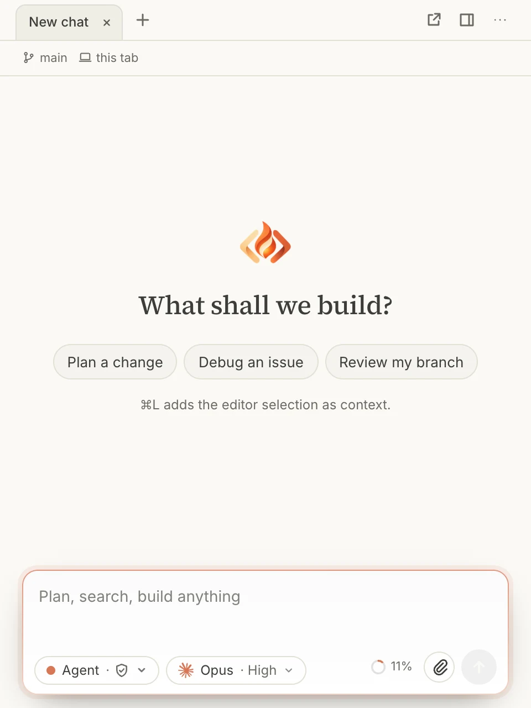
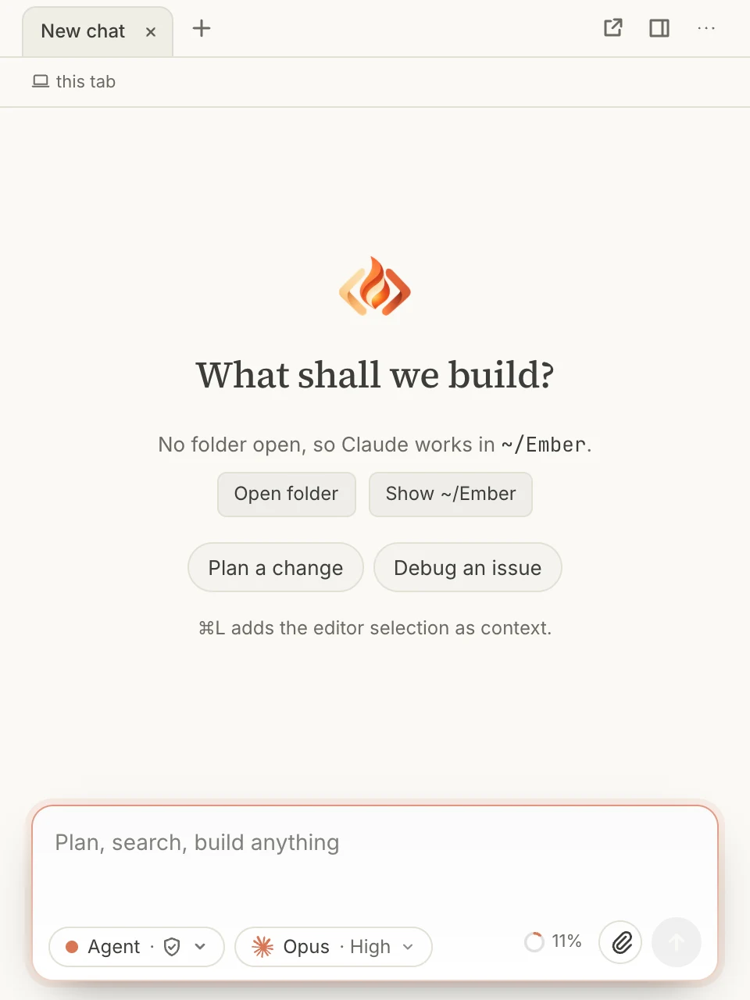
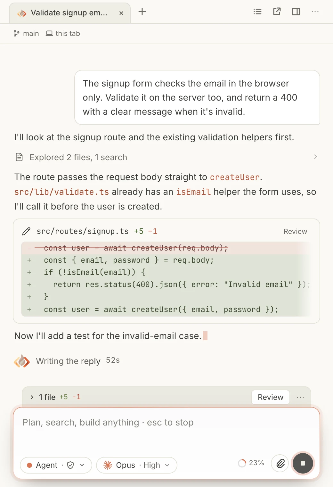

# Your First Chat

Send your first message, pick a mode and a model, keep or undo Claude's edits, and build from a plan.

A chat is a conversation with Claude about your project. Claude can read and search your files, edit them, and run
commands, and you review what it changed.

  <picture>
    <source media="(prefers-color-scheme: dark)" srcset="../images/chat-empty.dark.webp">
    
  </picture>
   <em>A new chat: quickstart shortcuts, and the message box with its mode and model</em>

## Start a chat

1. Open the chat panel (<kbd>⌘L</kbd> (<kbd>Ctrl+L</kbd> on Windows and Linux)), or start a new chat with <kbd>⌘T</kbd> (<kbd>Ctrl+T</kbd> on Windows and Linux) or
   **New Chat**.
2. Type what you want in the message box, for example "Add a --verbose flag to the CLI".
3. Press Enter to send. Shift+Enter starts a new line.

A new chat also offers shortcuts above the message box: **Plan a change**, **Debug an issue** and, in a repository,
**Review my branch**. They fill in the message box and pick the mode; nothing is sent until you press Enter.

With no folder open, Claude works in `~/Ember`, and a new chat says so. **Open folder** works on a project of yours instead;
**Show ~/Ember** shows what's been written there.

  <picture>
    <source media="(prefers-color-scheme: dark)" srcset="../images/chat-empty-no-folder.dark.webp">
    
  </picture>
   <em>With no folder open, a new chat says where its files go</em>

## Pick a mode

The mode button under what you write in the message box sets what Claude does with your message; its dot shows the mode's colour. Press Shift+Tab to move
to the next mode, or open the menu and press 1–4.

| Mode | What Claude does |
|---|---|
| **Agent** | Plans, searches, builds and fixes: it edits files and runs commands. |
| **Plan** | Writes a plan first and changes nothing until you build it or switch to Agent mode. |
| **Ask** | Answers questions without changing anything. It reads files and runs commands that only read (`git log`, `ls`, `rg`); anything that would change something offers to switch to Agent mode. |
| **Debug** | Finds a bug's cause from runtime logs, then fixes it. |

## Pick a model

The model button sits beside the mode. Click it (or press <kbd>⌥P</kbd> (<kbd>Alt+P</kbd> on Windows and Linux)) to choose
a model for this chat. See [Models, thinking, Fast and effort](../chat/composer.md#models-thinking-fast-and-effort) for effort, thinking and Fast, and
[Choosing models](../models/choosing-models.md) for which model suits what.

## Watch Claude work

While Claude works, the chat shows what it's doing: files it reads and searches, edits, commands, and short notes
between them. When the turn finishes, its work folds into one row above the reply that says what it did; click it to
see everything again. A line under the reply says how long it worked. See [Read a Chat](../chat/reading-a-chat.md).

  <picture>
    <source media="(prefers-color-scheme: dark)" srcset="../images/chat-running.dark.webp">
    
  </picture>
   <em>Claude at work: it reads the code, edits a file and keeps going</em>

Press Esc, or click the stop button, to stop Claude.

If Claude wants to run a command that needs your OK, a card asks you to **Run** or **Skip** it. See
[Approvals and Permissions](../chat/approvals.md).

## Keep or undo the edits

Claude's edits go straight into your files, so you can run and test them. Until you decide, they stay pending:

- The row on top of the message box shows how many files changed. Click the count to see the list.
- When the turn ends, **Keep all** accepts every change and **Undo all** puts every file back (pick it twice to
  confirm). Both sit at the end of the turn.
- **Review** opens the changes one file at a time, so you can keep or undo each change.

See [Review changes](../editing/review-changes.md).

## Plan first, then build

For a bigger change, switch to **Plan** mode and describe what you want. Claude explores the code and writes a plan.

1. Read the plan in the chat. Click **Edit plan** to change it yourself.
2. Click **Request changes** to tell Claude what to change.
3. Click **Build** to have Claude carry it out.

See [Plans](../plans/plans.md).

## What next

- [The Message Box](../chat/composer.md): queue or send messages now while Claude works, edit and resend, and more.
- [Give Claude Context](../chat/context.md): point Claude at files, code, problems and terminals.
- [Chats, Tabs and the Chat List](../chat/chat-tabs.md): several chats at once.

---

[All documentation](../README.md)
