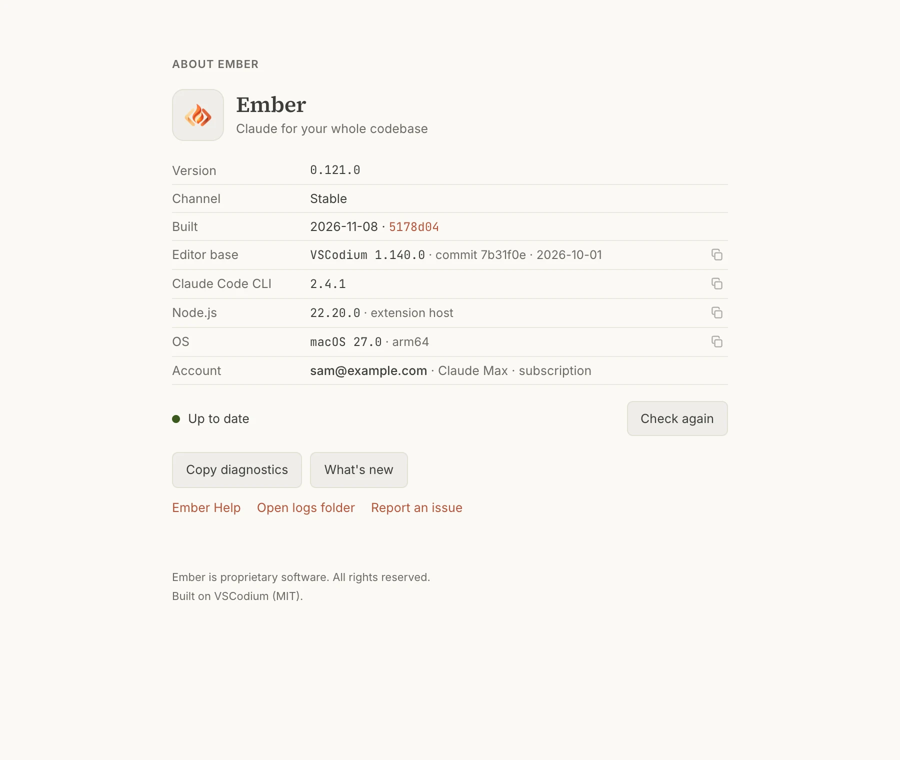

# Install and Update Ember

Install Ember.app on macOS, Windows or Linux, and choose how it updates itself.

Before you start, install the Claude Code CLI and sign in to it once (run `claude` in a terminal). Ember uses it for
every chat. See [Sign In with Your Claude Subscription](sign-in.md).

## Install Ember.app

Download the file for your computer from Ember's releases page and install it:

| Computer | File | How to install |
|---|---|---|
| macOS (Apple silicon) | `Ember-darwin-arm64-<version>.zip` | Unzip it and move **Ember.app** to Applications. |
| Windows (x64, Arm64) | `EmberUserSetup-<arch>-<version>.exe` | Run it. It installs for your user only, without admin rights. |
| Windows, portable | `Ember-win32-<arch>-<version>.zip` | Unzip it into a new, empty folder and run `Ember.exe`. |
| Debian, Ubuntu | `ember_<version>_<arch>.deb` | `sudo apt install ./ember_<version>_<arch>.deb` |
| Fedora, RHEL, openSUSE | `ember-<version>-1.<arch>.rpm` | `sudo dnf install ./ember-<version>-1.<arch>.rpm` |
| Any Linux | `Ember-linux-<arch>-<version>.tar.gz` | Extract it into a new, empty folder and run `ember` there. |

> **Note:** On Windows, Claude Code runs its shell commands in Git Bash, so install Git for Windows too.

> **Careful:** Don't unpack a `.zip` or `.tar.gz` over an older copy's folder. Nothing clears the files the new version
> no longer has, so the old ones stay beside it. Unpack it into a new folder and delete the old one. Your chats and
> settings aren't in that folder, so they stay.

On Linux, Ember needs glibc 2.28 or newer, and on Arm64 also libstdc++ from GCC 9 or newer. RHEL 8 on Arm64 has an older
libstdc++, so the `.rpm` won't install there and Ember's files can't load: use a newer system. On a Linux older than
glibc 2.34 (x64), Microsoft sign-in opens your browser rather than using the system's sign-in broker.

## How Ember updates

Ember.app looks for a new version when it starts and about every two hours while it stays open, so you don't need to
quit Ember to hear about a release. Coming back to Ember after your computer slept looks too, once a look is due. Once a
new version is found, Ember looks every six hours, and tells you about the same version at most once a day. Without a
connection it tries again in a few minutes, then less often. Choose what it does in **Settings › General ›
Updates** ([`ember.update.mode`](../settings/settings-general.md#emberupdatemode)):

| Choice | What happens |
|---|---|
| **Tell me about new versions** | A notification says a new version is out, with **Install and Restart**, **Release Notes** and **Skip This Version**. |
| **Install automatically when Ember quits** | Ember downloads the new version in the background and installs it the next time you quit. |
| **Don't check** | Ember never looks for new versions. |

On macOS, with the Windows installer and on Linux, Ember installs the update itself (a Linux package asks for your
password). The portable Windows zip offers **Download** instead, so you unpack the new file yourself.

## Check for updates now

1. Open **Settings › General**.
2. Next to **Updates**, click **Check now**. The line under it says whether you are up to date.

Or run **Check for Updates** from the Command Palette.

## See your version

**Settings › General › Version** shows the Ember version and the editor it runs on. Click **About Ember…** (or
**About Ember**) for the About page, a sheet of facts: the version (click it to copy), the channel, when it was built, what it runs on and your
account. Below them, the update state: a green dot for **Up to date**, a yellow one when a new version is available,
with **Check again** to look now. **What's new** shows the release notes. Hover **Dashboard** in the status bar for
**About Ember** with the version. The version also shows at the far right of the status bar (click it for **About
Ember**); turn off [`ember.version.statusBar`](../settings/settings-other.md#emberversionstatusbar) to hide it.

  <picture>
    <source media="(prefers-color-scheme: dark)" srcset="../images/about.dark.webp">
    
  </picture>
   <em>About Ember: the version, the channel, what it runs on, and whether it's up to date</em>

## The extensions in VS Code or VSCodium

When you run the Ember extensions in your own editor, Ember doesn't update them and the Updates row isn't shown.
Install the new extension files the same way you installed them.

## Claude Code updates

The Claude Code CLI updates separately. See [Keep Claude Code up to date](sign-in.md#keep-claude-code-up-to-date).

---

[All documentation](../README.md)
