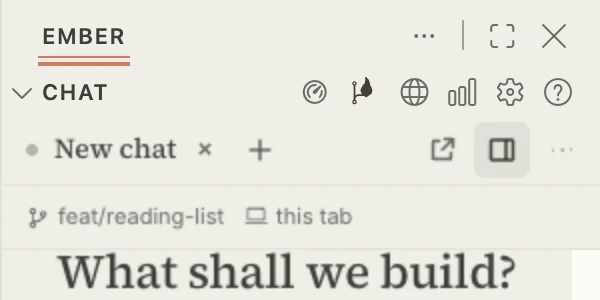

# Find Your Way Around

Where the Chat and Chats views live, one-step layouts, your own layouts, and swapping sides.

Ember adds two views to the right side bar: the **Chat** view (the chat panel), where you talk to Claude, and **Chats** beside
it: your chats as a card per branch (or with what needs you first, or by time), with where each is open, its branch and pull request, and each
chat's ✦ outputs.

  <picture>
    <source media="(prefers-color-scheme: dark)" srcset="../images/window-view-title.dark.webp">
    
  </picture>
   <em>The top of the chat panel: the chat's header row, with the chat list, its tabs and New chat</em>

## The chat panel

The chat panel lives in the secondary side bar, on the right of the editor by default. The chat's own header row holds
the open chats' tabs (or, while the chat list shows beside it, the chat's name) and **+** for a new chat on the left;
the outline, open in an editor tab, the **Chats** button that shows or hides the chat list, and a **⋯** menu (maximize or restore the chat panel, open to the side, save as a skill, copy or export as
Markdown, and the to-dos when they're hidden) on the right. In the Ember app that row is the top of the side bar: the
bar has no title row of its own while the chat is in it.

Ember's other pages have their buttons at the top right of the window, before the layout buttons: **Dashboard** with
what needs you and what's working (see [The Ember Dashboard](../worktrees/dashboard.md)), Bonfire while it's on, Forge, Ember's browser, the usage
dashboard, Settings and Help. In a narrow window the usage dashboard, the browser and then Forge move into a **⋯**. (Ember's builds without its own title bar code keep these buttons in the chat panel's title
bar, in two groups: where the work is, then you and Ember.)

- Press <kbd>⌘L</kbd> (<kbd>Ctrl+L</kbd> on Windows and Linux) to show the chat panel; with text selected in the editor, it also adds the
  selection to the chat.
- Press <kbd>⌘T</kbd> (<kbd>Ctrl+T</kbd> on Windows and Linux) for a new chat.

## Settings

**Settings** lists its sections under three headings: **You** (General, your account, models,
voice, the phone, keys and the editor), **Chats and agents** (permissions, memory and rules, subagents, skills, hooks,
MCP servers, plugins) and **Code and git** (the repository's policy, worktrees, Bonfire, issues, indexing). Type in
**Search settings** to find a setting in any section by its name, its description or its setting id. Up and Down move
between sections.

Each row has its label and description on the left and its control on the right: a switch for on or off, a row of buttons for
two to four choices, a list for more, and a box for text. Things you keep several of, such as accounts, endpoints, MCP
servers, hooks and subagents, are cards with their status and actions. Every value says where it comes from (see
[Where a value comes from](../claude-code/claude-code-files.md#where-a-value-comes-from)).

## Chats

Your chats are listed in **Chats**, in the right side bar with the chat. It's a view of its own, so you can
size, collapse or hide it apart from the chat:

- In Ember.app, the chat and its list sit side by side. Drag the handle between them to size each; Ember remembers both
  widths. Click a view's title to collapse it to a thin bar with its name (**CHAT** or **CHATS**), and click the bar to open it again.
- In VS Code or VSCodium, the chat list sits under the chat, as VS Code stacks a side bar's views.
- Press <kbd>⌃⌘L</kbd> (<kbd>Ctrl+K Shift+L</kbd> on Windows and Linux), or click the **Chats** button at the right of the chat's header row, to show
  or hide the chat list, or ✕ in its title bar to hide it. Hidden, the chat takes the whole side bar. The right side bar's own key, ⌥⌘B (Ctrl+Alt+B), shows or
  hides both together.
- Drag the **Chats** title to move it, for example into the left side bar, and it stays there.

The Ember icon in the activity bar opens **Ember Work**: **Now** (what needs you and what's working, see
[Outside the Dashboard](../worktrees/dashboard.md#outside-the-dashboard)), **Issues** and **Rules**. The icon's badge is the number of things that need
you, in every window.

At the top of the chat, under its tabs, the context line says which branch the chat works on, where that branch lives
and what it needs next (see [The context line](../chat/chat-tabs.md#the-context-line)). Click the branch for its details: the repository,
branch and worktree the chat's work lands in, and a way to open a terminal there.

## Pages for all your work

Three pages show work across every Ember window. Each opens as an editor tab:

| Page | Open it with | What it shows |
|---|---|---|
| **Dashboard** | <kbd>⌘K ⇧D</kbd> (<kbd>Ctrl+K Shift+D</kbd> on Windows and Linux) | What needs you first, what's working, Bonfire, metrics. See [The Ember Dashboard](../worktrees/dashboard.md). |
| **Issues** | <kbd>⌘K ⇧I</kbd> (<kbd>Ctrl+K Shift+I</kbd> on Windows and Linux) | Your GitHub and Jira issues, to start work from. See [Plan from GitHub and Jira issues](../plans/issues.md). |

These keys work anywhere but in an editor or the terminal, which keep ⌘K (Ctrl+K) for themselves. Ember.app opens the
Dashboard when a window with a folder starts with no open editors.

See [Chats, Tabs and the Chat List](../chat/chat-tabs.md) for everything you can do with chats.

## One-step layouts

Run **Layout…** and pick how to arrange the window:

| Layout | What you see |
|---|---|
| **Agent** | The editor and the chat side by side. |
| **Chat** | The chat fills the window. |
| **Editor** | Code first, with the Explorer and the chat beside it. |
| **Zen** | Only the editor. |
| **Browser** | Ember's browser beside the chat. |

Using a layout twice gives the same window, so you can always get back to a known arrangement. Each layout also has
its own command, for example **Ember: Layout: Agent**.

Press <kbd>⌥⌘J</kbd> (<kbd>Ctrl+Alt+J</kbd> on Windows and Linux) to switch to the Agent layout, and again to go back to the layout you had
before it.

## Save your own layout

1. Run **Save a New Layout…** (also at the bottom of the **Layout…** list).
2. Name it.
3. Choose what the side bar shows: **Explorer**, **Ember Work (Now, Issues, Rules)**, **Search**, **Source Control** or **Hidden**.
4. Choose how the chat shows: **Beside the editor**, **Fills the window** or **Hidden**.
5. Choose whether the panel (terminal, problems…) shows.

Your layouts appear under **Your layouts** in the **Layout…** list. Remove one with
**Delete a Layout…**.

## Swap sides

**Ember: Layout: Swap Side Bar and Chat** moves the side bar and the chat to opposite sides of the window. On macOS
it is <kbd>⌘E</kbd>.

## The Ember layout

The Ember layout puts the view icons at the top of the side bars, hides the icon row when a side bar has only one
view, keeps the chat's side bar open in new windows, and always shows a view's title buttons (the chat's buttons and the
rest, now that it shares its side bar with the chat list). It changes your user settings, and remembers what they were.

- In **Settings › General › Import and layout**, click **Use Ember layout**, or run
  **Use Ember Layout**.
- To undo it, click **Go back to my previous layout**, or run **Restore Previous Layout**.

---

[All documentation](../README.md)
