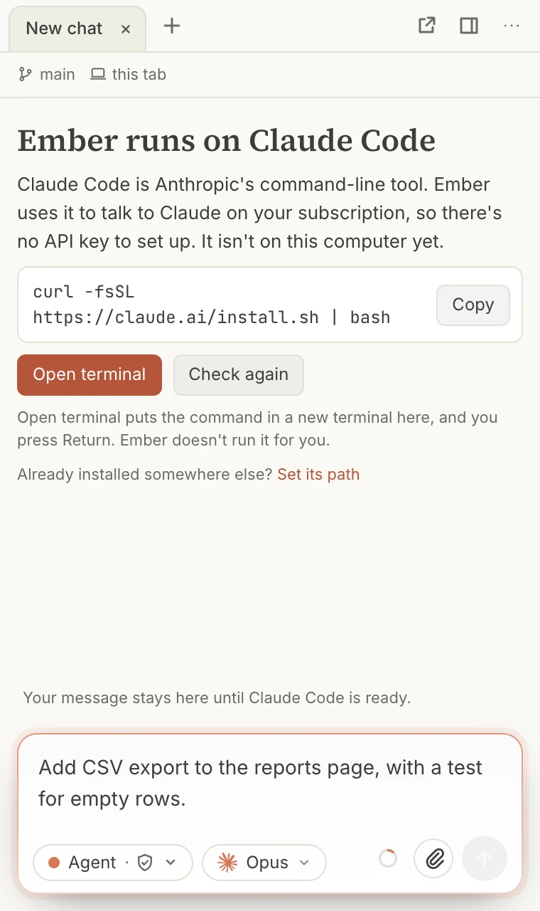

# Sign In with Your Claude Subscription

Ember runs on your Claude subscription through the local claude CLI. Sign in, check your account, and keep Claude Code healthy.

Ember doesn't have an account of its own. Every chat, plan and subagent runs through the Claude Code CLI (`claude`)
on your computer, signed in with your Claude subscription. Ember never sees your password or your sign-in token: the
CLI handles them.

## If Claude Code isn't installed

Without Claude Code, the chat panel says so before you send anything, with the install command for this computer.

- **Copy** copies the command. **Open terminal** types it in a new terminal, and you press Return: Ember doesn't run it for you.
- **Check again** looks again, and says where it looked. Ember also keeps looking by itself while the screen is up.
- **Set its path** is for a `claude` installed somewhere Ember doesn't look ([`ember.claudePath`](../settings/settings-account.md#emberclaudepath)).

What you typed stays in the box, and send stays off until Claude Code is ready. Ember never sends it by itself.

  <picture>
    <source media="(prefers-color-scheme: dark)" srcset="../images/chat-no-cli.dark.webp">
    
  </picture>
   <em>No Claude Code yet: what it is, this computer's command, and what you typed stays in the box</em>

## Sign in

If the CLI isn't signed in, the chat panel shows **Sign in to Claude** instead of a chat.

1. Click **Sign in with Claude**. Ember runs Claude Code's own sign-in, which opens a page in your browser.
2. Finish signing in on that page. The panel says **Waiting for your browser…** until you're done.
3. If the sign-in asks for something in the terminal, click **Show terminal**. Click **Cancel** to stop.

Already signed in to Claude Code in a terminal? Then Ember is signed in too: there is nothing to do.

## Check your account

Open **Settings › Accounts** (<kbd>⌘,</kbd> (<kbd>Ctrl+,</kbd> on Windows and Linux) opens Settings).

- **Claude CLI** shows which `claude` Ember runs and its version.
- **Account** shows your plan and email, and how the CLI is signed in. Use **Sign out** or **Sign in** here.
- **Settings files in effect** lists the Claude Code settings files the CLI reads, the first one winning a clash.

If the Account row warns that Claude Code isn't using your subscription, look at **Sign-in** further down the page.

To sign in to a second account, for example a work seat beside your personal plan, see [Use More Than One Claude Account](accounts.md).

## When a sign-in ends

A claude.ai sign-in stored by Claude Code lasts a fixed time; renewing in the background doesn't extend it. Claude Code
2.1.318 and later say when it ends, and Ember shows it on each account in **Settings › Accounts** ("Sign-in ends
Dec 1"). The real end can come up to 3 days before that date.

From 10 days before, Ember says so once (a notification, and a notice in that account's open chats) with **Sign in
again**, which runs Claude Code's own sign-in. Your current sign-in keeps working while you approve in the browser,
and Ember waits for the new one before it calls the sign-in done. Signing in again moves the date. Before a Bonfire run starts, Ember asks
if the run might outlive the sign-in, so an unattended run isn't signed out partway. Older Claude Code versions don't
give a date, and then Ember shows nothing. Ember never reads Claude Code's sign-in files.

## Use a different claude CLI

Ember finds `claude` on your login shell's `PATH`. To use another copy, enter its full path in **Settings › Accounts › Claude CLI** ([`ember.claudePath`](../settings/settings-account.md#emberclaudepath)). Leave it empty to find it automatically.

## Why Ember removes API keys

If `ANTHROPIC_API_KEY` or `ANTHROPIC_AUTH_TOKEN` reaches the CLI, Claude Code bills per token to that key instead of
using your subscription. So Ember removes both from the environment of every `claude` it starts, and tells you once
in the chat when it did.

Some variables send requests to another provider, for example `CLAUDE_CODE_USE_BEDROCK`, `CLAUDE_CODE_USE_VERTEX`
or an `ANTHROPIC_BASE_URL` that isn't Anthropic's. Ember leaves these alone but shows a warning in the chat while
one is set.

> **Note:** Chats on your own models (see [Your own endpoints](../models/own-endpoints.md)) use that provider's key, not your Claude
> subscription.

## Settings that sign in another way

**Settings › Accounts › Sign-in** shows three read-only lists:

- **Settings that sign in another way**: settings in your Claude Code files that make it use an API key, another
  provider, or credentials from a script. Ember never writes them. Click **Open file** to edit or remove one.
- **Sign-in policy**: Claude Code settings that limit which accounts can sign in.
- **Managed by your organization**: keys your organization sets. They win over every other file.

## Run diagnostics

1. Open **Settings › Accounts › Diagnostics**.
2. Click **Run diagnostics**. Claude Code checks its installation, settings files and updates. Nothing is changed.
3. Each section shows ✓, ⚠ or ✗. Sections with a problem open on their own.

To fix what it finds, click **Fix with Claude**: a new chat runs Claude Code's `/doctor`, which can repair it.

## Keep Claude Code up to date

Claude Code updates itself in the background. To update now, click **Check for update** in **Settings › Accounts › Updates**. `claude update` runs in a terminal, and Ember reads the version again when it closes.

On the same page:

- **Release channel**: **Latest** gets every release as it ships; **Stable** is about a week old and skips releases
  with known problems.
- **Minimum version**: Claude Code won't go below this version.
- **Turn off automatic updates**: Claude Code stops updating itself. **Check for update** still works.

These are Claude Code settings, so the terminal uses them too.

---

[All documentation](../README.md)
