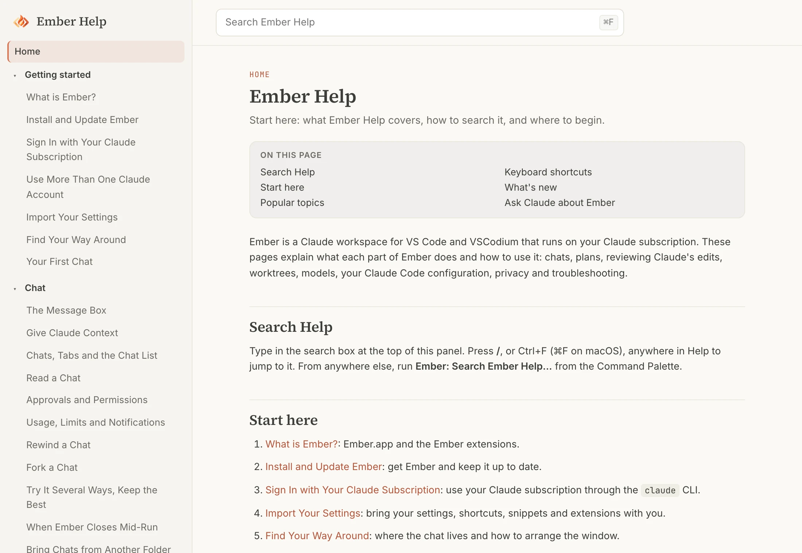

# Ember Help

Start here: what Ember Help covers, how to search it, and where to begin.

Ember is a Claude workspace for VS Code and VSCodium that runs on your Claude subscription. These pages explain
what each part of Ember does and how to use it: chats, plans, reviewing Claude's edits, worktrees, models, your
Claude Code configuration, privacy and troubleshooting.

  <picture>
    <source media="(prefers-color-scheme: dark)" srcset="../images/help-panel.dark.webp">
    
  </picture>
   <em>Ember Help: the contents on the left, the page on the right</em>

## Search Help

Type in the search box at the top of this panel. Press **/**, or Ctrl+F (⌘F on macOS), anywhere in Help to jump to
it. From anywhere else, run **Ember: Search Ember Help…** from the Command Palette.

## Start here

1. [What is Ember?](../getting-started/what-is-ember.md): Ember.app and the Ember extensions.
2. [Install and Update Ember](../getting-started/install-update.md): get Ember and keep it up to date.
3. [Sign In with Your Claude Subscription](../getting-started/sign-in.md): use your Claude subscription through the `claude` CLI.
4. [Import Your Settings](../getting-started/import-settings.md): bring your settings, shortcuts, snippets and extensions with you.
5. [Find Your Way Around](../getting-started/layout.md): where the chat lives and how to arrange the window.
6. [Your First Chat](../getting-started/first-chat.md): send a message, pick a mode and a model, and keep or undo Claude's edits.

## Popular topics

- [The Message Box](../chat/composer.md): modes, models, effort and what Enter does while Claude works.
- [Give Claude Context](../chat/context.md): add files, code, problems, terminals and more with @.
- [Approvals and Permissions](../chat/approvals.md): how much Claude may do on its own, and which commands always ask.
- [Review changes](../editing/review-changes.md): keep or undo Claude's edits.
- [Plans](../plans/plans.md): plan first, then build.
- [Worktrees](../worktrees/worktrees.md): let a chat work in its own worktree.
- [Rules and CLAUDE.md](../knowledge/rules.md) and [Memory](../knowledge/memory.md): tell Claude how you work.
- [Choosing models](../models/choosing-models.md): pick a model for each chat.
- [Usage, Limits and Notifications](../chat/usage-limits.md): see how much of your plan you have used.
- [Troubleshooting](../troubleshooting/troubleshooting.md): when something doesn't work.

## Keyboard shortcuts

Every Ember shortcut, by where it works, is in [Keyboard shortcuts](../shortcuts/keyboard-shortcuts.md). Open it at any time with
<kbd>⌘K ⌘R</kbd> (<kbd>Ctrl+K Ctrl+R</kbd> on Windows and Linux) or **Show keyboard shortcuts**.

## What's new

Each release's changes are in [What's new in Ember](https://github.com/dgruhin-hrizn/ember-releases/releases). **Open What's New**

## Ask Claude about Ember

You can ask Claude in any chat how to do something in Ember, for example "how do I compare two chats?". Claude
has a read-only `ember_help` tool that searches these pages and answers with links into Help. It never asks for
approval and changes nothing. Turn it off with [`ember.help.tool`](../settings/settings-other.md#emberhelptool).

---

[All documentation](../README.md)
