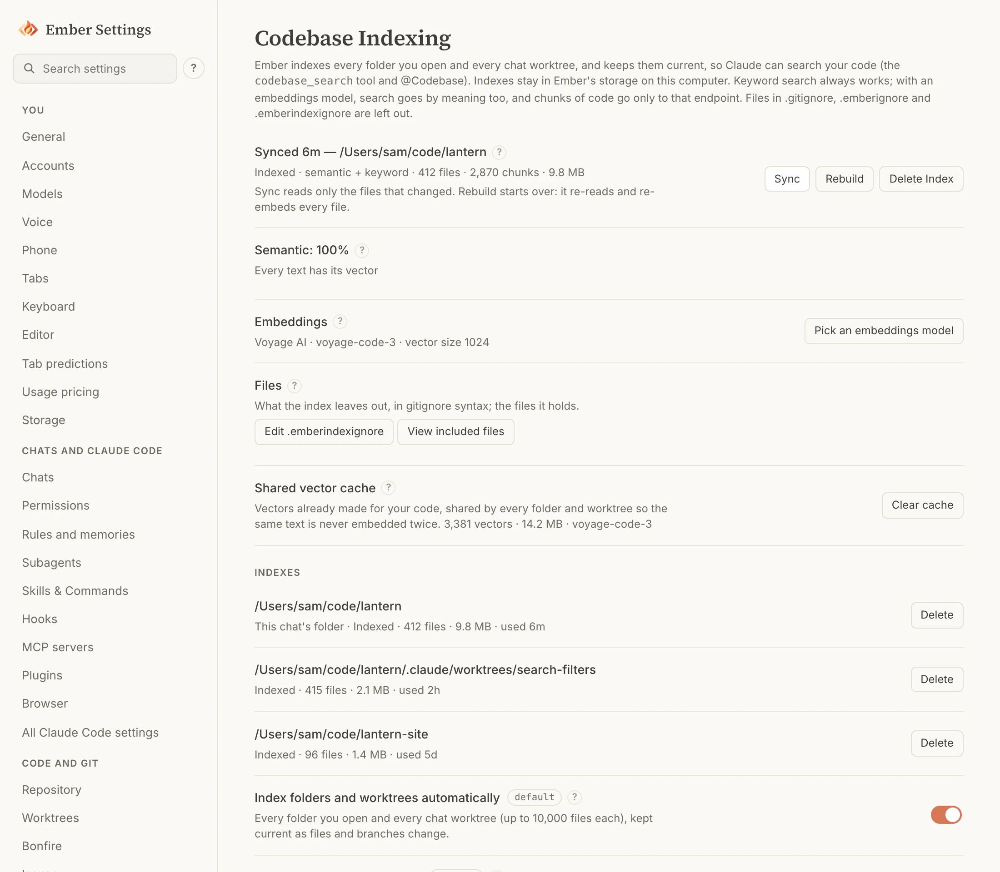

# Codebase Index

Ember indexes your code so Claude can search it by words, and by meaning with an embeddings model.

Ember builds an index of each folder you open, and of every chat worktree, and keeps it current as files and branches
change. Claude uses it to find code quickly: through the read-only `codebase_search` tool, and when you mention
**@Codebase** in a message.

Indexes stay in Ember's storage on this computer. Keyword search always works. Add an embeddings model and search
also goes by meaning, so Claude finds code that does what it is looking for even when the words differ.

  <picture>
    <source media="(prefers-color-scheme: dark)" srcset="../images/settings-indexing.dark.webp">
    
  </picture>
   <em>Settings › Indexing: the codebase index</em>

## Automatic indexing

With [`ember.index.auto`](../settings/settings-indexing.md#emberindexauto) on (the default), every folder you open and every chat worktree is indexed, up to
10,000 files each. Larger folders are indexed when you click **Index this folder** in Settings › Indexing.

Left out of every index: files in `.gitignore`, `.emberignore` and `.emberindexignore`. Click
**Edit .emberindexignore** under **Files** to leave out more (gitignore syntax), and **View included files** to see
what the index holds.

Besides watching for changes, each open index re-checks its whole folder every
[`ember.index.reconcileMinutes`](../settings/settings-indexing.md#emberindexreconcileminutes) minutes for anything the file watcher missed.

## Check an index

Settings › Indexing shows the current chat folder's index: whether it is **Synced**, **Indexing** (with progress),
**Out of sync** or **Not indexed**, and how many files and chunks it holds. Its buttons:

- **Sync** reads only the files that changed (**Sync Codebase Index**).
- **Rebuild** starts over: it re-reads and re-embeds every file (**Rebuild Codebase Index**).
- **Delete Index** removes it (click twice to confirm).

**Open Indexing settings**

## Keyword and meaning-based search

Without an embeddings model, the index supports keyword search only. To search by meaning too, add an embeddings
model under **Embeddings** › **Pick an embeddings model** (it opens Settings › Models). Chunks of your code then go
to that embeddings endpoint, and nowhere else.

While vectors are being made, a **Semantic** row shows how far along it is, with the speed and the time left.
Keyword search stays current throughout.

- **Pause meaning-based indexing** stops making vectors for now; **Resume meaning-based indexing** carries on
  (**Pause Codebase Index Vectors**,
  **Resume Codebase Index Vectors**).
- When the embeddings endpoint runs on this computer and a chat is using it, indexing waits so the chat stays
  responsive ([`ember.index.yieldToChats`](../settings/settings-indexing.md#emberindexyieldtochats)).
- [`ember.index.embedConcurrency`](../settings/settings-indexing.md#emberindexembedconcurrency) sets how many embedding requests run at once (1 or 2).

Some files stay keyword-only: lockfiles, minified code, source maps, snapshots, generated code and data files over
64 KB. Add your own patterns to [`ember.index.embedExclude`](../settings/settings-indexing.md#emberindexembedexclude), for example `legacy/` or `*.sql`.

## Space and cleanup

**Shared vector cache** holds vectors already made for your code, shared by every folder and worktree, so the same
text is never embedded twice. **Clear cache** empties it.

Under **Indexes**, Settings lists every index in Ember's storage, with its state, size and when it was last used.
**Delete** removes one.

[`ember.index.maxTotalGb`](../settings/settings-indexing.md#emberindexmaxtotalgb) is a soft cap on the space indexes take (5 GB by default; 0 means no cap). When
Ember starts and the indexes are over it, it first deletes the least recently used indexes of folders not open
anywhere, then the least recently used vectors in the shared cache. A text whose vector was removed is embedded again
only if it is needed.

## Claude's codebase_search tool

With [`ember.index.tool`](../settings/settings-indexing.md#emberindextool) on (**Codebase search for Claude**), new chats get the read-only `codebase_search`
tool once their folder has an index.

---

[All documentation](../README.md)
