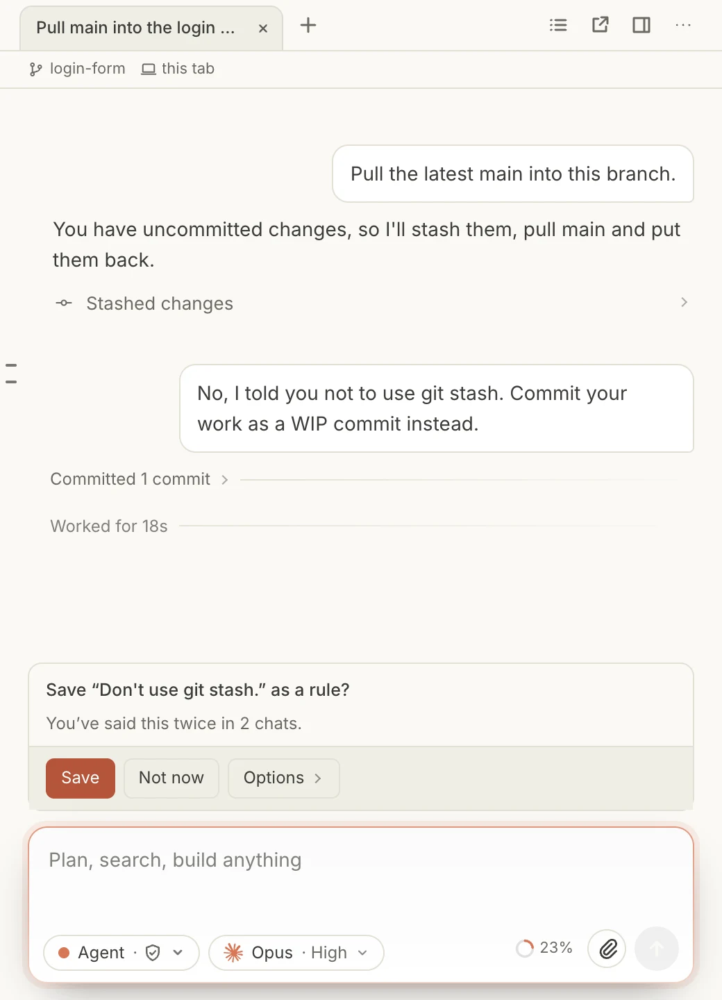

# Memory

Have Claude remember facts across chats: memories you add, and the notes Claude Code keeps on its own.

Memory carries facts from one chat to the next, such as "the staging API needs the VPN". There are two kinds: the
memories you add yourself, and the notes Claude Code keeps on its own while it works (auto memory). Both are saved
in Claude Code's memory, so the terminal sees them too.

Manage both in Settings › Rules and memories. **Open Rules and memories**

## Add a memory

From the editor:

1. Select some text, right-click and choose **Add to Memory** (or run **Add to Memory**).
2. Edit the text if you like (up to 2,000 characters) and press Enter.
3. Choose who it's for: **For this project** (new chats in this folder) or **For me, in every project** (every new chat, in any
   folder).

From a chat, hover a reply and click its **Remember** button (the bookmark icon), or, in the **⋯** of one of your
messages, pick **For this project…** or **For me, in every project…** under **Remember** (the text opens to edit
first; the menu has already asked who it's for). From Settings ›
Rules and memories, type it under **Memories you add**, pick **Where to use it** and click **Add**.

Memories for this project go into Claude Code's auto memory (or `CLAUDE.local.md` when auto memory is off).
Memories for all projects go into a rules file in your Claude Code folder. New chats load them from there. To change
or remove one, use **Edit** or **Delete** next to it in Settings.

## Learn from your corrections

When you correct Claude the same way again and again, such as "never use git stash" or "Opus for everything", Ember
notices and offers to save it, so you don't have to say it again. The third time you say it, in the same chat or
other ones, a card appears below the chat asking **Save “…” as a rule?** with the rule drafted from your words (once or
twice could be chance, so it waits):

  <picture>
    <source media="(prefers-color-scheme: dark)" srcset="../images/chat-correction.dark.webp">
    
  </picture>
   <em>You gave the same correction three times: one line asks to save it as a rule, with Save, Not now and the text and where it goes under Options</em>

- **Save** writes it where the defaults say; point at **Save** to see where.
- **Not now** closes the card. Ember asks again once you've said it three more times.
- **Options** opens the rest: what you said last time, the rule text (edit it if you like), and:
  - **Remember**: **For this project** or **For me, in every project**, the same choice a message's **⋯** offers.
    Ember suggests **For me, in every project** when you said it in more than one folder.
  - **Save as**:
    - **Always-on rule** (the default): a rule file Claude Code loads in every chat, in the project's `.claude/rules`
      folder or, for all projects, in the `rules` folder of your Claude Code folder.
    - **Memory**: saved like a memory you add yourself (see above).
    - **File rule**: the same, but it loads only when Claude works on files that match its patterns, such as
      `**/*.test.ts`. Ember fills in patterns when you named some.
- **Don't offer this again**, under **Options**, closes the card, and Ember never asks about that correction again
  when you say it in much the same words.

Nothing is saved until you click **Save**. Ember doesn't offer a correction when a memory or rule Claude Code loads
for the project already says much the same, and it ignores questions, one-off requests ("for now", "this time"),
bug reports ("it fails every time") and replies like "never mind" or "no luck". You can answer the card from your
phone too.

Ember keeps a short list of the corrections it noticed in its own storage on your computer, so it can spot a repeat.
For a correction that isn't clearly a standing rule, such as "no, put it in core/util" or "Opus for everything",
Ember asks a small, fast Claude model once, in the background, whether it is a lasting preference before it offers
the card. Deleting a chat removes what you said there from that list.

To turn this off, set **Learn from your corrections** in Settings › Rules and memories to **Off**
([`ember.learn.corrections`](../settings/settings-other.md#emberlearncorrections)).

## Auto memory

With **Auto memory** on, Claude saves what it learns about the project as it works, and reads it back in new chats.
These notes live outside the repository. In Settings › Rules and memories, under **Auto memory**:

- **Auto memory** turns it on or off. **Memory folder** shows where the notes are kept.
- **Tidy up in the background** lets Claude Code merge and trim its notes between chats.
- **Auto memory index (MEMORY.md)** is the index Claude Code loads into every chat. Its meter shows how much of the
  load limit is used: only the first 200 lines (25 KB) load. **Open** opens it.
- Each note is listed with **Open** and **Delete**. Delete removes its line from `MEMORY.md` and moves its file to
  the Trash.

> **Tip:** If `MEMORY.md` grows past the limit, Settings says so. Ask Claude to tidy it up, or delete entries you no
> longer need.

## Memories still kept by Ember

Older versions of Ember kept your memories in its own storage, where the terminal can't see them. If you have any,
Settings › Rules and memories lists them under **Still kept by Ember**:

- **Give these memories to new chats** ([`ember.memories.enabled`](../settings/settings-memories.md#embermemoriesenabled)) gives them to new chats as always-on
  rules. Off keeps them without using them.
- **Move to Claude Code's memory** › **Preview the move…** shows where each one would go. Nothing moves until you
  click **Move**, and Ember keeps its old copies as a backup.

---

[All documentation](../README.md)
