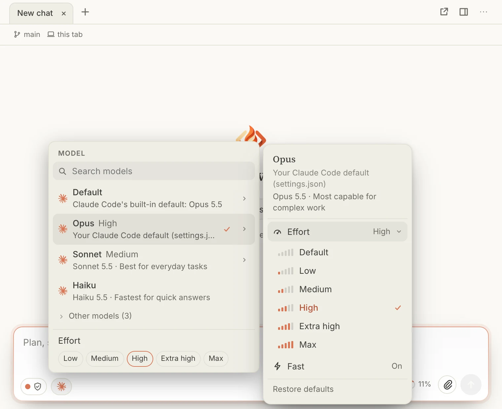
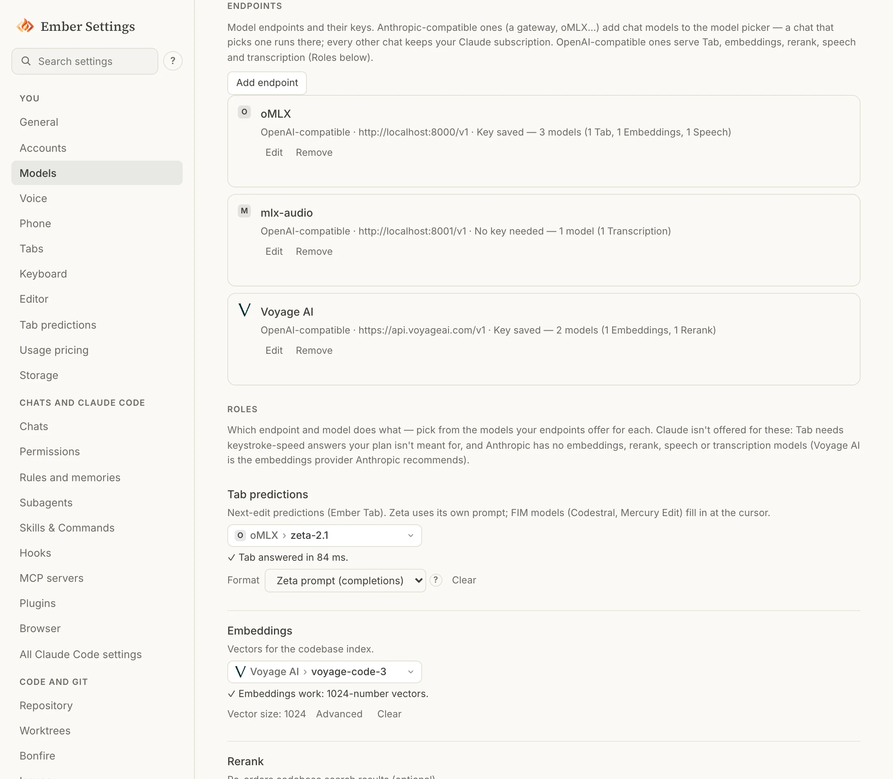

# Choosing models

Pick a model and effort for each chat, see where a default comes from, set what new chats start on, and choose the models for titles, commit messages, inline edits and subagents.

Every chat has its own model and effort. Settings › Models decides what new chats start on, and which models Ember uses for its smaller jobs: chat titles, commit messages and inline edits.

  <picture>
    <source media="(prefers-color-scheme: dark)" srcset="../images/chat-model-picker.dark.webp">
    
  </picture>
   <em>The model picker: models, where each default comes from, and each model's effort and Fast</em>

## Pick a model for a chat

1. Click the model name under the message box, or press <kbd>⌥P</kbd> (<kbd>Alt+P</kbd> on Windows and Linux) while the message box has focus.
2. Type to search, or use the arrow keys. Claude's own models are listed first; full model ids sit under **Other models**.
3. Press Enter or click a model.

The pick stays with that chat. Models from your own endpoints ([Your own endpoints](own-endpoints.md)) and from the model bridge ([Model bridge](model-bridge.md)) appear in the same list under their provider's name. A chat on one of your own models shows a marker on the model name: it runs on that endpoint, not on your Claude subscription.

> **Tip:** The message box has keys for the picker and for cycling effort too — see [In the message box](../shortcuts/keyboard-shortcuts.md#in-the-message-box).

### When a model can't be used

The picker says so plainly instead of spinning:

- **Not available on** your account (by the name Ember shows for it, or **your account** when you have one you never
  named): Claude Code said this account has no such model, and its own words show under it.
- **Not loaded on** one of your own endpoints: the endpoint said it has no such model (for example, a local server
  that hasn't loaded it). This is about the endpoint, whichever Claude account the chat uses.
- **Not available: its endpoint is gone**: a model from one of your own endpoints that is no longer in Settings ›
  Models.
- **Not available: Ember's connection to your own models isn't running**, or **Not available on** the bridged account when its plan doesn't
  include the model.
- **Not available: its endpoint isn't answering**: one of your own models still isn't listed after ten seconds.

Either one is offered again as soon as a turn on that model succeeds, or after an hour.

The model name under the message box reads **Not available**, and the picker shows the reason at the top with a
**Model settings** link. Another model the chat can't use says why on its row, and picking it does nothing (in **Try several**, a model you
had already ticked can still be unticked). Picked
any other way (a build, the phone), it is refused with the same reason, and the chat stays on its model. One of your
own models whose endpoint is gone, or whose bridge isn't running, is the exception: it may come back, so it stays
picked, the chat says why, and nothing is sent until it's back or you pick another model. A chat never falls back to
your Claude subscription on its own.

### Where a default comes from

The picker says which row is a default, and whose:

- **Your Claude Code default (settings.json)** — the model Claude Code's own `model` setting names, and the file it is in (a project's settings say **project settings.json**, a local one **settings.local.json**). New chats start on it, and so does the `claude` terminal.
- **Ember's default for new chats** — the model in Settings › Models › **Model when nothing else picks one**, when it is what new chats start on: no settings file sets a model, and nothing is remembered (or **Remember last selected model** is off).
- **Claude Code's built-in default: Opus 5.5** — on **Default** whenever one of the two notes above is shown: what **Default** would pick for your plan, by name.

Otherwise — no settings file sets a model, and new chats start on **Default** or on the model you picked last — no row is labelled, and **Default** reads as Claude Code describes it. The model you picked last is ticked in the chat it runs in.

If `ANTHROPIC_MODEL` is set in a settings file, the foot of the picker says so: it overrides the model for every chat and the terminal.

## When a model declines

Sometimes a model declines a request. If Claude Code is set up with a model to fall back to, it retries the turn on
that model and keeps using it. The declined reply is taken out of the chat, the chat says "Switched to … after a refusal", the model button in the message box shows the model now
answering. A chat on a model of its own stays on the new one, also after Ember restarts it or moves it to another
account. A chat that uses the default model goes back to the default once its Claude Code process ends. Pick a model in the
picker to go back. A subagent's or a side question's fallback doesn't change the chat's model.

If nothing retried it, the chat says the model declined, and **Edit and retry** opens your message so you can reword it
and send it again (on your computer; the phone says so). You can also pick another model.

## Effort and Fast mode

Point at a model in the picker (or press the right arrow on it) to open its settings:

- **Effort** — how hard Claude thinks on this chat. **Default** uses the model's default. **Max** is for one chat only, so it can never be saved as a default.
- **Fast** — faster output on models that have it, at a higher cost; it needs extra usage on your plan.
- **Restore defaults** puts the chat's effort back.

Which models have Fast comes from Claude Code's own model list, so it changes when Anthropic drops it for a model
(Opus 4.8's Fast mode ends on November 30, 2026). When a chat's model no longer offers it, Ember turns Fast off for that
chat and says so once. If a turn still fails because Fast has ended, its card offers **Turn Fast off and continue**.

To keep a choice for new chats, use **Make … the default** at the bottom of the picker (for the model) or in the model's settings (for effort and Fast). These save into Claude Code's own settings, so the `claude` terminal starts the same way. Your phone's picker doesn't offer them: they change settings on your computer. It has Fast for the chat it shows.

## What new chats start on

Settings › Models, from the top:

| Row | What it does |
| --- | --- |
| **Default model** | Claude Code's model setting. New chats start on it, and so does the terminal. **Make … the default** in a chat writes it here. |
| **Remember last selected model** | New chats start on the model you last picked in a chat. Not used while a settings file sets the default model. |
| **Model when nothing else picks one** | Ember's own fallback, used only in Ember, when no settings file sets a default and nothing is remembered. Your own models can only be chosen here. |

If none of these picks a model, Claude Code chooses for your plan.

> **Note:** When the `ANTHROPIC_MODEL` environment variable is set in a settings file, Settings › Models says so: it overrides the default model for every chat and the terminal.

The **Effort, fast mode and thinking** group holds Claude Code's defaults for new chats: **Default effort**, **Fast mode by default**, **Start every new chat without Fast mode**, **Extended thinking** and **Show thinking summaries**. Under **Effort per model** each model can have its own level, which beats the default effort.

### Effort cap

When one of your Claude Code settings files sets a maximum effort, Settings › Models shows it as **Effort cap**, locked: chats never run above it. Change it in the file it names.

## The same models in every picker

Every model choice in Ember — the chat, **Try several**, a plan's build model (on its card, in its tab and on your phone), Bonfire's plan check, Settings › Models, Bonfire, Subagents, Hooks and Skills, and inline edit (<kbd>⌘K</kbd> (<kbd>Ctrl+K</kbd> on Windows and Linux)) — lists the same models, with the same names, notes and remembered efforts. A new model from your own endpoint, an updated `claude`, an edited settings file or an allowed/denied models list shows up in all of them at once. Some pickers offer fewer: inline edit and chat titles offer the fast aliases, and rows that Claude Code reads itself (its default model, subagents, hooks, skills) leave out your own models.

Reviews, **Suggest groupings** and a plan check without a pick of its own run on Claude Code's default model when a settings file sets one, else on **Model when nothing else picks one**, else on **Default**.

## Models for Ember's smaller jobs

| Job | Where | Setting |
| --- | --- | --- |
| Inline edits in the editor | Settings › Models › inline edit row (model and effort) | [`ember.inlineEdit.model`](../settings/settings-models.md#emberinlineeditmodel), [`ember.inlineEdit.effort`](../settings/settings-models.md#emberinlineediteffort) |
| Chat titles | Settings › Models › **Chat titles** | [`ember.autoTitleModel`](../settings/settings-models.md#emberautotitlemodel) |
| Commit messages from Source Control | The setting only | [`ember.commitMessage.model`](../settings/settings-models.md#embercommitmessagemodel) |

A fast model suits these: they run often and their answers are short.

## Subagents

Claude can hand parts of a task to subagents. Settings › Subagents sets their models:

- **Default for subagents** — a **Model** and an **Effort** for built-in and plugin subagents that have no setting of their own. **Default** leaves the choice to Claude Code; **Same as the chat** uses the chat's own model or effort. This is Ember-only ([`ember.subagents.default`](../settings/settings-subagents.md#embersubagentsdefault)).
- Each built-in or plugin subagent has the same two choices and a **Use** switch, also Ember-only ([`ember.subagents.overrides`](../settings/settings-subagents.md#embersubagentsoverrides)).
- For subagents you made yourself, **Model** and **Effort** are written into the subagent's own file, so the terminal uses them too. Turning one off adds a deny rule for it to your Claude Code settings.

Settings › Models › **Advanced** also has **Subagent model**: Claude Code's model for subagents unless their own settings pick one.

**Open Settings › Subagents**

## Billing

Ember runs chats on your Claude subscription through the `claude` CLI. Only chats on your own models use their provider's key, and bridged chats use that provider's subscription. Your account is in Settings › Accounts — see [Sign In with Your Claude Subscription](../getting-started/sign-in.md).

  <picture>
    <source media="(prefers-color-scheme: dark)" srcset="../images/settings-models.dark.webp">
    
  </picture>
   <em>Settings › Models</em>

**Open Settings › Models**

---

[All documentation](../README.md)
