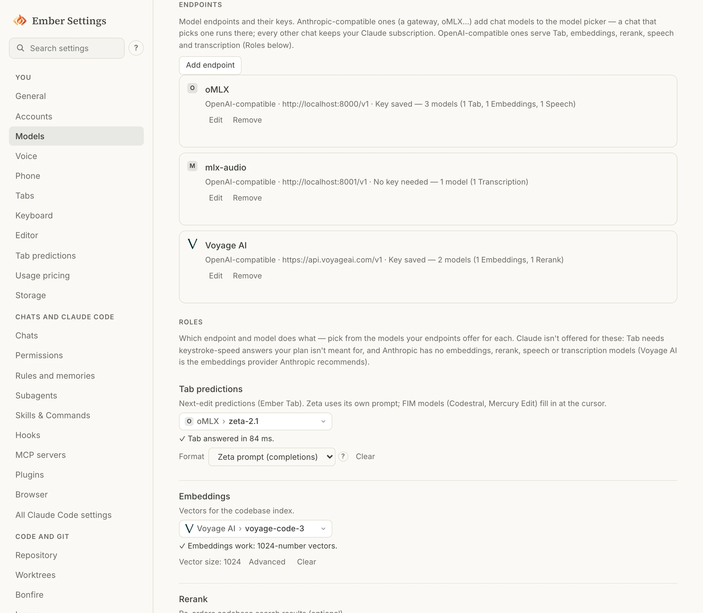

# Your own endpoints

Add model endpoints — local servers, hosted providers and gateways — and choose which model does Tab, embeddings, rerank, speech and transcription.

Claude through your subscription is all Ember needs for chat. Endpoints add what the subscription doesn't cover — a model for Tab predictions, embeddings for meaning-based search — and let you run chats through a gateway or a local server if you want to.

Endpoints and roles live at the bottom of Settings › Models.

## Two kinds of endpoint

| Kind | What it's for |
| --- | --- |
| **Anthropic-compatible (chat)** | Adds chat models to the model picker. A chat that picks one runs there; every other chat keeps your Claude subscription. |
| **OpenAI-compatible (Tab, embeddings, rerank)** | Serves the three roles below. |

## Add an endpoint

1. Open Settings › Models and scroll to **Endpoints**.
2. Click **Add endpoint**. Pick a preset:
   - **Local** — model servers on this computer (oMLX, Ollama, LM Studio).
   - **Hosted** — providers for Tab, embeddings and rerank.
   - **Gateways for chat** — Claude through a gateway; chats that pick these models run there.
   - **Show advanced** adds other models behind Anthropic's API, through Claude Code. Not every feature may work with them.
   - **Custom URL…** starts from an empty form.
3. Fill in **Name**, **API**, **Base URL** and **API key** (local presets that need no key say so). **Get a key ↗** opens the provider's key page where a preset knows it.
4. Click **Test connection**. Ember lists the endpoint's models; nothing is saved yet.
5. Turn on the models you want. If the endpoint doesn't list its models, type their ids under **Model ids**.
6. Click **Save**.

After a save, Ember offers to fill an empty role when the endpoint has exactly one model that fits it: click **Use** or **Not now**.

Each endpoint's row shows its API, address, whether a key is saved and its models, with **Test** (chat endpoints), **Edit** and **Remove**. Removing an endpoint deletes its saved key too; chats on its models switch to your default model, and roles that used it stop until you pick another endpoint.

> **Note:** API keys and header values are kept in your system's secret storage, not in the settings file.

> **Note:** Amazon Bedrock requests are signed with your AWS credentials by Claude Code, so Ember can't test them. Enter the model ids by hand; the first chat is the test.

## Roles

Under **Roles**, pick which endpoint and model does each job. Claude isn't offered here: Tab needs answers at typing speed, and Anthropic has no embeddings, rerank, speech or transcription models.

| Role | What it does | Setting |
| --- | --- | --- |
| **Tab** | Next-edit predictions in the editor ([Tab Predictions](../editing/tab-predictions.md)). **Tab format** picks how Ember asks: **Zeta prompt (completions)**, **Fill in the middle (FIM)** or **FIM tokens in a prompt**. | [`ember.roles.tab`](../settings/settings-tab.md#emberrolestab) |
| **Embeddings** | Vectors for the codebase index. **Vector size** is optional; leave it empty for the size the model returns. | [`ember.roles.embeddings`](../settings/settings-models.md#emberrolesembeddings) |
| **Rerank** | Re-orders codebase search results. Optional. | [`ember.roles.rerank`](../settings/settings-models.md#emberrolesrerank) |
| **Speech** | Ember's voice: spoken notifications and replies read aloud. Kokoro, OpenAI's speech models, or any OpenAI-compatible `/audio/speech`. See [Talk to Ember and hear it](../connect/voice.md). | [`ember.roles.tts`](../settings/settings-voice.md#emberrolestts) |
| **Transcription** | Talking back: what you say becomes text in a chat's composer. Whisper, Parakeet, OpenAI's transcribe models, or any OpenAI-compatible `/audio/transcriptions`. See [Talk to Ember and hear it](../connect/voice.md). | [`ember.roles.stt`](../settings/settings-voice.md#emberrolesstt) |

Each picker lists the models your endpoints offer that fit the role; **Show all models** lists the rest. After you pick, Ember tests the model and shows the result under the picker.

### What an embeddings model adds

- **Codebase search by meaning.** Without one, the codebase index does keyword search only. With one, chunks of your code go to that endpoint to be turned into vectors, and search goes by meaning too. Settings › Indexing shows how far along it is. See [Codebase Index](../knowledge/codebase-index.md).
- **Ember Help search by meaning.** Help search always matches words; once an embeddings role is set, it also ranks by meaning. Help's text is embedded once and kept in Ember's storage.

> **Tip:** When the embeddings model runs on a local server, the codebase index waits while a chat is working on a model from that same server, so the chat isn't slowed down. Settings › Indexing says when it's waiting.

## Local servers

The **Local** presets point at a model server on this computer: oMLX at `http://localhost:8000/v1` (it needs the API key from oMLX's own settings), Ollama at `http://localhost:11434/v1`, LM Studio at `http://localhost:1234/v1` and mlx-audio (speech and transcription) at `http://localhost:8001/v1` (no key). Start the server before you test the endpoint. If a test fails, check the server is running and the address and port match.

What a local endpoint is sent never leaves your computer. Tab never sends `.env` files or files your `.emberignore` lists — see [Privacy and storage](../privacy/privacy-storage.md).

  <picture>
    <source media="(prefers-color-scheme: dark)" srcset="../images/settings-models.dark.webp">
    
  </picture>
   <em>Settings › Models</em>

**Open Settings › Models**

---

[All documentation](../README.md)
