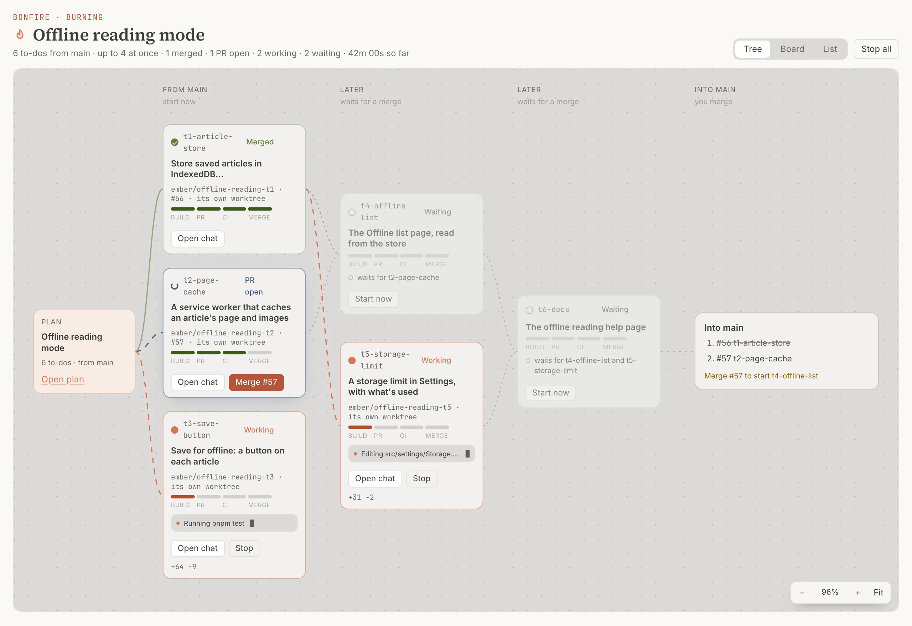
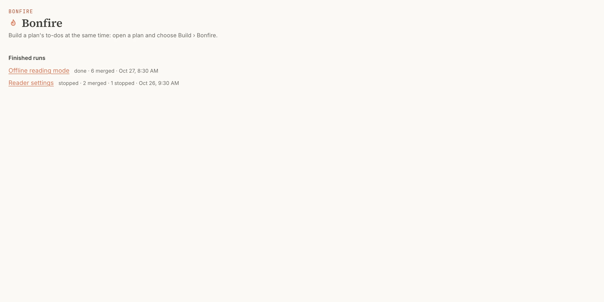
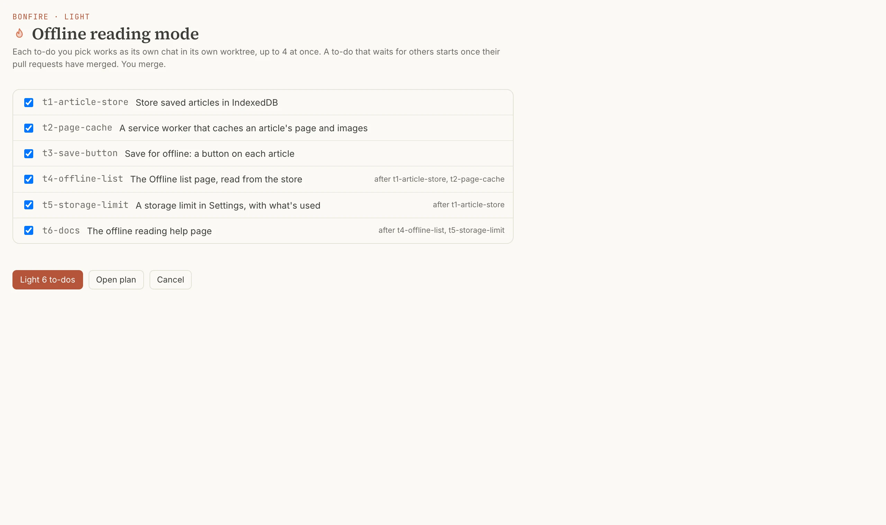
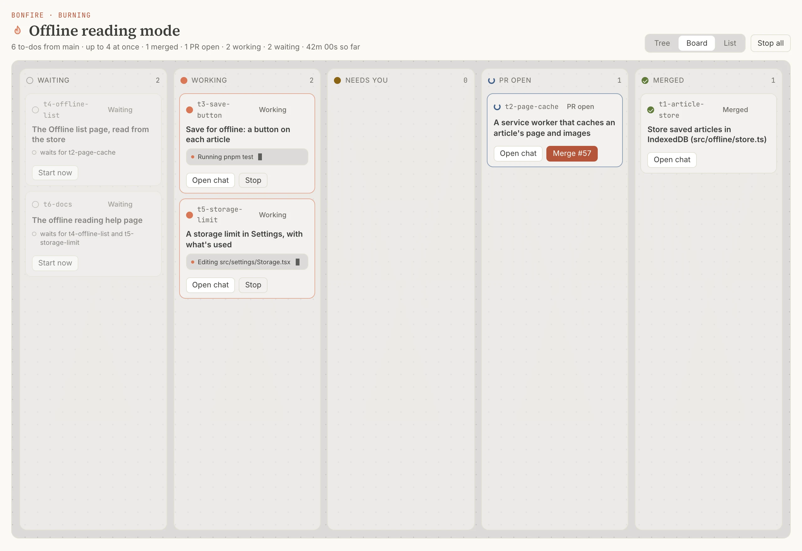
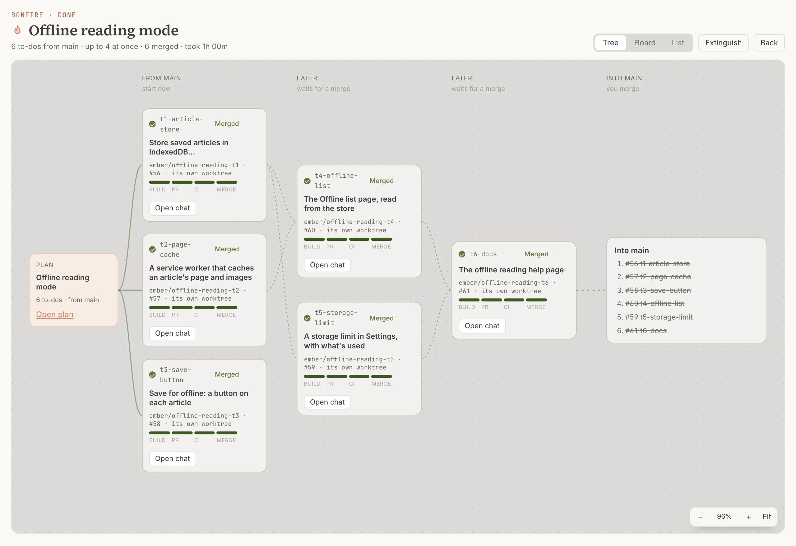

# How to build a plan with Bonfire

Build a plan's independent to-dos at the same time: each one a chat in its own worktree with its own pull request, the ones that depend on others starting once those merge.

> **Note:** Bonfire is off by default. Turn on [`ember.bonfire.enabled`](../settings/settings-bonfire.md#emberbonfireenabled) to see its buttons and menus; while it
> is off, a plan builds here or in a new chat.

Bonfire builds a plan's independent to-dos at the same time. Each to-do becomes an ordinary chat in its own branch and
worktree, and when it's done it opens a pull request. A to-do that depends on another starts once that one's pull
request has merged. You merge each pull request yourself, from the Bonfire page or GitHub.

For what plans are, see [Plans](plans.md); for worktrees, see [Worktrees](../worktrees/worktrees.md).

<p align="center">
  <picture>
    <source media="(prefers-color-scheme: dark)" srcset="../images/bonfire-tree.dark.webp">
    
  </picture>
  <br><em>A build burning: three columns by dependency, a merged to-do, a green pull request to merge, two at work and two waiting</em>
</p>

## Open Bonfire with nothing burning

**Open Bonfire**, or the Bonfire button in the chat panel's title bar. With nothing burning, the
page lists this folder's finished builds. Click one to see it as it ended.

<p align="center">
  <picture>
    <source media="(prefers-color-scheme: dark)" srcset="../images/bonfire-landing.dark.webp">
    
  </picture>
  <br><em>Nothing burning: this folder's finished builds, each opening as it ended</em>
</p>

## Write a plan Bonfire can build

Bonfire reads the plan's to-dos and their `dependencies:`, the ids of the to-dos each one waits for. With Bonfire on,
Plan mode asks Claude for them. A to-do with no dependencies can start at once; the others line up behind theirs.

```yaml
todos:
  - id: t1-article-store
    content: "Store saved articles in IndexedDB"
    status: pending
    dependencies: []
  - id: t4-offline-list
    content: "The Offline list page, read from the store"
    status: pending
    dependencies: [t1-article-store, t2-page-cache]
```

A plan that says nothing about dependencies builds every to-do at once.

## Light the Bonfire

On a plan, choose **Light Bonfire** from Build's ▾ menu (or make it Build's default in
**Settings › Bonfire**). The Bonfire page lists the plan's to-dos with the unfinished ones
checked. Untick any you want to leave out, then click **Light N to-dos**.

<p align="center">
  <picture>
    <source media="(prefers-color-scheme: dark)" srcset="../images/bonfire-picker.dark.webp">
    
  </picture>
  <br><em>Light: the plan's to-dos to pick from, the unfinished ones checked</em>
</p>

Bonfire starts as many to-dos as [`ember.bonfire.maxParallel`](../settings/settings-bonfire.md#emberbonfiremaxparallel) allows (4 by default), first the ones that wait
for nothing. Each gets a chat with the to-do as its first message, in a new worktree off the base branch. The rest wait
their turn.

## Columns and what each card says

The to-dos sit in columns by how deep their dependencies go: the first column waits for nothing, the second waits for
something in the first, and so on. Each card says where its to-do is:

- **Waiting**: for a to-do it depends on to merge, or for one of the others to finish.
- **Working**: its chat is at work; the card shows what it's doing.
- **Needs you**: its chat asks a question or an approval. Answer in its chat (**Open chat**).
- **PR open**: it opened its pull request. With green checks, **Merge #N** merges it.
- **Merged**, **Failed** or **Stopped**.

Switch between **Tree**, **Board** and **List** at the top.

<p align="center">
  <picture>
    <source media="(prefers-color-scheme: dark)" srcset="../images/bonfire-board.dark.webp">
    
  </picture>
  <br><em>The same build as a board: a column per state</em>
</p>

## Merge and what starts next

Each to-do's pull request goes into the base branch. Merge it from its card's **Merge #N**, or on GitHub. Once it's
merged, the to-dos that waited for it start, from the base branch as it is now.

A to-do whose dependencies haven't merged yet offers **Start now**: it starts from the base as it is, without them.

## Stop, retry and continue

- **Stop** on a card stops that to-do's chat; the run doesn't count it as working any more.
- **Retry** starts a to-do again whose chat couldn't be set up.
- **Stop all** at the top stops every to-do.

A to-do's chat is an ordinary chat: you can type into it, switch its mode or open its worktree like any other.

## When it's done

When every to-do has merged (or you stopped the rest), the build ends and the page remembers it. **Extinguish**
clears the worktrees it left (only the merged ones with nothing uncommitted; the page says what stays and why), and
once nothing of it is left it leaves the list.

<p align="center">
  <picture>
    <source media="(prefers-color-scheme: dark)" srcset="../images/bonfire-done.dark.webp">
    
  </picture>
  <br><em>A finished build, remembered: every pull request merged, and Extinguish to clear its worktrees</em>
</p>

With [`ember.bonfire.animations`](../settings/settings-bonfire.md#emberbonfireanimations) on, the fire climbs the page when a build is lit and burns down when it's
extinguished.

## On the phone

On the phone, Bonfire shows the burning build: each to-do's state, what needs you, **Merge #N**, **Start now** and
**Stop**. A finished build sends a push ("Bonfire finished") while no phone is connected. See [Ember on your phone](../connect/phone.md).

## Bonfire words

The words only Bonfire uses. For the words of an everyday chat, see [Glossary](../glossary/glossary.md).

- **Bonfire**: building a plan's to-dos at the same time, each in its own chat, worktree and pull request.
- **Light Bonfire**: starting a build, from a plan's **Build ▾** menu. **Light N to-dos** on the Bonfire page starts it.
- **Burning**: a build that's under way. The Bonfire page shows it; with nothing burning, it lists finished builds.
- **Column**: the to-dos that wait for the same depth of dependencies. The first column waits for nothing.
- **Start now**: starting a to-do before the to-dos it depends on have merged, from the base as it is.
- **Extinguish**: ending a finished build: its merged worktrees go and it leaves the page.
- **Reviewer**, **merge queue**, **final check**, **full suite**: words from builds made by older Ember versions, which
  you may still see in their chats. A reviewer checked each finished to-do, the merge queue merged them one at a time,
  and the final check ran the whole test suite at the end.

---

[All documentation](../README.md)
