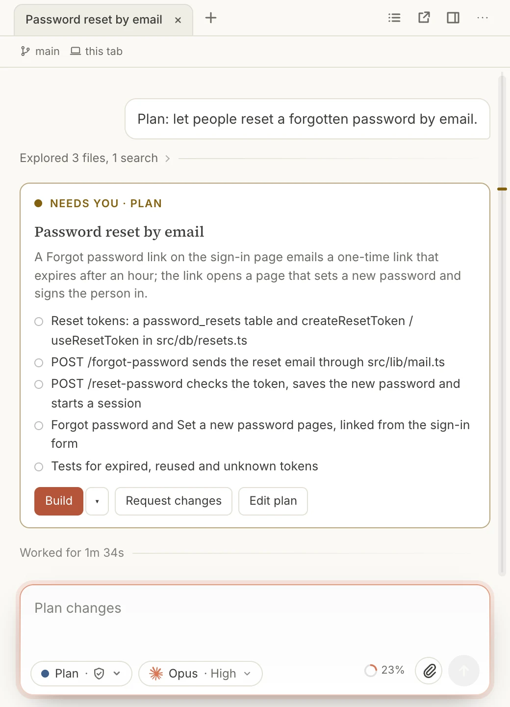
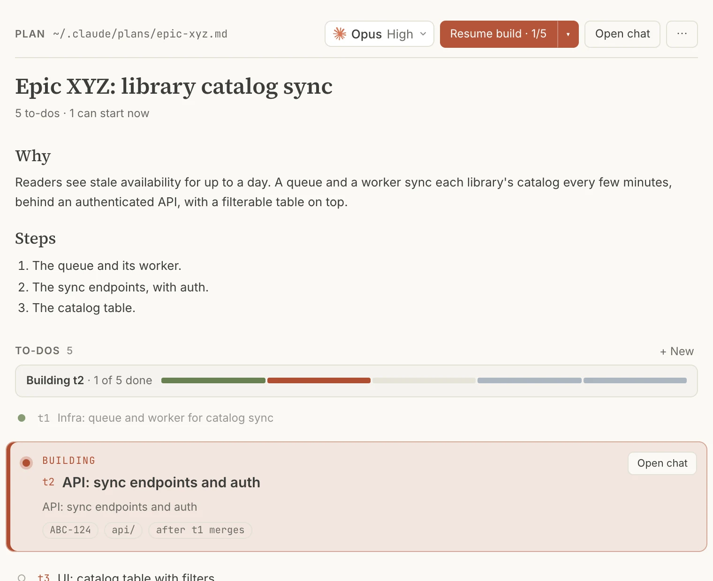
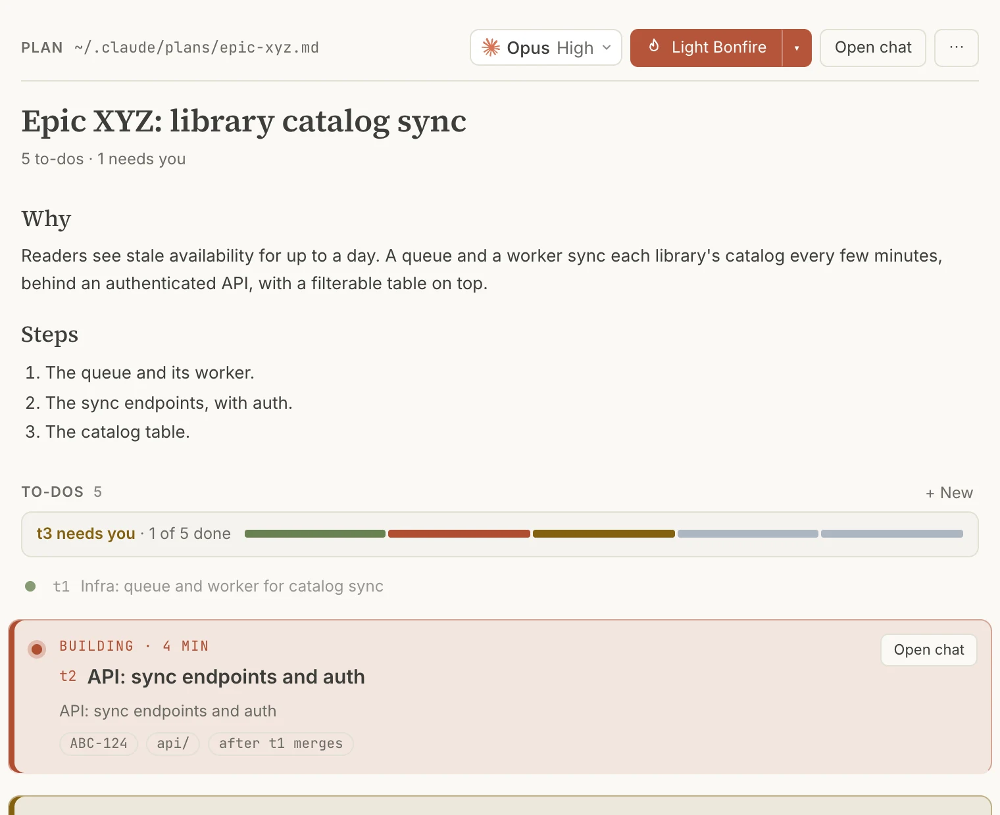

# Plans

Have Claude plan a larger change first, review and edit the plan, then build it here, in a new chat or with Bonfire.

For a larger or unclear change, ask Claude for a plan before any code is written. In **Plan** mode Claude reads
the code, then hands you a plan: an overview, the steps, and a list of to-dos. You review it, change it if you
like, and then build it.

## Ask for a plan

1. In the message box, click the mode button under what you write and choose **Plan** (or press Shift+Tab).
2. Describe what you want, and send.

You can also ask for a plan in an Agent chat ("draft a plan for…"): Claude switches into plan mode by itself, and the
plan it hands in is one of Ember's plans, with the same plan card in the chat as one made in Plan mode.

Claude explores the project without editing anything. Whatever it needs to get the plan done stays in Plan mode:
reads and searches run, and a query, a command or a scratch script in the temp folder asks for its own approval,
so the chat keeps planning. At **Run everything** a command runs without asking, for the chat and its subagents.
Only an edit to your project asks to switch the chat to Agent mode, and when you agree to
the plan in a message, Claude suggests switching (see [Mode suggestions](../chat/approvals.md#mode-suggestions)). Where your project's instructions (`CLAUDE.md` and the files it
imports, `AGENTS.md`, rules) define a plan or to-do format, Claude uses it; Ember itself needs only each to-do's
`id`, `content` and `status`. While Claude writes the plan, a **Writing the plan…** line with the Ember flame counts
its lines. When the plan is ready, a card labelled **Needs you · plan** replaces that line in the chat, with the
plan's name, overview and to-dos (each in one line, as the checklist above the message box shows it: click one to read
it whole), and the plan opens beside the chat
([`ember.plans.openOnReady`](../settings/settings-other.md#emberplansopenonready); the chat keeps focus).
If Claude writes its plan but ends the turn without handing it in, the plan card still appears, made from the plan
file it wrote, even if you switched the chat to Agent mode during that turn.

  <picture>
    <source media="(prefers-color-scheme: dark)" srcset="../images/chat-plan-ready.dark.webp">
    
  </picture>
   <em>A plan is ready: its overview and to-dos, with Build, Request changes and Edit plan</em>

## Review the plan

On the plan card:

- **Build** (or Enter) starts building it. See below.
- **Request changes** (or Esc) lets you tell Claude what to change. Claude revises the plan and hands in a new one.
- **Edit plan** opens the plan in its editor.

The card shows no count until a build starts; from then the build button says how far it got. The build model is in
the **▾** menu next to **Build**.

## The plan editor

The plan editor shows the plan as a page. Its bar names the plan's file and holds the build model picker, the **Build**
button, **Open chat** (the chat that wrote or is building the plan) and the **⋯** menu; with Bonfire on, **Check plan**
too. Under it come the plan's title and overview, then the plan itself, and at the bottom how many to-dos it has and
how many can start now, and the to-do list.

  <picture>
    <source media="(prefers-color-scheme: dark)" srcset="../images/plan-tab.dark.webp">
    
  </picture>
   <em>A plan's tab: the build model, Build (here Resume build, one to-do done) and Open chat, and each to-do's state, id and tags — ticket, scope, dependency, PR; the step a chat is building lights up and the band above the list counts progress</em>

Each to-do shows its state as a dot, in the same colours as the branches board: green when it's done, clay while it's
being built, blue while it waits for another to-do, gold for a step only you can do, and a hollow dot when it can
start. Its id is in clay, and its tags say what it works on: the ticket, its scope, what it waits for ("after t1
merges", "stacks on t2", "waits for all") and its pull request.

### While the plan builds

Whether a chat or Bonfire builds the plan, the step being worked on lights up so you can spot it from across the room:

- **The step at work** gets a clay edge and tint. Its top line says **Building** and for how long (**Building · 6 min**),
  then its title in bold and what its chat is doing right now ("Running pnpm test"). Its full text stays below it, still
  editable, and **Open chat** opens the chat building it. When Bonfire builds several to-dos at once, each one lights.
- **A step that waits for you** turns gold: **Asks a question** shows the question, and **Answer in chat** takes you there
  (another wait says **Needs you**).
- **A step that stopped** (its chat's turn failed) turns red and says why. Open its chat to try again.
- **Finished steps** shrink to one faint line. Point at one, or click into it, to see and edit all of it.
- **A band above the list** says who's building and how many are done ("Building t8 · 7 of 14 done"), with a segment
  per to-do. When the step at work is scrolled out of view, its arrow takes you back to it. When a new step starts,
  the list scrolls to it (but not while you're typing in a to-do).
- In a narrow editor, the lit row drops its tags and the band shortens to "t8 · 7/14".

The note under the title counts the steps that need you. Answer them in the to-do's chat or on the Bonfire page.

The chat's to-do strip lights up the same way while a to-do is in progress: the same edge and tint, how long the turn
has run, and a second line with what it is doing, that it asks you something, or why it stopped. While the turn runs,
waiting on your answer included, your prompt and its strip stay pinned to the top of the chat; the strip's pin button
lets them scroll, and they let go on their own when the turn ends.

  <picture>
    <source media="(prefers-color-scheme: dark)" srcset="../images/plan-tab-bonfire.dark.webp">
    
  </picture>
   <em>With Bonfire on and running the plan: Light Bonfire is the default, the step at work lights up with how long it has been building, and one that asks a question lights gold</em>

### Edit the to-dos

- Click a to-do's text to edit it. Changes are saved right away.
- **+ New** adds a to-do.
- Click a to-do's dot to select it (Shift-click selects a range). With to-dos selected, the **⚙** menu sets
  their status (**Pending**, **In progress**, **Done**, **Cancelled**) or deletes them, and
  **Build in a new chat** builds just those in a fresh chat.
- A to-do that a chat worked on shows a chat badge; click it to open that chat.

**Referenced by** lists the chats that wrote or built the plan; click one to open it.

As Claude builds, it ticks off to-dos in the plan. If it updates them while you have unsaved edits, a banner offers
**Take them** to take its changes.

### Plan preview or Markdown

The plan is a Markdown file. To edit the whole text, choose **Markdown** in the **⋯** menu, or press
<kbd>⇧⌘V</kbd> (<kbd>Ctrl+Shift+V</kbd> on Windows and Linux) (**Show Plan Markdown**). From the Markdown, the same key
(<kbd>⇧⌘V</kbd> (<kbd>Ctrl+Shift+V</kbd> on Windows and Linux)) or **Show Plan Preview** goes back to the preview.

Each to-do is written with these fields, one line each: `id`, `content`, `status`, `scope`, `dependencies`, and
where needed `manual`, `deploy`, `verify`, `signoff`, `branch`, `ticket`, `base`, `after` and `pr`. Ember edits any
plan written this way, in any key order, and keeps every field when you add, delete, move or rename to-dos. Comments
stay too: a `# note` at the end of a field line, or on its own line, stays with its to-do.

If a to-do line is written in a way Ember can't edit, the editor turns checklist edits off and names the line. That
might be a field Ember doesn't know, a value over several lines, or the whole list on one line. Fix that line in the
Markdown to edit the list again. You can still build the plan, light Bonfire and check the plan meanwhile.

### Where plans are kept

Ember keeps your plans in `~/.ember/plans`, one `.plan.md` file each, outside your projects. To keep them in the
project instead, set Claude Code's `plansDirectory` to a folder inside it (Settings › Chats › **Plans folder**); Claude
Code ignores a folder outside the project, so there's no need to set it to `~/.ember/plans`. If Ember can't write to
`~/.ember/plans`, a new plan goes to the chat folder's `.ember/plans` instead, and the chat says so.

**Save to Workspace** (in the **⋯** menu) moves a plan into the project's `.ember/plans` folder, so you can commit it
or share it. Ember saves any unsaved edits first. The plan keeps its name, and its chats, builds and open tab move
with it. Nothing is left behind in `~/.ember/plans`. It waits while the plan's chat is still writing it or a build of it is
running. A plan file of Claude Code's own is copied instead.

Any `.plan.md` file, and any Markdown file directly in a `.ember/plans` or `.claude/plans` folder, opens in the plan
editor.

## Build a plan

The **Build** button does what [`ember.plans.defaultBuild`](../settings/settings-bonfire.md#emberplansdefaultbuild) says; the **▾** next to it offers the other ways:

| Choice | What happens |
|---|---|
| **Build here** | One to-do after another, in the plan's own chat. |
| **Build in a new chat** | The same, in a fresh chat with the plan as context, in the worktree of the chat that planned it. |
| **Light Bonfire** | The plan's independent to-dos are built at the same time, each in its own branch, worktree and chat. |

If the worktree the plan was written in has been removed since, a build in a new chat doesn't start somewhere else on its
own. It waits in the new chat and says the plan's worktree is gone: **Reopen** *branch* puts that branch in a new worktree
and builds there (offered only while the branch still exists), **Build** builds wherever the first button under the
message box (where the chat works) points (choose there first), and **Don't build** drops the build. A build that waits for a running turn
says where it will build.

With Bonfire on, change the default in Settings › Bonfire under **Default way to build a plan**.

While a plan builds, the button shows **Building…** with how many to-dos are done, and **Stop** stops the build.
A plan that was stopped part-way offers **Resume build** with how far it got (**Resume build · 2/5**), and builds the
to-dos still open. When every to-do is done, the button reads **Done ✓** and the plan can't be built again.

A build stays its chat's when a turn ends with to-dos left, for example when Claude stops to ask you something or waits
for your review. The plan and its card then read **Waiting on you** with how far it got (**Waiting on you · 2/5**), with
**Stop** beside it and no Build or Resume build. Reply in that chat and the build carries on: the button goes back to
**Building…**, and the to-dos Claude finishes in later turns reach the plan until all of them are done. **Stop** in
the plan, a new build of the plan, a new plan in that chat, or archiving the chat ends the build.

In the chat, the to-do checklist above the message box has a plan button while the build runs: click it to open the
plan being built. If the build moves its chat into a worktree's own tab, the plan goes too and opens beside the chat
there, so you can watch its progress.

To watch a build's changes as they come, turn on [`ember.plans.reviewOnFirstEdit`](../settings/settings-other.md#emberplansreviewonfirstedit): the build's first file
edit opens Review Changes where the plan editor is, once per build. It stays shut in a chat that runs without asking
(**Run everything**).

### Choose the build model

In the plan editor's bar next to **Build**, or at the top of the **▾** menu on the chat's plan card, pick the model and
effort the build starts with. Each plan remembers its own pick. Plans without
a pick use [`ember.plans.buildModel`](../settings/settings-models.md#emberplansbuildmodel), or the chat's default model when that is empty.

> **Tip:** Before building with Bonfire, **Check plan** in the plan's bar has Claude read the plan once for things
> that would stall the run, such as steps only you can do, oversized to-dos or missing dependencies.

---

[All documentation](../README.md)
