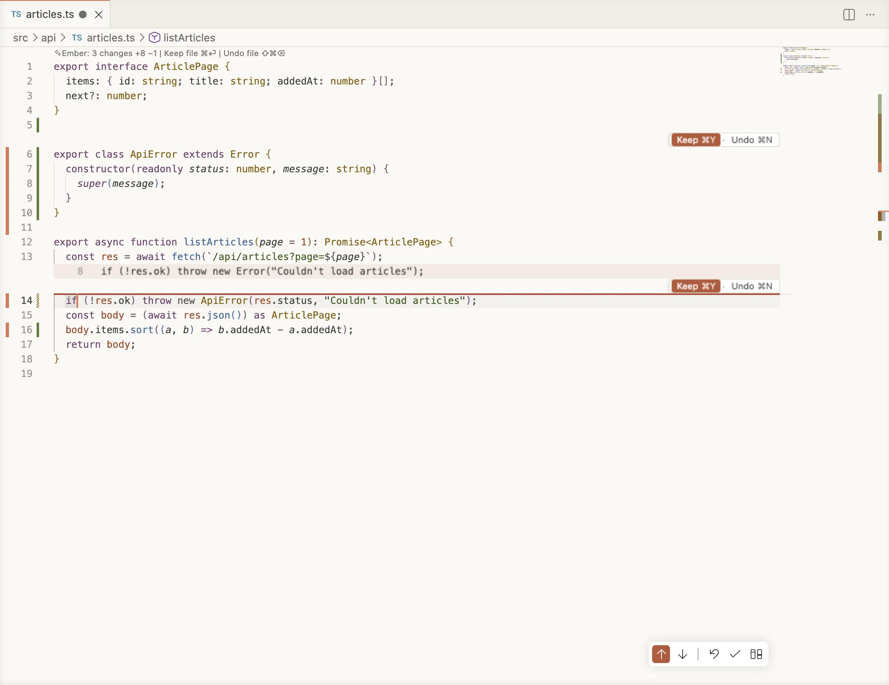

# Ember in stock VS Code or VSCodium

What works the same when you install Ember's extensions into your own VS Code or VSCodium, and what you get instead of Ember.app's editor changes.

Ember's extensions (Ember, Ember Tab and the Ember Light / Dark themes) also install into your own VS Code or
VSCodium from their `.vsix` files. Chats, plans, Bonfire, Forge, review, Settings, Help and everything else work the
same, on the same Claude subscription and the same Claude Code setup.

What differs comes from two things Ember.app has and a stock editor doesn't: a few editor APIs that aren't final
yet, which Ember.app lets its extensions use, and some changes to the editor itself that no extension can make. This
page lists what you get instead. See [What is Ember?](../getting-started/what-is-ember.md) for the two ways to run Ember.

## Reviewing changes

In Ember.app, a pending change looks like this:

  <picture>
    <source media="(prefers-color-scheme: dark)" srcset="../images/window-keep-undo.dark.webp">
    
  </picture>
   <em>An agent's change in the editor: Keep · Undo, and the lines it removed</em>

| In Ember.app | In stock VS Code or VSCodium |
| --- | --- |
| Lines Claude removed show inline, just above each change ([`ember.review.inlineRemoved`](../settings/settings-editor.md#emberreviewinlineremoved)). | Hover the red line marker to see them. |
| A **Keep · Undo** pair of buttons sits above the first change and the change under the cursor or mouse ([`ember.review.hunkPills`](../settings/settings-editor.md#emberreviewhunkpills)). | Each change has its own **✓ Keep** and **✕ Undo** row above it. |
| A floating bar in a changed file has **Previous Change**, **Next Change**, **Keep All Changes in File**, **Undo All Changes in File** and **Open Diff for File**. | No floating bar. The row at the top of the file still has **Keep file** and **Undo file**, and the shortcuts work: <kbd>⌥K</kbd> (<kbd>Alt+K</kbd> on Windows and Linux) and <kbd>⌥J</kbd> (<kbd>Alt+J</kbd> on Windows and Linux) move between changes. |
| A diff of Claude's changes has **Keep This Change** and **Undo This Change** on each change's toolbar. | Not in the diff. Keep or undo the change in the file (<kbd>⌘Y</kbd> (<kbd>Ctrl+Y</kbd> on Windows and Linux) / <kbd>⌘N</kbd> (<kbd>Ctrl+N</kbd> on Windows and Linux)). |
| The review of a chat's changes has **Keep File** and **Undo File** on each file. | **Keep All** and **Undo All** at the top of the review still work; keep or undo single files in the file itself. |

See [Review changes](../editing/review-changes.md).

## Editing where you are

- **Inline Edit** (<kbd>⌘K</kbd> (<kbd>Ctrl+K</kbd> on Windows and Linux)): in Ember.app the prompt bar opens inside the editor, just above the
  lines it edits, and stays there while Claude works. In stock editors the same steps use a box at the top of the
  window, and the progress shows as a notification. See [Inline Edit](../editing/inline-edit.md).
- **The selection toolbar** ([`ember.selectionToolbar`](../settings/settings-editor.md#emberselectiontoolbar)): in Ember.app, **Add to Chat** and **Quick Edit**
  appear just under your selection. In stock editors use <kbd>⌘L</kbd> (<kbd>Ctrl+L</kbd> on Windows and Linux) to add the selection to the chat
  and <kbd>⌘K</kbd> (<kbd>Ctrl+K</kbd> on Windows and Linux) to edit it.

## The terminal

**Add Terminal Selection to Chat** (<kbd>⌘L</kbd> (<kbd>Ctrl+L</kbd> on Windows and Linux), also on the terminal's right-click menu)
needs Ember.app; stock editors don't let an extension read a terminal's selected text. **@Terminals** mentions and
Claude's `terminal_output` tool still bring in your terminals' recent commands and their output.

## The browser

Ember's browser runs on the editor's built-in browser tab when the editor has one, which Ember.app does. Elsewhere,
the **Automatic** engine runs Ember's own headless Chrome and shows it in Ember's **Browser** tab. Claude's browser
tools work the same, with sign-ins kept in a profile of their own
([`ember.browser.engine`](../settings/settings-browser.md#emberbrowserengine)). See [Ember's browser](../connect/browser.md).

## Tab predictions

In Ember.app, Ember Tab's predictions use the editor's own next-edit display: an inline diff for edits near the
cursor, and the editor's "Tab to jump" marker for edits further away. In stock editors Ember Tab draws them itself:
ghost text for text at the cursor, an inline preview for nearby edits, and its own "Tab to jump" marker. **Tab**
takes a prediction and **Esc** skips it in both. See [Tab Predictions](../editing/tab-predictions.md).

## Things only Ember.app does

These are changes to the editor itself, so the extensions can't make them:

| Ember.app | Stock VS Code or VSCodium |
| --- | --- |
| Asks before quitting while chats are still working, and can resume them next time ([`ember.quitGuard`](../settings/settings-chats.md#emberquitguard)). | Quits right away. Chats interrupted by the quit still offer **Continue** the next time ([`ember.chats.resumeInterrupted`](../settings/settings-chats.md#emberchatsresumeinterrupted)). See [When Ember Closes Mid-Run](../chat/resume.md). |
| The app icon shows how many things need you, across every window: the Dashboard's number. | No badge. The Now view in Ember's side bar shows the same count. |
| On macOS, notifications come from Ember itself, with its icon and buttons such as **Run** and **Skip**. | Notifications still arrive: on macOS through Ember's helper app, on Linux through `notify-send`, on Windows as a toast. See [Notifications and sounds](../chat/usage-limits.md#notifications-and-sounds) for the notification settings. |
| Updates itself (see [Install and Update Ember](../getting-started/install-update.md)). | Ember doesn't update the extensions, and Settings has no Updates row. Install the new `.vsix` files yourself. |
| Files, tabs and selections drop into the chat directly. | Hold Shift while you drop. |
| Folders open with workspace trust off, so Ember works at once. | A folder you haven't trusted opens in Restricted Mode, where the editor turns Ember's extensions off and the chat stays empty. Trust the folder to use Ember there. |
| Your phone can show screenshots of Ember's windows (Settings › Phone). | No window screenshots. |
| The window title can show the repository, worktree and branch a chat works in. | The title shows the folder and the editor's own title variables. |
| **Ember Settings…** in the Preferences and gear menus; **About** opens Ember's About tab. | Open Settings with <kbd>⌘,</kbd> (<kbd>Ctrl+,</kbd> on Windows and Linux) or **Settings**, and About with **About Ember**. |
| Ember's Dashboard (or Welcome, with no folder) replaces the editor's Welcome page. | The editor's own Welcome page opens; [`ember.dashboard.showOnStartup`](../settings/settings-other.md#emberdashboardshowonstartup) turns Ember's on. |
| Ember's layout, JetBrains Mono, the Ember theme and Ember's icons are the defaults. | The editor keeps its own defaults. Pick Ember Light or Ember Dark as your color theme and Ember as your product icon theme, and arrange the views with [Find Your Way Around](../getting-started/layout.md). |
| The editor's own questions stay out of a chat's way: notifications show in the bottom-left corner, away from the chat, and Git doesn't ask about repositories in parent folders, too many changes or syncing, nor recommend extensions, and an empty editor area shows no shortcut hints. Each is only a default; set `workbench.notifications.position`, `git.openRepositoryInParentFolders`, `git.ignoreLimitWarning`, `git.confirmSync`, `extensions.ignoreRecommendations` or `workbench.tips.enabled` to get the stock behaviour back. | Notifications show bottom-right, over the chat's composer, Git and the extension recommendations ask as usual, and an empty editor area lists shortcuts. |

## Only in the Ember app

The Ember app is built from VS Code's source, so it carries a few more changes to the editor itself. The extensions in
VS Code or VSCodium don't have these:

| The Ember app | VS Code or VSCodium |
| --- | --- |
| A button in the title bar says how many things need you and how many are working; click it for the Dashboard. | The Now view and the badges show the same count (see [Outside the Dashboard](../worktrees/dashboard.md#outside-the-dashboard)). |
| VS Code's settings editor marks a setting whose default Ember changed (the editor font, the theme, the title bar…) with a small **Ember default** tag beside its title. | VS Code's own "Default value changed" note, which names Ember Defaults in its hover; a default changed inside the editor itself shows nothing. |
| A notification with buttons stays up until you answer or close it (Ember's own keep the usual timing: most of them point at a question that also waits in the chat). | Only an error with buttons stays up; other notifications hide into the bell after a few seconds. |
| The built-in Git never asks whether to fetch periodically; Git: Autofetch stays off unless you turn it on. | After the first push or pull in a folder, Git asks whether to run `git fetch` periodically. |

---

[All documentation](../README.md)
