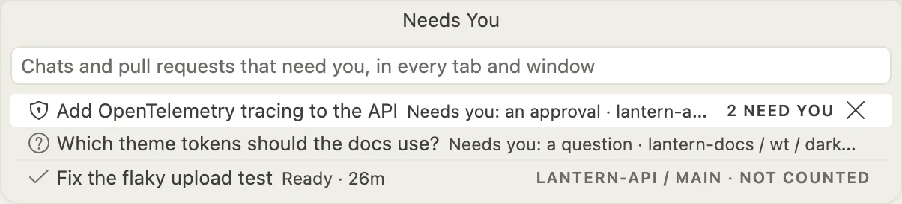
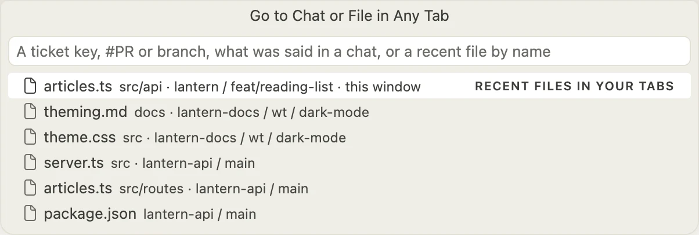

# Work across tabs and windows

See what needs you in every tab and window, and jump to a chat or file in any of them.

Each Ember tab and window keeps its own chats, but they know about each other. From any of them you can see what needs
you everywhere, and jump to a chat or a file in another tab.

## See what needs you everywhere

A chat needs you when it waits for an approval, a question, or a sign-in in Ember's browser, or when it stopped
responding. A chat that finished a turn you haven't read is listed as well,
but it isn't counted: it's **Ready**, as on the Dashboard ([Outside the Dashboard](dashboard.md#outside-the-dashboard)).

- **The status bar**, on the left after the branch, says how many things need you, in every Ember window:
  **● 3 need you** in gold. The dock, the Chats badge and the phone say the same number. With nothing needing you it says how many have a chat working (**● 2 working**, in clay),
  and only a bell when all that's left is a finished turn to read. A pull request asking for your review counts as
  needing you. Click it to see the list. **Dashboard** beside it opens the Dashboard.
- **In Ember.app** with workspace tabs, a bell also appears in the row of tabs at the top of the window, next to ⌄, with the status bar's
  number; a finished turn left to read shows it without a number. Its menu lists what the number counts, per tab or
  window: a chat's ask opens that chat, and a branch with red CI, conflicts or a review opens its tab. When no tab shows
  that branch, the Dashboard opens (or comes to the front) on every repository with its row highlighted and pulsing.
  Finished turns come after.
- From anywhere, run **Needs You**.

The list starts with exactly what the status bar's number counts, one line for each thing that waits for you: each
chat's approval, question or sign-in (two chats waiting on one branch are two lines), a chat that stopped or failed,
and each pull request's red CI, requested changes or conflicts, or a review asked of
you. A chat outside any git folder counts too. Each line says why and where, and for a chat how long it has waited. A
chat opens in its tab or window, a pull request on your git host, and anything else on the
branches board. After them, grouped by tab or window and newest first, come finished turns to read, which aren't
counted.

Each counted line has a **×** button to dismiss it. A chat that stopped or failed stops asking (as **Dismiss** does on
its card). Anything else stops counting in every window, that one need only: the chat's next approval, the pull
request's red CI on a new commit counts again. A window that closed or stopped responding stops counting within a few
minutes.

  <picture>
    <source media="(prefers-color-scheme: dark)" srcset="../images/window-inbox.dark.webp">
    
  </picture>
   <em>Needs You: every tab's and window's chats that need you, newest first</em>

Pick a row and Ember brings that tab or window to the front and opens the chat there. A window with no folder open can't be brought forward this way: Ember opens the chat there
and asks you to switch to that window.

## Go to a chat or file in any tab

1. Run **Go to Chat or File in Any Tab…**.
2. Before you type, it lists the files you opened recently in every open tab and window, this one first.
3. Type a ticket key, a pull request number or a branch name to find that piece of work (see below). Type anything
   to filter the files by name and to search the chats of every open tab by what was said. Chat search uses the same
   index as **Search chats** (see [Conversation Search](../knowledge/conversation-search.md)). Chats of windows with no folder open are included too.
4. Pick a row. Its tab or window comes to the front and opens the chat or file.

  <picture>
    <source media="(prefers-color-scheme: dark)" srcset="../images/window-goto-any-tab.dark.webp">
    
  </picture>
   <em>Go to Chat or File in Any Tab: recent files of every open tab, before you type</em>

## Find a ticket, its branch, its chats and its PR at once

Type a ticket key such as `ABC-123` (or `#7` for a GitHub issue), a pull request number such as `#41`, or a branch
name or part of one. Go to lists each match first, under its name, for example **ABC-123 · feat/ABC-123-infra**:

- **Ticket**: the issue, with its status. It opens in **Issues** ([Plan from GitHub and Jira issues](../plans/issues.md)), selected, with its details open.
- **Branch**: the branch and where it lives, in the same words as everywhere (this tab, tab 2, its own worktree, not checked out),
  with its state. It opens in its tab (see [Open a branch in its tab](workspace-tabs.md#open-a-branch-in-its-tab)).
- **Chats**: every chat on that branch, in any tab or window, each saying which one. A chat opens in its own tab or
  window, which comes to the front.
- **Pull request**: its number, CI and title. It opens on your git host. A review asked of you shows here too.

An exact key, number or branch name comes first, then branches whose names only contain what you typed. A ticket
nobody works on yet shows on its own. Go to reads what Ember already has, the branches board's list and the issues
**Issues** last read, so typing sends nothing to GitHub or Jira. When no issues have been read for this folder yet,
Ember reads them once when Go to opens, and the tickets appear when that's done.

## A chat that belongs to another tab

A chat stays with the tab it was started in, and you drive it from there, also when it works in a worktree. Click one
of another worktree's chats in the chat list and it opens in that worktree's tab (a new tab when none is open there; see
[Branch cards](../chat/chat-tabs.md#branch-cards)). Open one of another tab's chats here from a link or the switcher and the chat
panel shows it read-only and says where it runs, for example **Running from tab 2**. Click **Open in tab 2**: that tab or window comes
to the front with the chat open. A branch row's **Go to tab** on the Dashboard does the same (see [The Ember Dashboard](dashboard.md)).

A chat that works on a branch in another worktree can move to that worktree's tab: click **Move this chat to tab 2** on
its branch line, or **Move to tab 2** in its menu (see [Move a chat to its worktree's tab](worktrees.md#move-a-chat-to-its-worktrees-tab)). When Claude
moves your chat into a worktree with `EnterWorktree`, the tab you're in switches to that worktree with it by default
(see [Claude makes a worktree itself](worktrees.md#claude-makes-a-worktree-itself)).
To have a branch in front of you, open it in its tab instead (see [Open a branch in its tab](workspace-tabs.md#open-a-branch-in-its-tab)).

See also [How to use workspace tabs](workspace-tabs.md) for tabs themselves, [The Ember Dashboard](dashboard.md) for every branch in flight,
and [Bring Chats from Another Folder](../chat/move-chats.md) to bring every chat of a folder you moved or renamed.

---

[All documentation](../README.md)
