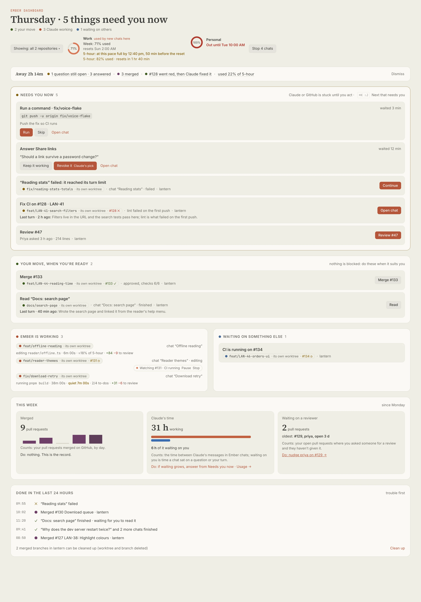
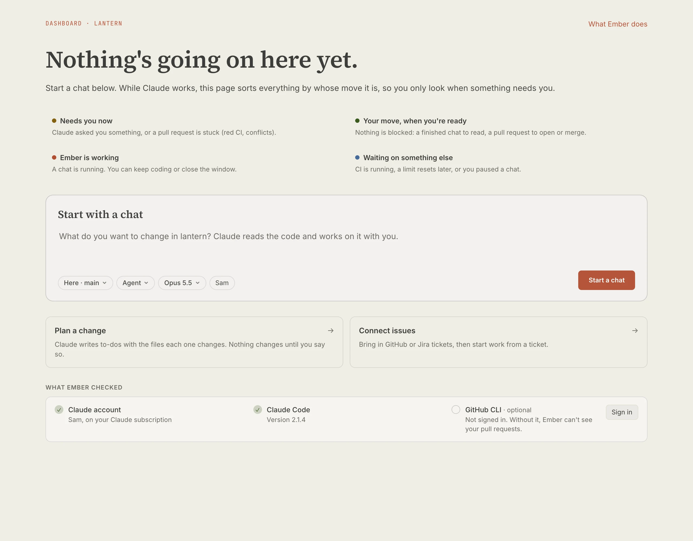
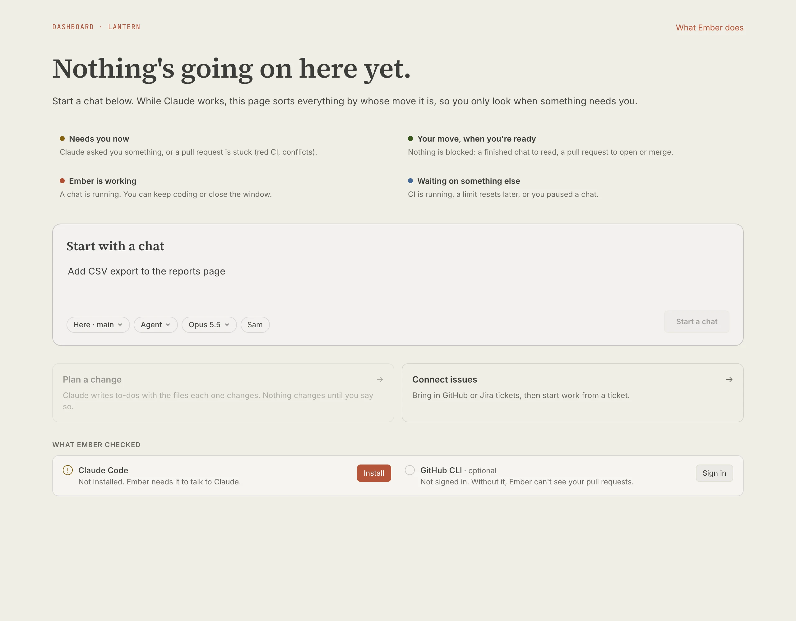
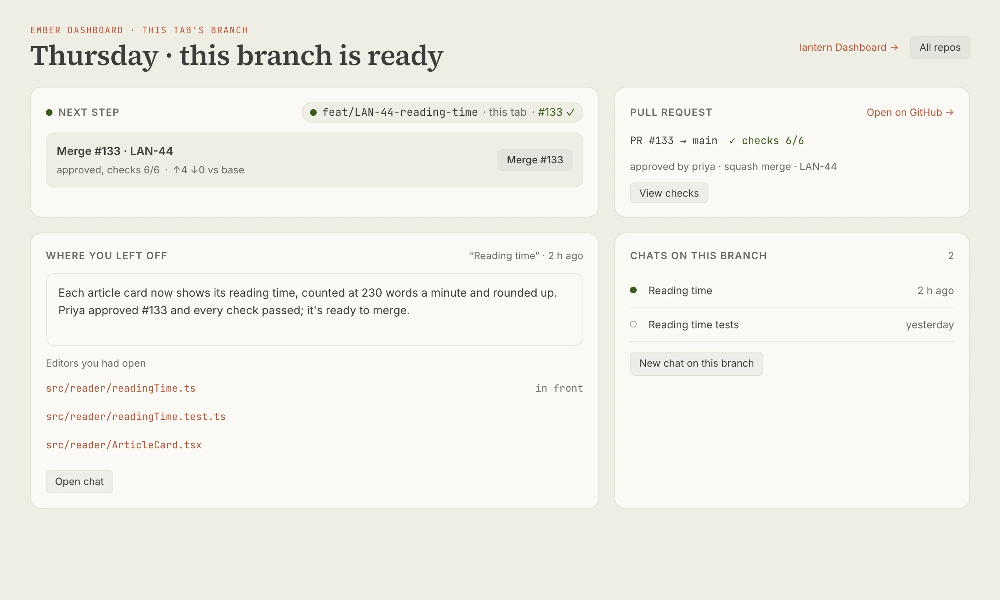
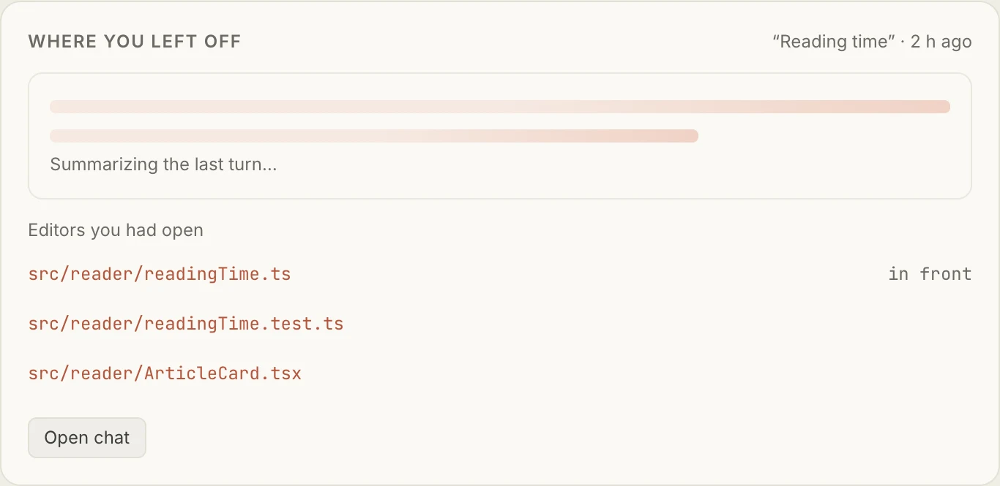
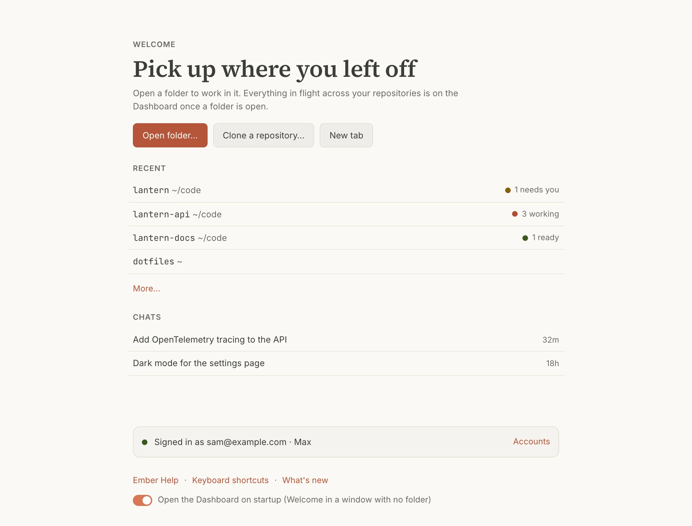
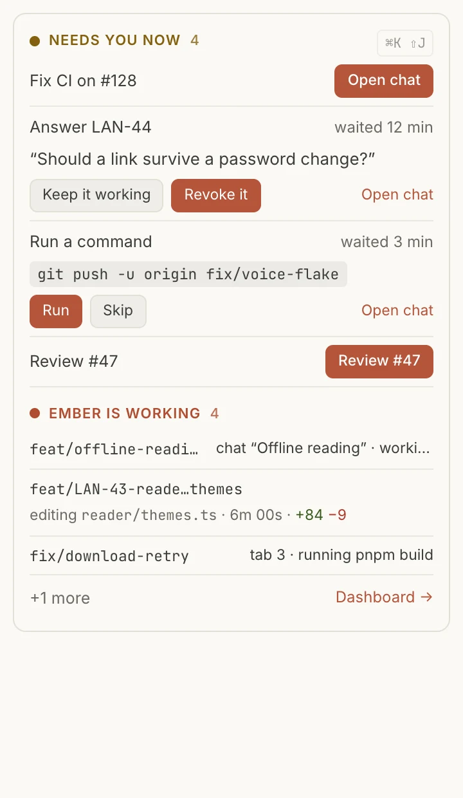

# The Ember Dashboard

One page for your work in flight, sorted by whose move it is: what needs you now, your move, what Ember is working on, what waits on others, this week and what's done.

The Ember Dashboard puts your work in flight on one page: every branch and chat in every Ember window, sorted by whose
move it is, with this week's record and what's done in the last day. It reads the same list as the tab dots and the bell,
so their numbers always match. The same numbers also show outside the page: in the side bar's **Now** view, in the
title bar and on the dock, and on your phone (see [Outside the Dashboard](#outside-the-dashboard)). It replaces the
Agents dashboard and Bonfire's home page of earlier versions.

Open it with <kbd>⌘K ⇧D</kbd> (<kbd>Ctrl+K Shift+D</kbd> on Windows and Linux) (anywhere but an editor or the terminal, which keep ⌘K for themselves),
**Dashboard**, or the **Dashboard** button at the top right of the window.

  <picture>
    <source media="(prefers-color-scheme: dark)" srcset="../images/dashboard.dark.webp">
    
  </picture>
   <em>The Ember Dashboard: what needs you now, your move, what's working and waiting, this week, and what's done in the last 24 hours</em>

## Its own tab

In Ember's tab strip the Dashboard has a tab of its own: the first tab, pinned, with Ember's flame and how many branches
need you. It is only the Dashboard: no chat, no chat list and no side bars, and it shows every repository you have open.
The **Dashboard** button and the title bar's pill bring it forward from any tab.

- It reads every tab's repository and worktree itself, asleep or awake: their branches and pull requests show even when
  no other tab is open. Chats at work and what they ask come from the tabs they run in, so they show while their tab is
  awake.
- While it is open, a sleeping tab's branch that needs you (failing checks, say) counts on every tab's bell too, so the
  numbers agree everywhere. It reads up to 24 tabs' folders.

- Click a row's chat and it opens in its own tab. **New chat** and **Fix with Claude** start in the branch's tab, which
  opens if it isn't already.
- A folder you open while it's in front (**File › Open Folder**, **Open Recent**, the welcome page, dropping a folder on
  it) never replaces it: the folder opens in a new tab right after it, or its tab comes forward if it's already open.
- The tab doesn't close: **Close** and **Put Tab to Sleep** close its window and keep the tab, and a click opens it again.
  It doesn't move or tear off, and nothing goes in front of it.
- Tab numbers skip it, so ⌃⌥1 is still your first folder tab.
- Turn it off with [`ember.tabs.dashboard`](../settings/settings-general.md#embertabsdashboard): the Dashboard then opens inside the tab you're in, as it does with
  tabs off or the system title bar.

## The first time

Until this Ember has had its first chat, the Dashboard is a first screen rather than an empty page: why there's nothing
to show, the four lists it will sort your work into, and a chat box.

  <picture>
    <source media="(prefers-color-scheme: dark)" srcset="../images/dashboard-first.dark.webp">
    
  </picture>
   <em>Your first time: why it's empty, a sample row, a chat box and what Ember checked</em>

- **Start a chat** sends what you typed to a new chat. Its buttons set where it works, the mode, the model and the
  account, as in any chat. What you type stays in the box if you switch tabs or reload the window.
- **Plan a change** and **Connect issues** are the other ways in (and **Try Bonfire**, while Bonfire is on).
- **What Ember checked** lists your Claude account, Claude Code and, when this folder has a GitHub remote, the GitHub CLI,
  with a fix beside each. The GitHub CLI is optional: without it Ember can't see your pull requests, but it never stops you
  starting a chat. When everything's fine this is one quiet line.

If Claude Code is missing or you're signed out, the fix is what you press first, and **Start a chat** and **Plan a change**
wait for it. **Install** opens the install screen with what you typed kept, and the page updates once it's fixed.

  <picture>
    <source media="(prefers-color-scheme: dark)" srcset="../images/dashboard-first-blocked.dark.webp">
    
  </picture>
   <em>With Claude Code missing, Install is the one filled button, and what you typed stays</em>

The first screen stops after your first chat in any folder, or if this folder already has Claude Code chats. A message
that couldn't send doesn't count.

## Your landing page

In Ember.app every window with a folder opens with its Dashboard as a landing page, over the editors it restored, so
coming back shows you both what changed and where you were. A window with no folder opens Welcome instead.

- **When Ember starts**, the Dashboard opens in each window, pinned at the far left of its tabs, and takes the focus.
- **In a window you open later** (**Go to tab**, **Open tab** on a branch), it opens pinned but
  stays behind what you came for.
- **Each window has one.** Opening the Dashboard again brings the same tab forward. If you close it, that window keeps
  it closed until Ember next starts; **Dashboard** still opens it.
- **It's about that tab's work.** A main worktree's tab opens on its repository, with **Showing: lantern ▾** in the header
  for the rest. The title bar's **Dashboard** button and the side bar's **Now** count every repository, so opening the Dashboard from either
  shows them all.
- **A Dashboard you can't see costs nothing.** It doesn't load or refresh while it's behind another editor or in a tab
  behind another tab, and catches up when you look at it. Your windows also share one read of your pull requests from
  GitHub, rather than each asking.
- **It keeps up with your work.** After you act on a row, the Dashboard shows what happened, then the branch as it is
  now. A commit, a switch of branch, a merge, a push or a fetch updates its rows within a second or two, whether it
  came from Source Control, a terminal or a chat. So does saving, staging or discarding a file in a repository Source
  Control has open.

[`ember.dashboard.showOnStartup`](../settings/settings-other.md#emberdashboardshowonstartup) picks when this happens: **always** (Ember's default), **emptyWindows** (only
a window with no open editors) or **never**. In VS Code or VSCodium the setting starts at **never**. A true or false you
set before carries over as **always** or **never**.

### A worktree's tab

A worktree's tab opens on its own branch instead of the whole repository:

- **Next step**: the branch and the one thing to do next, with its button.
- **Pull request**: where it merges, its checks, who approved it and how it merges, with **View checks** and **Open on
  GitHub**, or **Open PR** when there is none yet.
- **Where you left off**: what the newest chat's last turn came to in a sentence or two, the editors the window
  restored as links, and **Open chat**.
- **Chats on this branch**: each with its state and when you last used it, and **New chat on this branch**, which works
  in this worktree, so its commits land on this branch and its pull request.

The summary comes from a small model, [`ember.dashboard.summaryModel`](../settings/settings-other.md#emberdashboardsummarymodel) (Haiku unless you pick another), on your
Claude subscription. It costs one call per finished turn, only for a page you're looking at, and reopening it costs
nothing. While it's being made the panel shows a soft shimmer and **Summarizing the last turn…**. If it takes more than
about 10 seconds or fails, for a chat on your own model, or with the setting at **off**, the panel shows the chat's last
message instead.

The header links to the repository's Dashboard and to **All repos**; **This branch** there brings you back.

  <picture>
    <source media="(prefers-color-scheme: dark)" srcset="../images/dashboard-branch.dark.webp">
    
  </picture>
   <em>A worktree tab's Dashboard: its branch's next step, its pull request, where you left off and its chats</em>

  <picture>
    <source media="(prefers-color-scheme: dark)" srcset="../images/dashboard-branch-summarizing.dark.webp">
    
  </picture>
   <em>While the summary is being made, a soft shimmer shows where it will go</em>

## Welcome

Welcome, in a window with no folder, offers **Open folder…**, **Clone a repository…** and **New tab**, then your
recent folders. A folder with work in flight shows the dot of its most urgent branch and how many are in that state
("1 needs you", "3 working"), so you see that something waits there before you open it. ⌘-click (Ctrl+click on
Windows and Linux) opens a folder in a new window. Your recent chats and the account you're signed in with are below.

  <picture>
    <source media="(prefers-color-scheme: dark)" srcset="../images/welcome.dark.webp">
    
  </picture>
   <em>Welcome, in a window with no folder: open one, or pick up a recent folder — its dot says what's in flight there</em>

## What's on it

The page sorts your work by whose move it is, in four lists, then shows the week's record and what's done. It shows only
the lists that have something in them, top to bottom:

- **The headline**: today and what needs you now (for example **Thursday · 3 things need you now**), or what Claude is
  doing when nothing does. Under it, the other lists' counts by their dots (**2 your move · 1 waiting on others**).
  Beside it: your plan limit, **Stop 3 chats** while any chat works or asks (it asks first), and **Continue 2
  interrupted chats** after a crash. A chat in a folder that isn't a git repository counts too.
- **Your plan limit** says how much is used (**Week: 71% used**) with when it resets under it, and the 5-hour limit
  once it's near (**5-hour: 82% used · resets in 1 hr 40 min**). Click it for **Usage**. With more than one Claude
  account, each has its own meter, with **used by new chats here** on the one new chats here use. An account at its
  limit says so (**Out until Sun 2:00 AM**). Hover a meter for all of its limits.
- **The repository menu**: with work in more than one repository, **Showing: all 2 repositories ▾** narrows the whole
  page to one of them. Each repository in it says its base and the tabs it's open in (**tabs 1, 2**, or **tab 3 on
  fix/rate-limits**), then, in plain words, what needs you, how many branches are open and how far behind the base they
  are (**1 is 12 commits behind main**). Under a repository with merged branches, **Clean up 2 merged branches** removes
  their worktrees and deletes the branches, after one yes. A merged branch already deleted here and on GitHub isn't
  counted. What it keeps it lists in brief, one branch at a time (**hzn-3734 (2 ignored files that may be yours)**);
  clean that one up from its own row to see what would go. **All** says the four counts across every repository.
- **Needs you now**: what Claude or GitHub can't go on without: a question or an approval, a chat that failed, red
  checks, a review asked of you. The oldest question comes first; reviews come last. Each row says what to do, where
  it is and who's on it, with one button for its next step: **Answer**, **Open chat**, **Continue**, **Review #47** and
  so on. Five show; **2 more** opens the rest.
- **Your move, when you're ready**: nothing is stuck, but the next step is yours: merge a green pull request, open
  one, mark a draft ready, read what a chat finished. These never count on the bell, the dock or the title bar. Three
  show; **Show all** opens the rest.
- **Ember is working**: each chat at work and what it's doing, with the tab it's in when another tab shows it. Click
  what it's doing to open its chat. A pull request a chat watches shows what it's doing here, with **Pause** and **Stop**. While
  Bonfire is on, a burning run is one row here that opens its tab.
- **Waiting on something else**: CI running with no chat on it, a chat you paused, a chat waiting for its limit to reset. Each
  says what it waits for.
- **Work started outside Ember**: a branch whose first Claude Code session ran in a terminal or in the Claude desktop
  app says so beside its branch: **Claude Code CLI**, **Claude Desktop**, or **Outside Ember** for another app. Hover it
  for the session that started it. Ember's own work has no mark, and nor does a branch Ember made, whatever ran in it
  later. A tab finds the sessions in its own repository's worktrees, so the mark shows while one of that repository's
  tabs is awake.
- **Who it's for**: a row says who opened its pull request, who made the branch's last commit, who it's assigned to and
  who is asked to review it (**opened by @ana · last commit Ana Lopez · assigned @bo · review @cy**), as far as git and
  GitHub say.
- **A line from the chat**: a row whose chat has finished a turn or waits on you gets one short line on what it did or
  what it's waiting on, and when (**Last turn · 2h ago: …**), from the same small model as
  [`ember.dashboard.summaryModel`](../settings/settings-other.md#emberdashboardsummarymodel). A turn is summarized once and only for rows you can see, up to eight at a
  time with the most urgent first. A soft shimmer holds the line while it's being made. If it takes more than about 10
  seconds or fails, for a chat on your own model, or with the setting at **off**, the row shows what it always shows.
- **This week**, since Monday, three figures. Each says what it counts and what to do about it:
  - **Merged**: your pull requests merged on GitHub, with a bar for each day so far.
  - **Claude's time**: hours Claude spent working in Ember chats, and how many of them it waited on you, as two bars.
    If the waiting grows, answer from **Needs you now**; **Usage →** has the rest.
  - **Waiting on a reviewer**: your pull requests where you asked someone for a review and they haven't answered, with
    the oldest named and a link to nudge them.
- **Done in the last 24 hours**: trouble first (a chat that failed, was interrupted or stopped at its limit, with when
  it carries on if you chose to continue it), then pull requests merged, Bonfire runs that ended and chats that
  finished, in any window. A finished chat you haven't read says so, and several chats that finished in the same hour
  are one line. Click one to open it (a chat in another window opens there, and one of another repository opens its
  folder). Under the list, merged branches a repository can clean up offer **Clean up**.

### All clear

When nothing needs you, nothing is your move, no chat works and nothing waits on anyone, the headline says **All
clear**, and one panel offers **Start a chat** and **Start from a ticket** (with how many tickets are open and not
started). **This week** and **Done in the last 24 hours** stay below it. It says all clear only when that's true: if
the folder has a GitHub remote and the GitHub CLI can't read it, it says **Nothing's working** and why instead, since a
pull request could be waiting.

Click a branch ([Branch](../glossary/glossary.md#branch)) for the same menu as everywhere: **Go to tab**, **Open tab**,
**Open chat** and **Open PR**, each when the branch has it.

## Will the limit last?

Under your plan limit, a line says how long it lasts at the pace it's going: **5-hour: at this pace full by 3:10, 50 min
before the reset**, or that it lasts past the reset. With several accounts each says its own, under its week line. It looks
at the last hour and a half of that account's readings, and with too few of them it says it's too early to tell.

A row at work says about how much of the limit its chat has used in this window (**≈18% of 5-hour**), and a finished
turn's footer says what that turn took when you hover its time. Both are estimates from what the chat cost and what that took of the limit before,
so they show once Ember has learned that from your own use. Ember learns it from your main account, so with several
accounts only that account's chats show one, by name.

## While you were away

After 30 minutes with no Ember window in front and in use, and no phone use, a block at the top of the page says what changed: what
merged, what went red and whether Claude fixed it, which questions are still open and how many were answered since (**1
question still open · 3 answered**, the open ones first), and how much of your plan limit it used.
Each part opens its row's chat (else its branch's tab), several rows open a short list first, and the limit opens **Usage**. A part's dot is
where that thing stands now. A worktree tab's page shows only that branch. Your phone's **Now** shows the same block, and
**Dismiss** on either clears both. Without it, the block stays until your next gap replaces it. If nothing changed, you get
one quiet line that goes on its own. It says only what it saw: if Ember was closed or your Mac was asleep for part of the
time, it says how long (**Ember was closed for 11h of it**). Once you've seen the block, it folds to one line; **Show**
opens it again.

## Answer on the row

A chat that asks one question with two to four short choices, or wants to run one command, can be answered right on its
row, here and in **Now**, without opening the chat. The row shows the question or the command and how long it has waited.

- A question's choices are its buttons. Only the choice Claude itself recommends is filled ("Claude's pick"); with none,
  they're all plain.
- A command has **Run** and **Skip**. **Always run** stays in the chat. A command the guard flagged says
  what it touches, and **Run** isn't filled.
- Anything more says so and keeps one button: **Answer in chat**. It opens the chat that asks, in whichever Ember tab or
  window has it (that one comes forward), and brings its card into view with the focus on the card, never on its
  **Run**. If it was answered meanwhile, or its chat has closed, the row says so instead.

<kbd>⌘K ⇧J</kbd> (<kbd>Ctrl+K Shift+J</kbd> on Windows and Linux) (**Next That Needs You**) moves down every row of **Needs you now** and wraps, opening the
list past its fold when it gets there, and opening **Now** if nothing shows **Needs you**. Tab reaches the row's buttons;
the key alone never answers anything. A notification says what's asked, and clicking it opens **Now** on that row, or
the Dashboard when the row is past Now's five. The bell lands on its row the same way, switching the page to all
repositories when the row is in another one. Its **Run** and **Skip** show only on an ordinary command a row answers in one
click; anything flagged, one that always asks, or too long for a row is answered in its chat.

## Where the numbers come from

- Branches, chats and to-dos come from the branch store, which every Ember window writes to.
- **This week** counts from Monday 00:00 on this computer's clock.
- Merged pull requests and review requests come from `gh`, for your own pull requests in each repository. Without
  `gh`, **Merged** and **Waiting on a reviewer** have nothing to count.
- Claude's hours are counted from when Claude wrote in each Ember chat: turns close together are Claude working,
  a longer gap (up to two hours) is the chat waiting for you, and anything longer isn't counted.
- With one repository picked, each record counts where it happened: a chat in the repository its branch or folder is
  in, a pull request and a Bonfire to-do in their own. A ticket worked in two repositories counts in each of them, and
  once with every repository shown.

### While it reads

Some of these take a moment: your pull requests from GitHub, your plan limits, Claude's hours and, just after Ember
starts, your branches and chats. A part of the page that hasn't read anything yet shows its own shape in grey with what
it's reading underneath (**Reading your pull requests…**), so nothing jumps when it arrives. A part that has data keeps
showing it while it reads again, and adds a thin bar along its top and **updating** beside its title. A read that fails
or can't happen (no `gh`, say) ends the wait and says why, as before. With reduced motion on, the grey shapes and the
bar stay still.

## Stopping chats and Bonfire

To stop every working chat at once, press <kbd>⌘K ⇧⌘⌫</kbd> (<kbd>Ctrl+K Ctrl+Shift+Backspace</kbd> on Windows and Linux) (**Stop All Chats**), or **Stop 3 chats** on the
Dashboard: it asks first. For a run's full
tree, open its tab with **Open Bonfire**. With nothing burning, the chat panel's Bonfire button opens the Bonfire page, which says what you can do next; see [Open Bonfire with nothing burning](../plans/bonfire-howto.md#open-bonfire-with-nothing-burning).

## Outside the Dashboard

The Dashboard's count of what needs you, and its order, show in more spots. They all read the same list, so
they always agree with the page:

- **The Now view**: click the Ember icon in the activity bar. **Now** sits at the top of **Ember Work** and shows the Dashboard's
  top two panels, small: **Needs you** (its first five, each with the same next-step button as on the Dashboard) and
  **Working** (click a branch to open its chat), with a line each for your move and what waits on others.
  **Dashboard →** opens the whole page.
- **The title bar** (only in the Ember app, whose editor Ember builds itself): the **Dashboard** button at the top
  right says, for example, **Dashboard ● 3 ● 2**: how many need you and how many are working, each after its state's
  dot, with a gold border while something needs you. Point at it to see the first five things that need you; click it
  to open the Dashboard.
- **Ember's own editor tabs**: the Dashboard and Bonfire pages show a dot instead of Ember's icon, in the
  colour of the most urgent state on them (gold when something needs you, clay while something's working). The Bonfire
  page's dot reads only the run it shows; a tab with nothing on it keeps Ember's icon.
- **The dock** (Ember.app): the app icon's badge is the number that needs you, across every window. Windows in different
  VS Code profiles each count their own work, and the badge adds them up.
- **The Ember Work icon**: its badge in the activity bar is the same number; point at it to see the first ones.
- **Your phone**: the Chats tab shows **Needs you** with the same count and list, one card each, the first standing
  out. Tap an item (or the first one's **Open chat**) to open its chat when it's in the window your phone shows; the app icon's badge on the phone is the same number. See
  [Ember on your phone](../connect/phone.md).

  <picture>
    <source media="(prefers-color-scheme: dark)" srcset="../images/now-side.dark.webp">
    
  </picture>
   <em>Now, in Ember's side bar: what needs you (each with its next step) and what's working</em>

A chat that's finished and waiting to be read doesn't count as needing you: it shows under **Your move**.

---

[All documentation](../README.md)
