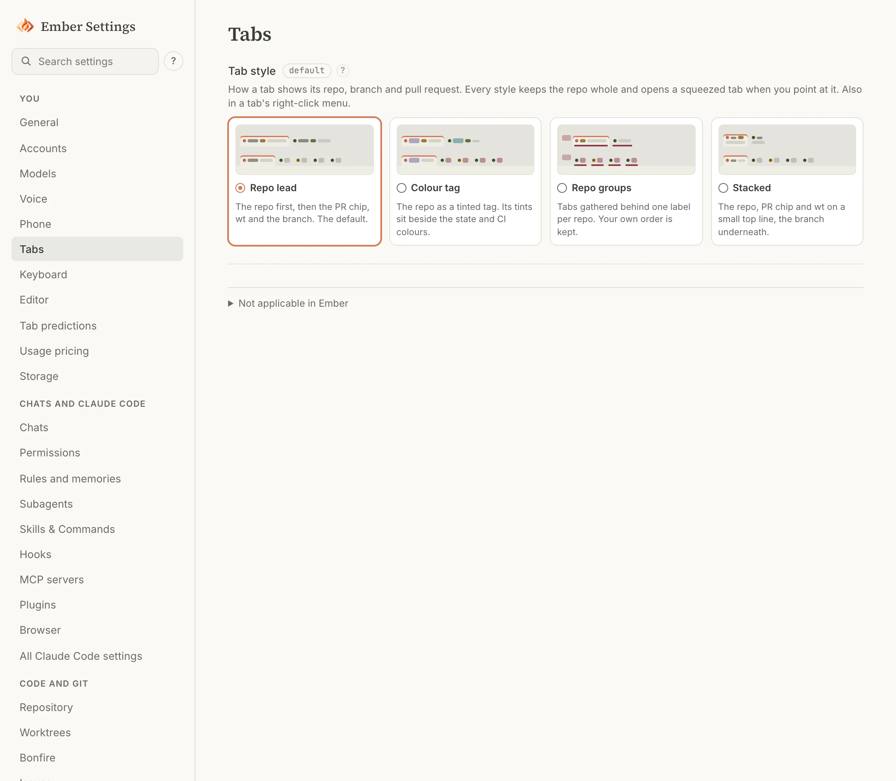

# How to use workspace tabs

In Ember.app, keep several repositories and worktrees as tabs in one window's title bar, and move tabs between windows.

In the Ember app, each open repository or worktree can be a tab in the window's title bar, so one window holds several
of them. A tab is still its own workspace: its own folder, branch, chats and Source Control. Only the front tab is
shown; the others keep running in the background, chats included.

Workspace tabs are on by default. To turn them off, clear `ember.tabs.enabled`. If you used Ember before it had tabs,
the first time you see them Ember also offers **Turn Off Tabs**.

## What a tab shows

- A state dot first, in the same colours as everywhere else in Ember: **Needs you** (gold) when something there waits for
  you — an approval, a question, a sign-in, a chat that stopped responding, a to-do of this tab's Bonfire run (wherever
  its branch is), or red CI, requested changes
  or conflicts on the branch's pull request; **Working** (clay) while a chat works on the tab's branch, or a chat you
  started in this tab works anywhere; otherwise the state of the branch the tab shows now: **Waiting** (blue), **Ready** (green),
  **Merged** (plum), or **Idle**, a hollow ring. A finished turn you haven't read doesn't light the dot; the bell lists it.
- The repository, first and in full: with tabs open on several repositories you can always tell which tab is which.
  A folder outside git shows a folder mark and its name instead.
- The branch's pull request, with its CI, in colour: **#41 ✓** passed (green), **#41 ✕** failed (red),
  **#41 ◷** still running (yellow), **merged #41** (purple), **draft #41** or **closed #41**. A cancelled or skipped
  check doesn't count either way, as on GitHub. It's the same mark the branch shows in the chat panel. Click it to open
  the pull request on GitHub in your browser; the tab stays where it is.
  Ember asks GitHub every 20 seconds while CI runs and every minute while a pull request is open, every five minutes
  when nothing is open, and again when you switch to a tab. Anything you do in Ember (push, open, merge) shows at once.
  A sleeping tab keeps the mark it had when it went to sleep until you wake it.
- A small **wt** mark on a worktree's tab.
- The branch last. A tab you renamed shows your name there, and a detached HEAD its commit. With tabs, the title bar
  gives the room of its own centre title to them; a window with no folder open just says Ember.
- A close button on the front tab. Any other tab shows its close button when you point at it.
- Dimmed when the tab is asleep (see below).

Rest the pointer on a tab to see its card: the full title, the folder's path, what's going on in it (its state word, its
pull request and CI, pinned, asleep) and how much memory its window uses. The
**All tabs** menu, **Move Tab to Window** and the bell name tabs branch first, with the repository after it.

## When there are more tabs than fit

The tab you're in always keeps its full width. The others share what's left, every one the same width, and each is
cut from the right only: first the end of the branch fades out, then the whole branch goes, then the **wt** mark, then
the pull request. The repository's name is never cut: when it no longer fits, the tab shows a two-letter mark for its
repository instead, chosen so your open repositories never
share one. A repository with its own icon shows that icon instead of the letters. Widen the window and everything comes
back. Only past that does the row of tabs scroll sideways (use the scroll wheel), and only then does the **All tabs**
button (⌄) appear, listing every tab. A tab dragged in from another window makes room the same way.

### See a squeezed tab in full

Point at a squeezed tab and, after a moment, it opens to the right over its neighbours to show the whole tab: its
repository, pull request, **wt** mark, full branch and close button. Nothing it already showed moves or disappears,
and the other tabs stay where they are. Near the right end of the row, where there's no room to the right, it opens
to the left instead. Move straight on to the next tab and that one opens at once; move away and it closes. The pull
request in an opened tab is a link like any other.

### Use the keyboard

The row of tabs is one stop for the Tab key, on the tab you're in. Use the left and right arrow keys (or Home and End)
to move between tabs; a tab you move to opens to show itself in full. Press Enter or Space to switch to it. While a
tab is open, Tab reaches its pull request, and Enter opens it on GitHub.

## Choose a tab style

Tabs can show their repository in four ways. Choose one in **Settings › Tabs**, or right-click any tab and choose
**Tab Style** (it's also `ember.tabs.style`):

- **Repo lead** (default): the repository first, then the pull request, **wt** and the branch.
- **Colour tag**: the repository as a tinted tag, so tabs of one repository share a colour.
- **Repo groups**: tabs gathered behind one label per repository, with a coloured bar under each. Your own order is
  kept: switch back and it returns. Dragging a tab moves it within its group.
- **Stacked**: two small lines in each tab, the repository and pull request on top and the branch underneath.

Every style keeps the repository whole and opens a squeezed tab when you point at it.

  <picture>
    <source media="(prefers-color-scheme: dark)" srcset="../images/settings-tabs.dark.webp">
    
  </picture>
   <em>Settings › Tabs: how workspace tabs show their repo</em>

## Each tab opens with its Dashboard

When Ember starts, every tab opens with a Dashboard pinned at the far left of its editors, over the files it restored:
the repository's Dashboard in a main worktree's tab, the branch's own page in a worktree's tab (see
[Your landing page](dashboard.md#your-landing-page)). A tab you open later gets one too, behind what you came for. A tab behind another
doesn't load or refresh its Dashboard until you switch to it. Close it and that tab keeps it closed until Ember next
starts.

## Open a new tab

1. Click **+** (**New Ember tab**) at the end of the row of tabs, or run **New Ember Tab** from the Command Palette.
2. Pick a recent folder, or **Open Folder…** to choose any folder.

The folder opens as a new tab next to the current one.

To open a folder from the Explorer, right-click it and choose **Open in New Ember Tab** or **Open in New Ember Window**.

## Choose where Ember opens folders and worktrees

When Ember itself opens a folder or a worktree, for example **Open tab** on a branch or **Open in New Ember Tab**, it
goes by `ember.tabs.openFoldersIn`:

- `tab` (default): the folder becomes a new tab in this window.
- `window`: the folder gets a window of its own.

Hold Alt (⌥ on macOS) when you choose to get the other one. When Claude moves your chat into a worktree, the tab you're
in switches to that worktree by default and the chat carries on there; set it to open as a tab of its own instead (see
[Claude makes a worktree itself](worktrees.md#claude-makes-a-worktree-itself)).

## Open a branch in its tab

Wherever Ember offers a branch's tab (the branches board's and the Dashboard's **Open tab**, Forge's **Open tab**, the
branch menu's worktrees, a ticket's **Work in Ember**), it opens the branch rather than a folder:

- A tab already showing that branch, in any window, comes to the front (a sleeping one wakes).
- Otherwise the worktree the branch is checked out in opens as a new tab.
- A branch checked out nowhere first gets a worktree of its own (yours: Ember's cleanup never removes it), then opens.

In VS Code, VSCodium or Ember.app with tabs off (or with the system title bar, which has no tab strip), the worktree
opens in a window instead, or the window already open on it comes forward. When you picked **New Tab** for a chat, the
chat says once that it opened a window instead.

## Switch tabs

- Click a tab.
- Next or previous tab: ⌘⌥⇧] / ⌘⌥⇧[ on macOS, Ctrl+Alt+Shift+] / Ctrl+Alt+Shift+[ on Windows and Linux.
- Jump to tab 1–8: ⌃⌥1 to ⌃⌥8 on macOS, Ctrl+Alt+Shift+1 to 8 on Windows and Linux. The 9 key goes to the last tab.
- Pick from the **All tabs** (⌄) menu when the row of tabs overflows.

Drag a tab along the row to reorder it. Pinned tabs stay at the front.

## Close tabs

- Click a tab's close button, middle-click the tab, or press ⌃⌘W (macOS) / Ctrl+Alt+Shift+W.
- Right-click a tab for **Close Tab**, **Close Other Tabs** and **Close Tabs to the Right**.

Closing a tab closes only that workspace. Closing the window itself closes every tab in it. If a workspace has unsaved
changes, you're asked first as usual.

## Move tabs between windows

- **Tear a tab off:** drag it up or down out of the row of tabs. It becomes a window of its own, held where you grabbed it.
- **Move it into another window:** keep dragging over the other window's row of tabs. That window comes forward, the tab
  rides along its row under the pointer and the other tabs slide aside to show where it will land. Let go and it
  glides into its slot. Holding it over a window that's partly behind others for a moment brings that window forward.
- **Move a whole window into another:** a window with one tab moves as a whole when you drag that tab; drop it on
  another window's row of tabs to make it a tab there. Dragging a window by its title bar just moves the window, as in a
  browser.
- **From the menu:** right-click a tab and choose **Move Tab to New Window**, or **Move Tab to Window** and pick the
  window.

## Merge all windows

Right-click any tab and choose **Merge All Windows** to gather every window's tabs into this one.

## See what needs you in every tab

While a branch in any tab or window needs you, a bell appears next to ⌄ with the same count the status bar shows
(**● 3 need you**); a finished turn left to read shows the bell without a number. Click either to see what needs you and jump to it; the bell's list holds what its number counts. See [Work across tabs and windows](across-tabs.md), which also covers jumping to a chat or file in any tab and
what happens when you open a chat that belongs to another tab.

> **Note:** On Linux with Wayland, tabs can't be dropped onto another window's row of tabs. Use **Move Tab to Window** or
> **Merge All Windows** instead; tearing a tab off still works.

## Rename a tab or change its icon

1. Right-click the tab and choose **Rename Tab…**.
2. Type a name, or leave it empty to go back to the repository's name.

To change the icon:

1. Right-click the tab and choose **Change Icon…**.
2. Pick **Choose an Image…** (PNG, SVG, ICO, JPEG or WebP, up to 70 KB), **Use a Letter…** (a letter, digit or emoji on
   a color you pick), or **Use the Repository's Own Icon** to undo your choice.

Every worktree of a repository shares its icon. Without a choice, Ember uses the repository's favicon or logo, or a
letter. Both commands are also in the Command Palette for the current tab.

## Sleeping tabs

A sleeping tab keeps its spot in the row but closes its workspace, so it uses no memory. It shows dimmed; click it to
open it again.

To put a tab to sleep, right-click it and choose **Put Tab to Sleep**. A tab can't sleep while a chat in it is running
or waiting for you, while it has unsaved changes, or when it's the window's only open tab.

## Pin a tab

Right-click a tab and choose **Pin Tab** to keep it at the front of the row. **Unpin Tab** undoes it.

## Restore tabs on start

When Ember starts, your windows come back with their tabs. `ember.tabs.restore` decides which tabs open:

- `all` (default): every tab that was open comes back open.
- `active`: only each window's front tab opens; the others come back asleep and open when you click them.

Inside a window, Ember's own editor tabs come back where you left them, in the same group and order: the Dashboard,
Branches, Usage, Issues, Ember Settings, Ember Help, Forge, Bonfire and chats in editor tabs. Help opens on the page it
showed and Settings on its section. Each comes back once: opening it again shows that tab, and the Dashboard that opens
on start doesn't add a second. Pages for one moment (Compare, a review, About, Welcome, a subagent, a canvas, the
browser) don't come back.

## Keyboard shortcuts

| Action | macOS | Windows / Linux |
|---|---|---|
| Next tab | ⌘⌥⇧] | Ctrl+Alt+Shift+] |
| Previous tab | ⌘⌥⇧[ | Ctrl+Alt+Shift+[ |
| Go to tab 1–8 | ⌃⌥1 – ⌃⌥8 | Ctrl+Alt+Shift+1 – 8 |
| Go to the last tab | ⌃⌥9 | Ctrl+Alt+Shift+9 |
| New tab | ⌃⌘T | Ctrl+Alt+Shift+T |
| Close tab | ⌃⌘W | Ctrl+Alt+Shift+W |

These work on any keyboard layout. On Windows and Linux, a Ctrl+Alt combination that types a character with AltGr is
left to the editor. See also [Keyboard shortcuts](../shortcuts/keyboard-shortcuts.md).

---

[All documentation](../README.md)
