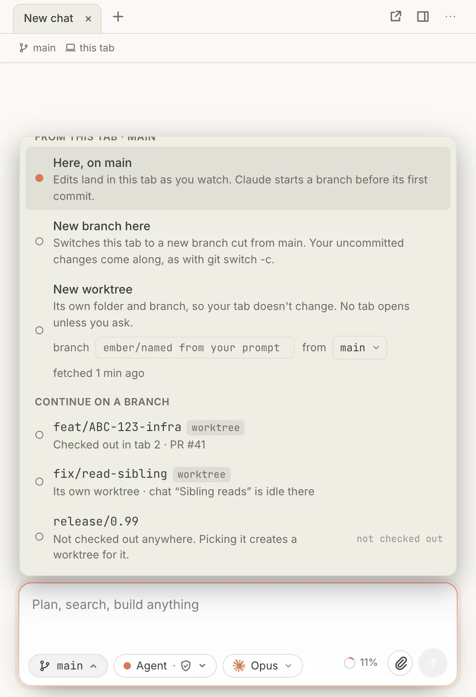
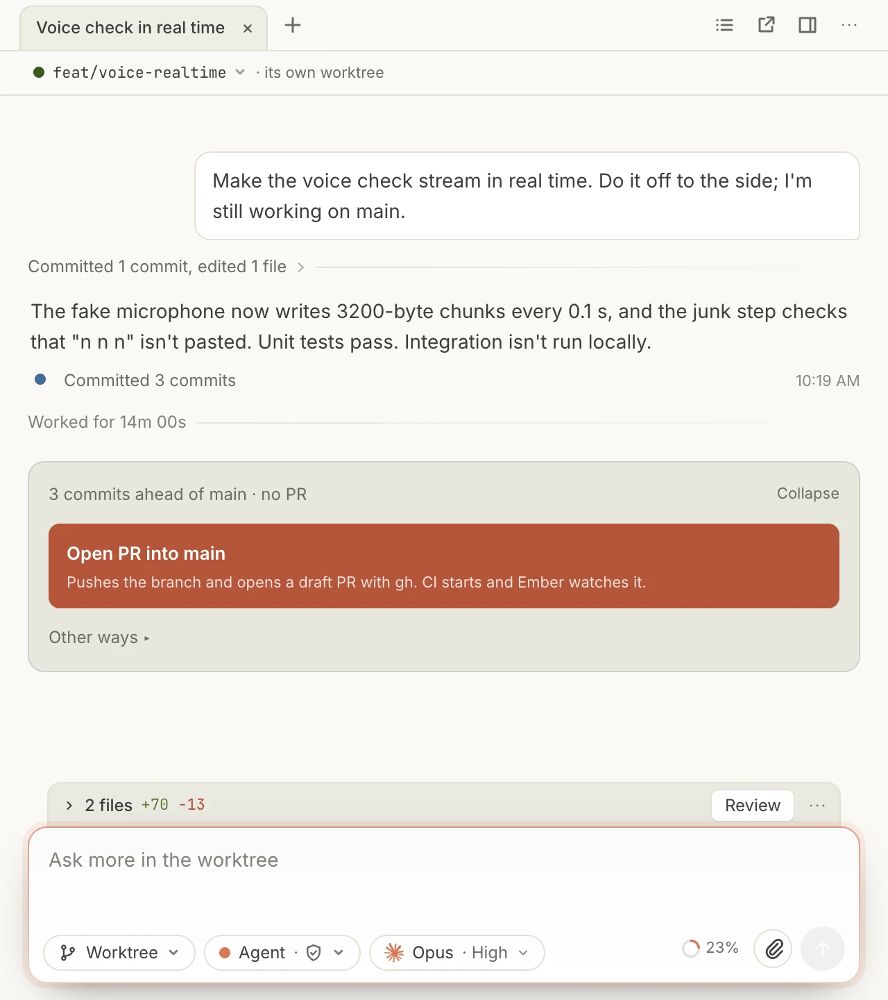
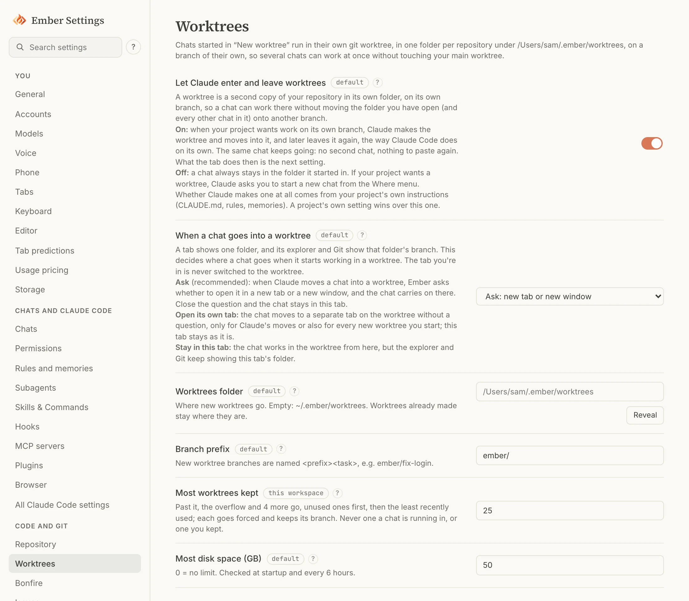
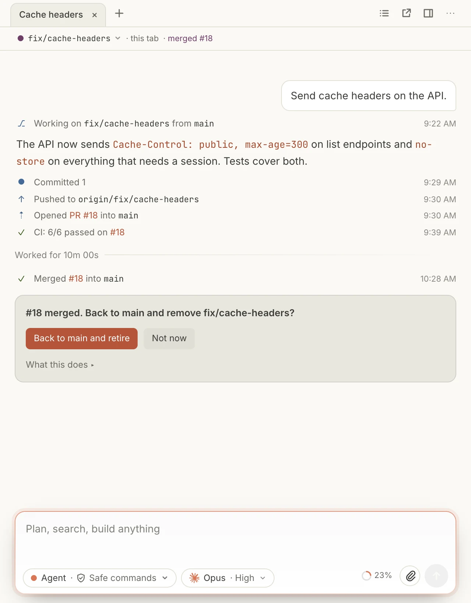
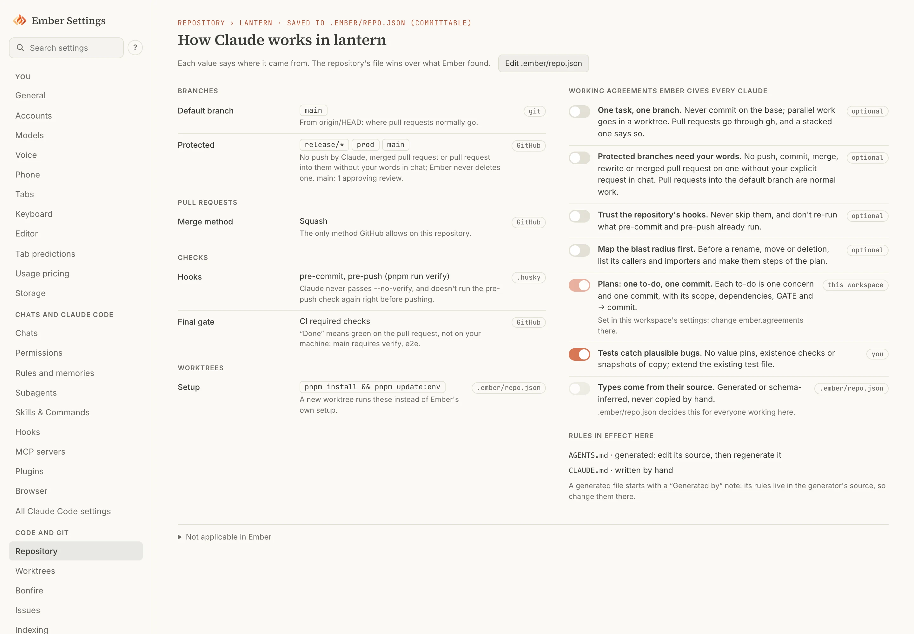

# Worktrees

Run a chat in its own git worktree and branch, so several chats can work at once without touching your main worktree.

A git worktree is a second working copy of the same repository, in its own folder and on its own branch. A chat that runs
in a worktree can edit, build and test freely while your main worktree stays exactly as you left it. You can run
several such chats at once.

Ember puts new worktrees in `~/.ember/worktrees`, one folder per repository ([`ember.worktrees.root`](../settings/settings-worktrees.md#emberworktreesroot) picks
another folder), and names each branch with a prefix ([`ember.agentBranchPrefix`](../settings/settings-worktrees.md#emberagentbranchprefix), `ember/` by default), for
example `ember/fix-login`. Worktrees made before that stay in the repository's `.claude/worktrees` folder and keep
working.

## Start a chat in a worktree

Before the first message, the first button under what you write in the message box shows where the chat will work
(**Here · main**). Click it and choose:

- **Here, on** *branch*: work in this tab's folder, on its branch (the default). Edits land as you watch.
- **New branch here**: this tab switches to a new branch from its own when you send the message (named from your
  prompt, like a worktree's). Your uncommitted changes come along, as with `git switch -c`.
- **New worktree**: an isolated copy on its own branch, created when you send the message. This
  tab doesn't change. Under it, **branch** shows the prefix and **named from your prompt**: type a name to choose it
  yourself. **from** picks the base it starts from (this tab's branch, or the repository's default branch), as your
  local copy has it; beside it, when the repository last fetched (**fetched 1m ago**). Typing or picking there
  chooses this option.
- **Continue on a branch**: an existing worktree, or a branch that isn't checked out anywhere (one Ember made, or one
  with an open pull request). Each says where it lives (**Checked out in tab 2** when another tab shows it), its pull
  request and the chat on it. A
  branch checked out nowhere gets a worktree of its own when you send.

<p align="center">
  <picture>
    <source media="(prefers-color-scheme: dark)" srcset="../images/chat-where-menu.dark.webp">
    
  </picture>
  <br><em>A new chat's Where menu: here on this tab's branch, a new branch here or a new worktree, or a branch to continue on</em>
</p>

With **New worktree** picked, the message box says "Describe the task — it runs in a new worktree". Once the first
message is sent, the chat's branch shows on the line at the top of the chat. In a worktree chat the button then says
**Worktree** and holds the worktree's own actions (see [Finish a worktree chat](#finish-a-worktree-chat)).

You can also start one from the branch menu: click the branch on the line at the top of the chat, then **Switch
branch…**, and pick **New Worktree from** *branch*….

## Claude makes a worktree itself

Claude can also make a worktree in the middle of a chat, the way Claude Code does on its own: when your project's
instructions want work on its own branch, it calls Claude Code's `EnterWorktree`, which creates the worktree and moves
into it. **The same chat keeps going, and Ember asks where to open the worktree**: in a new tab or in a new window,
where the explorer, Source Control and the branch in the status bar all show the chat's branch. The tab you're in is
never switched to the worktree, so everything you had open stays where it is. You don't open a second chat or paste
your request again. Whether Claude makes a worktree at all comes from
your project's own instructions (`CLAUDE.md`, rules, memories); Ember doesn't decide that for it.

How the chat moves:

1. Claude ends its turn at the move with one short line. If it calls a tool anyway, Ember ends the turn there. That
   call isn't shown as a failure: it's how Ember ends the turn.
2. Once nothing is in flight (no approval waiting, no background task or command, no message being sent), one
   card in the chat, under its last reply, asks **Open it in a new tab or a new window?** with **New Tab**, **New
   Window**, **Stay Here** and **Always New Tab**. Stay Here keeps the chat in this tab, working in its worktree.
   Closing the card isn't an answer: it comes back until you pick one. Always New Tab opens a new tab now and sets
   **When a chat goes into a worktree** to always, so you aren't asked again. The first time, the chat says how to undo
   that. A tab already open on that worktree comes forward without a question.

   A project can set this too, in its `.vscode/settings.json` (or the workspace file in a multi-root window), and the
   project's choice wins there. When it differs from yours, the chat says so: the card adds that this project's settings
   ask, a chat that moves without asking says the project chose it, and one that stays says why. Always New Tab only
   ever changes your own setting, never the project's file; while the project's file still asks, the chat says so and
   names the file to change.
3. Once you click, the card shows what's happening, such as **Opening mileage in a new tab…**, until the chat has gone.
   If you type in this tab meanwhile, the chat waits until you pause, so nothing takes your text or your focus.
   In the Ember app the new tab appears at once in the row of tabs at the top of the window, with the Ember flame. This
   tab stays in front, still saying **Opening mileage in a new tab…** with the flame and the seconds so far, until the
   chat is there; then the new tab comes forward in one step. Click the new tab to go there sooner. If its window
   doesn't open, this tab says so, with **Retry**. (If new tabs ever come up blank, see
   [The window went blank when a worktree opened](../troubleshooting/troubleshooting.md#the-window-went-blank-when-a-worktree-opened).)
4. The new tab's chat panel shows the Ember flame with **Carrying “Fix login” here…**, then **Resuming…**, until the
   chat is there. The chat gets one line, **Moved to worktree** *name*, the cursor is in its message box, and it carries
   on by itself with **Carry on in this worktree.** The tab you were in isn't disturbed: its chats, editors and
   terminals stay as they were, and it keeps showing the chat (see [The tab a chat left](#the-tab-a-chat-left)).

When Claude leaves the worktree again with `ExitWorktree`, the chat goes back the same way: the turn ends, and the chat
carries on with **Carry on here.** in the tab on the folder Claude went back to (it opens behind this one if you closed
it). Nobody asked for that move, so the tab you're in stays in front and says where the chat went, with **Open**.

### The tab a chat left

When a chat you're looking at moves to its worktree's tab, the tab you were in keeps showing it: the conversation you
were reading stays on screen, read-only, and never turns into an empty chat. One line above it says how the move goes:

- **Opening mileage in a new tab…** with the Ember flame and the seconds so far, while that tab opens.
- **Continues in tab 3.** once it's there, **Working in tab 3…** with the flame while Claude works there, or
  **Waiting on you in tab 3: an approval** when it asks you something, with the gold **Needs you · tab 3** label.
  Approvals and questions are answered in its own tab: the line's **Open in tab 3** takes you to it (and is the only one
  then).
- **mileage's tab didn't open.** with **Retry** if its window failed to open.

While Claude works in the other tab, the conversation here keeps up within a few seconds. There's no message box:
instead, **This chat continues in tab 3.** with **Open in tab 3** and **New chat**. Anything you'd typed in the chat's
message box goes with it (**Your unsent message went with it.**, **Open in tab 3 and keep typing**). You can't edit, fork
or restore its messages here. **New chat**, picking another of this tab's chats, or **✕** on the line puts this tab's
own chat back. When the chat comes back to this tab, it replaces the read-only view. If you close its tab, the chat
says where it belongs, as any chat from another folder does.

Settings › Worktrees has both choices: **Let Claude enter and leave worktrees** and **When a chat goes into a
worktree** (where the chat goes). Turn the first off ([`ember.worktrees.claudeMayEnter`](../settings/settings-worktrees.md#emberworktreesclaudemayenter)) to
keep every chat in the folder it started in. Then Ember refuses `EnterWorktree` and `ExitWorktree`, and the note Claude
gets tells it not to switch the folder's branch instead. If your project's instructions want work in its own worktree,
Claude asks you to pick **New worktree** with the first button under the message box, and waits. A project can set this in its own `.vscode/settings.json`,
and that value wins over yours.

## When a chat moves to its worktree's tab

[`ember.worktrees.chatMovesToTab`](../settings/settings-worktrees.md#emberworktreeschatmovestotab) decides where the chat goes: **Ask** (the default,
above) asks for a new tab or a new window; **never** keeps the chat in this tab while it works in the worktree, so the explorer and Git
keep showing this tab's folder. With **always** or **claude**, the chat carries on in the worktree's own tab without a question:

1. Claude ends its turn right there with one short line, such as "Continuing in the worktree's tab." Ember holds it to
   that: if Claude calls a tool after the move in the same turn, Ember ends the turn there, without a failed row. A
   background subagent that's still running finishes its work first.
2. Once nothing is in flight (no approval waiting, no background task or command, no message being sent, no queued
   build), the worktree opens as a tab of this window, behind the one you're in (its tab shows the Ember flame while it
   opens), and your tab says where the chat continues, with **Open**. In stock VS Code it opens in a new
   window. A tab already open on that worktree stays where it is. The chat's pending edits go with it.
3. The worktree's tab shows the chat coming (the Ember flame with **Carrying “Fix login” here…**, then **Resuming…**),
   then the chat with one line, **Moved to worktree** *name*, and it carries on by itself with
   **Carry on in this worktree.** That message is Ember's, not yours, so Agent Review doesn't count it as something you
   asked for. Anything you type there before that turn ends waits in the queue. A message you sent while the turn that
   moved it was ending goes with the chat, with its images, files and mentions, and is its first turn there instead.
4. The tab it left isn't disturbed. If the chat was on screen, it stays on screen there, read-only (see
   [The tab a chat left](#the-tab-a-chat-left)). The chat list there still shows it, in its repository's group, with the tab
   it's open in.

If you're typing in this tab when the move is ready (in an editor or the message box, in the last couple of seconds),
Ember doesn't take the focus away. A card in the chat, under its last reply, says where the chat continues, with
**Open its tab** and **Stay in this tab**. The chat moves only when you click **Open its tab**; Stay in this tab keeps it in this tab.
Closing the card isn't an answer: it comes back until you pick one.

To keep a chat in this tab, click **Stop** while that last turn ends. The chat stays here and works in its worktree from
this tab. The same happens when Claude leaves the worktree again with `ExitWorktree` before the move.

Only your own chats move like this. A chat watching a PR and a side chat stay in their tab, and so does a chat moving into the worktree this tab already shows.

A new chat you start in a new worktree (**New worktree** under the message box, or a branch that isn't checked out anywhere)
goes to that worktree's tab too, once its first turn ends. It arrives idle, with no turn of Ember's. Forks, the tries of
a prompt sent to several models, and a chat that works in a worktree because the main worktree stays on its base stay in
this tab, so you can compare them. The setting
[`ember.worktrees.chatMovesToTab`](../settings/settings-worktrees.md#emberworktreeschatmovestotab) decides when chats move by themselves: **Ask** (the default: Ember asks, new tab or new window,
for a chat Claude moves into a worktree), **always**, only when **claude** moves them with `EnterWorktree`, or **never**. You can
still move one yourself, as below.

## Move a chat to its worktree's tab

A chat started in one tab may work on a branch that lives in another worktree. Its branch line then reads **Branch is in
its worktree · Move this chat to tab 2** (or **Open its tab and move this chat there** when no tab is open on that
worktree). Click it, or use **Move to tab 2** in the chat tab's menu or the chat's menu in **Chats**, or run
**Move This Chat to Its Worktree's Tab**.

The worktree's tab opens or comes to the front, and the chat moves there idle and ready. Nothing is sent for it. Its
pending edits, its queued messages and its review marks go with it. In the worktree's tab the chat gets one line,
**Moved to worktree** *name*, which stays in its history. The tab it left keeps showing it, read-only, with
**Continues in tab 2** and **Open in tab 2**. Its chat tab there closes.

What goes with it:

- **Its plan.** A plan the chat wrote that isn't lit yet moves with it. Its plan view and its Bonfire page open in the
  worktree's tab, and the Bonfire page in the tab it left stops showing it.
- **Its stopped or finished Bonfire run.** The run moves to the worktree's tab with its to-do chats, its suite log,
  screenshots and plan backups, so you can carry it on or clean it up from there.

When it can't move, the chat on screen says why:

- **It's busy.** A turn is running, an approval or a question waits, a background task or command still runs, or a message
  is being sent. Click **Move when it's done**, and it goes as soon as it's free. Until then the chat says what it waits
  for, such as **moves to tab 2 when this turn ends**, with **Don't move** to keep it here (closing that line keeps it
  here too). If you're typing in this tab right then, a card in the chat offers **Open its tab** instead of taking your
  focus.
- **Its Bonfire run is on.** The run's to-do chats work from this tab, so the chat that planned it stays with them until
  the run ends.
- **Its Bonfire run is still finishing.** While the run merges, pushes or is being cleaned up, the chat waits here. Move
  it once that's done.
- **It isn't yours to move.** A chat watching a PR and a side chat stay with what they belong to.

### Chats a worktree's tab finds

Open a tab on a worktree where chats from another tab already work, and its new chat shows **2 chats on this branch run
from main** with **Move here**. Click it to bring them over. A tab that's open moves its own chats, and says why when one
can't go. A chat whose tab is closed is moved straight away, unless it was working when that tab closed. In the tab they
run from, the chats' rows in **Chats** show a quiet **Move to tab 2** too. Ember never moves these older chats by itself.

## Chats stay with their tab

Apart from that move, a chat belongs to the tab (or window) you started it in, and you drive it from there. A chat you
start in a worktree from the message box, or fork with **Fork to Worktree**, keeps working from the same tab.
To see the worktree in Source Control, open it in Forge, or open it in its own tab from the branch menu.

Open a chat that belongs to another tab (from another branch's group in the chat list, a link or the switcher) and it
shows right here, read-only, with the tab that runs it (**Running from tab 2**). Click **Open in tab 2**: that tab comes to
the front with the chat open, to send to. The branches board's **Go to tab** does the same (see [Work across tabs and windows](across-tabs.md)).

## Fork a chat into a worktree

To try another approach without touching a chat or your main worktree, fork it into a new worktree: point at one of your
messages and click **Fork to Worktree**, or right-click the chat and click **Fork to Worktree**. The worktree
starts from the chat's files at that point. Forks stay in this window so you can compare them side by side, then keep
the best one. See [Fork a Chat](../chat/forks.md).

## Finish a worktree chat

When a worktree chat ends its turn and nothing else is still working for it (background subagents and the turns they
wake, a queued message, a move to a new chat), a card under its last reply shows the branch, one line of facts (how many
commits it is ahead of its base, and its pull request: **no PR**, **checks running**, **checks failing**, **merged**…)
and one button for the next step: **Open PR into** the branch's base while it has no pull request, then **View #18 on
GitHub** once it has one, whichever branch that pull request goes into. The base is the branch the worktree was cut
from (a hotfix cut from `prod` counts against `prod` and goes into `prod`). For a worktree Claude made itself with
`git worktree add`, Ember reads it from the branch's pull request, its upstream or git's record of where the branch
was created, else the long-lived branch it is fewest commits ahead of; with no other long-lived branch, the
repository's default. When it can't tell (the branch is as far ahead of `prod` as of `main`), the card doesn't guess:
it asks **Open PR into…** with a button for each. The card, the context line above the chat, the changes bar and the
git rows all name that same base. **Other ways ▸** holds the rest, each named by where it acts:
**Copy changes to main worktree**, **Open in a tab**, **Switch main worktree to this branch**, **Terminal in this worktree**, **Copy
worktree path** and **Remove worktree (the branch stays)…**, with what was last checked on the branch. The file counts stay on the changes
bar, and while the card leads with **Open PR** the context line doesn't show a second one. The **Worktree** button
under the message box has these too:

<p align="center">
  <picture>
    <source media="(prefers-color-scheme: dark)" srcset="../images/chat-worktree-done.dark.webp">
    
  </picture>
  <br><em>A worktree chat finished its turn: its branch, how many commits it is ahead of its base and its pull request, one next step (Open PR) and Other ways</em>
</p>

The card comes only after a turn that left the branch ready to finish: it changed files in the worktree or made commits
(Claude's own, a subagent's, or yours from a terminal once the turn ended), and it didn't stop partway or go on editing
after its own last commit. After a turn that only answered, planned, read files or pulled the base in, or one that
stopped partway, a single quiet line shows instead, with the branch and the card's line of facts, and
**Finish ▸** opens the card. **Collapse** on the card folds it back to that line, and it stays folded after Ember reloads. If you send your next message without
using the card, it folds away too, and it comes back only when a later turn changes the branch again. Nothing shows on
a branch that holds nothing yet, or while the chat's plan builds.

When you press one of them, it opens across the card with its work showing: Ember's flame, its name and the time so
far, counting each second, and the step it's on in words (for Open PR: the repository's check if it has one, **Push the
branch**, **Create the draft PR**). How a removal goes is said there too ("Moved its folder aside: its files are deleted
in the background."). The commands' own output stays closed while all goes well: **Show output** opens it, then **Show
all** opens it up and **Copy** takes it. Anything that looks like a token or a password is hidden before it shows. The
card's other actions wait, dimmed, until it ends. When it's done the box turns green and offers what's next, such as
**View PR #128**, and **Dismiss** puts it away. When it fails it turns red, shows the steps with the one that failed,
opens the output on its failing lines, and says in one sentence what went wrong (a rule on the repository that refused
the push, a sign-in, the network, a pull request that's already open). **Ask Claude to fix it** sends that to the chat,
and **Retry** runs it again. **Copy changes to main worktree** (**Check your main worktree**, **Copy the changes in**),
**Switch main worktree to this branch** (**Check both worktrees**, **Remove this worktree**, **Switch your main worktree**) and
**Remove worktree (the branch stays)…** (**Check that everything on it is merged**, **Remove the worktree**) work the
same way.

- **Copy changes to main worktree** (worktree menu): git squash-merges the worktree's branch into your main worktree. Its commits arrive
  as uncommitted edits for you to review and commit, and the chat stays in its worktree. Your main worktree must have no
  changes of its own first. Conflicts are git's own and show in Forge's banner, where **Abort** puts everything back.
  **Undo copy to main worktree** resets your main worktree while you haven't committed or staged anything of your own, and Ember waits while
  another chat works in your main worktree. Edits Claude didn't commit aren't on the
  branch, so they don't come.
- **Switch main worktree to this branch** (worktree menu): your main worktree moves to the chat's branch. The worktree goes
  (never forced, so commit first), and the chat continues in the main worktree. Ember refuses while a chat works in
  either one or is paused there, in any window, checked again right before the worktree goes, while either one has uncommitted changes or an editor with unsaved changes in any window,
  while the worktree isn't on its branch, or while the main worktree is in the middle of a merge or rebase. If git can't
  switch, Ember makes the worktree again and every chat on it continues there from your next message. A branch row's
  **⋯** menu on the Dashboard has it too.
- **Undo Apply**: only for a chat applied with the earlier **Apply**, which **Copy changes to main worktree**, **Switch main
  worktree to this branch** and **Open PR** replaced; it puts your main worktree back as it was, for one more release.
- **Open PR**: push the branch and open a draft pull request with the GitHub CLI (on GitHub Enterprise too). An open pull request for the branch is reused. On another host than GitHub, without `gh`, or when `gh` can't open it (not signed in), Ember opens the host's compare page instead. While it runs, the finished chat's card and the **Open PR** button above the chat say which step it's on ("Pushing…", "Opening the PR…"), and clicking again does nothing.
  The pull request's description says what was done and why: one short turn on the chat's own model, with no tools,
  writes it from what you typed in the chat and Claude's own summary of what it did (never Ember's hidden text). It
  then lists the commits and the files changed, how the work was checked as far as the chat knows ("some tests ✓",
  "typecheck not run"), and the ticket the branch names, linked when Ember knows your Jira site. When the repository
  has a pull request template (`.github/pull_request_template.md` and its variants), Ember fills it in rather than
  ignoring it. If the turn can't run, the description quotes what you asked and lists the commits. It never adds a
  "made with" line, and it's a draft, so you can edit it on GitHub.
- **Copy worktree path** and **Open terminal in worktree**.

## Go back to the main worktree

From a tab on a worktree, run **Open Main Worktree** to reopen this window on the
repository's main worktree. The branch menu (click the branch at the top of the chat, then **Switch branch…**)
also lists **← Main worktree** and every other worktree.

## Set up new worktrees

A fresh worktree has no installed dependencies and no ignored files such as `.env`. Unless the repository says
otherwise, Ember makes each new worktree ready: it copies the main worktree's ignored `.env` files, installs
dependencies from the worktree's lockfile, and builds generated code. The chat shows each step as **Worktree setup**.
Ember never reads or shows what is inside an env file.

To run your own setup instead, add `.ember/worktrees.json` to the repository:

```json
{
  "setup-worktree": ["pnpm install", "pnpm run build"]
}
```

- `setup-worktree` is a list of commands, or the path of a script to run.
- `setup-worktree-unix` and `setup-worktree-windows` override it on that kind of system.
- Or put the commands in the repository policy's `worktreeSetup` (`.ember/repo.json`, see Repository policy below).
- Either way, your setup replaces Ember's own when a worktree is made: Ember's install doesn't run then, and no `.env`
  file is copied from your main worktree, whatever `ready` says (useful when a branch writes its own environment, for
  example from the branch name). That goes for a chat's worktree, a Bonfire to-do's and Bonfire's test run, which runs
  your setup too, and again if the setup or the lockfile changes.
- Before Bonfire reviews or tests a worktree, Ember still installs when its lockfile asks for it, or when it has no
  record of an install there. A to-do's review doesn't run your setup in the temporary copy of the base branch; that copy
  gets the `.env` files the to-do's worktree has, never the main worktree's, so a test runs there as it does in the to-do.
- Once dependencies are installed, Ember still builds generated code your setup didn't make;
  `"ready": { "codegen": false }` turns that off.
- A file with only `ready` declares no setup, so the default setup stays. To skip parts of it, use
  `"ready": { "env": false, "codegen": false }`, or `"ready": false` to skip both.

A new worktree starts from the branch you're on, the way `git switch -c` does: your local copy of it, with nothing
fetched first (pull first if you want the remote's newer commits). From a detached tab it starts from that tab's own
commit. A branch only the remote has, opened in a
worktree, gets a local branch that tracks it, so a plain push and pull use that remote branch.

Settings › Worktrees also shows Claude Code's own worktree settings under **New worktrees**: **Start new worktrees
from** (the remote's default branch, or your current commit; when you set it, it takes over from the rule above),
**Folders linked, not copied** and **Only check out**.

## Limits and cleanup

<p align="center">
  <picture>
    <source media="(prefers-color-scheme: dark)" srcset="../images/settings-worktrees.dark.webp">
    
  </picture>
  <br><em>Settings › Worktrees: chat worktrees and cleanup</em>
</p>

Worktrees take disk space, so Ember keeps them in check. Cleaning up is two different actions, and
every button says which one it is:

- **Remove worktree** deletes the worktree's folder. **The branch always stays**, with every commit. Terminals Ember
  opened in that folder close first; terminals you opened yourself are left alone. Once every check has passed, Ember
  moves the folder aside (a hidden `.ember-removing-…` folder next to it) and deletes its files in the background, so
  the removal takes seconds even with a large `node_modules`. If the folder can't be moved (on Windows, a file in it is
  still open; a locked worktree; one with submodules), its files are deleted one by one instead, and the card says why.
  If the background delete fails or its window closes first, Ember finishes it later (when a window gets focus, and at
  its next start); a delete that fails says so once, with the folder's path.
- **Delete branch** deletes a branch that's checked out nowhere, and only once its work is in the base branch.

On its own (the limits below, or archiving a chat), Ember removes only a worktree whose work is all on its branch: one
with uncommitted or untracked files (a saved edit you haven't committed counts; a file your main worktree holds byte for
byte, such as one carried in when the worktree was made, doesn't), ignored files that may be yours, commits on a
detached HEAD, or files Ember couldn't finish checking stays, and Ember says why. So you can close a worktree's tab with
saved work in it and come back to it tomorrow. A removal you ask for is forced: it takes whatever is in the worktree,
after naming what goes. Only a chat working there, an editor with unsaved changes there in any Ember window, or a
linked worktree inside it stops that one. A worktree folder you deleted by hand is simply forgotten, its branch kept. A
chat whose worktree was removed after its pull request merged carries on in the repository's main worktree, with a
note saying so; a message you send while the removal is running waits for it to finish.

What goes with a worktree you remove is named before you say yes, on the sheet, the merged card, the Dashboard's
question and Delete Chat's: its uncommitted or untracked files, a detached HEAD's commits (on no branch), and **ignored
files that may be yours**, such as notes you kept there. Most gitignored files are nothing lost and go without a word:
dependency and build output (`node_modules`, `dist`, `.next`, `.turbo`, `.husky/_` and the like), any file your main
worktree holds byte for byte, generated code (`*.gen.*`, `*.generated.*`, `generated/`, `__generated__/`: run the
generator to make it again), generated files Ember's own setup made there, and env files Ember copied in and nobody has
edited since. When the sheet names files that may be yours, the button becomes **Remove worktree and delete these 2
files**. **Keep it** (on the merged card, **Not now**) leaves everything. A tab open on the worktree keeps it from going on its own; a removal you ask
for closes the tab first.

**Delete branch** is for a branch checked out nowhere (its worktree already removed): only when its work is in the
base branch (merged, including a squash merge, or never committed to). The base can be the branch its chat started
from, the repository's pull request target or the remote's default branch, and none of those branches, nor a
protected one, is ever deleted. It goes on the remote too when it was pushed and holds nothing that isn't here.
If Ember can't read the repository's policy, nothing is cleaned up on its own; one you ask for still works, protects
only `main`, `master` and the base, and says so.

- [`ember.worktrees.maxCount`](../settings/settings-worktrees.md#emberworktreesmaxcount) (**Most worktrees kept**, 25 by default): past it, Ember removes the overflow and
  4 more, worktrees no chat uses first, then the least recently used. Never a worktree a chat is running in (in any
  Ember window), one made in the last 10 minutes, or one you chose to keep when you archived its chat.
- [`ember.worktrees.maxSizeGb`](../settings/settings-worktrees.md#emberworktreesmaxsizegb) (**Most disk space (GB)**, 50 by default; 0 means no limit), checked at
  startup and every 6 hours. A notification says what went. A worktree over a limit that can't be removed stays (it
  has work its branch doesn't hold, say): a notification says why once, and
  **Clean up now** in Settings › Worktrees lists each one with its reason.
- Archiving a chat removes its worktree shortly after, when the rule allows: a message says "Archived. fix/login's
  worktree goes in 30 s" with **Keep it**, and another says when it has gone. When the rule doesn't allow it, a
  notification says why, and the chat says it too when you open it again.

## After a pull request merges

When a chat's pull request merges, a card comes after the **Merged** row in its transcript. For a branch you're on in a
worktree, it asks **#18 merged. Back to main and delete fix/cache-headers?**: the worktree switches to the base and
pulls it, then the branch is deleted here and on the remote. For a branch in its own worktree, it asks **#18
merged. Remove fix/cache-headers's worktree?** (**Remove worktree**): the worktree goes and the branch stays, and a chat
that worked in that worktree carries on in the repository's main worktree, with a note saying so. For a branch checked
out nowhere it asks **#18 merged. Delete fix/cache-headers?** (**Delete branch**). The card is that question and two
buttons: the one that goes, first, and **Not now**, which leaves everything as it is; the card doesn't come back for
that pull request (a later pull request of the branch gets its own). **What this does ▸** shows what Ember checked and
exactly what goes, with any ignored files that may be yours named (its button then says **Remove worktree and delete
these 2 files**). It opens on its own when a check fails: the button that goes is then off, with the reason beside it,
and nothing is changed. A branch that's gone already gets no card.

<p align="center">
  <picture>
    <source media="(prefers-color-scheme: dark)" srcset="../images/chat-merged-next.dark.webp">
    
  </picture>
  <br><em>Its pull request merged: one question, the button that cleans up and Not now; what Ember checked and what goes are behind What this does</em>
</p>

Ember first fetches the base, so the merge GitHub made counts, then checks everything again when you answer. It doesn't
go back while the worktree has uncommitted, untracked or unsaved changes (unsaved in any Ember window: it
names the tab that has them), while the branch has a commit that isn't in
the merged pull request (a squash merge counts as merged), while a chat works there, or for a protected branch. The
remote branch goes only when it holds nothing that isn't here, and only if nobody pushed to it since Ember looked.
With the repository's `autoRetire` on and its protected branches readable, Ember cleans up a merged branch on its own
when every check passes, and says so in the chat: as the merge comes in, for a merge it finds when it starts, and once a
chat that was working there stops. Otherwise a row in the chat says why it kept the branch, and the card asks. Once
it's cleaned up, that row stays in the transcript, no longer in red, with **Cleaned up since.** after it. The chat stays in your history.

When you answer, the card shows its work: Ember's flame, the time so far, and each step as it runs (**Fetch origin**,
**Check that everything on it is merged**, the switch and pull when the branch is checked out in your main worktree, **Close its tabs**, **Remove the
worktree**, and for a branch checked out nowhere **Delete the local branch** and **Delete the branch on origin**), with
the buttons off until it ends. A notification shows the same steps, so you can see them wherever you are, and then says
what went: "Removed fix/cache-headers's worktree: it's gone. The branch fix/cache-headers stays." Removing a worktree
closes its tab. That
tab stays open for a few seconds after the result shows, then closes, and an Ember window on the repository shows the
result too. If something stops it, the card stays with its buttons, and the box and the notification say why. **Retry**
in the box runs it again, unless the worktree is already gone: then the box keeps its result and offers no Retry. **Remove worktree** or **Delete branch** from the worktree card, from the branches board or when you delete a
chat shows the same steps, notification and result. Only one clean-up of a branch runs at a time: a second one waits for it and shows its result. **Not now** says in the status bar what it kept. If the branch on origin can't be
deleted (you're offline, say), that step is marked, and the result says the branch stays on origin and why.

Removing the worktree can take a while when it holds large ignored folders such as `node_modules` or `.next`: git
deletes every file in them, and the step says so while it runs. If a clean-up stops after the worktree is gone (the
local branch can't be deleted, say), the result says what went and what stopped, and nothing offers to run it again.

A worktree a chat is running in is never removed, and a worktree you made yourself outside Ember's worktrees folder is
never removed on Ember's own. Click **Clean up now** in Settings › Worktrees to enforce the limits right away.

## Every branch in flight

The [The Ember Dashboard](dashboard.md) shows every branch in flight, in every Ember window, with its one next step: open its tab, move
it into the main worktree, merge its pull request, remove its worktree or delete it. **Stop All Chats** stops
every working chat.

## Repository policy

<p align="center">
  <picture>
    <source media="(prefers-color-scheme: dark)" srcset="../images/settings-repository.dark.webp">
    
  </picture>
  <br><em>Settings › Repository: how Claude works in this repository</em>
</p>

Settings › **Repository** shows what Ember knows about the repository of the folder you're in, grouped as **Branches**,
**Pull requests**, **Checks** and **Worktrees**. Ember adds no workflow of its own: how branches are named, when pull
requests open and who merges come from the repository's own CLAUDE.md, AGENTS.md and rules. Each value has a line on
what it means there and a tag saying where it came from: `git.branchProtection` (VS Code's setting), `GitHub`, `git`,
`.husky` (its hooks), `.ember/repo.json` (the repository's own file) or `default`. What acts today:

- **Protected**: only what leaves your machine asks: a push to one (a force push or deleting it on the remote too), or
  opening or retargeting a pull request into one (other than the default branch). Committing, merging, rebasing,
  resetting or making branches on one locally never asks. Below **Run everything** these show you an approval card
  (at Run everything nothing asks), including inside a `bash -lc` script
  or after a `cd` into a worktree on that branch; so does merging a pull request, with `gh pr merge` or GitHub's API. Unstaging files with `git reset` and restoring them with `git checkout` don't ask, and a restore doesn't
  count as leaving the branch. Ember never deletes a protected branch. The protected branches are the names and
  patterns (`release/*`) in VS Code's `git.branchProtection` setting together with GitHub's branch protection, read
  when the GitHub CLI is signed in. Nothing is protected that neither of them protects.
- **Merge method**: how Forge merges a pull request: the repository's default merge method on GitHub, when GitHub
  allows it, else the first method GitHub allows. Without the GitHub CLI, a merge commit.
- **Final gate** (Checks): the CI checks GitHub requires on the default branch, from its branch protection and
  rulesets, so done means green on the pull request. The **Protected** row adds how many approving reviews GitHub
  requires there ("main: 1 approving review"), tagged `GitHub`. On a private repository without GitHub Pro, GitHub
  can't require checks or reviews, and the row says **Not available**; without a signed-in GitHub CLI it says
  **Unknown**. Ember reads them again at most once a minute while Settings is open.
- **Default branch** and **Hooks**: the working agreements (below) tell Claude about them.
- **Setup** (Worktrees): commands a new worktree runs instead of Ember's own setup (`worktreeSetup` in
  `.ember/repo.json`).

Click **Write down as .ember/repo.json** to save the worktree setup in the repository, where your team can review and
commit it; after that, **Edit .ember/repo.json** opens it. The file sits at the repository's top, the main worktree's
from a worktree or a subfolder, since that's the one Ember reads. It holds only `worktreeSetup` and `agreements`. A
folder outside any git repository has no policy to show or write. Saving the file, here or in any editor, redraws the
page within a second or two. **Rules in effect
here** lists the repository's AGENTS.md and CLAUDE.md; one a generator wrote (it starts with a "Generated by" note) is
marked, so edits go to its source.

## Working agreements

Ember's working agreements are off by default: Ember adds no process of its own, and how to branch, commit or open pull
requests comes from the repository's own CLAUDE.md, AGENTS.md and rules. Turn one on and every chat gets it, written
from the repository's policy: one task is one branch and
one pull request, and it never commits on the base branch; protected branches need your own words to push to, merge
into or rewrite, while a pull request into the default branch is normal work; the repository's hooks are trusted and never skipped; a big rename or deletion starts by
finding every caller; plans use one to-do per commit with its checks; tests are added only when a plausible bug would
fail them. The repository's own CLAUDE.md, AGENTS.md and rule files win where they say otherwise. A new chat reads the
policy as it starts, so a changed `.ember/repo.json` reaches the next chat you open; a chat in a worktree reads the
main worktree's file. A Bonfire to-do's chat leaves out what Bonfire handles for it: its branch, worktree and pull
request.

Settings › Repository lists them beside the policy, each with a switch and a tag saying who decided: `Ember` (on by
default), `optional` (off until you turn it on — every agreement now), `you`, `this workspace`, `this folder`, or `.ember/repo.json`. A
switch saves to [`ember.agreements`](../settings/settings-other.md#emberagreements) in your settings and takes effect in new chats. One the repository decides
(`agreements` in its `.ember/repo.json`, for everyone working in it) is locked, and says so. So is one this
workspace's or this folder's settings decide, since they win over yours: change it in that settings file. **Types
come from their source** is off until you turn it on.

To have `claude` in a terminal keep the same agreements, run
**Install the Branch Workflow Skill for Claude Code**. It writes the
`ember-branch-workflow` skill to your Claude Code skills folder (asking first), worded for any repository, with the
agreements you turned off in [`ember.agreements`](../settings/settings-other.md#emberagreements) left out (run it again after changing that setting); a
repository's own rules still win.

---

[All documentation](../README.md)
